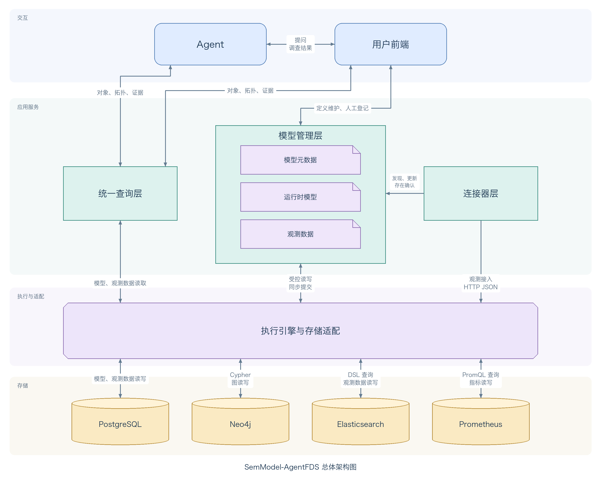
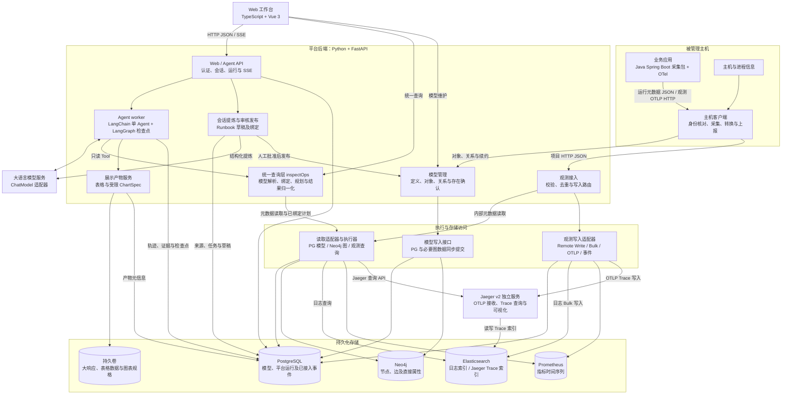
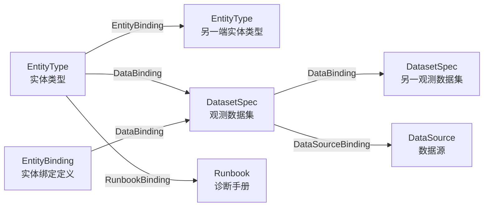
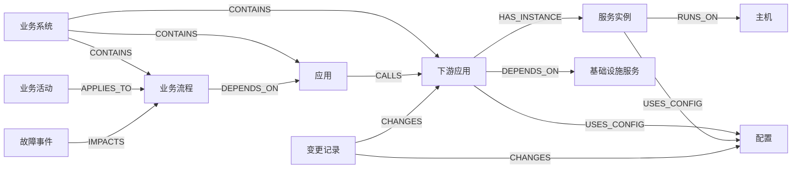
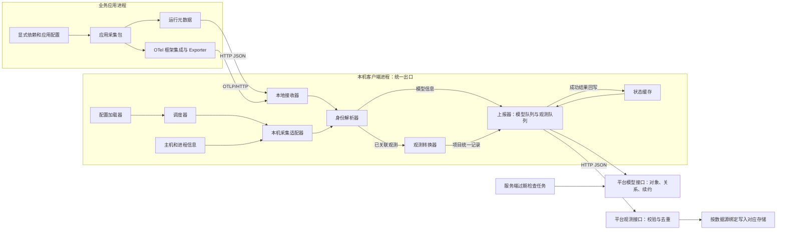
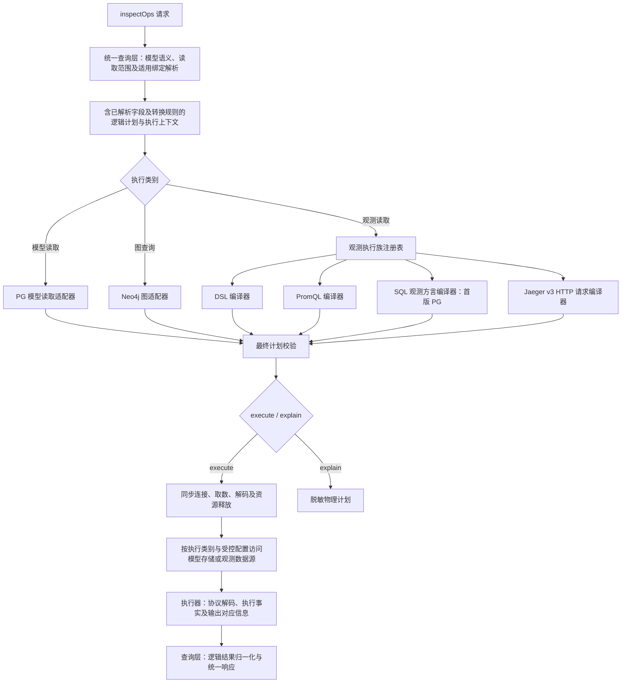
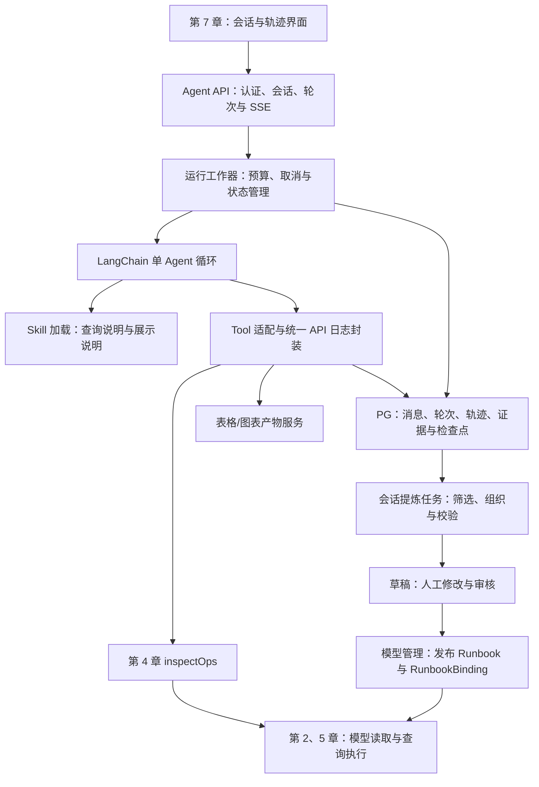

# 基于语义建模的Agent故障诊断系统设计与实现架构设计

## 0. 摘要

本系统面向中小型应用的运维诊断场景，构建以大语言模型 Agent 为核心的故障诊断系统设计与实现，提供业务与资源管理、日志和指标采集查询、拓扑展示、自然语言交互及故障辅助诊断功能。借鉴 [UModel 论文](https://arxiv.org/abs/2606.04799) 的对象中心建模思想，将用户定义的业务系统、业务流程与客户端发现的应用、服务实例、主机、基础设施服务及配置关联，建立实体、依赖关系与观测数据之间的统一语义映射，使 Agent 能沿拓扑收集证据，定位疑似故障根因，并输出可追溯的诊断报告和处理建议。

参考 UModel 开源仓库：[alibaba/UnifiedModel](https://github.com/alibaba/UnifiedModel)

官网的描述：https://help.aliyun.com/zh/cms/cloudmonitor-2-0/overview/?spm=a2c4g.11186623.help-menu-28572.d_2_0.7c704bc2Sz66jM

验收场景如下：

[验收场景 1](../验收场景1.md)

[验收场景 2](../验收场景2.md)

## 1. 架构图与技术栈

### 1.1 总体设计与技术路线

SemModel-AgentFDS 采用前后端分离架构，以统一对象模型连接业务拓扑和观测数据，以统一查询入口支撑人工查询和 Agent 调查，形成“采集发现 → 模型与观测存储 → 查询取证 → 故障诊断 → 手册审核发布 → 后续复用”的闭环。

平台后端统一使用 **Python + FastAPI**，前端使用 **TypeScript + Vue 3**。基础数据设施采用 **PostgreSQL（PG）、Elasticsearch（ES）和 Prometheus**；按后文章节要求，同时引入 **Neo4j** 保存拓扑图数据，使用 **LangChain / LangGraph** 实现 Agent 运行与检查点，使用 **OpenTelemetry（OTel）** 接入应用观测。Trace 方案确定为 **Jaeger v2 + Elasticsearch**：OTel 负责应用侧采集，Jaeger 负责 Trace 接收、存储访问、查询和可视化，ES 作为其持久化后端。平台 Python 服务通过 Jaeger 写入与查询适配器接入，保留统一对象模型及 inspectOps 查询入口。

本章汇总全系统选型与组件关系，具体字段、接口、生命周期和错误语义以第 2～7 章为准。技术栈表示拟采用的实现方案，不表示仓库已经完成相应服务。Java Spring Boot 应用采集包和验收商城的 MySQL 属于被观测业务侧，平台 Python 后端的选型不改变它们；主机客户端的实现语言按第 3.8 节另行确定。

### 1.2 总体架构图



上图复用项目已有的总体架构概览。图中“模型管理层”的观测数据表示数据集、数据源及绑定等管理视角，实际观测正文由独立观测接入模块写入对应存储；“执行引擎与存储适配”汇总了底层访问职责，读取执行器与写入适配器分别实现。Agent 实际运行在服务端。下图进一步展开应用侧接入、Agent 工作器、读写路径、Trace 存储和知识发布流程。



图中的箭头表示调用或数据访问方向，查询结果沿调用链返回。Web 直连的 QUERY、MODEL 是后端 HTTP 入口，不是浏览器直连存储；它们与 Agent API 共用认证及权限约束。逻辑模块可以在同一后端服务内实现，不要求每个方框成为独立微服务。Trace 读写统一经过 Jaeger，平台 ES 适配器负责日志等已接入数据；Jaeger 管理自身的 Trace 索引结构及存储访问。只有实际后端、绑定和适配能力均验证通过后才公开为可执行。

### 1.3 技术栈清单

#### 1.3.1 前端与交互

| 组成 | 技术选型 | 在本项目中的用途与边界 |
| --- | --- | --- |
| 前端语言与框架 | TypeScript + Vue 3，采用 Composition API | 实现业务概况、模型与拓扑、数据查询、Agent 对话、轨迹、手册审核及 Skills / Tools 配置页面 |
| 构建、路由与状态 | Vite、Vue Router、Pinia | 本章补充的前端工程选型；组织页面、环境上下文、查询草稿、会话与订阅状态，业务运行状态仍以服务端为准 |
| 指标与诊断图表 | ECharts | 按第 6.7 节受限 ChartSpec 渲染折线图和柱状图，表格按返回 Schema 展示；数据来自实际查询产物 |
| 拓扑视图 | Vue 3 图视图组件，具体图库在实现时确定 | 展示第 7.5.3 节的模型图与对象拓扑；消费真实子图、稳定引用及状态，不在前端推导缺失关系 |
| 查询与手册编辑 | JSON / Schema 驱动的编辑与校验组件 | 编辑 inspectOps 请求、模型定义及 Runbook 草稿；查询页只在规定位置开放逻辑只读 Cypher，服务端完成最终语义校验 |
| HTTP 与流式交互 | HTTP JSON + SSE | POST 提问和取消，GET 订阅已持久化事件；按 runId、eventSeq 去重并通过 Last-Event-ID 续取，遵循第 6、7 章断连规则 |

#### 1.3.2 Python 后端、Agent 与执行层

| 组成 | 技术选型 | 在本项目中的用途与边界 |
| --- | --- | --- |
| 平台服务 | Python + FastAPI，异步 I/O | 实现模型管理、观测接入、统一查询、执行适配、Agent API、轨迹、产物及审核发布；共享契约并保持模块职责独立 |
| 参数与结构校验 | Pydantic + JSON Schema | 校验模型、统一查询、Tool 参数、观测记录及结构化草稿；查询 Schema 与能力说明来自同一注册表 |
| Agent 编排 | LangChain `create_agent`、结构化 Tool、middleware | 单 Agent ReAct 工具调用循环；装配上下文、加载 Skill、控制预算与处理错误 |
| 模型接入 | LangChain ChatModel 适配器 | 接入支持工具调用、结构化输出及流式响应的模型；供应商、模型名、超时及凭据引用由服务端配置 |
| 执行检查点 | LangGraph PostgreSQL checkpointer | 保存单次运行状态；业务会话、轨迹和证据另行持久化，检查点不提供旧模型或历史拓扑回查 |
| 运行与提炼工作器 | Python 独立 worker + PG 任务表 | 用行锁领取任务，维护租约、心跳、取消和终态；会话提炼读取已有轨迹并生成待审草稿 |
| 调度与回收 | Python 调度入口及后台检查任务 | 触发符合条件的会话提炼、回收失联运行、检查对象与关系到期；各自遵循原有状态契约 |
| 查询规划 | 项目内实现的类型化逻辑计划、能力注册表与绑定解析 | 统一入口为 inspectOps；解析模型、字段、身份、时间和权限，输出已绑定计划及统一结果 |
| 编译与物理校验 | SQL AST、受控 Cypher AST、ES DSL 构造器、PromQL 表达式构造器 | 确定性生成并校验物理请求；SQL 观测方言首版为 PostgreSQL，高级图查询按允许子集解析，不透传调用方原文 |
| 存储访问 | Python PostgreSQL、Neo4j、Elasticsearch 驱动，以及 Prometheus HTTP / Jaeger OTLP 写入与查询 API 适配器 | 驱动、连接池、凭据、超时、取消和协议解码集中在存储访问层；具体依赖版本在实现时锁定 |
| 展示与内容服务 | Python 产物服务 + PG 元信息 + 持久卷 | 从保存的真实查询结果生成 table/line/bar 产物，通过受控接口读取大响应及产物内容 |
| 手册与技能 | 项目 Skill 注册/加载、Runbook 与 RunbookBinding | Skill 提供查询方法说明，Tool 提供可调用能力，Runbook 提供经审核的调查方法；普通诊断 Agent 仅有读取及展示工具 |

#### 1.3.3 采集、传输与观测写入

| 组成 | 技术选型 | 在本项目中的用途与边界 |
| --- | --- | --- |
| 主机连接器 | 每台主机一个独立常驻客户端 | 采集主机与进程信息，接收应用数据，核对身份、维护对象与关系存在证据，并作为统一上报出口；语言按第 3.8 节确定 |
| 首版应用采集包 | Java Spring Boot 依赖包 + OpenTelemetry API / SDK / Exporter | 业务显式引入并配置；复用已验证的 Spring Web、JDBC、Logback 等集成，补充运行身份、元数据和自定义观测 |
| 应用到本机客户端 | 运行元数据 HTTP JSON；观测 OTLP/HTTP Protobuf | 本地接收器分别处理两种协议，保留 Resource、维度、原始时间和链路上下文 |
| 客户端到平台 | 项目 HTTP JSON 批量协议 | 模型提交与观测上报分路；分别记录本地接收、模型提交及观测持久化结果 |
| 指标写入 | Prometheus Remote Write 1.0、Protobuf、Snappy | 平台转换项目指标记录并写入已启用接收功能的 Prometheus；实验配置包含 `--web.enable-remote-write-receiver`，具体类型及确认规则见第 3.4.6 节 |
| 日志写入 | Elasticsearch Bulk API | 使用确定的目标索引和字段映射，逐项确认写入结果；写入确认与搜索可见性分开处理 |
| Trace 写入与查询 | Jaeger v2 + Python OTLP 写入适配器及正式查询 API 适配器 | 平台将项目 Span 记录转换为 OTLP 发往 Jaeger；将 search/readTrace 映射为受支持的 Jaeger 查询，归一化结果；保留原始链路身份、权限范围及完整性信息 |
| 通用事件写入 | PostgreSQL 观测表及参数化 INSERT | 仅写入已登记、已接入的事件数据集，按绑定读取；与模型表和平台管理表隔离 |

OTel/OTLP 的应用接入边界止于本机客户端；客户端转换后向平台发送项目协议。按第 3 章方案，平台观测入口不要求部署 OTel Collector，也不直接接收应用的 OTLP。平台存储写入适配器仍需按照后端协议编码数据；Trace 路径为“应用 OTel → 本机客户端 → 平台项目 JSON 接口 → Jaeger OTLP 接口 → ES”，查询路径为“inspectOps → Jaeger 查询适配器 → Jaeger → ES”。

首版 Trace 查询固定采用 **Jaeger v3 HTTP API**，设计基线锁定 Jaeger **2.23.0** 及其依赖的 jaeger-idl **0.14.0**；这表示实现与验收目标，不表示仓库已经部署或验证该版本。Python 查询适配器使用受控 HTTP 客户端访问查询端点，不依赖 UI 内部接口。search/readTrace 的模型声明、请求编译与结果处理分别见第 2.7.4、2.8.8、4.6.3、5.9 节。版本升级须重跑能力与协议验收，不凭“v2”版本族名称假定能力相同。[Jaeger API](https://www.jaegertracing.io/docs/2.23/architecture/apis/)、[版本依赖依据](https://github.com/jaegertracing/jaeger/blob/v2.23.0/go.mod)

Trace 写入确认沿用第 3.4.7 节：Jaeger 到 ES 采用同步写入配置，接收处理链须等待存储结果，避免在内存接受后提前向平台确认。适配器核对 OTLP 响应中的部分成功和错误，未取得足够写入依据时按项目契约返回失败或结果待确认。[Jaeger 写入确认](https://www.jaegertracing.io/docs/latest/deployment/delivery-guarantees/)

### 1.4 存储职责与访问边界

| 存储 | 保存内容 | 主要访问方式 | 边界 |
| --- | --- | --- | --- |
| PostgreSQL：模型数据 | 八类模型定义、对象、关系、具体数据集登记及请求控制信息 | 模型存储写入接口；PG 模型读取适配器 | 作为模型事实主存储，保留唯一当前记录；version / revision 不代表可回查旧内容 |
| PostgreSQL：平台运行 | 会话、消息、Run、Span、SSE 事件、证据引用、API 调用、任务、草稿、审核发布记录及检查点 | 所属服务的数据访问接口 | 独立 schema 及授权；不自动成为观测 SQL 的查询目标 |
| PostgreSQL：观测数据 | 实际接入的通用事件等结构化观测记录 | 观测写入适配器；SQL 观测执行器 | 按 DataSourceBinding 限定表、字段和时间范围；与模型、运行数据分开授权 |
| Neo4j | 需要图查询的节点、边及直接属性 | 模型层受控写入；Neo4j 图适配器以参数化 Cypher 读取 | 与 PG 使用相同业务身份；按第 2.12.5 节同步维护，不独立创建业务实体 |
| Elasticsearch | 应用及实例日志，以及 Jaeger 管理的 Trace / Span | 日志由平台 Bulk 写入、ES Query DSL 读取；Trace 由 Jaeger 访问 | 日志和 Trace 分开索引、模板及保留策略；可复用 ES 集群，平台不直接维护或查询 Jaeger 内部 Trace 索引 |
| Prometheus | 主机、JVM、HTTP、线程池、连接池等已启用指标 | Remote Write 写入；PromQL HTTP API 查询 | 承担指标时序存储，不保存模型对象或会话；指标类型、单位、标签与聚合口径由模型声明 |
| Jaeger Trace 服务（ES 持久化） | 管理分布式 Trace / Span 的接入、检索和展示 | 平台通过 OTLP 写入，通过正式查询 API 读取 | Trace DataSource 与绑定面向 Jaeger 接口登记；物理 ES 配置由 Jaeger 管理，与日志及指标通过身份、时间和 traceId 关联 |
| 持久卷 | 大响应正文、表格数据、图表规格及受控来源内容 | 内容及产物服务鉴权读取 | PG 保存稳定引用和元信息；对象存储作为后续适配扩展 |

PG 的几类用途可以共用实例，但需隔离库/schema、凭据和连接池。模型写入涉及 PG 和 Neo4j 时，必须满足第 2.12.5 节规定的同步提交与整体回滚要求；这属于需要专门实现、验证的一致性能力，不能由分别调用两个驱动自动获得。观测写入不加入该跨库模型事务，各记录按实际后端确认返回状态。

### 1.5 核心业务数据流

1. **模型配置与采集发现。** 管理员登记类型、数据集、数据源和绑定；主机客户端通过已登记定义发现对象、核对关系并提交更新或存在确认。应用采集包推送本机元数据和观测，客户端统一转换上报。模型层同步维护 PG 及必要的 Neo4j 图数据，观测接入将正文写入各自后端，其中 Trace 经 Jaeger 写入 ES。
2. **对象与观测查询。** 前端和 Agent 共用 inspectOps。查询层通过内部元数据读取解析模型和适用绑定，生成逻辑计划；执行层按模型、图、观测类别选择读取适配器，完成编译、校验和取数；查询层归一化字段、时间、单位、质量及证据引用。explain 复用规划与编译而不读取目标结果。
3. **自然语言诊断。** 用户提交问题后，Agent worker 从会话及调查摘要装配上下文，按预算调用只读工具。模型依照拓扑、Metrics、Logs、Traces 等实时证据推进调查，输出结论及建议。消息、轨迹和证据先持久化，再经 SSE 推送；图表从实际结果生成，处理建议不自动执行。
4. **知识沉淀与复用。** 已结束会话经人工或定时触发提炼，固定来源范围并生成 Runbook 草稿及候选绑定。人工批准具体修订后，发布服务通过模型管理接口提交 Runbook 与 RunbookBinding；提交确认后才标记已发布。后续 Agent 从对象上下文发现手册，用新证据验证其适用性。

### 1.6 部署组成与首版范围

| 部署单元 | 首版组成 | 运行约束 |
| --- | --- | --- |
| Web 工作台 | Vue 3 构建的静态资源 | 通过 HTTP API 与 SSE 访问平台，不持有数据库或模型供应商凭据 |
| Python API 服务 | 模型管理、观测接入、统一查询、Agent API、内容和审核发布模块 | 初期按模块组织，可共用服务进程；模型操作和观测接入按各自同步契约返回 |
| Python 后台工作器 | Agent 运行、会话提炼、调度与失联回收 | 使用 PG 任务表、租约和心跳；任务受理不等于执行完成，首版不依赖额外消息队列 |
| Jaeger 服务 | Jaeger 2.23.0 可执行程序，每个隔离范围内首版单进程承载接收与查询角色，连接 ES | 作为独立主机进程部署；按第 2.7.4、5.9 节验证范围隔离、ES 兼容、同步写入确认、v3 HTTP 查询及保留策略 |
| 数据设施 | PG、Neo4j、ES、Prometheus 及持久卷 | 配置持久化、权限和保留策略，分别验证写入确认与查询可见性 |
| 被管理主机 | 常驻客户端、业务进程及其应用采集包 | 首版验收采用同主机、同网络命名空间，通过回环地址接入本机客户端 |
| 模型服务 | 服务端配置的 ChatModel 供应商接口 | 验证工具调用、结构化输出、流式取消和 usage 返回，记录调用预算和错误 |

首版完整验收覆盖对象与拓扑、指标、日志、Trace、已接入事件、Agent 调查轨迹、展示产物及 Runbook 审核复用。采集可以按第 3.8 节分阶段启用，但两份验收场景要求的 Metrics、Logs、Traces 必须完成端到端接入。Go 应用包、配置快照、配置加载及业务专属证据、对象存储和其他 SQL 方言保留扩展位；Redis、Kafka、Celery、向量数据库不列为当前必需依赖。

验收商城仍采用 Java Spring Boot / HikariCP 与 MySQL 业务依赖，MySQL 在平台模型中表示为 InfrastructureService，不改变平台采用 PostgreSQL 的选型，也不意味着首版 SQL 观测执行器支持 MySQL。Jaeger 使用官方可执行程序部署，Python 后端通过协议对接，无需把 Jaeger 作为 Python 库嵌入。[Jaeger 下载](https://www.jaegertracing.io/download/)

依赖版本及运行配置在实现阶段锁定并记录，避免以未验证的框架或后端能力代替本项目的支持清单。

### 1.7 后续架构图与详细设计索引

| 架构图或设计 | 所在章节 | 说明 |
| --- | --- | --- |
| 元数据总体架构图 | [2.2.1 元数据总体架构](#221-元数据总体架构) | 四类 Node、四类 Binding 及模型定义之间的连接 |
| 实体关系图 | [2.4 实体绑定](#24-实体绑定-entitybinding) | 业务、应用、实例、主机和基础设施服务等对象关系 |
| 数据访问关联图 | [2.8.4 查询能力与适用范围](#284-查询能力与适用范围) | 从模型与绑定找到可执行的观测访问路径 |
| 连接器数据流图 | [3.2.4 客户端组件与数据流](#324-客户端组件与数据流客户端各组件) | 应用、本机客户端、模型接口与观测接口的协作 |
| 查询执行路由图 | [5.1 执行类别与路由](#51-执行类别与路由) | 模型、图和观测读取的规划、编译、校验与执行 |
| Agent 与知识闭环图 | [6.2.1 单 Agent 的 ReAct 工具调用循环](#621-单-agent-的-react-工具调用循环) | API、worker、Tool、轨迹持久化及草稿发布 |
| 工作台布局与接口映射 | 第 7.2、7.11 节 | 页面组织、状态模型及后端 HTTP 契约 |

## 2. 建模元数据

### 2.1 组织方式与范围

本章负责定义元数据、对象之间的语义及对外接口契约，包括数据源的类型、位置及数据集的存储映射。2.12 节确定模型管理的操作接口、发现事实的维护规则及模型存储方案；观测数据的采集与存储、驱动接入、查询执行和修复执行由后续章节实现，通过接口接入。描述 PostgreSQL、Elasticsearch 等观测数据源不意味着模型管理服务实现其驱动；模型描述与执行实现保持分离。

本章按模型种类展开，各种类下面列出具体定义，定义下面再给出实例或使用示例。例如，“实体类型”下的“主机”定义描述主机应具有的字段，“主机”下面的实例示例表示一台实际机器；“关系类型”下的“运行于”定义约束服务实例与主机之间的连接，其关系示例表示某个实例实际运行在哪台主机上。

主机、服务实例等实体的定义描述对象结构，关系定义描述允许建立的连接。绑定和手册的示例则说明定义如何作用于具体对象，不要求为每一种定义另建一套实例表。

具体定义与运行数据应当区分。例如，`Host` 定义主机标识、名称和操作系统等字段，`host-01` 是符合该定义的实际主机，其操作系统名称属于对象数据。主机 CPU 使用率、实例的线程池活跃线程数和排队长度，以及 `stock-02` 在 10:05 出现拒绝任务的日志，则是带时间的观测数据。线程池和连接池通过所属应用或实例的观测数据描述，池名称作为查询维度，不单独建立实体。查询这些数据产生的执行记录归入调查记录，不再与模型种类并列分类。

### 2.2 模型种类与公共约定

#### 2.2.1 元数据总体架构

元数据按其在模型图中的职责分为节点（`Node`）和绑定（`Binding`）两类。节点描述实体类型、观测数据集、诊断手册和数据源；绑定描述这些定义之间允许的对象关系、数据绑定、手册绑定和存储绑定，在模型图中表现为边。两类下共包含八种模型元素，`Node` 和 `Binding` 是分类，不额外增加两种需要单独登记的模型。



上图表示元数据定义之间的关系。`DataBinding` 支持实体类型、实体绑定定义或数据集作为源端，目标均为数据集。图中单独画出的 `EntityBinding` 方框表示可被引用的绑定定义，不增加新的模型种类。例如，服务实例可关联日志，`CALLS` 关系定义可关联 Trace，Trace 数据集还可关联日志数据集。

从对象取得观测数据的路径为：根据对象所属的 `EntityType`，通过 `DataBinding` 定位 `DatasetSpec` 并映射对象身份，再通过 `DataSourceBinding` 确定 `DataSource` 及物理存储位置。沿对象拓扑探索使用 `EntityBinding` 对应的关系事实，发现适用诊断手册使用 `RunbookBinding`。

#### 2.2.2 节点 `Node`：定义模型中的内容

| 节点种类                | 定义的职责                     | 详细定义 |
|---------------------|---------------------------|------|
| 实体类型 `EntityType`   | 定义系统能够识别哪类对象，如主机、应用、服务实例  | 2.3  |
| 观测数据集 `DatasetSpec` | 定义某类指标、日志、事件或配置快照是什么、如何解释 | 2.5  |
| 诊断手册 `Runbook`      | 定义针对一类问题如何收集和验证证据         | 2.9  |
| 数据源定义 `DataSource`  | 定义平台从哪里读取调查数据             | 2.7  |

被调查业务依赖的数据库属于 `InfrastructureService` 实体类型；平台读取指标或日志所用的数据源属于 `DataSource`。二者分别承担业务拓扑与数据接入的职责，可以指向同一套物理设施，但不自动视为同一个对象。

#### 2.2.3 绑定 `Binding`：定义模型之间的关联

| 绑定种类                      | 源定义 → 目标定义                                                   | 定义的职责                         | 详细定义 |
|---------------------------|--------------------------------------------------------------|-------------------------------|------|
| 实体绑定 `EntityBinding`      | `EntityType` → `EntityType`                                  | 定义对象之间允许的关系，如调用、包含、运行于        | 2.4  |
| 数据绑定 `DataBinding`        | `EntityType`、`EntityBinding` 或 `DatasetSpec` → `DatasetSpec` | 定义对象、关系事实或数据集记录到目标观测数据集的映射与关联 | 2.6  |
| 手册绑定 `RunbookBinding`     | `EntityType` → `Runbook`                                     | 声明某类对象有哪些相关诊断手册               | 2.10 |
| 数据源绑定 `DataSourceBinding` | `DatasetSpec` → `DataSource`                                 | 定义数据集与实际数据源之间的访问关联            | 2.8  |

#### 2.2.4 模型概念的对应范围

| 本项目模型               | 对应范围与差异                                           |
|---------------------|---------------------------------------------------|
| `EntityType`        | 对应实体类型定义                                          |
| `DatasetSpec`       | 是多种数据集的统一分类，不对应单一 Schema                          |
| `Runbook`           | 借鉴手册与观察知识的组织方式；本文聚焦诊断方法，统一查询 Skill 仍直接挂载在 Agent 上 |
| `DataSource`        | 与数据源绑定的规格分工统一见 2.2.7 节                            |
| `EntityBinding`     | 对应实体类型之间的关系语义                                     |
| `DataBinding`       | 支持实体类型、实体绑定定义、数据集到目标数据集的关联，范围统一见 2.6 节            |
| `RunbookBinding`    | 对应实体类型到手册的关联；具体字段与发现规则按 2.10 节定义                  |
| `DataSourceBinding` | 与数据源绑定的规格分工统一见 2.2.7 节                            |

#### 2.2.5 领域命名空间 `domain`：组织多业务线的模型图

domain 的核心作用是提供一层轻量的命名空间，避免不同业务领域的模型名称冲突。例如，一个 devops 域可以包含表示服务的 service 实体，而一个 k8s 域可以包含表示工作负载的 workload 实体，它们互不干扰。

模型定义使用 `domain + kind + id` 区分身份，`id` 在同一领域、同一模型种类内唯一，`version` 仅标记当前定义的修订，不参与唯一身份，也不用于读取旧版本。例如：
```yaml
kind: EntityType
metadata:
  domain: devops
  id: service
  version: "1"
  displayName: 服务
```
在这个例子中，devops 就是该模型元素所属的 domain。常见的 domain 划分示例包括：

devops：交付与服务责任对象。

k8s：Kubernetes 对象。

automaker、game 或 supplier：业务场景对象


#### 2.2.6 公共字段与引用约定

每份模型定义由公共字段和个性化 `spec` 组成：公共字段负责身份、组织和说明，`spec` 负责具体结构与规则。两部分都属于模型定义，不按“静态字段”和“动态数据”划分。本节集中规定公共字段及引用，具体规格见 2.2.7 节。

**模型定义的公共字段**

四类节点和四类绑定使用同一组公共字段。绑定也是独立登记和引用的元数据定义，并非只有两个端点。

| 公共字段               | 含义                                        |
|--------------------|-------------------------------------------|
| 模型种类 `kind`        | 标明属于八种模型中的哪一种，使用下文规定的固定取值                 |
| 所属命名空间 `domain`    | 标明定义归属的领域，领域组织方式见 2.2.5 节                 |
| 稳定标识 `id`          | 在同一领域、同一模型种类内标识一份定义，例如 `Host`；不是某台实际主机的标识 |
| 显示名称 `displayName` | 面向用户展示的名称，不承担唯一身份识别                       |
| 语义说明               | 解释该定义的含义和适用范围                             |
| 定义修订标记 `version`   | 非空字符串，只说明当前定义修订；更新覆盖旧内容，不保存旧版，也不提供按版本回查   |

所有模型定义引用统一为 `DefinitionRef = { kind, domain, id }`，三个字段均必填。`kind` 区分大小写，只允许 `EntityType`、`DatasetSpec`、`Runbook`、`DataSource`、`EntityBinding`、`DataBinding`、`RunbookBinding`、`DataSourceBinding`，不使用下划线别名。`id` 是定义标识，`displayName` 仅用于展示，`name` 不作为定义标识或引用字段。

完整定义的 `kind` 放在顶层，`domain`、`id`、`version`、`displayName` 放在 `metadata` 中；引用时提取 kind、domain、id 三字段。例如 `{"kind":"EntityType","domain":"devops","id":"service"}`。绑定端点 `src / dest`、事实的 `definitionRef`、接口中的 `refs` 都使用同一结构。Binding 两端分别提供完整引用，不能根据绑定自身的领域推断端点。引用始终解析到唯一的当前定义；version 不进入引用，不保存旧版定义，也不支持锁定旧版。

字段描述中的 `name` 表示业务字段名，例如 `record_fields[].name`；来源引用中的 `kind` 表示来源类别，例如 `discovery`。二者均不属于模型定义引用，不使用上述枚举。

**运行时对象与记录的公共约定**

模型定义和运行时数据分别保存。例如，`Host` 是实体类型定义，`host-01` 是引用该定义的实际对象；`RUNS_ON` 是实体绑定定义，`stock-02` 运行于 `host-01` 是引用该绑定的关系事实。对象提供业务属性值，关系事实连接具体对象。数据绑定、数据源绑定和手册绑定按规则作用于实际对象，不要求为每个对象复制定义，也不直接生成对象之间的拓扑事实。

模型结构与约束、具体模型记录、实际观测记录分为三个层次。前两层统一以 PostgreSQL 为主存储：例如 DatasetSpec 的字段约束，以及标识“host-01 的指标数据集”的 host-01-metrics 记录均保存在 PostgreSQL。第三层是实际指标点、日志等观测，按数据类型及 DataSourceBinding 指向的存储读写，例如 Metric 使用 Prometheus、Log 使用 Elasticsearch。需要拓扑表达或图查询的模型数据，也在 Neo4j 中持久化存储一份，相关写入由模型层同步完成。

对象和关系记录遵守以下公共约定，调查记录保留相关引用用于追溯：

模型定义、对象和关系属于非观测数据。同一唯一标识在整个建模世界中只有一份当前记录，人工配置、自动发现和观测推导通过同一身份定位它，不按来源或时间保存多份业务实体。Neo4j 中的图数据沿用同一标识，表示同一业务实体，不产生历史版本。update 提交完整业务属性并覆盖旧值，不保留被覆盖的旧属性或完整拓扑快照。过期仅改变存在状态，未删除的节点、关系和最后保存的属性仍可读取，并可按已保存的时间信息筛选；这与恢复已覆盖内容分别处理。来源用于权限校验、上报排序和说明本次写入出处，不参与身份识别；完整操作规则见 2.12 节。观测数据按对象身份、维度和时间保存多次观测，支持历史查询，不能与对象当前状态混淆。

| 约定      | 作用                                                                                        |
|---------|-------------------------------------------------------------------------------------------|
| 稳定的对象身份 | 使用“环境 + 类型 + 稳定标识”定位对象；显示名称、IP、端口不能单独作为普遍适用的唯一标识                                          |
| 运行实例身份  | 应用重启后能区分新旧运行实例；观测数据保留所属实例标识，避免不同实例的同名线程池数据混淆                                              |
| 来源与观测时间 | 唯一当前记录保留本次写入的 `sourceRef` 及首次、最后观测时间；来源不产生另一份对象或关系                                        |
| 当前存在状态  | 对象和关系保留 `firstObservedAt`、`lastObservedAt`，动态管理的记录另存到期时间及当前存在状态；expired 不等于删除，不保存完整历史有效区间 |
| 业务内容变更  | 对象、关系分别保存服务端维护的 `contentChangedAt`，表示当前业务内容最近一次变更提交时间；续约和过期标记不刷新它，详见 2.12.3               |
| 修订与并发   | 定义的 `version` 标记当前修订，`revision` 用于并发检查；二者都不提供旧状态读取能力                                      |

元数据更新时间、对象第一次/最后一次观测时间、变更生效时间和用户调查时间窗是不同概念，不能共用一个时间字段。

接口统一使用 `ObjectRef = { environment, type, id }` 引用对象。其中 `type` 必须能唯一解析到所属 domain 和具体实体类型标识，不能只用跨域可能重名的 `Application` 等裸名称；对象结构按所引用的当前类型定义校验。名称匹配用于发现候选，确定对象后使用稳定引用继续调查。

#### 2.2.7 个性化规格 `spec` 与字段定义

`spec` 承载一份具体模型的结构和规则。不同模型种类的规格内容不同；同一种模型也可以有多份具体定义，各自配置适用的内容。规格必须遵循所属模型种类的约束，并按 2.12 节校验，不是可任意塞入未经声明属性的容器。

**八种模型各自的规格内容**

| 模型种类                | `spec` 需要描述的内容                                            |
|---------------------|-----------------------------------------------------------|
| `EntityType`        | 业务属性的 `fields` 列表、身份识别规则、别名与对象来源约定                        |
| `DatasetSpec`       | 数据类别、记录结构、时间字段、维度、数据语义和可用查询能力；指标还需说明单位、统计与聚合规则            |
| `Runbook`           | 适用症状、调查步骤、证据要求、判断条件、分支、停止条件、知识说明和输出要求                     |
| `DataSource`        | 存储类型、适用环境、访问地址、数据库或租户范围、认证配置引用和连接选项                       |
| `EntityBinding`     | 源/目标类型引用、方向、关系含义、基数约束、关系属性和生命周期要求                         |
| `DataBinding`       | 源定义引用（实体类型、实体绑定或数据集）、目标数据集引用、身份与关联字段映射、过滤条件、查询粒度及结果身份解析规则 |
| `RunbookBinding`    | 实体类型与手册引用、可选的实体属性筛选条件和优先级                                 |
| `DataSourceBinding` | 数据集与数据源引用、存储定位规则、字段映射、支持的查询操作及适用环境或时间范围                   |

一个数据源可供多个数据集复用。具体表、索引及指标定位规则放在 `DataSourceBinding` 中；`DataSource` 提供共用的接入配置。`DataBinding` 负责“对象、关系事实或数据集记录的身份与关联字段 → 目标数据集逻辑字段”，`DataSourceBinding` 负责“数据集逻辑字段 → 物理存储字段”。例如实例标识先映射为逻辑字段 `instance_id`，再映射为 Elasticsearch 中的 `service.instance.id`。

知识说明和观察步骤先放在 `Runbook` 内部；只有出现独立管理、跨手册复用的实际需要时，再拆分。

**同一模型种类下的不同规格**

对于 `EntityType`，建模者在 `spec.fields` 中声明该类型自己的业务字段。字段结构由具体类型定义决定，不由 domain 或 `EntityType` 这个种类名称统一固定。同一个 domain 内的服务、主机和基础设施服务可以使用不同字段；不同 domain 内的同名类型也可以各自声明字段。

下面三份定义都属于 `EntityType`，但具有不同的 `spec.fields`。字段示例对应 2.3 节的属性，具体英文名称仅用于说明结构：

| 具体类型定义                   | `spec.fields` 中的字段定义                                               | 按定义填写的业务属性值示例                                                                 |
|--------------------------|--------------------------------------------------------------------|-------------------------------------------------------------------------------|
| 服务实例 `ServiceInstance`   | `runtime_id: string`、`artifact_version: string`、`endpoint: string` | `runtime_id=stock-02`、`artifact_version=v2.1`、`endpoint=http://stock-02:8080` |
| 主机 `Host`                | `asset_id: string`、`hostname: string`、`os: string`                 | `asset_id=host-01`、`hostname=worker-01`、`os=Linux`                            |
| 基础设施服务 `InfrastructureService` | `resource_id: string`、`resource_type: string`、`endpoint: string`   | `resource_id=stock-db`、`resource_type=mysql`、`endpoint=stock-db:3306`         |

自定义发生在类型建模阶段，具体实例按引用的定义填写属性值，不为每个实例重新声明结构。修改 `resource_type` 的值不会自动切换字段结构。若新增业务属性，应更新类型定义的版本，并按 2.12 节的接口约定校验和写入。

**字段描述 `FieldSpec`**

`spec.fields` 中每一项采用 `FieldSpec` 描述。它是实体属性、数据集字段等结构的公共组件，不是第九种顶层模型，也不代表运行时字段值。

| 内容                      | 要求       |
|-------------------------|----------|
| 字段名、数据类型、业务含义、是否必填      | 每个字段必须说明 |
| 单位、枚举、取值范围、默认值、是否参与身份识别 | 按字段用途补充  |

例如错误率必须明确采用 `0～1` 还是百分数，延迟必须明确采用毫秒还是秒。`FieldSpec` 只负责描述字段结构；手册的调查步骤、绑定的端点与映射规则等规格内容按各自模型定义表达，不全部转写为 `FieldSpec`。

### 2.3 实体类型 `EntityType`

`EntityType` 定义一类可被独立识别、查询和关联的对象。本节的十个类别都是 `EntityType` 的具体定义，不增加 2.2 节规定的八种模型种类。划分类型的依据是对象在调查中的职责和生命周期：系统组织业务范围，流程表达业务结果，应用表达软件能力，实例表达一次运行，主机表达承载资源，其余类型分别补充外部依赖、配置、变更、活动背景和故障跟踪。

下面各表描述各类型的 `spec.fields`，包含字段名、类型、是否必填和业务含义；实际对象填写对应的属性值。英文名作为本文首版字段约定，2.2.7 节的三组示例与之对应。同类定义可以按 domain 扩展字段，扩展时须更新定义版本。`string[]` 表示字符串列表，`datetime` 表示带时区的时间，`object` 及列表元素的内部字段也须在类型定义中声明。

所有类型复用 2.2.6 节的对象身份、显示名称、定义引用、来源和时间约定，表中不重复这些公共信息。业务编码、运行标识等字段是各类型的身份依据，由该类型的身份识别规则确定如何得到 `ObjectRef.id`；它们不能脱离环境和完整类型引用单独充当全局身份。别名按各类型的 `spec` 别名规则登记，不再重复设置同义字段。表中的“否”表示信息不可得时可以缺省，不以推测值补齐。

对象关系由 2.4 节的关系事实表达，不在属性中重复维护应用列表、所属主机列表等拓扑。CPU 使用率、错误率、日志和配置版本正文属于 2.5 节的观测数据，通过数据绑定查询，不作为实体的特有属性。执行、生效、启动等业务时间则保留为对应实体字段，与公共观测时间分别记录。

#### 2.3.1 业务系统 `BusinessSystem`

**存在意义：** 表示面向一组业务能力的整体系统，为用户问题提供可查询的业务范围。用户提到“商城”时，Agent 先定位系统，再查找其流程和应用；若只保留应用节点，就无法明确哪些对象属于用户所说的商城。

**类型边界：** 系统通过 `CONTAINS` 组织流程和应用，成员必须显式登记。它与 `domain` 的区别是：系统是实际业务对象，domain 是模型定义的命名空间；系统也不同于单个可部署应用，不能用一个语言或运行版本代表全部成员。

| 特有字段                  | 类型     | 必填 | 含义与约束                                           |
|-----------------------|--------|----|-------------------------------------------------|
| 系统编码 `system_code`    | string | 是  | 业务目录中稳定的系统编码，作为该类型的身份依据；名称或负责人变化时编码保持稳定         |
| 业务范围 `business_scope` | string | 是  | 系统提供哪些业务能力、覆盖哪些业务边界，如商品交易、订单与退款；用于判断用户问题是否属于该系统 |
| 负责人引用 `owner_ref`     | string | 否  | 业务系统负责人或团队在外部组织目录中的引用，不新增负责人实体类型                |

##### 实例示例

商城系统 `mall` 的业务范围为商品交易、订单与退款，通过 `CONTAINS` 包含下单、退款流程及订单、库存应用。“商城最近一小时下单失败”的调查从该系统进入下单流程；系统归属不限制后续沿关系探索跨系统依赖。

#### 2.3.2 业务流程 `BusinessProcess`

**存在意义：** 表示面向用户结果的一项业务流程，将“下单失败”等业务语言转成可调查对象，并明确成功和失败的判断口径。一个流程可能涉及多个应用，一个应用也可能参与多个流程，因此不能直接把应用错误率当成流程失败率。

**类型边界：** 流程是长期存在的业务定义，不是某个用户的一笔订单、一次请求，也不是有起止日期的促销活动。首版不将流程内每个步骤拆成实体；参与应用通过 `DEPENDS_ON` 关联，具体调用路径由应用关系和运行证据补充。

| 特有字段                       | 类型     | 必填 | 含义与约束                                          |
|----------------------------|--------|----|------------------------------------------------|
| 流程编码 `process_code`        | string | 是  | 稳定标识一项业务流程，作为该类型的身份依据                          |
| 流程说明 `process_description` | string | 是  | 描述业务目的和主要步骤，例如创建订单、预占库存、确认结果                   |
| 开始条件 `start_condition`     | string | 是  | 何时认为流程开始，例如收到合法的下单请求                           |
| 结束条件 `end_condition`       | string | 是  | 何时认为一次流程结束，例如返回下单结果或达到业务超时期限                   |
| 成功口径 `success_criteria`    | string | 是  | 哪种业务结果算成功，例如订单创建且库存预占成功                        |
| 失败口径 `failure_criteria`    | string | 是  | 哪些结果算失败，以及取消、参数校验失败和超时是否计入；不能仅用 HTTP 状态码代替业务口径 |

这些字段定义业务语义；对应哪些日志字段、指标及过滤条件，由 `DatasetSpec` 与 `DataBinding` 声明。缺少相应数据时应说明无法验证，而非从文本自动推断统计结果。

##### 实例示例

下单流程 `place-order` 以接收合法下单请求为开始，以返回结果或超时为结束，以订单创建且库存预占成功为成功。它直接依赖订单应用，调查时再沿订单应用的调用关系发现库存应用。

#### 2.3.3 应用 `Application`

**存在意义：** 表示实现业务能力的软件单元，为调用关系、基础设施依赖以及日志和指标提供稳定的逻辑归属。扩缩容、重启或滚动发布时，应用身份持续存在，使 Agent 可以先判断整个应用的情况，再下钻到具体实例。

**类型边界：** 应用描述软件职责和技术背景；一次运行的启动时间、制品版本和运行时版本属于 `ServiceInstance`。业务系统可以包含多个应用，应用也可以参与多个业务流程。

| 特有字段                    | 类型     | 必填 | 含义与约束                                                                            |
|-------------------------|--------|----|----------------------------------------------------------------------------------|
| 应用编码 `application_code` | string | 是  | 应用目录中的稳定编码，作为该类型的身份依据，不随某次发布改变                                                   |
| 应用职责 `purpose`          | string | 是  | 软件承担的能力，如订单创建或库存预占，用于解释其参与流程的职责                                                  |
| 技术类型 `application_kind` | string | 是  | 软件的执行形态，首版取 `web_service`、`worker`、`scheduled_job` 或 `other`，用于区分请求服务、后台消费者与定时任务 |
| 实现语言 `language`         | string | 否  | 主要实现语言，如 Java、Python                                                             |
| 主要框架 `framework`        | string | 否  | 主要开发框架，如 Spring Boot；具体运行版本在实例侧记录                                                |
| 运行平台 `runtime_platform` | string | 否  | 部署执行方式，如 JVM 进程、容器；不用于代替实际承载主机关系                                                 |
| 负责人引用 `owner_ref`       | string | 否  | 软件维护负责人或团队引用                                                                     |

##### 实例示例

库存应用 `stock` 负责库存查询与预占，技术类型为 `web_service`，使用 Java 和 Spring Boot。滚动发布时，它可以同时拥有运行 v2.1 和 v2.2 制品的实例，应用本身不记录唯一的当前制品版本。

#### 2.3.4 服务实例 `ServiceInstance`

**存在意义：** 表示某个应用的一次具体运行，将应用级异常定位到一个副本、进程或容器，并关联该次运行的指标、日志、配置加载情况与宿主机。多个实例可能运行不同版本或仅部分出现异常，必须分别识别。

**类型边界：** 每个实例通过 `HAS_INSTANCE` 归属一个应用，通过 `RUNS_ON` 关联主机。重启产生新的运行身份；显示名称、IP、端口乃至进程号都可能复用，不能据此把新旧运行合并。线程池、连接池属于实例内部的观测维度，不另建实例。

| 特有字段                    | 类型       | 必填 | 含义与约束                                               |
|-------------------------|----------|----|-----------------------------------------------------|
| 运行标识 `runtime_id`       | string   | 是  | 标识一次运行，作为该类型的身份依据；采集端应采用运行 UUID 或可区分启动批次的标识，重启后必须变化 |
| 启动时间 `started_at`       | datetime | 否  | 该次进程或容器运行的实际启动时间，不以首次发现时间代替                         |
| 制品版本 `artifact_version` | string   | 否  | 实际运行的软件版本、构建号或镜像摘要，用于比较发布前后的实例                      |
| 运行时名称 `runtime_name`    | string   | 否  | 实际使用的运行环境，如 OpenJDK、CPython、Node.js                 |
| 运行时版本 `runtime_version` | string   | 否  | 对应运行环境的版本，与制品版本、实体类型定义版本分别记录                        |
| 进程标识 `process_id`       | string   | 否  | 宿主运行环境中的进程号，仅用于定位进程，不单独承担实例身份                       |
| 容器标识 `container_id`     | string   | 否  | 容器运行环境分配的标识，非容器部署可缺省                                |
| 服务端点 `endpoint`         | string   | 否  | 该实例暴露的访问地址；无监听端点的后台任务可缺省                            |

##### 实例示例

库存应用拥有实例 `stock-02`，制品版本为 v2.1，运行时为 OpenJDK 21，端点为 `http://stock-02:8080`，通过 `RUNS_ON` 关联 `host-01`。此处 `stock-02` 代表一次运行；同名副本重启后必须分配新的 `runtime_id`。

#### 2.3.5 主机 `Host`

**存在意义：** 表示承载运行实例的物理机或虚拟机，用于发现共享宿主资源问题。例如多个应用实例同时异常时，可沿 `RUNS_ON` 判断它们是否集中在同一台主机，并查询该主机的资源观测。

**类型边界：** 主机表达计算资源及其规格，服务实例表达其上运行的软件。容器不是主机；云主机规格和 CPU 核数是主机属性，CPU 使用率、可用内存和磁盘利用率则是时序观测。

| 特有字段                | 类型       | 必填 | 含义与约束                                           |
|---------------------|----------|----|-------------------------------------------------|
| 资产标识 `asset_id`     | string   | 是  | 资产系统或云平台中的稳定机器标识，作为该类型的身份依据；跨账户或区域时应包含来源范围以避免冲突 |
| 主机名 `hostname`      | string   | 否  | 操作系统主机名，用于检索和展示，不作为唯一身份                         |
| 网络地址 `addresses`    | string[] | 否  | 该主机的已知 IP 地址，可有多个且可变化                           |
| 操作系统 `os`           | string   | 否  | 操作系统名称，如 Linux                                  |
| 操作系统版本 `os_version` | string   | 否  | 系统发行版或版本信息，辅助识别运行兼容性问题                          |
| CPU 核数 `cpu_cores`  | integer  | 否  | 分配的逻辑 CPU 数量，单位为核，必须大于 0                        |
| 内存容量 `memory_bytes` | integer  | 否  | 配置的内存总容量，单位为 byte，必须大于 0；不是当前可用内存               |

##### 实例示例

主机 `host-01` 的主机名为 `worker-01`，操作系统为 Linux，规格为 8 核、16 GiB 内存，承载库存实例 `stock-02`。查询其 CPU 使用率需经数据绑定读取指标，不能从 8 核这一规格直接判断是否存在瓶颈。

#### 2.3.6 基础设施服务 `InfrastructureService`

**存在意义：** 表示应用依赖的数据库、缓存、消息队列等基础设施服务，以逻辑服务为建模粒度，让 Agent 能从应用继续调查数据存储与中间件服务。此类资源可能由托管平台提供，即使没有其内部主机和进程信息，也需要作为独立依赖节点查询。

**类型边界：** 它表达业务使用的基础设施服务，`Host` 表达承载机器，`Application` 表达业务软件能力。平台用来读取调查数据的 `DataSource` 属于元数据定义；即使连接同一套数据库，也与业务使用的基础设施服务分开登记。

| 特有字段                 | 类型     | 必填 | 含义与约束                                          |
|----------------------|--------|----|------------------------------------------------|
| 资源标识 `resource_id`   | string | 是  | 来源范围内稳定的逻辑服务标识，作为该类型的身份依据；不能仅使用可变端点            |
| 资源种类 `resource_type` | string | 是  | 具体服务类别，如 `mysql`、`redis`、`kafka`，用于解释依赖和匹配诊断知识 |
| 资源用途 `purpose`       | string | 是  | 在业务中的用途，如库存持久化、商品缓存、订单消息传递                     |
| 逻辑端点 `endpoint`      | string | 否  | 客户端使用的服务入口，如 `stock-db:3306`；集群入口不等同于单个成员进程    |

修改 `resource_type` 的值不会自动切换字段结构。需要数据库名、消息主题等额外属性时，应在具体定义中声明并更新定义版本，不能把连接密码或数据接入配置混入该对象。

##### 实例示例

库存数据库 `stock-db` 的资源种类为 `mysql`，用途为库存持久化，逻辑端点为 `stock-db:3306`；库存应用通过 `DEPENDS_ON` 指向它。数据库内部实例不可见时，这条业务依赖仍可登记。

#### 2.3.7 配置 `Configuration`

**存在意义：** 表示可独立定位和持续追踪的一份配置文件或配置中心的一组配置，用于连接使用方、历史内容和配置变更。保留稳定配置对象后，Agent 才能比较同一份配置的多个版本，并核对各实例实际加载的内容。

**类型边界：** 配置对象是持续存在的配置来源；版本正文属于 `ConfigurationSnapshotDataset`，一次修改属于 `ChangeRecord`。配置项留在快照内容中，不逐项建立实体；实例的预期版本、已确认加载版本及加载证据属于 `USES_CONFIG` 关系。

| 特有字段                  | 类型     | 必填 | 含义与约束                                                   |
|-----------------------|--------|----|---------------------------------------------------------|
| 配置标识 `config_id`      | string | 是  | 稳定标识一份配置，作为该类型的身份依据；内容更新不改变此标识                          |
| 配置用途 `purpose`        | string | 是  | 说明配置控制的行为，如库存应用的线程池与调用超时                                |
| 来源类型 `source_type`    | string | 是  | 首版取 `file` 或 `config_center`，决定来源定位信息的含义                |
| 来源范围 `source_scope`   | string | 是  | 文件所属主机或独立文件空间的稳定定位，或配置中心实例、命名空间与分组的完整定位；与路径或键共同定位来源     |
| 来源键 `source_key`      | string | 是  | 文件在该范围中的路径，或配置中心配置键；不同范围中的同名路径或键不能合并为同一配置               |
| 内容格式 `content_format` | string | 是  | 首版取 `yaml`、`json`、`properties`、`toml` 或 `text`，用于解释快照内容 |
| 负责人引用 `owner_ref`     | string | 否  | 该配置的维护负责人或团队引用                                          |

来源定位只说明去哪里发现配置，不代表配置内容或实际生效状态。共享配置可被多个应用或实例引用，配置内容版本与 `Configuration` 类型定义版本分别记录。

##### 实例示例

配置 `stock-runtime-config` 位于生产配置中心的库存分组，内容格式为 YAML。线程池上限从 32 改为 16 后，配置对象身份不变，新增 v2 内容快照及一条变更记录；某实例是否加载 v2 仍需单独取得证据。

#### 2.3.8 变更记录 `ChangeRecord`

**存在意义：** 表示一次发布、配置修改或资源调整，将“什么发生了变化、何时发生、执行结果如何”与被修改对象连接，为比较异常前后状态、验证变更假设提供入口。

**类型边界：** 它记录一次操作的生命周期，不是配置对象、某个版本快照或一条发布日志。同一次操作的多条日志和通知通过观测数据关联到同一变更；修改对象通过 `CHANGES` 关联。变更发生在故障之前只支持时间关联，不能直接证明因果。

| 特有字段                           | 类型       | 必填 | 含义与约束                                                                                                                                                                                          |
|--------------------------------|----------|----|------------------------------------------------------------------------------------------------------------------------------------------------------------------------------------------------|
| 变更标识 `change_id`               | string   | 是  | 一次操作的稳定标识，作为该类型的身份依据；外部流水线单号须按来源范围消除重名                                                                                                                                                         |
| 变更类别 `change_kind`             | string   | 是  | 首版取 `release`、`configuration_update`、`resource_adjustment` 或 `other`                                                                                                                           |
| 执行开始时间 `execution_started_at`  | datetime | 否  | 操作实际开始时间，不用记录采集时间代替                                                                                                                                                                            |
| 执行结束时间 `execution_finished_at` | datetime | 否  | 操作实际结束时间，已知时不得早于开始时间                                                                                                                                                                           |
| 生效时间 `effective_at`            | datetime | 否  | 有证据确认的整体生效时间；分批生效或无法确认时缺省，具体对象状态由各自关系和证据表达                                                                                                                                                     |
| 执行状态 `status`                  | string   | 是  | 首版取 `planned`、`running`、`succeeded`、`failed`、`partially_succeeded`、`cancelled` 或 `unknown`；执行成功不自动代表所有实例已加载                                                                                    |
| 差异摘要 `change_summary`          | string   | 是  | 用文本说明修改了什么，例如库存线程池上限从 32 改为 16                                                                                                                                                                 |
| 变更明细 `change_details`          | object[] | 否  | 每项含目标 `target_ref: ObjectRef`、修改项 `field_path: string`，以及可选的 `before_value`、`after_value`、`before_version`、`after_version`、`before_snapshot_ref`、`after_snapshot_ref`；按已知内容填写，用于将前后值或版本对应到具体目标 |

`change_details` 中的前后值类型由具体字段定义声明，版本为字符串，快照引用须能定位固定历史记录。明细目标必须与 `CHANGES` 关系一致；明细用于描述差异，不替代拓扑关系。来源引用沿用公共约定，不重复设置。配置完整正文保存在快照中，差异内容沿用配置快照的脱敏规则。

##### 实例示例

变更 `change-stock-pool-001` 通过 `CHANGES` 指向 `stock-runtime-config`，明细记录 `thread_pool.max_size` 从 32 改为 16，并引用 v1、v2 快照。若仅确认配置源更新成功而没有实例加载证据，不能填入所有实例统一生效的时间。

#### 2.3.9 业务活动 `BusinessActivity`

**存在意义：** 表示有时间范围、可能改变负载或访问模式的活动，为异常调查补充业务背景。促销、集中导入或批量任务可以在没有软件变更时改变业务压力，因此需要与技术变更分别记录。

**类型边界：** 活动是一次有计划和执行过程的业务安排；`BusinessProcess` 是长期存在的业务流程，`ChangeRecord` 是修改软件、配置或资源的操作。活动通过 `APPLIES_TO` 关联流程或应用，实际产生的流量及影响须由观测数据验证。

| 特有字段                      | 类型       | 必填 | 含义与约束                                                                                                            |
|---------------------------|----------|----|------------------------------------------------------------------------------------------------------------------|
| 活动标识 `activity_id`        | string   | 是  | 一次业务活动的稳定标识，作为该类型的身份依据；周期性活动的各次执行分别识别                                                                            |
| 活动类别 `activity_kind`      | string   | 是  | 首版取 `promotion`、`batch_job`、`data_import` 或 `other`                                                              |
| 计划开始时间 `planned_start_at` | datetime | 否  | 活动计划开始的时间                                                                                                        |
| 计划结束时间 `planned_end_at`   | datetime | 否  | 活动计划结束的时间，不得早于已知计划开始时间                                                                                           |
| 实际开始时间 `actual_start_at`  | datetime | 否  | 已确认的实际开始时间，不以计划时间代替                                                                                              |
| 实际结束时间 `actual_end_at`    | datetime | 否  | 已确认的实际结束时间，不得早于已知实际开始时间                                                                                          |
| 活动状态 `status`             | string   | 是  | 首版取 `planned`、`running`、`completed`、`cancelled` 或 `unknown`                                                      |
| 预期业务规模 `expected_scale`   | object   | 否  | 包含 `measure: string`、`value: number`、`unit: string` 和 `window: string`，例如首小时预计下单量 100000 笔；数值非负，必须明确统计口径、单位和时间范围 |

计划或实际时间至少提供一项，以便将活动与调查时间窗关联；缺失边界仍标为未知。预期规模仅用于说明计划，不能代替实际请求量或直接作为根因证据。

##### 实例示例

商城促销活动 `mall-promotion-001` 通过 `APPLIES_TO` 关联下单流程，计划在 10:00 开始，首小时预计下单量为 100000 笔。调查时分别核查活动是否实际开始，以及同期请求量、并发量是否发生变化。

#### 2.3.10 故障事件 `Incident`

**存在意义：** 表示需要持续调查和跟踪的一次异常问题，将问题描述、发现时间、严重程度、处理状态及已确认影响汇集到稳定对象。多条告警、多个调查任务和诊断报告可以关联同一故障，避免每次提问都被视作新的故障。

**类型边界：** 它是被跟踪的问题，不是一条原始告警或一次 Agent 执行。告警属于事件观测，调查任务、证据和报告属于 2.11 节的平台运行记录，通过对象引用关联故障。已确认影响通过 `IMPACTS` 保存，不能把沿拓扑发现的所有依赖自动登记为受影响对象。

| 特有字段 | 类型 | 必填 | 含义与约束 |
| --- | --- | --- | --- |
| 故障标识 `incident_id` | string | 是 | 一次异常问题的稳定标识，作为该类型的身份依据；同一故障的后续调查沿用该身份 |
| 问题描述 `problem_description` | string | 是 | 已观察到的异常症状，例如下单失败率上升；未经验证的根因不写成已确认事实 |
| 首次发现时间 `first_detected_at` | datetime | 是 | 首次发现该问题的时间，不等同于故障实际开始时间或对象入库时间 |
| 初始调查窗 `initial_investigation_window` | object | 是 | 包含 `start_at: datetime`、`end_at: datetime`、`timezone: string`，结束晚于开始；将首次调查的“最近一小时”解析成固定绝对范围，作为后续调查的起点 |
| 严重程度 `severity` | string | 是 | 首版取 `critical`、`major`、`minor` 或 `unknown`，分别表示核心业务大范围不可用、明显受损、局部或轻微受损、尚未判定；判级应有业务影响证据 |
| 处理状态 `status` | string | 是 | 首版取 `open`、`investigating`、`mitigated`、`resolved` 或 `closed`，分别表示待处理、调查中、已缓解、已恢复、已结案；不代替某个调查任务的执行状态 |

初始调查窗用于保留问题入口；后续任务可以使用不同时间窗，各自保存在调查记录中，不覆盖初始范围。用户直接提问时不要求已有告警或故障实体，可以先创建调查任务，再按持续跟踪的需要建立或关联故障事件。

##### 实例示例

针对商城最近一小时下单失败建立故障 `incident-order-001`，保存已解析的绝对调查时间窗，处理状态为 `investigating`。取得流程失败数据后，通过 `IMPACTS` 关联下单流程；疑似库存线程池问题先作为调查假设，待证据验证。

### 2.4 实体绑定 `EntityBinding`

`EntityBinding` 定义允许连接的实体类型、关系语义、方向、基数、关系属性及时间约束；关系事实引用该定义，连接两个具体的 `ObjectRef`。本节各关系都是实体绑定的具体定义，不增加新的模型种类，也不代替数据绑定、手册绑定或数据源绑定。

除全同关系 `SAME_AS` 和相关关系 `RELATED` 外，下文关系均有业务方向；反向查询只改变遍历方向，不改变含义。例如从库存应用反查 `CALLS` 得到订单应用，表示订单调用库存，不表示库存调用订单。`SAME_AS` 和 `RELATED` 的两个端点在语义上对称，存储时仍使用源、目标字段。

同一个关系语义可对应多组源/目标类型约束，每组合法组合必须显式登记，并使用包含 kind、domain 和 id 的完整类型引用。默认连接同一环境内的对象；真实存在跨环境调用或依赖时，须由相应绑定定义明确允许并保留两端环境，不能因名称相同自动跨环境连边。`SAME_AS` 的环境限制见 2.4.10 节。

各节中的基数约束针对当前图中的关系事实；“零条”表示可能尚未登记或发现，不等于已证明没有关系。公共来源及首次、最后观测时间沿用 2.2 节，专有关系属性按 `FieldSpec` 声明。模型层不保存完整历史拓扑快照，但允许查询仍保留的过期关系，并按观测时间筛选。未被覆盖的关系内容可结合其时间依据用于过去的调查；已被删除或替换的关系无法凭当前图还原，过去的实际调用仍须由 Trace、日志、事件等观测证据验证；同一关系的新属性覆盖旧的当前属性，不按来源保留并行事实。

| 关系 | 回答的问题 | 主要边界 |
| --- | --- | --- |
| `CONTAINS` | 哪些流程或应用归属这个系统？ | 业务组成，不表示调用或运行位置 |
| `CALLS` | 哪个应用调用哪个应用？ | 软件调用，不等于本次请求一定经过 |
| `HAS_INSTANCE` | 这个应用有哪些具体运行实例？ | 应用与运行副本的归属，不表示部署主机 |
| `RUNS_ON` | 这个实例运行在哪台主机上？ | 运行承载，不表示业务依赖 |
| `DEPENDS_ON` | 流程依靠哪些应用、应用依靠哪些资源？ | 指定类型之间的依赖，不作为任意关联的兜底 |
| `CHANGES` | 这次变更修改了哪些对象？ | 操作目标，不表示故障影响或因果 |
| `APPLIES_TO` | 这次业务活动作用于哪些流程或应用？ | 活动范围，不表示实际流量已增加 |
| `IMPACTS` | 这次故障已确认影响了哪些对象？ | 有证据的影响，不表示根因 |
| `USES_CONFIG` | 应用或实例使用哪份配置？ | 区分声明使用、文件观测与确认加载 |
| `SAME_AS` | 两个对象表示是否指向同一个实际对象？ | 严格身份全同，慎重使用，不表示相似或相关 |
| `RELATED` | 哪些对象存在尚未由专门关系表达的关联？ | 通用相关性兜底，不表示依赖、因果、影响或全同 |

下图展示主要类型及允许的关系，不是已经确认的故障传播链；`SAME_AS` 和 `RELATED` 的端点限制分别见 2.4.10、2.4.11 节。



线程池、连接池通过所属应用或实例的观测数据调查，不作为这些关系的独立端点。拓扑用于寻找证据；仅存在依赖或异常先后顺序，都不足以证明某个池、下游或变更导致业务失败。

#### 2.4.1 包含 `CONTAINS`

**连接范围与基数：** 业务系统 → 业务流程；业务系统 → 应用。允许多对多，以表达共享应用或跨系统流程，每条归属关系都需明确登记。

**存在意义与查询方向：** 从系统查其业务和软件组成，也可从流程或应用反查所属系统，为用户问题确定调查起点。

**语义边界：** 只表达业务归属，不表达应用调用、实例归属或主机承载。不能因应用相互调用，就推断它们属于同一系统；首版也不使用它连接系统与主机、系统与实例或系统与系统。归属不构成后续探索的封闭范围，调查可沿依赖进入其他系统。

**关系属性：** 首版无专有必填属性，归属依据由公共来源引用记录。成员异常不自动等于整个系统不可用；系统级指标必须有独立统计口径，不能直接汇总成员错误率。

##### 关系示例

商城系统包含下单流程、订单应用和库存应用。订单应用调用另一个系统的客户应用时，只登记调用关系，不据此把客户应用加入商城成员。

#### 2.4.2 调用 `CALLS`

**连接范围与基数：** 应用 → 应用。允许多对多；双向调用须分别记录两个方向，调用环可以存在。

**存在意义与查询方向：** 从调用方查下游，从被调用方反查上游，用于扩展应用级调查范围。

**语义边界：** 表示应用间已声明或已观测到的软件调用，不表示一次具体请求，也不要求拆到接口或方法。同步请求与异步交互须明确区分；只有确认生产者与消费者的交互对应关系时，才记录异步应用调用。仅知道两个应用使用同一消息服务，不足以推断二者互相调用，相关资源依赖由 `DEPENDS_ON` 表达。

**关系属性：** 调用依据 `basis`（必填，`declared` 或 `observed`）；交互方式 `interaction_mode`（可选，`synchronous`、`asynchronous` 或 `unknown`）；调用条件 `condition`、失败处理 `failure_handling`、证据引用 `evidence_refs`（均可选，观测型调用须提供证据引用）。不同调用条件需保留各自记录，不能合并成无条件调用。

配置声明只能证明预期存在的调用；历史观测只证明对应观测范围内发生过调用。是否经过当前故障请求、失败是否向上游传播，还需核对时间、调用条件及重试、降级等证据。

##### 关系示例

订单应用同步调用库存应用进行库存预占。若已知调用失败时订单应用会取消下单，则记录相应条件和处理方式；其他条件下的调用不能据此被认定为下单故障路径。

#### 2.4.3 拥有实例 `HAS_INSTANCE`

**连接范围与基数：** 应用 → 服务实例。一个应用可拥有零到多个实例；每个服务实例在当前状态下只能归属一个应用。未解析出应用时保留待关联状态，不随意指定归属。

**存在意义与查询方向：** 从逻辑应用下钻到运行副本，或从异常实例反查所属应用，比较各实例的版本、配置与指标。

**语义边界：** 表达软件与一次运行的归属，不表示机器承载；同一主机上的多个进程不因此属于同一应用。应用发布新版本不必改变应用身份，实例重启则必须使用新的运行身份并建立新关系，不能复用旧实例来延续日志归属。

**关系属性：** 首版无专有必填属性。制品版本和启动时间属于实例属性，实例归属依据与观测时间保存在关系公共字段中。归属变更时原子地删除旧关系并建立新关系，不能将同一实例同时分配给两个应用。

##### 关系示例

库存应用拥有 `stock-02` 和 `stock-03` 两个运行实例。`stock-02` 重启后产生新的实例对象，即使其副本显示名称仍相同，也需重新登记归属关系。

#### 2.4.4 运行于 `RUNS_ON`

**连接范围与基数：** 服务实例 → 主机。一台主机可承载多个实例；一个服务实例在当前状态下至多对应一台承载主机，主机未知时允许暂缺关系。

**存在意义与查询方向：** 从实例查宿主机，或从异常主机反查其承载的实例，用于核查共享计算资源问题。

**语义边界：** 表达实际运行位置，不表示通过网络访问某台机器，也不表示基础设施服务的内部部署。首版只记录直接可识别的物理机或虚拟机承载，不用该关系表示容器层级或虚拟机与物理机的嵌套。跨主机有多个副本时，应登记多个实例。

**关系属性：** 首版无专有必填属性，承载位置由发现证据确定。同一次运行确实迁移主机时替换当前承载关系，不保存旧拓扑；迁移时间线由日志或事件提供；若迁移过程产生了新进程或容器运行，则按新实例建模。无法确认切换时刻时保留时间缺失，不制造精确迁移时间。

##### 关系示例

库存实例 `stock-02` 运行于 `host-01`。其他异常实例也指向该主机时，可以继续查主机指标，但共用主机本身不能证明主机就是根因。

#### 2.4.5 依赖 `DEPENDS_ON`

**连接范围与基数：** 业务流程 → 应用；应用 → 基础设施服务。两组均允许多对多。

**存在意义与查询方向：** 从流程查参与实现它的应用，从应用查数据库、缓存或消息服务；反向可查某个应用支撑哪些流程、某个资源被哪些应用依赖。

**语义边界：** 流程关联的应用可以是已知入口或其他参与者，不要求事先列全下游。流程没有运行进程，不能将流程到应用的关系称为一次实际调用。应用间调用统一用 `CALLS`，应用到主机的运行位置经实例和 `RUNS_ON` 表达，不能把所有关联都记成依赖。

**关系属性：** 依赖用途 `purpose`（必填，如流程入口、库存持久化）；依赖条件 `condition`、依赖失败处理 `failure_handling`、证据引用 `evidence_refs`（可选）。静态配置与运行发现的来源沿用公共字段，不自动将已配置的依赖判为本次请求正在使用的依赖。

是否必须经过某项依赖、故障能否被缓存或降级吸收，要结合条件和证据判断；存在依赖不等于依赖异常必然造成业务失败。

##### 关系示例

下单流程依赖订单应用，库存应用依赖库存数据库。订单调用库存另用 `CALLS`；不会为了构造完整路径，再凭推测给下单流程补上所有下游依赖。

#### 2.4.6 变更目标 `CHANGES`

**连接范围与基数：** 变更记录 → 应用/服务实例/基础设施服务/配置。允许多对多，一次变更可以涉及多个目标，同一目标可以经历多次变更。

**存在意义与查询方向：** 从变更查操作目标，或从异常对象反查相关变更，支持核对异常前后的版本和状态。

**语义边界：** 表示变更操作指向的对象，不表示对象已修改成功、全部使用方已生效或故障由该变更造成。计划、失败和部分成功的变更也可以保留目标，但必须结合执行结果解释。配置修改首先指向配置；不能自动把所有使用方都标为已变更。

**关系属性：** 目标执行结果 `target_result`（必填，`planned`、`running`、`succeeded`、`failed`、`partially_succeeded` 或 `unknown`）；目标生效时间 `target_effective_at`（可选，仅在有证据时填写）；证据引用 `evidence_refs`（可选）。操作级时间、状态及前后值/版本保存在 `ChangeRecord` 中，目标级属性用于表达分批执行的差异，不重复保存完整配置正文。

##### 关系示例

线程池变更指向 `stock-runtime-config`，配置源更新成功，但尚不确定实例是否加载。只有实际执行范围明确时，才同时关联对应应用或实例，并分别记录其执行结果和已知生效时间。

#### 2.4.7 活动作用范围 `APPLIES_TO`

**连接范围与基数：** 业务活动 → 业务流程/应用。允许多对多。

**存在意义与查询方向：** 从活动查业务范围，或从流程、应用反查相关活动，为流量及访问模式变化提供业务背景。

**语义边界：** 表示活动安排或实际覆盖的对象，不表示修改软件和配置，也不表示对象已经异常。计划覆盖范围与实际覆盖范围需分别说明；活动关联流程不自动意味着它关联了流程的所有下游应用。

**关系属性：** 范围依据 `scope_basis`（必填，`planned` 或 `confirmed`）；作用说明 `scope_description`（必填，如促销期间开放下单入口）；证据引用 `evidence_refs`（可选，确认实际范围时须提供）。活动计划和实际起止时间保存在活动对象中，具体作用时段由活动业务字段或事件证据说明，不形成关系历史版本。

##### 关系示例

商城促销计划作用于下单流程。活动开始后，可以根据活动记录确认覆盖范围；请求量是否增长仍需读取指标，不能用活动的预期规模代替实测结果。

#### 2.4.8 已观测影响 `IMPACTS`

**连接范围与基数：** 故障事件 → 业务系统/业务流程/应用/服务实例。允许多对多。

**存在意义与查询方向：** 从故障查已确认受影响对象，或从对象反查相关故障，形成可追溯的业务影响范围。

**语义边界：** 只保存有证据支持的影响；沿拓扑推测的潜在影响保留在调查假设中。它不表示根因或故障传播方向，也不能从一个受影响实例自动扩展到整个应用、流程和系统。确认系统受影响时，必须说明具体业务范围，不等同于整个系统不可用。

**关系属性：** 影响说明 `impact_description`、证据引用 `evidence_refs`（均必填，证据列表非空）；影响范围或程度 `impact_extent`（可选，如部分请求超时，量化时必须带单位和统计口径）。已知影响时段保存在影响证据中；只有采样窗口时须保留证据覆盖范围，不能推断精确故障起止。

##### 关系示例

故障事件通过 `IMPACTS` 关联下单流程，证据是特定时间窗内按流程口径统计的下单失败数据。库存应用处于调查路径上但尚无影响证据时，不新增对它的已确认影响关系。

#### 2.4.9 使用配置 `USES_CONFIG`

**连接范围与基数：** 应用 → 配置；服务实例 → 配置。两组均允许多对多，一份共享配置可被多个使用方引用。

**存在意义与查询方向：** 从应用或实例找到相关配置及历史快照，或从配置反查使用方，用于核对预期配置与实际加载状态。

**语义边界：** 应用侧表达声明使用的配置来源，实例侧表达该次运行的实际观测或加载情况。应用声明不能自动转成每个实例已加载，文件存在也不能证明进程已读取。配置对象、版本快照及配置变更分别建模，不用该关系代替 `CHANGES`。

**关系属性：** 使用依据 `usage_basis`（必填，`declared`、`file_observed` 或 `load_confirmed`）；预期版本 `expected_version`、已确认加载版本 `loaded_version`、证据引用 `evidence_refs`（可选）。应用侧只登记 `declared`，实例侧可登记三种依据；`file_observed` 和 `load_confirmed` 须提供相应证据。仅在加载日志或运行时反馈明确确认内容版本时，才填写 `loaded_version`；确认发生加载但无法识别版本时仍留空。

已确认加载版本变化时覆盖当前关系属性；过去的加载版本从加载事件或日志查询；仅知道观测时间时不推断准确加载时间。同一使用方采用多个配置源时，可补充加载顺序 `load_order` 和覆盖规则 `override_rule`，未知时留空，最终参数仍以运行时证据为准。版本信息必须能在对应配置对象下定位内容；源端无版本号时可引用固定快照标识，但需有证据证明它对应已加载内容。

##### 关系示例

库存应用声明使用 `stock-runtime-config` 的 v2，实例 `stock-02` 的加载证据仍指向 v1。Agent 继续核查配置刷新情况，不能直接用源端 v2 中的参数解释该实例行为。

#### 2.4.10 全同 `SAME_AS`（same_as，慎重使用）

**连接范围与基数：** 两个不同 `ObjectRef` 所表示的同一个实际对象。首版仅允许同一环境、同一实体类别、相同身份粒度与生命周期的对象之间建立关系；可以跨 domain，但两端类型必须在绑定定义中显式登记并确认语义兼容，不能使用任意类型通配。一个对象可与其他标识表示的对象全同，禁止保存指向自身的无意义关系。

**存在意义与查询方向：** 当不同 domain 或目录编码以不同标识登记同一实际对象时，显式记录身份对应，便于查找另一标识对应的属性和证据。关系语义对称，正向和反向查询含义相同；存储时对端点对采用固定顺序去重，不重复保存 A→B、B→A 两条同义事实。

**全同的严格含义：** A 和 B 必须指向同一对象，而非仅仅名称、属性、功能或地址相同。不同采集时间造成的状态差异不必然否定同一身份；若两条记录本来就能解析到同一 `ObjectRef`，应直接使用统一身份，不为使用此关系额外制造重复对象。同一身份的新事实按公共约定整体覆盖当前属性，当前来源和观测时间只说明最新状态的出处，不形成并行状态或字段合并。

**关系属性：** 核验依据 `identity_basis`（必填，说明用于核验的稳定标识、来源范围与生命周期）；证据引用 `evidence_refs`（必填且非空，指向权威标识映射或可复核记录）；确认方式 `verification_method`（必填，`authoritative_mapping` 或 `reviewed_evidence`）；核验时间 `verified_at`（必填，带时区）。公共来源记录映射或核验记录的出处，核验时间不等于对象首次存在时间。

**必须慎重使用：** 此关系会影响对象去重、拓扑探索和证据归属，一条错误全同关系可能把不同对象的异常混到一起。只有身份已经核实后才能写入正式关系；名称相似、同 IP/端口、同主机、同版本、配置内容相同或模型给出的高置信度，都不能单独作为建立依据。证据不足时保留两个对象，将候选对应及待核验依据留在调查记录中，不写入 `SAME_AS`。

以下情况不属于全同：应用与其运行实例、实例与承载主机、数据库服务与其宿主机、同一应用的两个副本、同名副本重启前后的两次运行、测试与生产对象、同内容但来源独立的两份配置。基础设施服务实体 `InfrastructureService` 与数据源定义 `DataSource` 即使指向同一物理设施，也不能用此关系连接，因为后者不是实体对象。

全同在逻辑上具有对称性和传递性，但实现时不能未经核验就将关系链批量写成新的直接事实，更不能据此自动合并或删除对象、覆盖属性、改写原始引用。首版保留原对象与原证据，查询可以展示直接全同对象；需要沿全同链探索时，须保留完整路径，核查各边的证据、时间适用性及整体身份是否冲突。传递得到的对应必须标为推导结果，不伪装成直接核验事实，也不自动继承其他关系的端点许可。

若发现身份冲突或原核验有误，应删除错误关系，并在调查说明中记录更正原因，停止将其用于后续全同解析，同时使依赖该边的推导结果失效；不能仅把它解释为“过去全同、现在变成两个对象”。调查中的更正说明不构成关系历史副本；不能用时间段包装对象粒度不一致的问题。

##### 关系示例

资产目录中的 `infra.Host/asset-789` 与发现系统中的 `infra.Host/discovered-456` 均指向同一云主机，核验记录确认二者具有相同的云账户、区域与不可复用的实例标识，且环境一致。此时可以登记 `SAME_AS` 并保留映射证据。若只知道两条记录都曾使用 `10.0.0.8`，则不能认定全同，因为地址可能被其他主机复用。

#### 2.4.11 相关 `RELATED`（related，兜底关系）

**连接范围与基数：** 实体对象 ↔ 实体对象，允许同类或不同类实体之间多对多关联，禁止指向自身。具体端点类型组合仍须在绑定定义中显式登记；兜底的是关系语义，不是跳过类型、环境及来源校验。它只连接实体对象，不连接数据集、手册或数据源定义。

**存在意义与查询方向：** 当两个对象确实存在值得调查的关联，但现有专门关系无法准确表达，或关联的具体性质尚未确定时，用它保留探索线索。语义对称，从任一端均可查询另一端；存储时对端点对采用固定顺序，避免将同一相关事实正反重复登记。

**语义边界：** 只表示“相关”，不承诺归属、调用、依赖、变更目标、已观测影响或身份全同，也不表示因果关系。已有专门关系能够准确表达时，应优先使用专门关系，不能为省略必要信息而统一写成 `RELATED`。无法证明两个对象全同时，只有存在独立的相关依据才能登记 `RELATED`，不能把所有待核验的 `SAME_AS` 候选直接转换为相关事实。

**关系属性：** 相关说明 `relation_description`（string，必填，说明两个对象具体因何相关，不能只填写“有关联”）；关联依据 `relation_basis`（string，必填，说明来自人工登记、外部记录或观测事实的具体依据）；证据引用 `evidence_refs`（string[]，可选，若依据是观测结果或外部记录则须提供非空引用）。公共来源保留登记者或来源系统的记录，已知关联时段由对应观测证据说明。尚无事实依据的猜测保留在调查假设中。

`RELATED` 不具有传递性：A 与 B 相关、B 与 C 相关，不能据此断言 A 与 C 相关。Agent 可以沿它查找线索，但必须重新核验下一步结论，不能自动把相关对象纳入故障影响范围、因果链或同一身份。后续明确具体语义时，应补充相应专门关系；若原兜底关系已被完整表达，则停止将其作为独立探索线索，删除被替代的当前关系，原始依据仍可通过其观测证据引用读取。

##### 关系示例

故障 `incident-order-001` 与变更 `change-stock-pool-001` 在同一调查记录中被关联：变更时间位于异常出现前的调查窗口，且其目标配置由被调查的库存应用使用。可以用 `RELATED` 保存这一有依据的调查线索，并引用变更及配置使用记录；它不表示已经确认该变更导致下单失败，根因仍需结合指标、日志和实际加载版本验证。

### 2.5 观测数据集 `DatasetSpec`

本节定义观测数据的记录结构、时间语义和查询能力，不实现采集。`MetricDataset`、`LogDataset`、`EventDataset`、`TraceDataset` 和 `ConfigurationSnapshotDataset` 是 `DatasetSpec` 下的五种数据类别。分类依据是记录表达的语义与粒度。首版不追求覆盖所有遥测信号；每种类别只有在能够说明对象身份、时间语义和查询能力时才登记。

| 数据类别 | 一条记录表达什么 | 主要用途与边界 |
| --- | --- | --- |
| 指标 `MetricDataset` | 某对象及维度组合在一个时点或统计窗口的数值、计数或分布 | 衡量多少、趋势及异常程度；不保留每次行为的完整上下文 |
| 日志 `LogDataset` | 程序或组件输出的一条运行记录 | 检索具体上下文、错误和调用线索；结构化日志仍可属于日志 |
| 事件 `EventDataset` | 一次有明确类别和发生语义的事实或状态变化 | 对齐发布、重启、告警等时间线；不等同于持续跟踪的变更或故障实体 |
| 链路 `TraceDataset` | 一条分布式调用链中的 Trace 或 Span 记录 | 还原请求跨应用的调用路径和上下文；不等同于应用间静态 `CALLS` 关系，也不直接证明业务失败 |
| 配置快照 `ConfigurationSnapshotDataset` | 一份配置在某次采集时取得的内容状态 | 回查版本和比较内容；不证明实例已加载或参数已生效 |

DatasetSpec 的结构约束及具体数据集记录统一保存在 PostgreSQL；实际指标点、日志、事件、Trace/Span 和配置快照属于观测记录，按类型和 DataSourceBinding 指向的实际存储保存并保留时间信息。例如指标进入 Prometheus、日志进入 Elasticsearch、Trace 经 Jaeger 存入 Elasticsearch；事件及扩展类别按已登记接入方案保存，不能统一写入 Neo4j。具体数据集记录可以标识 host-01-metrics 属于 host-01，但不包含每次 CPU 采样值。

各类定义均须声明记录字段、对象身份维度、时间字段及可用查询操作。`spec.query_operations` 中的名称统一采用第 4.6 节 `readObservations` 的 `operation.kind`，参数结构与语义由第 4 章统一定义；数据集只声明适用的操作子集及字段、类型、函数等约束，不另设操作别名或请求结构，能力声明规则见第 2.8.4 节。具体对象映射由 `DataBinding` 负责，物理存储位置由 `DataSourceBinding` 和 `DataSource` 负责。源端发生时间、采集时间、入库时间和生效时间不能混用，缺失时明确标注。一个物理存储可承载多个逻辑数据集，同一业务事实也可留下多种观测，但不能将它们当成多次独立发生。

业务指标要明确“下单失败”指订单创建失败、库存预占失败还是支付失败，以及重试是否重复计数。HTTP 错误率不能直接等同业务失败率。实例级指标可按定义聚合到应用级；P99 等分位数不能通过平均各实例分位数得到。

#### 2.5.1 指标 `MetricDataset`

**存在意义与粒度：** 用可量化的时间序列描述业务量、资源压力和性能变化。一条记录对应对象、维度组合和采样时点或统计窗口，回答“多少、是否增长、哪个维度异常”。

**分类边界：** 指标是数值观测，不是实体资源规格，也不是一次错误的详情。日志中的耗时字段不因是数字就自动成为指标；将日志转换为指标时，需要另外定义提取、分组、去重和聚合规则。指标与来源日志保留对应关系，不能当成彼此独立的故障证据重复计数。

定义内容：指标含义、单位、counter/gauge/histogram 等类型、值或分布结构、对象及业务维度、采样时间或窗口边界、统计方法、允许的时间及跨对象聚合、数据新鲜度。counter 应声明累计口径及重置处理，gauge 不默认允许跨时间求和，histogram 应声明桶或分布结构；缺失值不能默认为零。

线程池、连接池和 JVM 指标归入所属应用或服务实例的数据集；通过实例标识、`pool_name` 等维度区分来源及不同池。可查询的指标和维度以采集端实际提供的数据为准。

##### 商城中的数据示例

流程尝试数/失败数、应用请求量/错误率/延迟、实例资源使用、线程池活跃数/队列长度/拒绝数、连接池等待量/超时数。

#### 2.5.2 日志 `LogDataset`

**存在意义与粒度：** 保存程序或组件输出的逐条运行记录，保留错误正文、堆栈和请求上下文，支持从聚合异常下钻到具体发生过程。一条日志不必等于一次请求，同一请求可以产生多条日志，一条日志也可能描述批量处理。

**分类边界：** 文本日志与结构化 JSON 日志都属于本类；是否结构化不是区分日志与事件的依据。日志主要保留输出内容，事件则按明确事件类别解释一次发生或状态变化。日志中的“发布成功”可按明确解析规则形成事件记录，但必须保留来源日志引用，不能据此把一次发布算成两次。日志条数也不能直接当成业务失败次数，须先明确重复输出、重试及请求去重口径。

定义内容：日志发生时间及可用的采集时间、级别、正文、错误类别、对象标识、可选的日志标识与请求/链路关联字段，以及检索、排序、分页和截断规则。日志级别不等同于故障严重程度；没有请求标识时，不推测跨日志的请求归属。

##### 商城中的数据示例

下单失败原因、库存调用超时、任务拒绝、连接获取失败等日志。

#### 2.5.3 事件 `EventDataset`

**存在意义与粒度：** 保存有明确业务或运行语义的一次发生、状态变化或离散观测，用于建立可查询的事件时间线。一条记录应明确“什么对象发生了什么、何时发生”，例如实例重启、发布开始、发布完成或配置加载确认。

**分类边界：** 事件记录是一次事实，`ChangeRecord` 是持续记录执行状态和目标的一次变更对象，`Incident` 是需要跟踪处理的故障对象。一条变更可关联多条开始、结束或失败事件，多条告警也可关联同一故障；告警通知不自动创建新的故障实体。事件载荷可包含前后值或参数观测，但完整配置版本正文归入配置快照，连续采样的数值序列归入指标。

定义内容：来源范围内可去重的事件标识、事件类别、发生时间、已知生效时间、对象引用或可映射的对象标识、按事件类别声明的结构化载荷、来源，以及可选的变更/故障对象引用。不同类别分别约束载荷字段，不把任意 JSON 都视为已定义事件；重复投递的同一事件应可识别，发生时间未知时不能以采集时间冒充。

##### 商城中的数据示例

发布、配置生效、实例重启及告警记录。

配置加载或运行时参数观测记录应包含实例引用、观测时间、可确认的配置来源及版本、实际参数值和采集范围。参数可能由文件、环境变量、启动参数等共同决定；只观测到部分参数时标明覆盖范围，不将其描述为完整生效配置。

#### 2.5.4 链路 `TraceDataset`

**存在意义与粒度：** 描述分布式追踪系统中的 Trace/Span 数据，使 Agent 能从一次业务请求或一个服务实例继续调查实际经过的调用路径。一个 Trace 通常由多个 Span 组成；同一 `trace_id` 下的 Span 共同描述一次或一组相关请求，`parent_span_id` 表达 Span 的父子层级。每条记录至少要能识别所属 Trace 和当前 Span；根 Span 可以没有父 Span。

**分类边界：** TraceDataset 保存调用过程的观测记录，不是实体拓扑。静态的“订单应用可以调用库存应用”仍由 `EntityBinding(CALLS)` 表达；Trace 只说明在特定时间窗内实际观测到某次调用或调用链。Trace 也不是指标：调用次数、错误率、延迟分位数等聚合结果属于 `MetricDataset`；Trace 可以作为这些指标的原始或关联证据，但不能把每个 Span 直接当成一次业务失败。Trace 还不是日志：Span 事件或异常信息可以带有日志式字段，但独立输出的程序日志仍属于 `LogDataset`。

**定义内容：** 数据集字段、Trace 标识字段 `trace_id_field`、Span 标识字段 `span_id_field`、父 Span 标识字段 `parent_span_id_field` 以及追踪协议 `protocol`。默认字段名分别为 `traceId`、`spanId`、`parentSpanId`，默认协议为 `opentelemetry`；这些配置指向数据集的逻辑字段名，后端实际字段和协议结构由 DataSourceBinding 映射，不因更换后端而要求 Agent 改用物理字段名。协议字段说明数据格式和上下文约定，不代表平台已经实现该协议的全部查询或传播能力。

建议的 `TraceDataset.spec` 形状如下：

```yaml
kind: DatasetSpec
metadata:
  type: trace
  domain: mall
  id: service-call-traces
  version: "v1"
spec:
  record_fields:
    - name: traceId
      type: string
      required: true
    - name: spanId
      type: string
      required: true
    - name: parentSpanId
      type: string
      required: false
    - name: startTime
      type: datetime
      required: true
    - name: endTime
      type: datetime
      required: true
    - name: serviceName
      type: string
      required: true
    - name: instanceId
      type: string
      required: true
    - name: environment
      type: string
      required: true
    - name: durationNs
      type: int64
      required: true
    - name: spanName
      type: string
      required: false
    - name: status
      type: string
      required: false
  trace_id_field: traceId
  span_id_field: spanId
  parent_span_id_field: parentSpanId
  protocol: opentelemetry
  time_field: startTime
  query_operations:
    - search
    - readTrace
```

上例中的 `record_fields` 描述记录结构，不能与 `trace_id_field` 等识别配置混为一谈：前者说明字段及类型，后者说明哪些字段承担 Trace 关系语义。`startTime` 是 Span 开始时间；本例面向已结束的 Span，endTime 必填，durationNs 按结束时间减开始时间计算并声明纳秒单位，不能用采集时间替代发生时间。其他 Trace 数据集可将结束时间与耗时均声明为可选，但不能对缺失耗时补零。

**查询和关联规则：** `search` 按对象身份、服务名、Span 名称、状态和绝对时间窗筛选 Span；`readTrace` 按 `traceId` 和有界时间范围读取授权范围内的链路。上例声明这两种操作，实际可执行性仍须按第 2.8.4 节与绑定、适配器及权限取交集。仅提供实例局部 Span 检索的数据集可以只声明 `search`；支持按 traceId 过滤并不自动具备完整链路读取能力。`readTrace` 的记录关联、权限范围转换与完整性要求遵循第 4.6.3 节，不能沿用源实例或错误状态过滤而丢掉其他关联 Span。结果应保留原始 Trace/Span 标识、父子关系、服务身份、时间范围、状态、来源及截断信息；当父 Span 或上下游 Span 不在查询结果或存储保留期内时，返回不完整链路说明，不凭空补齐拓扑。跨服务查询可使用传播的 `trace_id` 或显式的调用方/被调用方字段，但字段映射必须由 `DataBinding` 或 `DataSourceBinding` 声明，不能由 Agent 猜字段名。

Trace 与实体的两种绑定粒度，以及它们的端点约束，统一在 2.6 `DataBinding` 中定义。TraceDataset 可以作为目标数据集，由实体类型或调用关系类型定位；它不自动创建、修改或替代 `CALLS` 关系事实。

##### 商城中的数据示例

下单请求的 Trace 包含订单应用入口 Span、订单调用库存的客户端 Span、库存服务端 Span 以及数据库调用 Span。Agent 可用它核对下单失败时间窗内是否实际经过库存、哪一段耗时或报错，但仍需结合业务指标、日志和实例状态判断失败原因。

#### 2.5.5 配置快照 `ConfigurationSnapshotDataset`

**存在意义与粒度：** 保存某个配置对象在一次采集时取得的内容状态，供历史回查和版本比较。一条记录对应一个配置对象的一次快照，不是单个配置项，也不要求每次采集都发现内容变化。

**分类边界：** `Configuration` 表示稳定配置对象，快照表示该对象的某份历史内容，`ChangeRecord` 表示修改操作，加载事件表示实例读取配置的观测。四者不能互相替代：快照存在不证明发生过发布，不证明实例已加载，更不证明它是进程最终生效的完整参数。内容相同的两次采集可以具有不同快照标识；同一源版本被多次采集时也不能把每份快照都算成一次配置变更。快照属于数据记录，不新增实体类型。

定义内容：快照标识、配置对象引用、源版本（若可获得）、采集时间、源更新时间（若已知）、内容格式、内容摘要、内容或内容引用、完整性及脱敏状态。源系统无版本号时，由采集侧分配快照标识并根据内容摘要识别内容变化；这些信息不代表实例已加载该内容。

##### 存储约定

| 内容 | 存储位置与职责 |
| --- | --- |
| 配置实体及使用、变更关系 | PostgreSQL 保存唯一当前记录；需要拓扑表达或图查询的数据也在 Neo4j 中存储一份，并同步写入，更新覆盖旧值 |
| 各版本配置正文及解析后的键值 | 由配置快照的 DataSourceBinding 指定实际存储，可采用关系数据库或对象存储；按固定快照标识保留观测历史 |
| 实例加载证据及运行时参数 | 对应事件或日志存储，保留实例引用、内容版本及观测时间；不作为模型当前属性的历史副本 |
| 原始配置文件或配置中心内容 | 仍由原应用或配置中心管理；SemModel-AgentFDS 保存用于调查的快照，不承担配置发布职责 |

快照来源和实际保存位置通过 2.8 节的 DataSourceBinding 定位，数据源类型和地址由 2.7 节定义；数据源、数据集和绑定的模型记录统一以 PostgreSQL 为主存储。快照正文保存在绑定指定的观测存储，不要求复制到 Neo4j。

已保存的快照内容不可原地覆盖，调查证据引用固定快照。原文件路径用于定位来源，不能替代历史快照；缺少历史版本时明确返回缺失，不能拿当前内容替代。配置正文在采集入库前处理密码、令牌等敏感值，并标记被隐藏的字段；正文及差异查询沿用相同规则。

##### 商城中的数据示例

`stock-runtime-config` 的 v1、v2 快照分别记录线程池上限为 32 和 16。文件版本说明配置源的内容变化；stock-02 实际使用哪个值，还需结合它的加载记录或运行时参数观测确认。

### 2.6 数据绑定 `DataBinding`

**存在意义：** 声明如何从对象、关系事实或已有数据集记录，定位目标观测数据集并确定查询条件。例如，通过实例身份查日志，通过调用关系的两端身份查 Trace，或通过 Trace 的 `trace_id` 查关联日志。字段名与标识值可以不同，必须通过明确映射关联，不能依靠 Agent 猜测。

**连接范围与粒度：** `DataBinding` 明确声明一个 `src` 源端点和一个 `dest` 目标端点。`src` 可以是 `EntityType`、`EntityBinding` 或 `DatasetSpec`；`dest` 必须是 `DatasetSpec`。因此它覆盖三种关系：

1. `EntityType -> DatasetSpec`：某类对象的观测数据，例如 `ServiceInstance -> TraceDataset`。
2. `EntityBinding -> DatasetSpec`：某类实体关系对应的观测数据，例如 `CALLS -> TraceDataset`，表示该关系可以用 Trace/Span 证据核对。
3. `DatasetSpec -> DatasetSpec`：两个观测数据集之间的关联，例如 `TraceDataset -> LogDataset` 或 `MetricDataset -> TraceDataset`。

端点引用必须包含模型种类、domain 和稳定标识；不能用某个运行时对象、某条关系事实或某一行观测记录代替端点。`EntityBinding` 作为 `src` 时，引用的是关系定义（例如 `Application CALLS Application`），不是某条具体的源对象到目标对象的运行时边。具体运行时对象、关系事实和观测记录由绑定规则在查询时解析。

一个源端点可以连接多个数据集，同一数据集也可以被多个源端点以不同粒度引用。绑定规则作用于符合条件的对象、关系事实或数据集记录，不为每个实例复制元数据，也不自动生成拓扑关系。

**职责边界：** 本绑定负责声明源端点到目标数据集的语义关联、字段映射、适用条件和结果身份解析。数据集的含义、单位、Trace 层级和聚合规则属于 `DatasetSpec`；逻辑字段到实际列、标签、表、索引或指标名称的映射属于 `DataSourceBinding`；地址和认证属于 `DataSource`。本绑定不保存 SQL、PromQL 或连接凭据，不执行查询，不把观测到的调用自动写成 `CALLS`，也不把两个数据集的关联误当成实体拓扑。

#### 2.6.1 绑定规格与公共规则

以下为 `DataBinding.spec` 的专有内容，身份、说明及定义版本沿用 2.2 节的公共字段。

| 规格字段 | 必填 | 含义与边界 |
| --- | --- | --- |
| 源端点 `src` | 是 | `DefinitionRef = {kind, domain, id}`；`kind` 只能是 `EntityType`、`EntityBinding` 或 `DatasetSpec` |
| 目标端点 `dest` | 是 | `DefinitionRef = {kind, domain, id}`；`kind` 必须是 `DatasetSpec`，指向逻辑数据集而不是物理表、索引或数据源地址 |
| 关系语义 `binding_type` | 是 | 声明 `related_to` 或 `produces`；仅表达模型关联强度，不代表自动生成数据或因果结论 |
| 字段映射 `fields_mapping` | 条件必填 | 源端点字段、关系属性或数据集字段到目标数据集逻辑字段的映射；Dataset→Dataset 时两侧均为数据集字段 |
| 身份映射 `identity_mapping` | 条件必填 | EntityType 源映射对象身份；EntityBinding 源可分别映射关系事实的源端对象和目标端对象；DatasetSpec 源映射数据集记录的关联维度 |
| 对象适用条件 `entity_selector` | 否 | 限定哪些对象可使用 EntityType 源绑定；不能替代关系事实或数据记录过滤 |
| 关系适用条件 `binding_selector` | 否 | 限定哪些 EntityBinding 关系事实适用，例如仅同步调用或指定交互方式；不能把静态关系定义直接当作已发生调用 |
| 固定数据过滤 `record_filter` | 否 | 在身份或关联条件之外限定目标数据集记录；字段须在目标数据集中声明，不得移除身份约束 |
| 查询粒度 `query_grain` | 是 | 说明对象、关系或数据集记录覆盖的粒度；不能把应用级汇总数据声明成实例级或单次调用证据 |
| 结果身份解析 `result_identity_mapping` | 条件必填 | 当结果维度可定位其他实体时，声明目标类型、环境及稳定标识的解析规则；普通维度不强行解析成对象 |

每项映射必须声明源字段或常量、目标逻辑字段，以及需要时的转换规则；字段类型与转换结果须兼容。`src.kind=EntityBinding` 时，映射可以区分 `source`、`destination` 两端，例如 `source.application_code -> caller_service`、`destination.application_code -> callee_service`；不能把未区分方向的 `id -> service_id` 当成调用关系的完整映射。过滤条件使用声明的逻辑字段和操作符，不能写未经约束的后端查询文本。不同环境或 domain 中的同名对象必须能区分；数据集不含完整类型或环境字段时，须由绑定适用范围及数据集、存储范围显式保证唯一性，不能默认假定数据天然隔离。

查询时将对象身份条件、绑定固定过滤、用户请求的合法维度条件和绝对时间窗组合使用。时间窗匹配哪个时间字段由 `DatasetSpec` 声明；快照、事件的采集时间不能代替发生或生效时间。历史观测优先使用稳定对象标识查询。模型层不提供历史属性映射；若只能依赖可变 IP、名称或端点且缺少观测证据中的对应关系，则返回无法确定，不能把当前属性当作过去的身份。

同一对象匹配多份绑定可以是正常情况，例如同时具有日志和指标。先按数据类别、数据集及查询目的选择；多份绑定指向相同查询目标且过滤或粒度不同、无法唯一确定时，返回候选与差异，不静默选择、合并或重复计数。没有适用绑定、缺少必需身份值或字段映射无效时，返回明确的不可查询原因，不能退化为无对象过滤的全量查询；合法查询返回空结果也不能自动等同于对象正常。

结果解析只把可确定的观测标识还原成 `ObjectRef`，不创建新实体或新的拓扑关系。Dataset→Dataset 的结果解析可以返回相关 Trace、Log 或 Metric 的固定记录标识，但不能把数据集关联转换成实体关系。无法匹配或出现多个候选时，保留原始维度及未关联、歧义状态；即使存在 `RELATED` 或 `SAME_AS`，也不能绕过本绑定的身份与类型校验。

#### 2.6.2 三类绑定及 Trace 的两种粒度

##### 实体级绑定：`EntityType -> DatasetSpec`

表示某类实体产生、拥有或可查询到某类观测数据。例如：

```text
ServiceInstance -> TraceDataset
```

它用于查询某个服务实例参与的 Span，并按 `runtime_id`、`service_name` 或其他已声明身份维度筛选。它回答“这个对象相关的 Trace 是什么”，不回答“某两个对象之间是否发生了调用”。

##### 关系级绑定：`EntityBinding -> DatasetSpec`

表示某类实体关系可以由某类观测数据解释或验证。例如：

```text
Application --CALLS--> Application
        └── DataBinding ──> TraceDataset
```

它表达订单应用的 `CALLS` 关系可以用 Trace/Span 证据核对。`identity_mapping` 应同时声明关系两端到 Trace 字段的映射，例如：

```yaml
src:
  kind: EntityBinding
  domain: mall
  id: application-calls-application
dest:
  kind: DatasetSpec
  domain: mall
  id: order-call-traces
fields_mapping:
  source.application_code: caller_service
  destination.application_code: callee_service
```

查询时，系统可取得当前 `CALLS` 关系作为探索线索，再用两端对象身份匹配调查时间窗内 Trace 中的客户端/服务端、caller/callee 或 peer 字段；当前关系不证明过去存在该调用。历史调用路径由对应时段的 Trace/Span 等观测记录确定。关系级绑定不为每条运行时边复制绑定定义，也不自动把一次 Trace 观测升级为永久 `CALLS` 关系。

##### 数据集级绑定：`DatasetSpec -> DatasetSpec`

表示两个观测数据集之间存在可查询的关联。例如：

```text
TraceDataset -> LogDataset
MetricDataset -> TraceDataset
```

常见映射是 `trace_id`、`span_id`、请求 ID 或其他已声明的关联键。该绑定可以支持从失败 Span 查对应日志，或从聚合指标回查原始 Trace，但不能把两个数据集变成实体节点，也不能以数据集之间存在关联为理由自动推断实体拓扑。

三类绑定都使用同一 `DataBinding` 模型；差异由 `src.kind` 决定。`src` 和 `dest` 不可省略，且禁止 `EntityType -> EntityType`、`DatasetSpec -> EntityType` 等方向，因为实体到实体属于 `EntityBinding`，数据集到实体的结果还原属于结果身份解析。

#### 2.6.3 业务流程、应用与实例的数据绑定

**存在意义：** 让业务问题能按流程、应用和一次运行逐层查询指标、日志及事件，并保持各层统计口径与对象身份一致。

| 绑定场景 | 身份或过滤依据 | 粒度与边界 |
| --- | --- | --- |
| 业务流程 → 数据集 | 环境、流程标识，或显式业务标签及操作过滤规则 | 只选择符合流程口径的数据；没有流程级观测时不能用整个应用错误率代替流程失败率 |
| 应用 → 数据集 | 环境、应用稳定标识及必要的类型/领域范围 | 查询该应用的数据；若原始记录保留实例维度，可按实例分组并解析实例身份；仅有汇总数据时不能下钻出不存在的实例明细 |
| 服务实例 → 数据集 | 环境、一次运行的稳定标识及必要的类型/领域范围 | 查询该次运行的数据；按 `pool_name` 等维度继续筛选，不混合同名副本重启前后的记录 |

业务流程缺少直接数据绑定时，可以沿 `DEPENDS_ON` 查询参与应用，再使用这些应用自己的数据绑定，并说明流程级证据缺失。这是拓扑探索后的独立查询，不是把流程身份自动替换成应用身份。应用到实例的下钻同样使用已登记的归属关系或明确的结果身份解析，不自动把应用级统计结果复制给每个实例。

线程池、连接池和 JVM 观测属于应用或实例的数据集，池名称只是维度。发现某个池异常并不证明它参与当前业务请求，仍需日志和调用条件核验。结果身份解析可以把 `instance_id` 转成实例引用，但不能把 `pool_name` 转成未经建模的实体。

##### 使用示例

查询生产环境库存实例 `stock-02` 的线程池数据时，绑定把对象环境映射为逻辑字段 `environment`，把运行标识 `runtime_id` 映射为 `instance_id`，再附加 `pool_name=stock-reservation` 和绝对时间窗。`DataSourceBinding` 随后把这些逻辑字段映射为实际存储标签；本绑定不填写实际 Prometheus 指标名。

若从库存应用查询并按实例分组，返回的 `instance_id` 只有通过声明的映射唯一解析到某次运行后，才能用于后续日志查询。仅返回应用级线程池汇总时，不能据此断言 `stock-02` 的线程池耗尽。

#### 2.6.4 配置对象与版本快照的绑定

**存在意义：** 从稳定配置对象定位其历次内容快照，支持版本列表、固定快照读取和内容对比，同时保留内容来源与采集时间。

**连接范围与映射：** `Configuration` → `ConfigurationSnapshotDataset`。使用环境、配置稳定标识及必要的类型/领域范围限定同一配置对象，再用快照标识或源版本筛选具体内容。配置文件路径或配置中心键用于定位配置来源，不能代替平台保存的快照身份或物理存储位置。

**语义边界：** 本绑定证明快照属于哪份配置，不证明哪个实例使用了它。应用或实例须先沿 `USES_CONFIG` 找到配置及使用依据，再查询该配置的快照。实例有已确认加载版本时，优先定位对应内容；缺少加载证据时，将预期版本、源端已观测版本与未知的实际加载状态分别表达，不能自动采用最新版本。

源版本不保证只对应一次采集；同一版本匹配多个快照时，应返回固定快照标识、采集时间、摘要及差异，不能无提示取一条。按时间查询返回有时间依据的候选快照，不把“最近采集”视为“当时生效”。历史版本缺失、标识映射有歧义或内容不完整时须明确说明，不能以当前内容补齐历史。

返回数据保留配置对象引用、固定快照标识、源版本、采集及已知来源时间、完整性与脱敏信息。参数路径用于在快照内容中选择配置项，不是实体身份维度；可用的正文读取、结构化过滤及差异能力由数据集与下游存储绑定共同约束。

##### 使用示例

调查 `stock-02` 时，先通过 `USES_CONFIG` 找到 `stock-runtime-config`，加载证据指向 v1；再使用配置对象的数据绑定定位 v1 的固定快照，查询线程池上限。同时读取变更记录引用的 v2 快照进行比较。若 v1 无可用历史内容，则报告缺失，不用 v2 的参数解释该实例当时的行为。

### 2.7 数据源定义 `DataSource`

描述平台读写观测记录时使用的数据源，包括存储类型、访问位置及接入参数。DataSource 的模型记录以 PostgreSQL 为主存储，需要关联图查询的数据也在 Neo4j 中存储一份，并同步写入；记录本身不负责创建存储、建立连接或执行查询。PostgreSQL、Elasticsearch、Prometheus 等既可描述已存在的外部观测来源，也可描述平台选用的观测存储，实际使用范围由接入方案确定，不要求把这些存储的观测正文搬入模型数据库。

公共内容：数据源标识、存储类型、适用环境、访问地址、可选的数据库或租户范围、认证配置引用、连接选项及定义版本。不同存储类型定义各自适用的字段，认证凭据通过引用交给下游解析，不在模型中保存明文。一个数据源可供多个数据集复用，具体表、索引及指标定位规则由存储关联定义。

`InfrastructureService` 表示被调查业务依赖的数据库、缓存、消息队列等基础设施服务，`DataSource` 表示平台从哪里读取调查数据。二者可以指向同一套物理设施，但分别承担业务拓扑与数据接入的职责，不自动视为同一个对象。数据源定义也不指定平台自身的模型存储实现。

#### 2.7.1 PostgreSQL 观测数据源

定义内容：服务地址、端口、数据库名、认证配置引用及连接选项。SQL 观测执行族首版仅适配 PostgreSQL；架构保留其他 SQL 方言的扩展能力，新方言接入并验收后才公开为可执行。模型主存储使用独立的服务端配置，不因同为 PostgreSQL 就登记成可任意读取的观测数据源。

##### 登记示例

`ops-records-prod`：类型为 PostgreSQL，地址为 `pg.ops.internal:5432`，数据库为 `ops_observations`，认证配置引用为 `ops-records-reader`；具体 schema 和表由 DataSourceBinding 指定。该数据源可用于已接入的结构化事件，后续也可用于配置快照等观测记录；只有实际接入并完成绑定的能力才可执行，不据此承诺首版支持配置快照。此处不指定所有事件、Trace 或快照必须存入 PG，也不要求将既有外部观测复制到模型数据库。

#### 2.7.2 Elasticsearch 数据源

定义内容：访问端点、可选的租户范围、认证配置引用及连接选项。

##### 登记示例

`app-logs-prod`：类型为 Elasticsearch，端点为 `https://es.ops.internal:9200`。订单和库存日志可以复用该数据源，通过各自的存储关联指定索引和字段映射。

#### 2.7.3 Prometheus 数据源

定义内容：访问端点、API 路径、可选的租户标识、认证配置引用及查询默认参数。

##### 登记示例

`runtime-metrics-prod`：类型为 Prometheus，端点为 `https://metrics.ops.internal`，API 路径为 `/api/v1`，用于访问实例及线程池等运行指标。

#### 2.7.4 Jaeger Trace 数据源

Jaeger 数据源表示平台访问的 Trace 查询服务。首版使用 `jaeger-v3-http` 适配配置，查询端点通常为 16686 端口上的 `/api/v3`；实际地址由服务端配置确定。OTLP 写入端点由独立 ObservationWriteProfile 引用，不能用查询地址替代写入地址。

以下为本项目拟定的 DataSource.spec 示例，字段是平台配置契约，不是 Jaeger 原生配置：

```yaml
kind: DataSource
metadata:
  domain: mall
  id: trace-store-prod
  version: v1
spec:
  type: jaeger
  environment: prod
  endpoint: https://jaeger-query-prod.ops.internal
  api_path: /api/v3
  protocol: http-json
  server_version: 2.23.0
  credential_ref: mall-prod-trace-reader
  connection_options:
    timeout_ms: 10000
    verify_tls: true
  capability_profile: jaeger-2.23-es-span-v1
  access_scope_ref: mall-prod-traces
```

`capability_profile` 引用服务端维护的适配器能力与验收记录，覆盖后端、功能开关、字段级过滤、排序、分页和协议版本；管理员填写该名称不能直接使能力变成可执行。配置上线前须确认实际版本，启用所需结构化过滤功能（基线版本的 `jaeger.query.structuredFilters`），并验证所连接 ES 后端的能力。能力探测结果与适配器已验收白名单取交集，无法确认的能力关闭；连接、后端或功能配置变更使旧验收依据失效。

`access_scope_ref` 引用可信部署范围。首版完整链路读取采用**每个租户/环境独立的 Jaeger 查询访问范围**：由独立查询部署及其 ES 只读凭据/索引范围隔离，或由已经验收的等价服务端隔离实现。平台可复用同一 ES 集群，但 Jaeger 自身配置必须保证该端点无法读到其他范围的数据。仅在模型中填写 environment 或仅给 Span 加环境属性不构成隔离。没有该保证时不能公开 readTrace；服务级受限用户也不能通过完整链路关联扩大权限，见第 5.9.3 节。

ES 地址、索引前缀、模板、保留策略及存储凭据放在 Jaeger 的部署配置中，由 Jaeger 管理。平台 DataSource 不携带 ES 索引作为 Jaeger API 参数。部署范围及 capability_profile 是服务端配置引用，不增加新的元模型种类。

以上是首版可表达的外部来源类型，不要求一次实现全部驱动。源系统使用对象存储提供配置内容时，可按相同方式扩展接入类型；观测正文的存储按类型及绑定确定，模型主存储及图数据存储规则见 2.12.5 节。

### 2.8 数据源绑定 `DataSourceBinding`

将一个 `DatasetSpec` 连接到一个已登记的 `DataSource`，声明逻辑数据集与物理观测存储之间的访问关联。数据集、数据源和绑定记录统一以 PostgreSQL 为主存储，需要拓扑表达或图查询的数据也在 Neo4j 中存储一份，并同步写入；实际日志、指标等观测正文留在各自存储。绑定包含数据集及数据源引用、存储定位、逻辑字段到物理字段的映射、支持的查询操作、适用环境或时间范围。定位可以是 PostgreSQL 的 schema/表、Elasticsearch 日志索引、Prometheus 指标及标签、Jaeger 查询协议及访问范围，或对象存储位置。具体驱动、采集与查询执行由后续章节实现。

数据绑定负责“对象、关系事实或数据集记录的身份与关联字段 → 目标数据集逻辑字段”，存储关联负责“数据集逻辑字段 → 物理存储字段”。例如实例标识先映射为逻辑字段 `instance_id`，再映射为 Elasticsearch 中的 `service.instance.id`。二者分工明确，避免将存储字段写进实体定义。

#### 2.8.1 公共契约与功能边界

`DataSourceBinding` 至少包含以下端点：

```yaml
src:
  kind: DatasetSpec
  domain: mall
  id: service-logs
dest:
  kind: DataSource
  domain: mall
  id: app-logs-prod
```

`src` 必须是 `DatasetSpec`，`dest` 必须是 `DataSource`。它不能把 `EntityType`、`EntityBinding`、运行时对象或某条观测记录作为端点；实体和关系到数据集的关联属于 2.6 `DataBinding`。一个数据集可以有多个 `DataSourceBinding`，例如按环境、时间范围或冷热归档拆分；一个数据源也可以被多个数据集复用。绑定本身是独立的元数据定义，不能省略端点而根据数据集名称或数据源名称推断关系。

| 层次 | 负责的问题 | 不负责的内容 |
| --- | --- | --- |
| `DatasetSpec` | 数据记录表达什么、字段含义、单位、Trace 层级、时间语义、统计口径和逻辑查询操作 | 物理表、索引、指标名、连接地址和认证 |
| `DataBinding` | 哪个对象、关系或数据集记录对应哪些数据集逻辑字段 | 物理字段、表名、索引名、PromQL、SQL 和凭据 |
| `DataSourceBinding` | 数据集逻辑字段如何映射到物理字段、数据存放在哪里、支持哪些操作及适用范围 | 对象身份推断、数据含义解释、关系拓扑、连接建立和查询执行 |
| `DataSource` | 访问哪类外部系统、地址、租户/数据库范围、认证引用和连接选项 | 某个数据集使用哪张表、哪个索引或哪个指标 |
| 统一查询层 | 借助模型层提供的模型信息，完成存储定位、逻辑字段到物理字段的绑定与转换规划，并归一化结果 | 模型维护、后端方言编译、连接建立和协议解码 |
| 下游执行器 | 根据查询层已解析的计划建立连接、生成后端查询、执行、解码和返回结果 | 自行解释模型来决定字段对应关系或转换语义、绕过计划选择存储、补造缺失字段或根因结论 |

因此，一条完整取数路径是：

```text
ObjectRef / 关系事实
  -> DataBinding
  -> DatasetSpec
  -> DataSourceBinding
  -> DataSource
  -> 下游执行器
```

`DataSourceBinding` 只提供执行所需的定位和转换信息。它不证明数据源可连接、不证明数据一定存在、不证明返回数据代表健康或故障，也不因绑定存在而自动创建采集任务。查询时缺少匹配绑定、多个绑定同时匹配或字段映射不完整，由查询层返回缺失或歧义，不能静默全量查询、随意选一份绑定或把逻辑字段直接当成物理字段。

#### 2.8.2 存储定位

存储定位回答“在目标数据源的什么位置读取数据”，由数据源类型决定格式：

| 数据源类型 | 定位内容 | 边界 |
| --- | --- | --- |
| PostgreSQL | 已配置 database 内的 schema、表、可用分区或时间范围 | database 由 DataSource 连接配置确定；schema/表由绑定限定，不以 schema 冒充跨数据库定位；不保存任意 SQL，不允许绑定到模型或平台管理数据以绕过其访问契约 |
| Elasticsearch | index 或 index pattern、可选 tenant、时间字段及索引范围 | 不把索引名当作数据集名称；不允许请求绕过声明访问任意索引 |
| Prometheus | 指标名、必要的固定选择条件、标签范围和时间序列能力 | 不在数据集绑定中声明单位或聚合语义；不把一个指标名自动当作实体 |
| 对象存储 | bucket/container、对象前缀或模板、内容格式和压缩方式 | 不保存明文凭据；对象地址必须可由固定规则解析，不能只留不可执行的裸 URL |

定位规则可以包含固定的环境、租户或业务范围条件，但不得移除 `DataBinding` 提供的身份或关联条件，也不得把用户输入未经校验地拼接成后端查询文本。

#### 2.8.3 逻辑字段到物理字段的映射

字段映射方向固定为：

```text
DatasetSpec 逻辑字段 -> DataSource 中的物理字段、标签或属性路径
```

例如：

```yaml
field_mapping:
  instance_id: service.instance.id
  event_time: '@timestamp'
  message: message
```

映射只解决名称、路径和必要的类型转换，不改变字段语义。单位转换、计数器重置、分位数计算、Trace 父子关系解释和日志去重规则属于 `DatasetSpec` 或查询能力声明；连接方言、分页、重试和网络超时属于执行器。源字段不存在、类型不兼容或一个逻辑字段映射多个物理字段而无合并规则时，绑定无效，不能由执行器猜测。

#### 2.8.4 查询能力与适用范围

`DatasetSpec.spec.query_operations` 与 `DataSourceBinding.spec.query_operations` 均为操作名称列表，元素必须取自第 4.6 节在 `capability=readObservations` 下的 `params.operation.kind` 注册表，名称、大小写、参数结构及语义保持一致。第 2 章声明数据集和存储绑定允许的范围，第 4 章定义公共调用契约；物理后端的接口名或查询语法由执行器处理，不作为模型中的另一套操作名称。未知或不适用于该数据类别的操作在模型校验时拒绝，不隐式转换别名。

各类数据集可按实际语义和接入能力选择以下操作子集；表中列出候选范围，不表示每个数据集或后端默认支持全部操作：

| 数据类别 | 可声明的 operation.kind | 语义与范围 |
| --- | --- | --- |
| MetricDataset | `metric` | 使用 evaluation 指定 instant/range 求值，使用 expressions 表达已声明的指标计算；指标聚合属于 metric 表达式，不使用记录聚合操作 aggregate |
| LogDataset | `search`、`getRecord`、`aggregate` | 检索、按固定记录引用读取、按声明口径聚合日志记录；聚合须有相应字段及后端支持 |
| EventDataset | `search`、`getRecord`、`aggregate`、`latestBefore` | 检索、固定记录读取及记录聚合；配置加载场景的 latestBefore 和业务专属结果事件精确统计按第 4.6 节列为后续扩展 |
| TraceDataset | `search`、`readTrace`、`getRecord`、`aggregate` | search 检索 Span，readTrace 读取授权链路，getRecord 读取固定 Span；aggregate 仅按声明口径聚合 Span 记录，不能将 Span 数量当作业务失败次数 |
| ConfigurationSnapshotDataset | `search`、`getRecord`、`diffSnapshots` | search 检索快照元信息，getRecord 读取固定快照，diffSnapshots 比较两个固定快照；配置快照相关读取与比较属于后续扩展 |

操作名称与操作支持范围分别声明和校验。`query_operations` 仅保存上述操作名；求值模式、函数、字段、过滤、排序、分页及预算等能力约束采用第 4 章同一注册表规定的字段路径和值域，按数据集及绑定的支持范围收窄，并由 describeQueries/listDatasets 返回。至少明确以下约束，不因操作名存在就默认开放其全部参数组合：

| 操作或参数 | 必须明确的支持范围 |
| --- | --- |
| `search` | 可投影字段、params.filter 支持的字段与运算符、orderBy 与 page 支持情况；page 是 search 的可选参数，不是独立操作 |
| `metric` | evaluation.kind 支持 instant、range 中的哪些模式；expressions 中允许的 expr.kind、函数、指标类型、维度及窗口；range 是求值模式，reduce 等聚合属于表达式 |
| `aggregate` | measures 的函数与字段、groupBy 维度及 bucket 规则；只聚合完整的合法记录集合，不对截断检索结果补算 |
| `readTrace` | 允许的链路关联和授权读取范围、时间边界及完整性报告能力；不接受用户 filter，也不继承只保留源实例 Span 的过滤 |
| `getRecord`、`latestBefore`、`diffSnapshots` | 固定引用读取、限定回溯读取或固定快照比较各自的参数与限制，遵循第 4.6.1 节；不得自行添加该操作不允许的 filter/time/page |

模型声明、绑定允许、实际适配器实现及调用者权限共同决定有效能力。数据集声明逻辑操作及语义约束，数据源绑定声明相同操作在目标存储上的可实现范围；两者都允许且适配器已实现、权限满足时才能执行。模型校验、describeQueries、listDatasets 和请求校验共用第 4.4.4、4.5.4 节的能力注册表，发现结果返回同一 operation.kind 及其限制。只有编译、执行、解码、归一化和验收均完成的能力才能标记 executeSupported=true；后续扩展即使已有声明也须返回不可执行及原因。声明可执行不证明后端此刻在线或一定存在匹配数据。

绑定还应声明适用的 `environment`、时间范围、租户或归档阶段。时间范围描述该存储位置覆盖的观测数据时间，不表示保留绑定历史版本。历史归档仍需用独立标识登记当前可用的存储绑定；更新同一绑定会覆盖旧内容。采集时间不能当成事件发生时间。


一个数据集可以有多份存储关联，例如不同环境或历史归档位置；按显式环境、时间范围选择。首版不要求跨存储联合查询，多个关联同时匹配且无法唯一确定时返回候选及歧义，不静默选取或合并。元数据声明的查询操作必须与下游实际能力一致。

#### 2.8.5 应用日志存储关联

将应用 `LogDataset` 连接到 Elasticsearch `DataSource`，指定索引范围、日志事件时间字段及对象维度的映射。该分类只负责“日志记录如何读取”，不负责定义日志字段含义、判断日志级别是否代表故障，也不负责把日志解析成 `EventDataset` 或业务失败指标。

##### 绑定示例

库存应用日志数据集使用 `app-logs-prod`，索引为 `stock-logs-*`；逻辑时间字段映射到 `@timestamp`，`instance_id` 映射到 `service.instance.id`，日志正文映射到 `message`。对象绑定提供实例过滤值，下游执行器据此生成查询。

#### 2.8.6 运行指标存储关联

将运行 `MetricDataset` 连接到 Prometheus 数据源，描述逻辑指标、实际指标名称及标签映射。该分类只负责“逻辑指标在哪里以及如何按标签读取”，不负责定义指标的业务含义、单位、counter/gauge/histogram 类型、聚合口径或异常阈值；这些属于 `MetricDataset` 和 Runbook。后端查询表达式的构造与执行由下游适配层实现。

##### 绑定示例

线程池拒绝任务计数使用 `runtime-metrics-prod` 中的 `executor_rejected_total`，逻辑维度 `instance_id`、`pool_name` 分别映射到标签 `instance`、`pool`。以 stock-02 为对象并附带池名称，查询指定时间窗内的计数变化；具体指标名称以采集端实际提供的为准。

#### 2.8.7 配置快照存储关联

将 `ConfigurationSnapshotDataset` 连接到快照存储，映射配置标识、快照标识、源版本、采集时间、正文及内容引用字段。该分类只负责“历史快照保存在哪里以及如何固定读取”，不负责表示配置对象、配置变更、实例加载状态或参数是否生效。配置实体记录的原文件路径用于定位配置来源；本绑定中的表、对象或索引位置用于读取外部来源中的历史快照；固定快照保存在实际绑定的观测存储，来源定位不能替代快照身份。

##### 绑定示例

配置快照数据集使用 `ops-records-prod` 中的 `configuration_snapshots` 表，配置标识映射到 `config_id`，快照标识映射到 `snapshot_id`，源版本映射到 `source_revision`，正文映射到 `content_json`。这是外部来源的字段映射示例；正文和时间信息按固定快照标识保存或读取，不复制到 Neo4j。外部正文位于对象存储时，应登记可解析的来源定位规则。

统一查询入口支持请求版本列表、指定快照内容或两个快照的差异。请求携带配置引用、快照标识或版本、可选的参数路径及内容大小限制；响应返回固定快照标识、时间、内容或差异、来源、完整性及脱敏信息。版本有歧义、版本不存在、内容被截断或无法解析时显式说明。参数路径过滤和结构化差异仅在下游支持对应格式时使用，不新增配置专用 Agent 工具。

#### 2.8.8 链路追踪存储关联

首版将 TraceDataset 关联到第 2.7.4 节的 Jaeger 数据源。ES 是 Jaeger 的实际存储；平台绑定描述 **Jaeger API 的访问与返回字段**，不直接定位 Jaeger 内部 ES 索引。平台 ES DSL 执行器不承接 Trace 查询。

以下是 DataSourceBinding.spec 示例，目标数据集采用第 2.5.4 节的逻辑字段。`request` 是已注册的字段选择器标识，`response` 是适配器可解析的类型化路径描述；它们不是可执行脚本或任意 JSONPath。该扩展与普通字符串字段映射一样，由模型校验器和适配器注册表共同校验。location.access_scope_ref 必须与目标 DataSource 的可信范围一致，不能在绑定中覆盖或扩大范围。

```yaml
src:
  kind: DatasetSpec
  domain: mall
  id: service-call-traces
dest:
  kind: DataSource
  domain: mall
  id: trace-store-prod
location:
  adapter: jaeger-v3-http
  access_scope_ref: mall-prod-traces
field_mapping:
  traceId: {request: span.traceID, response: span.traceId}
  spanId: {request: span.spanID, response: span.spanId}
  parentSpanId: {response: span.parentSpanId}
  startTime: {request: span.startTime, response: span.startTimeUnixNano}
  endTime: {response: span.endTimeUnixNano}
  durationNs: {request: span.duration, response: span.endTimeUnixNano-minus-startTimeUnixNano}
  serviceName: {request: resource.service, response: "resource.attributes[service.name]"}
  instanceId: {request: resource.attribute.service.instance.id, response: "resource.attributes[service.instance.id]"}
  environment: {request: resource.attribute.deployment.environment.name, response: "resource.attributes[deployment.environment.name]"}
  spanName: {request: span.name, response: span.name}
  status: {request: span.status, response: span.status.code}
query_operations:
  - search
  - readTrace
```

时间戳转换、纳秒耗时及状态转换由数据集语义和注册的类型转换规则确定，查询层解析后写入计划；上述差值路径只允许注册的纳秒差值运算。`status` 的逻辑值为 `UNSET/OK/ERROR`，不是 HTTP 状态码；适配器将条件值转换为查询 API 接受的状态常量。字段可返回不等于可过滤；ID、属性层级、状态及时间的筛选能力均按第 5.9.1 节收窄。

本例要求接入时保留 `service.name`、`service.instance.id` 和 `deployment.environment.name` Resource 属性。`ObjectRef.id` 与实例属性不必相同，实体到逻辑 `instanceId` 的映射仍由 DataBinding 定义。字段缺失时报告映射或数据质量问题，不猜测另一个属性，也不把 span 属性与同名 resource 属性混为一谈。

同一底层存储可支撑两种具体数据集：实例局部 Span 数据集与环境内授权完整链路数据集。前者的 DataBinding 以 `runtime_id -> instanceId` 限定对象；后者使用单独的 DatasetSpec→DatasetSpec 关联，以源记录的 `traceId -> traceId` 为关联键、以可信租户/环境范围为约束，`query_grain` 为 trace，不携带源实例或错误状态过滤。只有完整链路关联、隔离范围及调用者权限均满足时才允许 readTrace；不能只在此处声明操作名就取得跨服务访问权。

结果身份解析继续使用 DataBinding 的 result_identity_mapping，将每个 Span 的原始环境、服务及实例身份映射为可确认的 ObjectRef；无法解析时保留原始身份及原因。链路关联不创建 CALLS 关系，也不把错误 Span 自动判定为业务失败。

#### 2.8.9 事件存储关联

将 `EventDataset` 连接到事件存储，描述事件表、索引或主题中的事件标识、类别、发生时间、对象身份和载荷字段。该分类只负责读取离散事件，不负责把事件升级为 `ChangeRecord`、`Incident` 或实体关系；事件是否代表发布、重启或配置加载由 `EventDataset` 的类别约束和上层模型解释。

事件的去重键、发生时间和采集时间必须分别映射。不能用入库时间代替发生时间，也不能把同一事件多次投递当成多次发布或多次故障。下游返回重复、时间未知或对象身份无法解析时，应在证据中保留相应数据质量状态。


### 2.9 诊断手册 `Runbook`

诊断手册定义可复用的调查方法，不保存某次事故的根因。通用运维信号由 Agent 结合上下文解释，场景相关的指标口径、阈值、持续时间、计算方法及判断条件写在手册中，不另建健康规则模型或规则执行引擎。

例如 CPU 使用率为 99% 可以提示负载较高，但是否构成故障仍需结合持续时间、业务表现及其他证据。线程池持续满载、队列积压和拒绝任务增加的组合判断，可以写进线程池排查手册；数据缺失时应说明无法判断，不能当作正常。若场景采用 SLO，其 SLI 口径、目标比例和考核窗口也在相应手册中说明。

每份手册包含以下内容：

| 内容 | 含义 |
| --- | --- |
| 适用范围 | 适用的对象类型、业务症状及前置条件 |
| 调查步骤 | 当前应检查什么，沿何种关系探索，通过统一查询接口获取哪些数据 |
| 证据要求 | 支持或反驳某个假设需要哪些数据、粒度、时间范围 |
| 判断与分支 | 观察结果对应哪些候选解释；证据不足、依赖正常、多个实例表现不同时如何继续 |
| 停止条件 | 问题已经得到证据支持、能力不足，或达到调查预算时如何结束 |
| 知识说明 | 指标的解释、常见故障机制、容易混淆的情况及适用限制 |
| 输出要求 | 结论、支持证据、反证、未验证事项、影响范围与建议动作 |

适用范围中的症状和前置条件属于手册内容，用于帮助 Agent 判断当前调查是否需要采用其中的方法。它们不是发现手册的必填查询参数，也不要求先被建模为独立对象或诊断标签。

#### 2.9.1 下单失败排查手册

针对“下单失败”的手册，应先核对业务失败口径和时间分布，再查看流程说明及关联应用，沿应用间的调用关系调查下游。调查可以进入库存，也可以进入其他异常分支；即使发现线程池饱和，也应继续检查是否由慢数据库、外部调用阻塞、负载变化或配置变化造成，区分故障表现与更深层原因。

元数据可以说明“线程池饱和可能导致任务被拒绝”，但不能声明“这个商城的下单失败一定由库存线程池导致”。最近发生过变更只能形成候选假设，变更说明声称影响很小也不能独立作为排除证据。

涉及配置时，沿 `USES_CONFIG` 找到配置对象，读取调查时段相关快照及变更差异，再用实例加载记录或运行时参数核对实际生效值。例如文件中线程池上限从 32 改为 16，只有确认相关实例已采用该值，并结合拒绝任务、调用失败等证据，才能进一步判断它与下单失败的关系。

##### 调查示例

用户提出“为什么最近一小时下单失败了”后，在定位下单流程和时间窗的基础上使用该手册；实际观察结果决定继续调查哪个依赖或组件。

### 2.10 手册绑定 `RunbookBinding`

`RunbookBinding` 关联实体类型定义与运维手册定义。其作用是声明“这类对象有哪些相关运维知识”，不预先判断对象是否异常，也不以 Agent 已识别出某种症状为前提。一类实体可以关联多份手册，同一份手册也可以被多个实体类型引用。

关联定义包含实体类型引用、手册引用、优先级和版本。若某份手册仅适用于部分对象，可以按已有实体属性设置可选筛选条件；未设置时，该实体类型下的对象均可发现这份手册。筛选条件不使用尚待 Agent 推断的故障症状或根因。

Agent 查询具体对象的上下文时，系统先根据对象所属实体类型找到关联手册，再按可选实体属性条件筛选。Agent 读取手册的用途和内容后，结合用户问题与观测证据选择调查方法。统一查询 Skill 直接挂载在排查 Agent 上，不通过 `RunbookBinding` 发现。

#### 2.10.1 系统、业务流程、应用、服务实例与配置的手册绑定

| 实体类型定义 | 关联的手册定义 |
| --- | --- |
| 业务系统 `BusinessSystem` | 系统排查入口手册 |
| 业务流程 `BusinessProcess` | 业务流程排查手册 |
| 应用 `Application` | 应用排查手册 |
| 服务实例 `ServiceInstance` | 实例排查手册、线程池排查手册、连接池排查手册 |
| 配置 `Configuration` | 配置变更与生效核查手册 |

##### 使用示例

从商城系统进入调查时，可通过系统排查入口手册确定需要检查的流程和应用；调查到下单流程时，通过其所属的 `BusinessProcess` 类型发现流程排查手册；沿依赖进入库存应用时，发现应用排查手册；定位到库存实例时，通过 `ServiceInstance` 类型发现线程池、连接池等排查手册。Agent 根据手册适用范围及可用数据选择方法，再按池名称查询指标和日志，检查饱和、阻塞、配置变化等候选原因，无需先确认线程池耗尽。

### 2.11 调查记录与证据追溯

调查任务、证据引用、结论和统一 API 调用日志以 PostgreSQL 为主存储，不必全部扩充为基础实体类型。任务及结论等非观测记录按唯一标识更新覆盖旧值；证据引用对应观测存储中的固定记录，观测记录自身保留历史。确需图查询的关联也在 Neo4j 中持久化存储一份，由模型层同步维护。执行时的修订标记不能用于回读旧定义、旧对象属性或历史拓扑。

| 运行记录 | 必要内容 |
| --- | --- |
| 调查任务 | 原始问题、解析后的业务对象、绝对时间范围与时区、歧义处理记录、执行状态 |
| 证据 | 目标对象、查询条件、实际覆盖时间、数据来源、获取时间、结果引用、数据质量与截断信息；配置证据保留固定快照标识及加载证据引用 |
| 假设与结论 | 候选解释、支持证据、反驳证据、未验证条件及当前状态 |
| API 调用日志（含查询执行记录） | 调用标识、Agent/调查关联、工具和 API 名称、输入、起止时间、耗时、成功/候选/失败状态、错误及实际返回数据或响应内容引用；查询调用另含模型修订、绑定、逻辑/物理计划及来源；修订标记不提供历史模型读取能力 |

每个工具 API 在调用边界使用统一日志封装，覆盖查询、模型管理及其他工具，记录 Agent 调用了什么、是否成功、返回了什么；校验拒绝、超时和取消同样记录，重试通过父子调用或尝试关联。小结果保存脱敏后的实际响应，大结果保存可受控读取的响应内容引用、摘要和截断说明，凭据不入日志。各层提供执行事实，日志封装统一持久化；查询层不另建调用日志管理。executionRef 对应 API 调用日志，数据证据仍使用独立记录引用。

“最近一小时”在调查开始时解析为固定时间窗并贯穿后续查询。确需向前追查变更时，显式扩大查询时间范围，而不是让每一步使用不断变化的“最近一小时”。

### 2.12 静态配置、动态发现与模型管理

本节规定模型定义、对象、关系和观测记录的身份、操作接口、生命周期及存储职责。八类元数据的分类保持不变；数据源驱动、采集传输和查询执行由后续章节实现。本层以 PostgreSQL 为模型主存储，需要拓扑表达或图查询的数据也在 Neo4j 中持久化存储一份，并保证相关写入同步完成或整体回滚；实际观测数据按类型及绑定接入。

模型管理服务与第 4 章的查询服务处于同一应用服务层级。本文所称模型层负责模型定义、写入校验、生命周期和写入一致性；模型读取的公共入口及语义处理由查询服务负责。两者共用受控的模型存储访问接口：模型管理通过读写接口完成校验与变更，查询服务只使用元数据读取接口及模型读取适配器，不将普通查询转发给模型管理的增删改服务。模型层维护的数据与 Schema 可通过该共享接口供查询层读取，“模型层提供模型信息”不表示每次读取都必须经过模型管理服务。存储访问接口不新增 Agent 工具或独立网络服务，其分工见第 2.12.5、4.3.2 节。

#### 2.12.1 操作对象与公共规则

**存储归属与历史保留是两组独立规则**

| 数据 | 身份及更新方式 | 历史规则 | 平台内存储 |
| --- | --- | --- | --- |
| 模型定义 | kind + domain + id 唯一；update 覆盖原定义 | 只保留当前内容，version 仅标记修订 | PostgreSQL |
| 对象事实 | environment + 完整类型名 type + id 唯一；update 覆盖完整属性 | 保留唯一记录及过期状态，不按来源或时间另建实体，不保存被覆盖旧值 | PostgreSQL；需要图查询的数据也存储于 Neo4j |
| 关系事实 | 关系定义身份 + 两端 ObjectRef + 定义要求的身份区分字段唯一；用 bindingRef 定位 | 未删除的过期关系仍可查，不保存被覆盖内容或完整历史拓扑快照 | PostgreSQL；需要图查询的数据也存储于 Neo4j |
| 观测记录 | 固定观测标识去重，并关联对象、数据集、维度和观测时间 | 不同时间的观测分别保留，支持时间范围查询 | 按类型与绑定确定，如 Prometheus、Elasticsearch |

人工登记和动态发现的模型记录均以 PostgreSQL 为主存储，保存完整身份、属性及关系。需要拓扑表达或图查询的数据，包括相应节点、边及直接属性，也在 Neo4j 中持久化存储一份。两库使用相同业务标识，Neo4j 不独立创建业务对象。模型结构约束和具体模型实例都以 PG 为主存储，实际观测记录按类别选择后端。

例如，Host 是唯一的类型定义，host-01 是唯一的主机对象；修改 host-01 的内存容量覆盖其当前属性。host-01 在 10:00、10:01 的 CPU 指标是两条观测，可以同时保存并用于过去一小时的指标查询。自动发现到的对象属性仍是非观测数据，不能因为来自采集端就自动变为历史记录。

**人工配置与动态发现共用身份**

| 边界 | 人工配置 | 动态发现 |
| --- | --- | --- |
| 入口 | 配置界面或受控导入，由建模专家或管理员维护 | 经过认证的采集端、资源发现器或观测推导任务 |
| 可维护内容 | 八类模型定义、人工对象、声明关系 | 已定义类型允许的对象和关系，以及观测记录 |
| 写入规则 | 按唯一标识新增、覆盖更新或授权删除 | 按同一唯一标识新增、覆盖更新、续约或标记过期；自动采集不发起生命周期删除 |
| 生命周期 | 人工管理或按计划调整，不依赖采集器心跳 | 根据实际存在确认、缺失证据和超时策略维护当前状态；过期记录保留，删除由有权限的用户明确发起 |

来源 sourceRef 只用于权限、上报顺序及本次写入出处，不参与对象或关系的唯一性。同一 host-01 被人工和采集端识别时，仍只有一个对象；通过权限及并发检查的 update 用提交的完整属性覆盖旧属性，不保存来源副本，不进行字段级合并。不同来源不能以 create 绕过唯一约束，未获授权的写入返回错误。

动态入口不允许自动修改模型定义。发现未知类型或未声明字段时返回校验错误，由专家补充定义后重试。发现规则、身份映射、采集范围和超时策略属于静态配置。人工预登记主机只表示已登记资源，不证明主机正在运行。

**非观测数据的增删改**

| 操作 | 统一行为 |
| --- | --- |
| 新增 | 唯一身份不存在时创建；已存在返回 ALREADY_EXISTS，不按来源新建另一份 |
| 修改 | 通过唯一标识定位已有记录，以完整业务属性覆盖旧值；不存在返回 NOT_FOUND；身份字段不变 |
| 删除 | 删除当前记录，不转存历史区间或旧版本；检查依赖和引用约束，无法安全删除时返回阻塞项 |
| 查询 | 定义只读当前内容；对象和关系读取仍保留的记录（含过期状态），支持按时间相关性筛选及业务内容适用性说明；不保证恢复被覆盖属性、删除关系或完整历史快照 |

模型定义更新必须校验当前引用及对象、关系的兼容性；不能以保留旧版定义让已有对象继续使用旧结构。无法满足约束时拒绝本次更新并返回受影响项；若操作包含对引用数据的联动调整，则作为同一业务操作原子完成。删除仍被当前定义、对象或关系引用的定义时返回 REFERENCED 及阻塞项，不能只撤下定义而保留可回读的旧版。

观测记录按自身固定标识和时间保存。对象删除不连带删除已经接入的观测记录，查询可继续使用这些记录中保留的 ObjectRef、数据集标识、维度、单位和时间信息；对象引用不代表当前图中仍有该对象。定义或字段更新后，历史观测的解释依据不得被改写；当前定义无法解释某条观测时应返回说明，不能据此读取不存在的旧定义。

#### 2.12.2 操作接口与参数

模型定义、对象和关系分别使用独立的新增、修改和删除接口，所有具体类型复用所属类别的接口。接口名称中的 Object 表示对象事实，Binding 表示运行时关系事实；四类 Binding 的模型定义使用 Blueprint 接口。操作由接口名称确定，不通过请求体字段切换增删改。

##### 模型定义接口

| 接口 | 主要参数 | 返回及语义 |
| --- | --- | --- |
| auditBlueprints | definitions：待校验的定义列表 | 校验结构、引用、字段映射及对当前使用方的影响；允许引用同批定义，不写入数据 |
| createBlueprints | requestId；definitions：完整新定义 | 按 kind + domain + id 新增；已存在返回 ALREADY_EXISTS |
| updateBlueprints | requestId；definitions：含唯一身份的完整定义；expectedRevisions | 覆盖现有定义并更新当前修订标记，不保存旧版；检查引用兼容性；不存在返回 NOT_FOUND |
| deleteBlueprints | requestId；refs：DefinitionRef 列表；expectedRevisions | 删除当前定义；仍有当前引用时返回 REFERENCED 和阻塞项 |
| inspectOps | capability=scanBlueprints；params.operation.kind=list/get，结构见下文 | list 按模型种类、域和声明属性列出摘要、引用及分页；get 按 definitionRef 读取完整当前定义或指定字段；不读取历史版本 |

DefinitionRef 固定为 `{kind, domain, id}`。version 是当前定义内容中的修订标记，revision 用于并发控制；二者都不构成另一份定义的身份，不提供版本回查。

scanBlueprints 使用两种互斥的只读操作，字段均位于 params.operation：

| operation.kind | 必填 | 可选 | 返回 |
| --- | --- | --- | --- |
| list | kind=list | modelKind、domain、filter、fields、orderBy、page | 授权范围内的当前定义摘要、definitionRef、revision 和分页；EntityType 另返回供 matchObjects 使用的 objectType |
| get | kind=get、definitionRef | fields | 省略 fields 时返回经授权脱敏的完整当前定义，提供时读取指定字段；始终保留引用及 revision |

列表的 filter 只允许已声明的定义属性，不查询运行时对象属性或观测值；跨种类只允许共同且类型兼容的字段。list 不接受 definitionRef，get 不接受筛选或分页；未知及混用参数拒绝。列表为空返回成功空集，精确引用不存在返回 NOT_FOUND。排序、受保护游标、目录变化处理及示例以本文第 4.4.5 节为准。两者读取当前定义，均不提供旧 version/asOf 回查；列表后精确读取的 revision 可能变化，不能据列表锁定旧内容。

##### 对象与关系接口

| 接口 | 主要参数 | 返回及语义 |
| --- | --- | --- |
| createObject | requestId；items：objectRef、definitionRef、完整 properties、sourceRef、观测时间及生命周期策略 | 新增唯一当前对象；身份已存在返回 ALREADY_EXISTS，不按来源创建副本 |
| updateObject | requestId；items：objectRef、完整 properties、sourceRef、顺序或并发参数 | 按对象唯一标识覆盖当前属性；不保存旧值；不存在返回 NOT_FOUND |
| deleteObject | requestId；items：objectRef、sourceRef、reason、并发参数 | 删除当前对象，并按关系约束处理关联边；不保留历史对象 |
| createBinding | requestId；items：definitionRef、sourceObjectRef、targetObjectRef、完整 properties、sourceRef、时间 | 校验端点、关系身份及基数后新增；相同关系已存在返回 ALREADY_EXISTS；返回唯一 bindingRef |
| updateBinding | requestId；items：bindingRef、完整 properties、sourceRef、顺序或并发参数 | 按唯一关系标识覆盖当前属性；类型、端点和身份区分字段不变；不存在返回 NOT_FOUND |
| deleteBinding | requestId；items：bindingRef、sourceRef、reason、并发参数 | 删除当前关系，不保留历史关系；不存在返回 NOT_FOUND |
| renewPresence | requestId、sourceRef、streamEpoch、sequence；items：clientItemId、objectRef 或 bindingRef、observedAt；详见[下方参数契约](#renewpresence-参数契约) | 刷新实际重新确认存在的对象或关系的最后观测时间、到期时间及当前状态，不修改业务属性；不存在返回 NOT_FOUND |
| inspectOps | capability；params：对象、关系、来源、状态或观测查询条件 | 按能力查询当前模型或历史观测；具体边界见 2.12.3 节 |

ObjectRef 为 `{environment, type, id}`，type 包含 domain。bindingRef 为服务端分配的全局唯一关系标识，用于定位唯一当前关系；服务端同时对关系定义、两端对象及身份区分字段建立唯一约束。相同关系由另一来源再次上报仍命中同一关系，不生成另一个 bindingRef。接口不再使用定位“某来源某段记录”的 recordId。

properties 表示完整业务属性。修改时漏传已有字段表示移除该字段；必填字段缺失则拒绝，不清空原记录。仅确认仍存在时使用 renewPresence。需要改变关系端点时，由模型层组合删除旧关系与创建新关系，原子完成；普通 updateBinding 只覆盖属性。对象或关系删除不要求保留结束时间区间，过去的删除、迁移或恢复过程仅在存在对应事件、日志等观测记录时可查。

##### renewPresence 参数契约

`renewPresence` 统一采用逐项存在确认结构，模型层与连接器共用本契约。请求字段如下：

| 层级 | 必填字段 | 约束 |
| --- | --- | --- |
| 请求 | requestId、sourceRef、streamEpoch、sequence、items | 整批共用来源、会话和递增序号；items 为非空数组 |
| items 中的每项 | clientItemId、observedAt，以及 objectRef 或 bindingRef | clientItemId 在当前请求内唯一；objectRef 与 bindingRef 必须且只能提供一个；observedAt 是该目标本次实际确认存在的时间，携带时区 |

不接受请求级 `objectRefs`、`bindingRefs` 或 `observedAt`，也不将批次时间隐式填入各项。每个目标独立校验观测时间并计算 `lastObservedAt` 和 `expiresAt`，不能用同批其他目标的确认时间或发送时间替代。关系项必须有支持该关系本次仍成立的证据。

响应按 `clientItemId` 对应输入项，返回目标引用、status；成功项另返回 revision、lastObservedAt、expiresAt，失败时返回 error 并明确标记整批未提交。整批沿用下文的同步原子提交、去重和顺序规则，逐项结果不表示允许部分提交。连接器请求示例与时间计算见 [第 3.6.2 节](#362-接口与批量提交上报器服务端模型层) 及 [第 3.6.1 节](#361-续约字段与时间计算服务端模型层)。

##### 来源、时间、顺序与返回

| 参数 | 含义 |
| --- | --- |
| sourceRef | `{kind, id}`，kind 为 manual、discovery 或 derived；校验来源权限并说明本次写入出处，不构成数据身份 |
| streamEpoch / sequence | 动态上报的会话及递增序号，阻止迟到旧消息覆盖当前状态；采集端重启需建立服务端认可的新会话 |
| expectedRevision | 调用方期望的当前修订号；与实际不符返回 REVISION_CONFLICT，不覆盖当前值 |
| observedAt / receivedAt | 来源实际观测时间与服务端接收时间，分别保存；所有时间携带时区，不用接收时间冒充实际发生时间 |
| firstObservedAt / lastObservedAt / expiresAt | 保留对象或关系的首次、最后观测时间及最近一次动态存在确认到期时间，不组成历史版本，也不证明中间持续存在 |
| contentChangedAt | 服务端维护当前业务内容最近一次变更提交时间；创建时初始化，内容相同的重复提交、续约和过期标记不刷新；没有可信维护记录时返回未知 |
| requestId | 一次请求的去重标识；同一来源以同一标识重试相同内容返回原结果，同标识不同内容拒绝 |
| clientItemId / items | 批内项标识及批量输入、结果；每项返回对应引用、revision、status 或 error |

status 为 created、updated、deleted、unchanged 或 failed。所有模型变更接口均同步执行，只有当前请求的 PG 写入、必要的 Neo4j 图数据写入及相关校验全部完成后才能返回成功。批量请求也以整个请求为原子边界：任一项或步骤失败，全部业务变更回滚；逐项结果仅用于定位错误，不允许部分提交。返回结果不得表示“已受理、稍后同步”，暂不提供异步任务接口。去重信息用于请求控制，不提供旧模型的历史读取能力；客户端响应丢失后以原 requestId 查询或重试原结果。

观测数据由后续采集接口接入：输入包含固定观测标识、数据集引用、对象引用、时间、维度及观测值或正文，校验后按类型和 DataSourceBinding 写入目标观测存储，例如指标进入 Prometheus、日志进入 Elasticsearch。观测正文不要求复制到 PG 模型主存储或 Neo4j。同一观测重复投递需去重，不同时间的观测分别保存，不调用对象 update 接口积累历史。模型跨库原子性契约针对 PG 与 Neo4j 的模型操作，不以分步操作的方式隐含承诺任意外部系统的联合事务。

#### 2.12.3 保留记录、时间相关性与历史观测查询

统一入口 inspectOps 接收 capability 和 params，模型定义及普通对象读取以 PG 为准，图查询读取 Neo4j 已持久化并与 PG 同步维护的节点与关系。图数据缺失或读一致性检查失败时返回明确错误；不得把存储副本陈旧与对象的 expired 状态混为一谈。expired 节点或关系是合法的可查询记录，不因其过期拒绝读取。

| capability | 查询内容 | 时间规则 |
| --- | --- | --- |
| describeQueries | 发现能力、操作、逻辑字段、限制、预算及当前可执行性；结合上下文和环境返回适用能力 | 不以发现成功证明后端在线或历史数据存在 |
| listDatasets | 按对象、关系或固定记录上下文发现具体数据集、结构引用、绑定、关联、字段和支持操作 | 返回时间口径及已知覆盖，不能把数据集记录当成观测值 |
| findRunbooks | 按对象类型及 RunbookBinding 发现手册摘要、引用和适用依据；全文由 scanBlueprints/get 读取 | 症状和前置条件由 Agent 阅读后判断，不预判根因或执行修复 |
| scanBlueprints | list 发现当前定义摘要及引用，get 按引用读取完整定义或指定字段 | 不提供旧定义版本读取；定义更新时间过滤不等于历史版本回查 |
| matchObjects | 按名称、类型、环境及状态查仍保留的对象 | 可用 temporal 筛选与目标时点/时段相关的保留记录 |
| readObjectState | 指定 ObjectRef 的最后保存属性与当前存在状态 | 可用 temporal 附加时间相关性和内容适用性说明；仍精确读取该对象 |
| walkBindings | 遍历仍保留的节点与关系，含未删除的过期记录 | 可用 temporal 逐节点、逐边筛选并评估；不承诺完整历史拓扑 |
| queryGraph | JSON 内提交受控逻辑只读 Cypher，一次完成共同依赖、异构路径、可选关联及图聚合 | 沿用 temporal/states；对多分支匹配检查共同时间候选交集，聚合前筛选，纯聚合仍返回时间评估摘要 |
| readObservations | 指标、日志、通用事件、Trace/Span；固定配置快照及业务专属证据为后续扩展 | 按数据集及操作的时间契约读实际历史观测，固定记录不要求虚构时间窗 |

**统一职责。** 普通模型、观测与基础图查询均由 Agent 提交结构化 JSON，查询层完成校验、模型解析及适用的绑定解析并生成逻辑计划；模型读取交给 PG 模型读取适配器，图查询交给 Neo4j 图适配器，观测读取交给相应观测执行族。上述读取组件属于存储访问/执行层，负责物理编译、物理校验、实际读取及协议解码，查询层负责逻辑字段、类型、单位、身份、时间、质量与错误的归一化和统一返回。普通模型查询不调用模型管理写入接口，不经过观测 SQL 入口。walkBindings 走结构化图计划路径，queryGraph 另增加下述 Cypher AST 校验。同步 execute 返回数据、候选或错误；explain 组织同样的规划与编译但不读取目标结果。所有 API 调用由 2.11 节的统一日志封装追踪。

查询层通过模型存储访问接口取得模型层维护的 contentChangedAt、具体数据集登记、历史身份解析依据和 PG/Neo4j 一致性证明，只消费、校验，缺失则返回限制或错误。datasetRef 标识结构定义，datasetInstanceRef 标识具体数据集；其稳定登记与解析由模型层维护。发现能力依据模型与执行支持清单，不因能读取元数据就宣称后端可执行。配置快照、加载及业务专属证据保留设计契约，列为后续扩展；首版查询与扩展范围以本文第 4.2、4.6 节为准。

**高级图查询。** 已确定在基础结构化能力之外增加 queryGraph，外层仍使用 inspectOps 的统一 JSON。params 必填 environment、operation，可选 states、temporal；operation 为 `{kind:"cypher",languageVersion:"ops.cypher/v1",text,parameters}`。Agent 使用模型声明的逻辑类型、关系、字段和完整 ObjectRef 参数；图模型映射负责转换物理标签、字段及身份值，不能要求 Agent 掌握 Neo4j 内部 ID。基础 walkBindings 保留用于邻居探索，复杂查询无需强制拆成多次一跳请求。

查询层将文本解析为 AST，按允许的语法子集校验整条请求，并校验类型、关系端点、权限、时间和预算；不支持的语法整体拒绝，不裁剪片段后继续执行。查询层交付已绑定 AST 与不可移除约束；外部执行层的图引擎负责将约束落实到正确匹配位置，物理编译为参数化原生 Neo4j 查询并在一个只读图事务内执行；查询层归一化结果后返回。禁止原文透传、全工作空间内存解释、写入、任意过程/代码、无界路径和跨数据源查询。OPTIONAL MATCH 无合法右侧结果时保留左侧行；所有匹配筛选先于聚合。该能力不恢复通用 pipeline，不开放原始 SQL/PromQL/ES DSL；语法、参数与预算以本文第 4.4.6 节为准，执行及验收要求见第 5.8.1、5.10.1 节。

对象和图查询默认包含所有仍保留且有权限的记录，未指定 states 时不隐式排除 expired。states 可显式选择 active 或 expired；它筛选的是当前存在状态，不表示目标时刻的历史状态。对象精确读取不因过期变为 NOT_FOUND。没有租约/存在状态的人工记录仍可读取；显式状态筛选只匹配有该状态的记录，不能给它们伪造存在证据。

时间条件使用独立的 temporal：`{kind:"point",at,includeUnknown}` 或 `{kind:"range",from,to,includeUnknown}`，时间带时区，range 为左闭右开，includeUnknown 默认 true。具体筛选算法、返回状态及图路径规则以本文第 4.8 节为准。普通 filter 与图节点/边属性过滤均作用于最后保存的内容，不自动变为“当时属性”过滤。直接要求读取旧版内容或完整 asOf 图快照仍返回 UNSUPPORTED_QUERY，并提示可使用保留记录筛选和历史观测。

**必须区分三种结论：**

1. 能读到记录：对象/关系尚未删除，最后保存的业务内容可返回，expired 不妨碍读取。
2. 与目标时间相关：根据首次/最后观测及最近租约形成候选，返回实际观测、租约或仅时间包络的依据；不把间隔中的断连、过期与恢复抹平。
3. 当前内容可用于目标时间：必须说明依据。新增 `contentChangedAt` 是服务端业务内容提交时间，涵盖属性、定义引用及影响解释的内容变化；相同内容重报、续约和状态标记不刷新。若它不晚于目标时刻，且该记录自创建以来所有内容更新均受该机制维护，可说明目标时刻平台已保存这一版内容且此后未覆盖。该结论只涉及平台保存的内容，不证明现实世界当时连续存在或采集无遗漏。若变更晚于目标时刻，旧值不可得；若信息缺失、无法确认完整维护或当前定义无法解释当时内容，则标为 unknown，不能猜测。

contentChangedAt 与通用 revision 分开：续约可以增加 revision，但不能被当作业务属性变更。对象与每条关系独立维护此时间，节点没改过不证明其边没改过。记录删除后按同一身份重新登记时重新初始化，不沿用已删除记录的内容时间。该字段不保存旧值或多段历史，不承诺恢复期间发生过的删除、恢复或完整状态序列；迟到观测也不能把其历史 observedAt 回填为平台内容生效时间。

例如 08:00 已保存 stock-02 和 RUNS_ON→host-01，09:00 故障，10:00 仅标记过期：11:00 仍能查到节点与边，并分别评估 09:00 的时间依据；若内容自 08:00 后未变，则保留内容可以用于该平台记录的解释，但当前 expired 不代表 09:00 已过期。若 10:00 旧 RUNS_ON 被替换为 host-02，已删除的旧边不能恢复，也不能把新边用作 09:00 的位置证据。

所有返回的对象/关系结果携带当前存在状态及保存内容；使用 temporal 时另返回逐记录 temporalAssessment，整体说明覆盖范围仅为仍保留记录。queryGraph 的纯投影或聚合结果不强行附带所有原始对象，但必须保留输入时间评估摘要及稳定证据追溯，不能因聚合丢掉 unknown 或内容不可用的限制。执行成功不意味着取得完整历史图。定义的 version 和通用 revision 可展示，但不用于回读旧版本。

对象已经删除时，模型读取返回 NOT_FOUND；已有日志、指标等仍可按观测中的稳定 ObjectRef 查询，不能为了读取观测重新创建对象。若历史观测仅有可变 IP、名称且无当时对应证据，返回无法确定。

#### 2.12.4 动态存在确认、失效与恢复

动态存在确认只维护唯一对象或关系的当前状态，不建立多段历史记录。人工管理对象及声明关系由人工或计划维护，不因采集器断连被删除；管理策略不随一次来源更新自动变更。

| 当前情况            | 处理方式                                             |
|-----------------|--------------------------------------------------|
| 首次发现且身份不存在      | createObject / createBinding，建立唯一当前记录            |
| 已有对象或关系被再次发现    | 属性未变时 renewPresence；属性变化时 update 覆盖旧值，不再次 create |
| 存在确认超时          | 当前状态改为 expired，保留节点、关系和最后保存属性；到期任务不删除记录          |
| 采集端报告目标退出、消失或缺失 | 核验来源后标记 expired，并保留缺失原因/证据；这不是删除授权               |
| 有权限的用户明确发起删除    | 管理接口按引用及关系约束删除，不创建历史版本；保留独立观测记录                  |
| 标记过期但尚未删除时恢复    | 刷新同一记录的当前状态和到期时间，身份不变                            |
| 已删除后重新发现        | 按原稳定对象身份重新 create，建模世界中仍只有一份当前对象，不恢复旧属性或旧关系      |

对象和关系分别确认存在，采集器自身心跳不能替代它们的存在证据。旧消息不得触发恢复；超时任务提交前必须核对当前修订号和到期时间，避免把刚续约的记录错误标为过期。若实际是新进程启动，则按运行实例身份规则创建新的对象；这是另一运行实例，不是同一对象的历史副本。

完整快照必须标识来源、采集范围和批次，只有确认完整结束后才在授权范围内对账。分页、部分上传或采集失败不能视为完整快照，不能据此删除未出现资源；独立存在确认超时仍按策略处理。

例如 host1 在 10:00 被发现，10:20 超时后标记 expired，10:40 再次确认时刷新同一记录。其最后保存的属性一直可查，未变化时 contentChangedAt 不变；firstObservedAt 到 lastObservedAt 之间可能存在确认空白，不能据此宣布 10:20—10:40 连续在线。该段存在状态需结合保留的心跳、断连和恢复事件确认，缺证据标为未知。如果用户已明确删除后才重新发现，则重新建立记录，不恢复删除前的属性或边。

删除对象时按约束原子地处理关联关系，避免当前图出现悬空边。只标记对象过期时不删除其关系；各关系的存在状态独立维护。对象恢复后不能直接把所有边标为 active，相关运行关系必须重新确认；已删除的旧边不能自动恢复。实例从 host-01 迁到 host-02 时原子地替换当前承载关系；这种结构性替换属于明确业务更新的原子操作，不是 TTL 自动清理；被替换且不再保留的旧边无法回查，过去一小时是否发生迁移须由事件、日志等证据验证，不能从新 RUNS_ON 反推。

#### 2.12.5 PostgreSQL 主存储、Neo4j 图数据存储与同步原子性

**存储职责**

| 数据 | 保存位置 | 职责 |
| --- | --- | --- |
| 模型结构及约束 | PostgreSQL | 保存模型的字段、约束和校验规则 |
| 具体模型记录 | PostgreSQL | 保存八类模型的具体定义、对象、关系、具体数据集及其所属对象、数据源和手册等完整当前信息，是模型事实的主存储 |
| 平台运行管理数据 | PostgreSQL | 保存调查任务、证据引用、结论、接口执行记录、请求控制信息及采集规则等 |
| 需要拓扑表达或图查询的数据 | PostgreSQL 与 Neo4j | PG 保留完整模型信息；节点、边及直接属性也在 Neo4j 中持久化存储一份，供拓扑与图查询使用 |
| 实际观测记录 | 按类别和 DataSourceBinding 指定 | 指标使用 Prometheus、日志使用 Elasticsearch、Trace 经 Jaeger 存入 Elasticsearch；事件及扩展配置快照按绑定接入，保留观测历史 |

PG 保存完整模型信息，Neo4j 另存一份图数据。这里描述的是持久化存储职责，不是查询时临时加载、缓存或数据库主从复制。图数据对应的业务实体在两库中使用相同唯一标识；两份物理存储表示同一实体，不形成两个业务实体，也不产生历史版本。模型定义、对象和关系仍是覆盖更新，只有观测记录按时间保留历史。

**PostgreSQL 的用途与访问归属**

| 用途 | 访问路径与负责模块 | 配置及边界 |
| --- | --- | --- |
| 模型维护 | 模型管理服务 → 模型存储写入接口 → PG，必要时同步 Neo4j | 服务端模型存储配置；模型层负责写入校验、修订、生命周期及跨库一致性 |
| 普通模型查询 | inspectOps → 查询服务 → PG 模型读取适配器 → PG | 查询层解析语义并生成已绑定计划；适配器使用模型存储只读配置编译和读取，不调用模型管理增删改服务 |
| 平台运行管理数据 | 调查运行、统一 API 日志等所属模块 → 各自数据访问接口 → PG | 各模块负责其记录与访问规则；同处 PG 不使它们自动成为模型查询或观测查询的目标 |
| PG 中的观测记录（选用时） | readObservations → 查询层解析 DataBinding/DataSourceBinding → SQL 观测执行器 → PG | DataSource 配置及绑定限定访问范围；实际入库由观测接入模块负责，读取执行器不写入观测 |

模型管理与查询服务在应用层并列，底层共用模型存储 Schema 和受控访问接口；底层读写接口可以复用驱动及类型处理，但业务事务和访问权限分别管理。查询层为规划而读取模型定义、绑定及修订时，通过内部元数据读取接口取得，不递归调用 inspectOps，也不触发模型写入。模型查询的参数及结果契约由第 4 章统一定义，物理读取机制由第 5.8.2 节定义。

这些用途可部署在同一个 PostgreSQL 实例，但必须区分库/schema、凭据授权范围和连接池配置；观测账号不能借用模型管理的写入权限，观测绑定不能扩展到模型表或平台管理表。PG 观测数据源也可以是已有外部数据库，无须复制进模型库。首版实现 PostgreSQL 观测查询能力，不等于把事件、Trace、配置快照统一存入 PG；具体数据集仍按接入方案与绑定决定。模型 PG 的选型与 SQL 观测方言的扩展相互独立，新增观测方言不改变模型主存储。

**图数据的同步写入与读取**

1. 模型层按数据是否需要拓扑表达或图查询确定写入范围；不需要图信息的数据只保存到 PG。
2. 新增需要图信息的模型数据时，在同一个同步请求中写入 PG，并在 Neo4j 中保存相应节点、边及直接属性。不能等第一次图查询时再临时构建。
3. 修改、删除或续约影响图数据时，同一请求内同步维护 PG 和 Neo4j，包括节点属性、关系、端点及需要用于图查询的存在状态。不能只修改 PG 后返回成功，再延迟维护图数据。
4. 普通模型读取以 PG 为准，图查询读取 Neo4j 已持久化保存的图数据；成功提交后，两种读取应反映一致的当前业务状态。
5. 图数据需修复或重建时，从 PG 的完整模型信息生成，并以同步原子操作完成；失败时不对外提供半成品图数据。重建属于维护操作，不是普通图查询的必经步骤。

**同步接口与整体回滚**

模型新增、修改、删除、续约、图数据维护及查询均为同步接口。一个请求涉及的校验、PG 写入、必要的 Neo4j 写入必须全部完成后才返回成功；任意步骤失败，整个请求的业务变更回滚，PG 和 Neo4j 保持该操作开始前的有效状态。

批量请求同样全部成功或全部回滚，不接受“部分项已提交、部分项失败”的业务结果。超时或响应丢失不能被当作业务失败已确认，客户端通过原 requestId 查询或重试原处理结果，不能换标识重复提交。

跨库原子性由模型层负责，是本系统的实现要求，不能把两个数据库各自提交成功等同于已经满足该要求。本节不展开具体实现机制。暂不提供异步接口、后台同步队列或先成功后补偿流程，也不返回仅表示排队受理的任务结果。

## 3. 连接器

### 3.1 连接器到底负责什么

连接器是部署在被观测环境中的主机客户端，直接读取本机信息，接收应用依赖包推送的内部数据，并作为统一出口上报属性、关系和观测数据，持续确认对象及关系是否仍然存在。服务端接到有效确认后更新最后观测时间；连接器不直接修改数据库。模型管理及续约调用统一采用同步接口，以 PG 为主存储，必要的 Neo4j 图数据写入在同一请求内完成；任一步失败，整个请求的模型变更回滚，不提供异步受理接口。

#### 3.1.1 采集、发现和存在检查

“采集”是连接器从操作系统、应用入口或其他可信来源读取实际信息的总称。一次采集可以包含以下工作，各项结果分别记录，不能笼统地用“采集成功”或“采集失败”概括：

| 工作 | 以库存应用为例 | 能说明什么 |
| --- | --- | --- |
| 对象与关系发现 | 发现一个库存运行实例，核对其应用归属及所在主机 | 有哪些对象，以及哪些关系有实际依据 |
| 存在检查 | 核对运行身份，确认之前发现的库存进程仍在 | 这个运行实例本次仍然存在 |
| 属性读取 | 读取实例版本、监听地址，或主机 CPU 核数、总内存 | 对象当前的描述和规格 |
| 观测数据采集 | 读取 CPU 使用率、线程池指标、日志、事件、Trace 或配置内容快照 | 对象在某个时间的运行表现及发生的事情 |

发现新对象时也会取得存在证据；对已知对象执行存在检查则不要求重新读取全部属性。CPU 核数是主机规格，CPU 使用率是带时间的运行观测。上述工作产生的数据分别进入两条上报通路：

| 通路 | 采集内容 | 处理方式 |
| --- | --- | --- |
| 模型发现、更新与存在确认 | 对象身份、属性、关系及本次存在证据 | 经模型管理接口新增、更新或续约唯一当前对象、关系 |
| 观测数据采集 | CPU 使用率、线程池指标、日志、事件、Trace、配置内容快照 | 经对应观测接入通道处理，保留时间信息，不塞进对象属性 |

#### 3.1.2 存在确认上报（续约）

“续约”是将本次实际检查取得的存在证据上报给服务端，使其更新最后确认存在的时间 `lastObservedAt` 和有效期 `expiresAt`。它属于采集结果的上报处理，不是脱离采集的另一种检查，也不是让应用继续运行的命令。后文使用“续约”时，均指“存在确认上报”。

例如 TTL（存在确认有效时长）配置为两分钟：10:00 实际确认库存实例存在并成功上报，到期时间为 10:02；10:00:30 再次确认并成功上报，到期时间推进到 10:02:30。如果此后没有新的有效确认，服务端到期后标记 `expired`。这个状态表示存在确认已失效，不单凭超时断言实例已经退出，也不表示删除对象。周期与 TTL 均通过配置控制，具体调度见第 3.6 节。

本地存在检查成功与服务端续约成功是两个阶段。连接器确认进程仍在，但上报请求因网络问题未送达时，服务端并未取得新证据；请求超时且结果不明时，也不能直接认定续约成功或失败。只有服务端接受确认并成功提交，才能记为续约成功。首次创建或属性更新可以同时携带存在证据，不必额外重复发送一次续约。

#### 3.1.3 连接器在线、对象存在和业务健康

连接器是检查者，被观测对象是检查目标，两者独立判断。例如同一主机上的库存进程已经退出，连接器进程仍可正常运行、发送心跳。因此连接器心跳只能说明连接器自身在线，不能替库存实例续约；缓存中的目标名单也不能代替本轮实际检查。

对象存在同样不等于业务健康。库存进程即使已经卡死、无法处理请求，也可能仍被操作系统确认为存在；是否健康需要结合指标、日志等证据判断。关系也需要独立证据：两个端点都存在，并不自动证明它们之间的关系仍然成立。

#### 3.1.4 各项检查及上报可以分别成功或失败

| 情况 | 是否可以续约 | 平台如何理解 |
| --- | --- | --- |
| 确认实例存在，指标读取成功 | 可以提交存在确认，提交成功后才算续约成功 | 存在信息和指标可分别更新 |
| 确认实例存在，但属性或指标读取失败 | 可以提交存在确认 | 存在检查成功，失败项没有新数据；已有属性不被清空 |
| 连接器在线，但无权检查实例或存在检查超时 | 不可以 | 无法确认实例存在；原确认到期后标记过期 |
| 本地确认实例存在，但上报网络中断 | 服务端尚未确认续约成功 | 本地检查结果与服务端已知状态可能不同 |
| 核对运行身份后确认实例已退出 | 不可以 | 上报明确缺失证据，由服务端标记过期并记录原因 |

界面和运行日志应分别呈现存在检查、属性读取、观测采集及上报结果，避免用单一的“采集失败”掩盖具体失败环节。

#### 3.1.5 职责边界

连接器负责采集和提供证据；模型层负责定义校验、身份唯一性、权限、并发控制及当前图的一致性；服务端过期检查任务负责到期判断和过期标记。按本稿讨论中明确的边界，自动采集与到期任务只标记过期，不自动删除对象或关系；删除须由有权限的用户明确发起。模型层 [2.12.4](#2124-动态存在确认失效与恢复) 与此一致：到期和缺失通知只更新状态，保留记录供后续调查。

本模块不自动创建未知类型，不擅自补全未知关系，不把采集失败认定为资源消失，也不承担诊断推理或修复执行。

### 3.2 部署、应用接入与内部组成

#### 3.2.1 部署边界（主机客户端连接器、应用采集包）

本稿中的客户端连接器指部署在主机上的常驻进程，是本机采集数据向平台推送的统一出口。客户端直接采集本机可以取得的主机、操作系统和进程信息，同时接收应用依赖包主动推送的内部信息。应用包不直接向平台服务端或观测存储发送数据，也不持有平台模型管理凭据。

| 部分 | 部署位置 | 职责 |
| --- | --- | --- |
| 主机客户端 | 每台被管理主机一个独立进程 | 本机直接采集、本地数据接收、身份核对、模型维护、续约和统一向平台推送 |
| 应用采集包 | 显式引入业务应用的依赖 | 读取配置、提供运行元数据，借助 OTel 获取应用内部观测并推送给本机客户端 |
| 平台服务端 | 中心服务 | 提供模型接口和观测接入通道，完成模型校验、存储和查询 |

#### 3.2.2 显式依赖接入与 OTel 分工（应用采集包）

业务方必须显式添加我们提供的应用包依赖，并填写 [第 3.4.3 节](#343-应用依赖包与本地接入配置应用采集包配置加载器本地接收器) 的配置；该包名和下文接口均为本项目拟议设计，不表示已经发布。包内复用 OpenTelemetry（OTel）的 API、SDK、Exporter 和明确支持的框架集成，不自行重写全部探针。

| 包内模块 | 具体工作 |
| --- | --- |
| 配置与自动初始化 | 绑定应用配置，校验必填项，初始化身份和受支持的采集能力；启用但配置错误时明确报告接入失败，不猜测身份 |
| 运行身份与元数据 | 生成本次进程运行的 runtimeId，取得进程启动时间、应用引用、运行时和已知构建版本，推送本地运行元数据 |
| OTel 集成 | 初始化受支持的框架采集、统一 Resource 身份属性，将指标、日志和 Trace 通过 OTLP/HTTP 发给本机客户端 |
| 项目扩展 | 对自定义线程池、业务指标或配置加载证据提供显式注册接口；无法自动取得的信息标明缺失 |
| 本地发送 | 在后台发送元数据，使用 OTel Exporter 发送观测；限制队列和重试，不在业务请求线程等待网络 |

OTel Spring Boot Starter 已提供部分 Spring Web、JDBC、Logback 等集成，也支持扩展自定义指标及链路；本项目封装仍需验证框架版本、启用项和采集语义。参考 [OTel Starter 支持清单](https://opentelemetry.io/docs/zero-code/java/spring-boot-starter/out-of-the-box-instrumentation/) 和 [自定义观测接口](https://opentelemetry.io/docs/zero-code/java/spring-boot-starter/api/)。

#### 3.2.3 本地接收、格式转换与统一出口（应用采集包、本地接收器、观测转换器、上报器）

统一出口采用同一个主机客户端进程。OTel/OTLP 的接入边界止于本机客户端；客户端完成身份关联和格式转换，再以项目 HTTP JSON 协议向平台推送。服务端按项目协议校验并入库，无需部署 OTel Collector，也不需要提供 OTLP 接收接口。内部按数据类别保留两条通路：

| 通路 | 应用包到客户端 | 客户端到平台 |
| --- | --- | --- |
| 运行元数据 | 项目 HTTP JSON 接口，包含协议版本、应用引用、runtimeId、进程信息、能力清单及字段采集时间 | 通过身份核对后，按模型规则提交对象、关系及存在确认 |
| 观测数据 | OTel Exporter 使用 OTLP/HTTP Protobuf 发送指标、日志、Trace | 客户端校验来源和身份，转换成统一观测记录，以 HTTP JSON 批量推送至平台；服务端校验后按 DataSourceBinding 写入对应存储 |

首版本地接收器提供拟议的 `POST /ops/v1/runtime`，以及 OTLP 标准的 `/v1/metrics`、`/v1/logs`、`/v1/traces` 接收路径；只启用已验证的信号类型和协议能力。普通 HTTP JSON 接口不能直接接收 OTel 的 Protobuf 请求。客户端需实现或集成对应接收、响应及转换模块，复用官方协议定义和可用组件；使用 OTel SDK 本身并不自动获得接收器。

OTLP 成功、部分成功、错误及重试语义遵循 [OTLP 协议](https://opentelemetry.io/docs/specs/otlp/)。首版可按单个本地请求全部接收或明确拒绝，不能丢弃部分内容后仍返回全部成功。观测转换器保留原始时间、Resource、维度及链路上下文，按 [第 3.4.4 节](#344-统一观测记录与平台接入观测转换器上报器服务端观测接入模块) 转换为项目 JSON 记录；转换失败或暂不支持的数据形态必须明确报告，不能静默压平或丢弃字段后声称完整接收。客户端自行采集的主机观测也经相同转换器生成统一记录。

本地接收成功只表示客户端已经接收数据，不等于平台持久化成功。运行元数据接口返回本地接受结果及当前 collectionInterval；它不是 createObject 或 renewPresence 的同步成功结果。平台模型接口仍按单请求同步提交，观测转换、上报和入库不加入 PG、Neo4j 的模型事务。

首版可采用有界内存队列，明确不保证客户端崩溃期间零丢失；元数据可重新发送，观测丢失必须有计数和时间范围提示。队列已满时返回协议允许的拒绝或可重试错误，不先确认接收再静默丢弃。超时重试可能造成重复观测，按现有观测去重约定处理；OTLP 本身不被当作端到端恰好一次保证。

#### 3.2.4 客户端组件与数据流（客户端各组件）



| 组件 | 职责 | 对应章节 |
| --- | --- | --- |
| 配置加载器 | 校验客户端身份、授权目标、本地接收及上报配置和周期 | [3.4.1](#341-连接器配置配置加载器)、[3.5.1](#351-启动与会话建立配置加载器本地接收器上报器服务端模型层)、[3.6.3](#363-统一周期采集与续约配置配置加载器调度器采集适配器上报器) |
| 本地接收器 | 接收应用包推送，校验凭据、协议、大小和来源，返回明确的本地处理结果 | [3.2.3](#323-本地接收格式转换与统一出口应用采集包本地接收器观测转换器上报器)、[3.4.3](#343-应用依赖包与本地接入配置应用采集包配置加载器本地接收器)、[3.5.2](#352-本机周期采集与应用推送接收调度器采集适配器本地接收器)、[3.7.1](#371-异常处理与恢复分工应用采集包本地接收器上报器调度器服务端模型层服务端过期检查任务) |
| 采集适配器 | 读取本机系统和进程，区分 present、absent、unknown，记录实际采集时间 | [3.4.2](#342-适配器输出采集适配器)、[3.5.2](#352-本机周期采集与应用推送接收调度器采集适配器本地接收器)、[3.6.3](#363-统一周期采集与续约配置配置加载器调度器采集适配器上报器) |
| 身份解析器 | 核对应用元数据与本机进程，生成 ObjectRef，关联模型与观测身份 | [3.3](#33-采集目标和身份身份解析器采集适配器)、[3.5.3](#353-生成对象与关系引用身份解析器) |
| 调度器 | 按统一周期触发本机发现、属性读取和存在检查 | [3.5.2](#352-本机周期采集与应用推送接收调度器采集适配器本地接收器)、[3.6.3](#363-统一周期采集与续约配置配置加载器调度器采集适配器上报器)、[3.7.2](#372-并行采集与串行上报调度器上报器服务端模型层) |
| 状态缓存 | 保存运行身份映射、已接收元数据及其时间、已成功提交的模型状态；各类状态分别记录 | [3.3](#33-采集目标和身份身份解析器采集适配器)、[3.5.4](#354-查询当前状态与判断差异上报器状态缓存)、[3.5.6](#356-处理提交结果与更新缓存上报器状态缓存服务端模型层) |
| 观测转换器 | 将本机采集与 OTLP 观测映射成统一记录，保留各类数据语义并校验支持范围 | [3.2.3](#323-本地接收格式转换与统一出口应用采集包本地接收器观测转换器上报器)、[3.4.4](#344-统一观测记录与平台接入观测转换器上报器服务端观测接入模块)、[3.4.6](#346-写入路由与适配器服务端观测接入模块)、[3.5.5](#355-模型提交与观测转换上报观测转换器上报器服务端模型层观测接入模块) |
| 上报器 | 比较属性，模型队列串行提交；观测队列以项目 HTTP JSON 独立批量发送，分别重试和报告失败 | [3.2.3](#323-本地接收格式转换与统一出口应用采集包本地接收器观测转换器上报器)、[3.5.4](#354-查询当前状态与判断差异上报器状态缓存)、[3.5.5](#355-模型提交与观测转换上报观测转换器上报器服务端模型层观测接入模块)、[3.5.6](#356-处理提交结果与更新缓存上报器状态缓存服务端模型层)、[3.6.2](#362-接口与批量提交上报器服务端模型层)、[3.4.5～3.4.8](#345-观测接入接口与请求边界上报器服务端观测接入模块)、[3.7](#37-断连重试删除和恢复) |

状态缓存不是另一份模型存储；首版可在内存维护，客户端重启后由本机检查、应用包重新推送和服务端查询恢复。接收元数据与模型提交成功使用不同的状态，不能提前修改“已上报状态”。

后文标题标明负责组件，正文说明协作动作。客户端内部组件是逻辑模块，不要求一个组件对应一个线程。应用采集包位于业务进程，服务端模型层、过期检查任务和观测接入端位于平台侧。

#### 3.2.5 跨语言扩展与方案评估（应用采集包、本地接收器）

扩展 Go 时提供独立 Go module，由使用者显式引入、配置，并在程序入口初始化；按实际 Web 框架接入中间件。Go 包复用 OTel Go 能力，提供同一运行元数据协议并发送 OTLP；不能直接复用 Java Starter，也不能承诺所有语言导入依赖后自动取得全部数据。参考 [OTel Go 接入示例](https://opentelemetry.io/docs/languages/go/getting-started/)。

可复用的部分是本机客户端接收、转换及项目上报协议、对象身份规则、模型维护和续约。需要补充的是语言/框架采集适配、运行时专属指标的数据集映射，以及诊断规则。Go 的运行时指标不能冒充 JVM 指标；首版只验证 Java，Go 为扩展方案。

显式依赖和配置使实验可复现，OTel 减少通用探针工作，客户端集中维护平台凭据与统一出口。主要实现成本转向本地协议接收、身份对齐、保留数据语义的转换、队列与故障处理；不能把这些成本视为 OTel 已自动解决。客户端也是本机上报的集中故障点，需以进程管理、有限重试、丢失可见和恢复验证控制影响。

### 3.3 采集目标和身份（身份解析器、采集适配器）

采集适配器提供本机身份信息和关系证据，本地接收器提供已校验来源的应用元数据；身份解析器核对两者后，按已登记规则生成对象与关系引用。负责维护目标的授权范围由服务端模型层校验。

先打通 Host、ServiceInstance、HAS_INSTANCE 和 RUNS_ON 的发现与续约。Application 由管理界面登记，连接器通过配置的应用引用完成实例归属；不能仅凭进程名猜测应用。未知资源类型先报告不支持，后续按适配器扩展。

| 对象或关系 | 身份或证据要求 |
| --- | --- |
| Host | 使用平台认可的稳定资产标识生成 ObjectRef；主机名和 IP 变化不产生新主机 |
| ServiceInstance | 使用一次运行的 runtime_id；应用重启必须生成新身份，PID 或端口复用不能延续旧实例 |
| HAS_INSTANCE | 已登记应用引用 + 实际运行实例引用 + 合法关系定义；归属信息必须有配置或运行元数据依据 |
| RUNS_ON | 实例引用 + 实际承载主机引用 + 合法关系定义；必须确认实例仍在该主机运行 |

接入依赖包的应用使用包在进程启动时生成的 runtimeId；进程内保持不变，应用进程重启才生成新值，Spring 上下文重新初始化不能更换进程身份。客户端核对应用引用、PID、进程启动时刻和本机信息后建立映射；客户端重启不改变仍在运行的应用身份。未接入依赖包的目标可以显式选择进程组合身份规则，但同一目标不能在两种规则之间自动切换，避免重复建模。

应用包将同一 runtimeId 设置为 OTel 的 service.instance.id，并按配置写入 service.name、service.namespace 和环境标识；service.name 使用稳定应用标识，service.namespace 使用约定的应用类型/命名空间。客户端校验这些属性与应用引用一致，将环境、应用引用和 runtimeId 映射为唯一 ServiceInstance ObjectRef，进程扫描命中时复用该映射，不另建实体。OTel Resource 属性只是关联标签，不代替认证或存在检查。OTel 对实例标识的唯一性约定见 [服务语义规范](https://opentelemetry.io/docs/specs/semconv/resource/service/)。

元数据先于观测发送；若重试或重启导致观测先到、身份尚未验证，客户端在有界待关联队列中暂存，超过限制则明确拒绝或记录丢弃，不能凭未验证标签建立对象。对于已映射实例，观测允许独立于模型请求转发，保留稳定身份以便后续关联。

线程池、连接池通过实例指标及池名称维度表示，不额外发现为实体。

同一唯一标识只对应一个对象，关系也不按连接器来源重复建立。建议为每个动态管理范围指定一个负责写入和续约的连接器，减少并发争用；这是权限和调度约定，不是通过来源划分实体。更换负责连接器不改变原对象身份。

### 3.4 配置与采集结果

#### 3.4.1 连接器配置（配置加载器）

| 配置项 | 含义 |
| --- | --- |
| connectorId / sourceRef | 稳定连接器身份及模型上报来源；认证凭据与之绑定，不由请求任意冒用 |
| environment / scope | 环境及授权主机、应用、实例范围，限制可采集和维护的目标 |
| modelEndpoint / credentialRef | 模型服务入口及认证配置引用；不在普通属性中传递凭据 |
| targets | 本机进程选择规则、应用引用、身份模式及允许的采集范围 |
| localReceiver / applicationCredentials | 本地监听地址、支持的协议、请求限制及绑定应用范围的本地凭据引用 |
| queues | 模型、观测及待关联数据各自的容量、重试和过载处理规则 |
| definitionRefs / identityRules | 已登记的实体、关系定义引用，以及稳定身份映射规则 |
| collectionInterval | 连接器统一采集周期；每轮执行发现、属性读取和存在检查，不再分别配置周期 |
| requestTimeout / retryPolicy | 超时、有限重试、退避及随机抖动策略 |
| observationChannels | 平台统一观测接口、项目协议版本及已登记的数据集映射；实际存储与驱动由服务端按数据源绑定确定 |

首版发现与续约只保留两个核心时间参数：连接器配置中的 `collectionInterval` 和服务端策略中的 `presenceTtl`。后者不是连接器可自行上传覆盖的配置；上报器取得服务端认可的策略后，交由配置加载器校验与采集周期是否匹配。具体配置示例见 [3.6.3 节](#363-统一周期采集与续约配置配置加载器调度器采集适配器上报器)。请求超时和重试退避仍属于通信控制参数，不另行形成发现或续约周期。配置变更须校验权限和结构，不能静默改变已登记对象身份。

#### 3.4.2 适配器输出（采集适配器）

适配器按第 3.1 节区分存在检查、属性读取和观测采集结果。每次存在检查至少返回目标、结果类别、实际 `observedAt` 和可解释的证据，统一为三种结果：

| 结果 | 含义与后续操作 |
| --- | --- |
| present | 本次确认对象或关系存在；可生成新增、属性更新或存在续约 |
| absent | 有权威证据确认目标已不存在，例如进程已退出且运行身份核对一致；上报缺失证据，由服务端标记过期并记录原因 |
| unknown | 超时、无权限、解析失败、来源不完整或无法确认；记录失败，不续约，已有确认按 TTL 到期 |

属性读取结果还需标明是否完整；读取失败时不得向 update 接口提交空属性覆盖已有字段。

#### 3.4.3 应用依赖包与本地接入配置（应用采集包、配置加载器、本地接收器）

使用者显式添加 Java Starter 依赖后，在应用的 `application.yml` 中填写下列项目配置。未填写必需字段时，采集组件报告接入失败；不能默认归属到任意 Application。以下为拟议配置示例，版本和包坐标在实现时确定。

```yaml
ops:
  enabled: true
  environment: prod
  applicationRef:
    environment: prod
    type: ops.Application
    id: stock
  client:
    endpoint: http://127.0.0.1:4318
    credentialRef: /etc/ops/apps/stock.token
  collection:
    runtime: true
    jvm: true
    http: true
    threadPools: true
    logs: false
    traces: false
```

`applicationRef` 指向已登记应用；两个 environment 字段必须一致。`credentialRef` 是仅供本机接入认证的应用凭据引用，不是平台访问凭据。`threadPools` 仅启用支持清单中的适配器；未注册的自定义线程池不会凭此开关自动出现。日志和 Trace 在实验验证后显式启用。

对应客户端配置示例：

```yaml
connectorId: collector-host-01
environment: prod
collectionInterval: 30s
modelEndpoint: https://ops.example.com/model
credentialRef: /etc/ops/platform.token
localReceiver:
  listen: 127.0.0.1:4318
  protocols: [runtime-json-v1, otlp-http-protobuf]
applicationCredentials:
  - credentialRef: /etc/ops/apps/stock.token
    applicationRef:
      environment: prod
      type: ops.Application
      id: stock
targets:
  - applicationRef:
      environment: prod
      type: ops.Application
      id: stock
    processSelector:
      serviceName: stock.service
    identityMode: application-runtime
observationChannels:
  endpoint: https://ops.example.com/api/observations/ingest
  protocol: http-json
  schemaVersion: "1"
```

上述地址和路径均为示例；本地端口可配置。首版采用同主机、同网络命名空间的进程部署，监听回环地址并校验绑定应用范围的本地凭据，不能认为 localhost 自动代表可信应用。客户端将应用声明与授权进程选择规则、实际 PID 和启动时刻交叉核对；本地接入凭据不能授权修改其他应用。容器部署需另行设计宿主访问地址与身份核对方式。

包内封装负责将项目配置转换为 OTel Exporter、Resource 和启用项配置；运行元数据与 OTLP 都只发送到 `client.endpoint`。若应用已有 OTel 初始化，接入时需明确复用或替换策略，避免重复 SDK、重复采集和绕过客户端的 Exporter；首版先验证无重复初始化的实验应用。应用包不接受指向平台的直接导出配置。

元数据首包至少包含 `protocolVersion`、`applicationRef`、`runtimeId`、`processId`、`processStartedAt`、`snapshotSequence`、`observedAt`、`capabilities`、属性值及完整性标记。同一运行内序号递增，重试保持原序号和内容；客户端拒绝同序号不同内容，忽略旧快照覆盖，缺失字段不自动清空已有属性。`runtimeId`、进程信息和采集时间由包取得，不由业务方写成固定配置。

启动流程为：加载配置 → 建立本次运行身份 → 向本地客户端推送元数据 → 客户端认证并核对本机进程 → 返回本地接收结果和 collectionInterval → 后续按能力持续推送元数据及观测。网络不可用时在后台有限重试，不阻止业务应用启动和处理请求；OTel 观测在身份可关联后导出，等待期间使用有界缓冲。配置错误和网络故障均应在组件日志中明确区分。

#### 3.4.4 统一观测记录与平台接入（观测转换器、上报器；服务端观测接入模块）

客户端将不同来源的观测转换成“公共信息 + 按类型定义的 payload”。统一格式不表示所有数据都压成名称和值；模型请求继续使用既有接口，观测批次使用独立的项目 HTTP JSON 接口。平台地址和认证机制可以统一，模型与观测不组成一个跨存储事务。

| 公共字段 | 约定 |
| --- | --- |
| schemaVersion | 项目观测协议版本，首版为字符串 `1`；不支持的版本明确拒绝 |
| recordId | 当前观测记录的去重标识；客户端重试和重新分批时保持不变 |
| kind | 观测类别，如 metric、log、span、event、configurationSnapshot；首版仅启用已验证类别 |
| objectRef | 经客户端核对的稳定对象引用，不以 IP 或名称代替实例身份 |
| datasetRef | 已登记的 DatasetSpec 引用；由受控映射规则确定，不从任意标签自动创建定义 |
| observedAt | 该记录对应的实际观测时间；指标区间和 Span 起止时间另外保存在 payload |
| payload | 对应数据集声明的类型化内容，包括所需的维度、属性和上下文 |

转换后的简单 Gauge 指标示例如下，示例数据集和字段须预先登记；这不是完整的所有指标类型定义：

```json
{
  "schemaVersion": "1",
  "recordId": "collector-host-01-observation-42",
  "kind": "metric",
  "objectRef": {
    "environment": "prod",
    "type": "ops.ServiceInstance",
    "id": "stock-runtime-01"
  },
  "datasetRef": {
    "kind": "DatasetSpec",
    "domain": "ops",
    "id": "service-instance-metrics"
  },
  "observedAt": "2026-11-15T10:00:00+08:00",
  "payload": {
    "name": "thread_pool.active",
    "metricType": "gauge",
    "value": 12,
    "unit": "thread",
    "dimensions": {"pool_name": "stock-reservation"}
  }
}
```

不同类型的转换必须保留如下语义；完整字段结构通过各 DatasetSpec 定义，转换器按支持清单映射：

| 类型 | 必须保留的信息 |
| --- | --- |
| 指标 | 名称、类型、单位、维度、数值或聚合结构；Sum 的单调性与 delta/cumulative 口径、统计区间，Histogram 的桶边界、桶计数、count、sum 等实际存在字段；不得仅转为平均值 |
| 日志 | 事件时间、观测时间（如有）、级别、原始正文类型和属性，以及可用的 traceId、spanId |
| Trace/Span | traceId、spanId、父 spanId、名称、种类、起止时间、状态、属性、事件和 links 等实际存在字段 |
| 事件与配置快照 | 实际发生/采集时间、目标引用、事件或快照标识，以及经授权采集的内容 |

Resource、Instrumentation Scope 及相关 Schema URL 等来源信息按数据集保留，不能因已映射 objectRef 就全部丢弃。时间精度和 64 位整数不得在 JSON 转换中截断；超出通用 JSON 数字安全范围的整数需按协议规定使用十进制字符串。暂不支持的类型或字段组合先明确拒绝并记录原因，补充映射与验证后再启用；不能把“HTTP 指标可接收”当作所有 OTel 指标都已兼容。

上报器按批提交记录，重试保留 recordId 和原始内容；客户端生成的标识需跨自身重启避免碰撞。客户端到平台的重复发送按 recordId 去重，同标识不同内容拒绝。应用到客户端的 OTLP 重发不一定带稳定的逐条标识，应单独定义各类数据的重复处理策略；不得只靠客户端新生成 recordId 就宣称端到端恰好一次。

服务端重新校验认证来源、环境范围、对象引用、数据集、协议版本和字段类型，按 DatasetSpec 及 DataSourceBinding 选择存储和驱动，不接受客户端任意指定物理库表。暂不能解析的对象或数据集返回明确错误，不自动创建模型。观测正文按类别写入对应存储，不因统一 HTTP JSON 就全部写入 PG 模型表。

观测响应按 recordId 返回已持久化、重复、失败或结果待确认的状态；不能把只进入服务端内存队列的记录标为已持久化。不同观测存储不承诺整批跨库原子性，响应须明确已完成项及失败项；响应丢失时按原标识重试，不重新生成观测。该约定与模型接口的整批同步原子提交分别适用。具体接入接口、写入路由、适配器、状态值与有限重试契约统一见第 3.4.5～3.4.9 节。

#### 3.4.5 观测接入接口与请求边界（上报器；服务端观测接入模块）

平台统一提供 `POST /api/observations/ingest`，由客户端配置的 observationChannels.endpoint 指向。首版采用同步写入：服务端在当前请求内完成校验、路由和后端写入，返回逐项结果；不返回 202 或仅表示排队成功的观测确认。应用仍通过本机客户端发送数据，本接口不属于 inspectOps，也不承担对象新增或存在续约。以下为设计契约，接口实现与启用须经过本节验收。

| 请求字段 | 约定 |
| --- | --- |
| apiVersion | 固定为 `ops.observation/v1`，表示批量接入协议版本；每条记录的 schemaVersion 表示观测记录格式版本 |
| requestId | 本次 HTTP 请求的追踪标识；同一次请求重发可沿用，拆分或重新组批生成新值；记录身份仍使用 recordId |
| records | 非空记录数组，每项完整使用第 3.4.4 节的公共字段和 payload；每项须有可用于响应关联的非空 recordId，且同一请求内不重复；各项可属于不同数据集或已启用的观测类别 |

请求示例（所引用对象、数据集与写入配置须预先可解析）：

```json
{
  "apiVersion": "ops.observation/v1",
  "requestId": "collector-host-01-observations-41",
  "records": [
    {
      "schemaVersion": "1",
      "recordId": "obs-100",
      "kind": "metric",
      "objectRef": {
        "environment": "prod",
        "type": "ops.ServiceInstance",
        "id": "stock-runtime-01"
      },
      "datasetRef": {
        "kind": "DatasetSpec",
        "domain": "ops",
        "id": "service-instance-metrics"
      },
      "observedAt": "2026-11-17T10:00:00+08:00",
      "payload": {
        "name": "thread_pool.active",
        "metricType": "gauge",
        "value": 12,
        "unit": "thread",
        "dimensions": {
          "pool_name": "stock-reservation"
        }
      }
    }
  ]
}
```

认证来源、租户和可写环境由服务端认证上下文取得，不接受请求体覆盖。客户端不能提供物理库表、索引、写入地址或凭据。请求级结构、apiVersion、身份认证、批量大小及 recordId 的存在性和唯一性检查在任何写入前完成；单项 schemaVersion、字段、对象引用、数据集和路由检查按项执行，错误项不送后端，其他合法项可继续。

首版建议限制为每批最多 1,000 条、解压后 JSON 正文最多 2 MiB、服务端总处理时限 5 秒，客户端请求超时 10 秒；均为部署配置，客户端超时须大于服务端时限并留出传输余量。后端调用共享剩余时限，不能每个子批次重新获得完整 5 秒。时限耗尽时，尚未送往后端的项返回 failed / DEADLINE_EXCEEDED 且 retryable=true；已经发送但未确认的项返回 unknown。超出记录数或大小时整批拒绝，客户端拆分后保留原 recordId、observedAt 和内容。

| HTTP 结果 | 处理约定 |
| --- | --- |
| 200 | 已形成逐项结果，必须读取 items；不表示全部记录写入成功 |
| 400 / 401 / 403 / 413 | 服务端在写入前发现请求级格式、认证、权限或大小问题，返回 `{requestId,error}`；不进行本批写入 |
| 429 / 503 | 接入服务在写入前限流或不可用，返回 `{requestId,error}` 及可选 Retry-After；客户端退避 |
| 请求已进入写入阶段 | 能正常回复时统一返回 200 及逐项结果；局部后端错误不改成整批失败 |
| 连接中断、无有效响应或中间代理返回错误 | 客户端不能据此推断全部未写入，将尚未确认的记录视为结果待确认，按第 3.4.8 节处理 |

#### 3.4.6 写入路由与适配器（服务端观测接入模块）

写入路径为：认证与请求检查 → 逐项校验 → 解析数据集和可写目标 → 按后端分组转换 → 调用写入适配器 → 归一化逐项结果。服务端由 objectRef、datasetRef 和已登记的对象到数据集映射定位具体数据集；无法唯一解析时返回该项错误，不凭客户端标签创建模型。

DataSourceBinding 提供数据源及字段定位依据，`query_operations` 仍只声明查询能力。允许读取不自动授予写入权限，也不能把查询字段映射机械反转为写入规则。接入模块为需要写入的绑定维护独立的 `ObservationWriteProfile` 服务端配置；该配置不是新增元模型种类，也不由客户端随请求提交。

| 写入配置字段 | 约定 |
| --- | --- |
| profileId、enabled | 配置身份及启用状态；未启用的接入不得宣称支持写入 |
| datasetRef、kind、environment、sourceScope | 允许写入的数据集定义、类别、环境及认证来源范围 |
| storageBindingRef、adapter | 指向已登记 DataSourceBinding 和写入适配器；目标须与该绑定的数据源及覆盖范围一致 |
| endpointRef、credentialRef | 服务端解析的写入地址及写权限凭据；与查询配置分别授权，不能借用模型管理数据库权限 |
| writeMapping | 指标名与标签映射，或文档/表字段及写入位置规则；索引通配符必须解析成唯一实际写入索引，时间分区按记录发生时间确定 |
| supportedShapes、limits | 支持的记录结构、指标类型和时间精度，以及后端子批大小、超时和并发限制 |
| retention、visibilityCheckTimeout | 目标存储的数据保留配置及验收回读时限；必须覆盖实验调查窗口，旧数据超出可写范围时明确拒绝；实验建议观测保留 7 天、验收回读时限 10 秒，由后端配置落实 |

每条记录必须解析到唯一启用的写入配置；没有配置返回 WRITE_ROUTE_NOT_FOUND，多项匹配返回 WRITE_ROUTE_AMBIGUOUS。绑定只读、目标无写权限、类型不支持或必要映射缺失时返回对应项错误，禁止写往默认库或默认索引。相同目标的写入顺序和并发由适配器约束，不依赖整个 HTTP 批次的输入顺序。

建议内部接口为 `validateAndEncode(records, profile) -> WriteBatch`、`writeBatch(batch, deadline) -> BackendWriteResult` 和 `normalize(result) -> items`。编码阶段保留输入 recordId 与生成的后端文档、样本之间的对应关系。一个记录转换为多个样本或文档时，只有全部必要写入被确认才可标为 persisted；有部分结果无法确认时，该记录标为 unknown。后端整体确认能覆盖哪些输入项，必须由适配器明确定义。

| 类别 | 写入实现与启用范围 | 成功确认依据 |
| --- | --- | --- |
| metric | 首版采用 Prometheus Remote Write 1.0 写入适配器，将项目记录转换为时间序列和样本；目标为已启用接收功能的 Prometheus | 对应后端请求收到成功确认，且该输入记录展开的所有样本均包含在成功请求中 |
| log | Elasticsearch Bulk 写入适配器；按 writeMapping 生成文档和确定的目标索引，模板与字段类型在接入前配置 | Bulk 响应中对应文档项写入成功；HTTP 200 本身不能作为全部文档成功的依据 |
| span | 使用 Jaeger OTLP 写入适配器，保持 traceId、spanId、parentSpanId、实例身份、起止时间、状态、属性、events 和 links；Jaeger 负责写入 ES，写入路由独立于第 5.9 节查询适配器 | 必须提供能覆盖对应 Span 的后端写入确认；仅支持异步内存接受的接口不能直接映射为 persisted |
| event | 对已接入的通用事件，可配置 PostgreSQL 观测表写入适配器，以参数化 INSERT 写入授权表；不使用模型表 | 相应观测事务提交成功；一次事务内失败的记录不返回成功，不影响其他已完成后端写入 |
| configurationSnapshot | 保留写入适配器扩展位，按配置快照规格校验固定内容及引用；首版未启用 | 未接入时返回 UNSUPPORTED_OBSERVATION_KIND，不只保存引用就宣称正文已写入 |

**指标转换。** 首版启用 Gauge、cumulative 单调 Sum，以及具备所需桶、count、sum 字段的 cumulative 显式桶 Histogram。按模型声明转换物理指标名、单位、对象身份标签和业务维度；counter 保留运行身份及重置语义，Histogram 转换为对应的 bucket/count/sum 系列，桶计数按所选目标格式转换并校验一致性。delta 聚合、指数直方图及其他未验证形态先返回 UNSUPPORTED_METRIC_SHAPE，不临时补做未经定义的累加转换。recordId 只用于接入关联，不作为每个采样点新增的指标标签。受支持类型的转换依据 [OTel 与 Prometheus 兼容规范](https://opentelemetry.io/docs/specs/otel/compatibility/prometheus_and_openmetrics/)，启用项以本项目已验证子集为准。

Remote Write 编码采用协议要求的 Protobuf 与 Snappy；样本时间按毫秒表示。同一系列按时间顺序发送；输入时间或数值不能被所选格式无损表示时，在写入前返回 PRECISION_UNSUPPORTED，不静默截断。实验使用 Prometheus 的 `/api/v1/write`，部署时启用 `--web.enable-remote-write-receiver`；这是项目实验规模下的写入选型，不从“支持 PromQL 查询”推断目标必然支持写入。[Remote Write 接收端](https://prometheus.io/docs/prometheus/latest/querying/api/#remote-write-receiver)

Remote Write 1.0 不提供通用的逐样本成功清单。后端 2xx 可确认该请求成功；400 可能伴随部分样本已写入，适配器不得将所有输入标为明确未写入，也不得解析错误文本猜出成功项，此时无法确认的项返回 unknown 且 retryable=false。429、5xx 或传输超时按可重试错误退避，未取得明确写入结论的项返回 unknown；仅在能够证明未写入时才返回 failed。重试次数与存续时间按第 3.4.8 节限制。[Remote Write 1.0 协议](https://prometheus.io/docs/specs/prw/remote_write_spec/)

**日志与查询可见性。** Elasticsearch Bulk 响应逐项解码并关联 recordId；正常批写使用 `refresh=false`，写入确认与搜索可见性分别处理。验收按配置的 visibilityCheckTimeout 有界回读，尚未搜索到不自动撤销已确认的写入结果，也不因此重新写入。后端写入权限、模板及保留策略必须在启用前验证。[Elasticsearch Bulk API](https://www.elastic.co/docs/api/doc/elasticsearch/operation/operation-bulk)

Trace 写入适配器及后端未配置或未验收时，span 接入返回不支持或缺少写入路由；不宣称 Trace 已完成落地。写入能力与第 4、5 章的 search/readTrace 读取能力分别验证，完成写入不能自动把查询标为 executeSupported=true。

#### 3.4.7 逐项响应与成功判定（服务端观测接入模块、上报器）

响应固定为 `{requestId, items}`；items 与输入 records 一一对应，每项返回 recordId、status、receivedAt、retryable。persisted 或 duplicate 另返回 confirmedAt；failed 或 unknown 必须返回 error=`{code,message}`；可重试项可返回 retryAfterMs。receivedAt 是本次服务端接收时间，confirmedAt 是本次取得后端成功依据或核实已有成功结果的时间，两者都不替代记录的 observedAt。

| status | 含义 | retryable 与客户端动作 |
| --- | --- | --- |
| persisted | 目标存储按已验证的写入确认语义完成该记录所需的全部写入 | false；标记该记录完成并释放发送缓冲 |
| duplicate | 依据已有成功结果确认同一记录、相同内容已写入 | false；按完成处理；仅见过 recordId 而未取得写入成功依据时不能返回此状态 |
| failed | 当前记录明确未写入，如校验拒绝、路由错误或后端明确拒绝 | 临时不可用可为 true；字段、权限、映射、过期及不支持类型等为 false |
| unknown | 已尝试写入但未取得足以判断该记录完整结果的确认，包括后端可能部分写入 | 按错误是否允许重试设置，不把 unknown 等同于失败或成功 |

persisted 表示取得目标后端的成功确认，前提是该后端已启用持久化存储并完成相应接入验证；不能用内存排队、写入函数开始执行或单纯 HTTP 连接成功代替。它不承诺跨存储事务、任意硬件故障下的恢复，或所有查询接口立即可见。首版平台不增加磁盘接收队列和后台写入任务，收到请求后在当前时限内直接调用适配器。

例如，下列响应表示一项成功、一项校验失败和一项结果待确认：

```json
{
  "requestId": "collector-host-01-observations-42",
  "items": [
    {
      "recordId": "obs-101",
      "status": "persisted",
      "receivedAt": "2026-11-17T10:00:01+08:00",
      "confirmedAt": "2026-11-17T10:00:02+08:00",
      "retryable": false
    },
    {
      "recordId": "obs-102",
      "status": "failed",
      "receivedAt": "2026-11-17T10:00:01+08:00",
      "retryable": false,
      "error": {"code": "INVALID_RECORD", "message": "缺少数据集声明的必填字段"}
    },
    {
      "recordId": "obs-103",
      "status": "unknown",
      "receivedAt": "2026-11-17T10:00:01+08:00",
      "retryable": true,
      "retryAfterMs": 1000,
      "error": {"code": "BACKEND_TIMEOUT", "message": "未取得目标存储的写入确认"}
    }
  ]
}
```

同批 100 条中已有 80 条成功时，另外 20 条失败或待确认不会回滚这 80 条，也不能把整批标为全部成功。响应缺少某个 recordId、响应损坏或客户端超时时，只对未确认项保留 unknown；已经明确成功的项不重新进入发送队列。返回错误说明须脱敏，不暴露存储凭据和受限正文。

#### 3.4.8 重试、缓冲释放与运行记录（上报器；服务端观测接入模块）

按第 3.4.4 节保留普通重复投递的 recordId 与内容校验规则。本版按正常请求、超时和重试路径实现，不增加后端写入与去重状态之间的跨库事务、崩溃窗口恢复或持久化对账机制。

客户端只重新提交 retryable=true 的 failed/unknown 项，保持 recordId、observedAt 和内容不变；可以重新组批，并为新批次分配 requestId。整批未收到有效响应时，尚无明确结果的项可按原记录重试。重试在客户端统一调度，适配器不另设一套无限自动重试，避免次数叠加。相同指标系列有待重试项时，适配器与发送队列应保持时间顺序；迟到数据超出后端允许范围时明确停止重试，不改写采样时间。

建议默认总尝试次数为 5 次（含首次），从首次发送起最多保留 15 分钟；采用带随机抖动的指数退避，间隔从 1 秒增至最多 30 秒，并遵守 retryAfterMs/Retry-After。次数、时间、缓冲容量及最大可接受观测年龄均可配置。后端数据保留期与客户端重试时限分别配置，不把“保留 7 天数据”理解为“持续重试 7 天”。

persisted/duplicate 释放发送缓冲。retryable=false、达到次数/时间上限或缓冲溢出的记录停止自动发送，保存错误摘要和丢弃计数；unknown 在停止时记录为“结果未确认”，不能改记为明确未写入。字段或映射错误由维护者处理后显式重新提交；仅服务端配置被修正且原记录内容不变时可保留 recordId，记录内容有变则重新采集或分配新 recordId，不能用旧标识携带修改后的内容。客户端有界内存缓冲仍沿用第 3.2.3、3.7.1 节的运行边界。

平台沿用第 2.11 节 API 日志记录 requestId、认证来源、接收时间、recordId、命中的 profileId/storageBindingRef、后端耗时及逐项结果；日志写入失败单独告警，不改变已经取得的目标存储写入结果。记录摘要默认保留 7 天并可配置，敏感 payload 不复制进处理日志。本版不提供按 requestId 查询写入任务的接口；诊断日志用于排障，客户端按逐项响应和重试规则推进。接入模块至少统计各状态数量、后端错误率和耗时，上报器统计待发、重试、丢弃及停止后仍未确认的数量。

#### 3.4.9 观测写入验收（上报器；服务端观测接入模块）

| 场景 | 通过标准 |
| --- | --- |
| 正常指标、日志写入 | 返回逐项 persisted；按模型绑定在可见性检查时限内回读，核对身份、时间、数值、单位及正文 |
| Counter 与 Histogram | Counter 口径与运行身份保留；Histogram 桶、count、sum 与输入一致；未支持的 delta/指数直方图明确拒绝 |
| 部分输入非法 | 合法项可写入，非法项返回 failed 及字段错误；HTTP 200 不被客户端解释为全部成功 |
| 后端超时与结果不明 | 未取得写入确认的项返回 unknown；客户端保留原 recordId、时间和内容并按允许条件有限重试 |
| 后端整体响应缺少逐项依据 | 不猜测成功项；可能部分写入的记录保留 unknown，例如 Remote Write 400 的不可确定部分 |
| 写入确认与搜索可见性 | 后端已确认但暂未搜索到时不重复写入；超过检查时限报告可见性异常 |
| 只读绑定、路由歧义或未知类别 | 返回明确错误，不写往默认目标，不因查询可执行就允许写入 |
| 重试耗尽或缓冲溢出 | 停止自动发送并记录错误、丢弃或结果未确认计数，其他合法记录继续处理 |
| Trace 或扩展类别尚未接入 | 返回不支持或无路由；接入后需验证 Span 字段完整性、后端写入确认及查询读取，才能纳入端到端验收 |

### 3.5 一轮发现与上报怎样进行

#### 3.5.1 启动与会话建立（配置加载器、本地接收器、上报器；服务端模型层）

配置加载器读取并校验配置结构、目标范围和引用格式；上报器完成认证，建立新的上报会话，并获取或确认引用的定义及应用对象。服务端模型层校验身份、授权范围和定义引用。通过后启动本地接收器，将有效配置交给调度器；应用包启动时主动推送运行元数据，不要求客户端访问应用采集接口。

#### 3.5.2 本机周期采集与应用推送接收（调度器、采集适配器、本地接收器）

调度器启动后立即触发一轮本机采集，之后按 `collectionInterval` 执行发现、属性读取和存在检查。本地接收器同时接收应用包主动推送的元数据与观测，记录各字段的实际采集时间和完整性；应用属性取自最近一次有效推送，不把缓存读取时间写成新的属性采集时间。各目标任务独立执行，完成即提交结果，不等待整轮结束。模型续约以本轮实际进程及关系检查为依据，不能使用旧元数据或旧 OTLP 包代替新检查；应用包停止推送但进程仍可核实存在时，实例可续约，内部数据标明陈旧。

#### 3.5.3 生成对象与关系引用（身份解析器）

身份解析器使用配置中的身份规则和应用引用，核对应用元数据与本机采集结果，转换为稳定 ObjectRef，并解析 HAS_INSTANCE、RUNS_ON 等关系的定义及两端引用。此时得到的是待提交的对象和关系信息；bindingRef 以服务端登记结果为准。

#### 3.5.4 查询当前状态与判断差异（上报器、状态缓存）

上报器调用 inspectOps 查询当前对象，结合本轮采集结果和状态缓存决定操作：本轮确认存在且服务端尚未登记的对象，准备 createObject；已登记且完整属性有变化的对象，准备 updateObject；已登记、存在检查成功且属性未变化或读取失败的对象，准备续约。创建和更新同时携带本轮存在证据，不额外重复续约。存在结果为 unknown 时不续约；为 absent 时上报缺失证据，由服务端标记过期。属性读取失败的项不生成覆盖属性的更新请求。

状态缓存提供已确认的引用、完整属性摘要及修订号；差异比较不以失败请求为基准。属性摘要只用于减少无变化写入，不能替代服务端 revision 或唯一约束。

#### 3.5.5 模型提交与观测转换上报（观测转换器、上报器；服务端模型层、观测接入模块）

上报器先提交对象登记或更新，对象登记成功后再提交关系；端点失败的关系暂不上报，不制造悬空边。只把本轮实际确认存在、且未随创建或更新提交存在确认的对象和关系加入续约批次。本机观测与应用推送的 OTLP 观测先由观测转换器按 [第 3.4.4 节](#344-统一观测记录与平台接入观测转换器上报器服务端观测接入模块) 生成统一记录，再由客户端上报器经独立队列发送至平台 HTTP JSON 观测接口。服务端观测接入模块按第 3.4.5～3.4.8 节校验、解析 DataSourceBinding 与写入配置、调用适配器并返回逐项结果；应用包不绕过客户端直连平台。

服务端模型层校验身份唯一性、权限、定义约束及修订号，按请求执行同步写入。本地缓存命中不能省略服务端校验。create 返回 ALREADY_EXISTS 时，上报器查询已有对象或关系，经服务端检查维护权限后复用，不能换一个标识重复创建；update 或续约返回 NOT_FOUND 时，上报器将目标交回调度器安排重新采集，实际确认存在后才能重新登记。

#### 3.5.6 处理提交结果与更新缓存（上报器、状态缓存；服务端模型层）

上报器等待每个模型请求的整批同步处理结果，整批成功后才将返回的对象引用、bindingRef、属性摘要及 revision 写入状态缓存，更新本地“已上报状态”。任一项失败，服务端模型层回滚该请求的全部模型变更，上报器不将其他项记为已提交。原子边界是单次模型请求，不是整个采集轮次；此前其他请求已成功提交的结果仍有效。

### 3.6 续约协议与最后观测时间

#### 3.6.1 续约字段与时间计算（服务端模型层）

| 字段 | 规则 |
| --- | --- |
| firstObservedAt | 当前对象或关系首次被实际确认的时间；普通续约不重置 |
| lastObservedAt | 最近一次被接受的实际存在确认时间，只能前进，不能被迟到消息改小 |
| receivedAt | 服务端接收本次确认的时间，不冒充实际观测时间 |
| expiresAt | 按服务端认可的 TTL 和实际确认时间计算的到期时间 |
| state | 根据最新确认及当前策略维护 active、expired 等当前存在状态，不代表业务健康 |

到期依据为 `expiresAt = lastObservedAt + presenceTtl`。例如实际观测发生于 10:00:00、TTL 为 120 秒，即使上报在 10:00:20 才抵达，到期时间也仍是 10:02:00。已过期的缓存确认不能因为刚收到就重新获得完整 TTL。

服务端要校验时区，统一采用北京时间（东八区）。

#### 3.6.2 接口与批量提交（上报器；服务端模型层）

连接器调用模型层定义的 `renewPresence`，请求及逐项返回统一遵循 [第 2.12.2 节的参数契约](#renewpresence-参数契约)。请求级字段为 `requestId`、`sourceRef`、`streamEpoch`、`sequence` 和 `items`；每项携带自己的 `observedAt`，保留不同目标的实际确认时间。以下示例展示该设计契约，不表示已经实现对应路由：

```json
{
  "requestId": "collector-01-epoch-7-request-42",
  "sourceRef": {"kind": "discovery", "id": "collector-01"},
  "streamEpoch": "epoch-7",
  "sequence": 42,
  "items": [
    {
      "clientItemId": "host-presence",
      "objectRef": {"environment": "prod", "type": "ops.Host", "id": "host-01"},
      "observedAt": "2026-11-15T10:00:00+08:00"
    },
    {
      "clientItemId": "runtime-presence",
      "objectRef": {"environment": "prod", "type": "ops.ServiceInstance", "id": "stock-02"},
      "observedAt": "2026-11-15T10:00:02+08:00"
    },
    {
      "clientItemId": "runs-on-presence",
      "bindingRef": "binding-stock-02-host-01",
      "observedAt": "2026-11-15T10:00:02+08:00"
    }
  ]
}
```

每项必须且只能提供 objectRef 或 bindingRef 之一。关系项只能在本次确认证据支持该连接时提交。

逐项响应字段遵循上述模型层契约；逐项结果用于定位问题，不表示允许部分提交。整批存在失败时，服务端回滚该请求所有模型变更，并明确标记未提交项及错误。未变化或重复请求不重复刷新到期时间；状态改变或确认时间前进时才更新当前状态。租约刷新也属于当前记录变更，应参与并发检查，防止旧的超时检查将刚续约的记录标记过期。

#### 3.6.3 统一周期采集与续约配置（配置加载器、调度器、采集适配器、上报器）

首版客户端将本机发现、可直接取得的属性读取和存在检查合并为一次周期采集；应用属性采用主动推送结果，不再增加客户端轮询应用接口的任务。发现与存在维护不设置独立的发现周期、属性读取周期或续约定时器。调度器每轮触发采集适配器，上报器按 [第 3.5.4 节](#354-查询当前状态与判断差异上报器状态缓存) 的规则选择创建、更新、续约或上报缺失证据；已随创建或更新提交的存在确认不再重复排入同轮续约批次。

建议初始值为采集周期 30 秒、TTL 120 秒，分别配置在连接器和服务端，不硬编码为协议常量：

```yaml
# 连接器配置
collectionInterval: 30s
```

```yaml
# 服务端动态存在策略
presenceTtl: 120s
```

配置加载器校验两者均为正时长，且 `collectionInterval < presenceTtl`；不满足时明确报错。实际取值还应为采集耗时、上报延迟和短暂失败留出余量，不能仅因满足大小关系就认为不会误过期。修改采集周期不会自动修改服务端 TTL。

以下均为北京时间，假设使用上述配置，成功上报均在确认到期前完成：

| 时间 | 本轮结果与操作 | 服务端状态 |
| --- | --- | --- |
| 10:00:00 | 首次发现库存实例，创建时携带存在证据 | active，到期时间 10:02:00 |
| 10:00:30 | 同一实例存在，属性无变化，只续约 | active，到期时间推进到 10:02:30 |
| 10:01:00 至 10:02:30 | 后续各轮均无法确认存在，不续约 | 到期后标记 expired，保留对象 |
| 10:03:00 | 重新确认同一运行实例存在，成功上报 | 恢复 active，到期时间为 10:05:00 |

若恢复时发现应用已重启，则按新的 runtime_id 创建新实例，旧实例保持过期。对象和关系各自使用本轮证据及实际 observedAt，统一采集周期不自动延续未经确认的关系。

应用包首次推送元数据后，从客户端响应取得 collectionInterval，按同一配置值周期刷新元数据，变化时也可立即推送；客户端不可用时按通信退避重连，恢复后发送新快照。包不另行决定模型 TTL。OTel 指标导出周期、日志/Trace 批处理参数属于观测通道配置，与上述两个核心时间参数分开；观测发送不等待模型采集轮次结束。

#### 3.6.4 到期检查与状态更新（服务端过期检查任务、服务端模型层）

服务端过期检查任务查找已到期记录，交由服务端模型层核对当前 revision 和 expiresAt 后标记 expired；若期间已成功续约，则不应用旧的过期判断。扫描频率属于服务端内部运行参数，不是连接器接入时需要配置的第三个核心时间参数；状态标记落库可能晚于 expiresAt 一个扫描周期。状态变更按模型层的同步写入规则提交。续约、过期标记及恢复 active 可以更新并发 revision，但不刷新 contentChangedAt；只有最后保存的业务内容实际变化时才刷新该字段。

### 3.7 断连、重试、删除和恢复

#### 3.7.1 异常处理与恢复分工（应用采集包、本地接收器、上报器、调度器；服务端模型层、服务端过期检查任务）

上报器负责请求重试、队列、会话及错误反馈；需要重新采集时，由调度器触发采集适配器，并沿第 3.5 节流程重新解析身份和提交。下表中的服务端认证、校验、提交和恢复由服务端模型层负责，超时过期由服务端过期检查任务发起。

| 情况 | 连接器行为 | 服务端行为 |
| --- | --- | --- |
| 请求超时，不确定是否写入 | 相同请求用原 requestId 和原内容重试 | 去重后返回原结果，不把重试当作新观测 |
| 网络持续中断 | 记录连接失败，限制队列和退避次数；恢复后优先重新实际采集 | 对象无有效确认时按策略过期 |
| 旧续约积压 | 不把旧 observedAt 改成发送时刻；合并尚未发送的过期确认，重新采集后生成新请求 | 校验时效及顺序，过时确认不得使目标恢复有效 |
| 权威来源明确报告目标已不存在 | 核对目标身份和管理权限，上报缺失证据 | 校验证据及顺序后标记过期，保留对象和关系 |
| 用户明确发起删除 | 连接器不自动发起删除 | 管理接口校验权限，按约束原子处理当前对象及关联关系 |
| 某轮只取得部分资源 | 标记该轮不完整，不将缺失目标判为 absent | 不把部分结果当作完整范围对账 |
| 连接器重启 | 使用原 connectorId、新 streamEpoch，重新发现及查询当前状态 | 接受认证建立的新会话，拒绝旧会话继续写入 |
| 过期后重新发现 | 按稳定对象身份上报新鲜证据，关系分别确认 | 恢复同一当前记录的有效状态；新进程按新运行身份创建 |
| 模型字段或权限错误 | 暂停错误项反复重试，报告具体错误；其他合法目标继续处理 | 返回校验或权限错误，不能自动放宽定义 |

应用到客户端的故障独立处理：客户端暂不可用时，应用包后台退避、限制缓冲并报告丢弃，不直连平台兜底；客户端恢复后推送当前运行元数据。已接受但尚未上送的内存观测可能随客户端崩溃丢失，重启时记录非正常退出及未知覆盖区间，不能声称精确恢复全部丢失条数。应用包停止推送不等于进程退出，存在检查仍按本机证据执行。

#### 3.7.2 并行采集与串行上报（调度器、上报器；服务端模型层）

首版客户端采用一个调度线程、有限采集线程池、本地接收处理线程，以及模型和观测各自的发送任务。采集线程按目标并行执行，本地接收器同时接收应用推送；结果完成即进入对应队列，不等待整轮目标全部完成。一个模型发送线程串行提交模型变更与续约，等待当前请求结果并更新已提交缓存后再处理下一请求；观测发送任务独立批处理，避免日志流量阻塞续约。统一出口指同一个客户端负责向外发送，不要求所有数据共用一个队列或一个发送线程。

例如采集线程 A 在 100 毫秒完成主机信息读取，线程 B 的另一个目标仍在检查，本地接收器又收到库存应用指标：A 的模型结果可以先提交，指标完成统一格式转换后经观测队列独立发送，均不等待 B。模型请求响应超时且结果不明时，按原 requestId 查询或重试，不假定已经失败。服务端模型层确认当前会话及顺序；后续若增加并行模型发送流，需另行定义排序范围。

#### 3.7.3 断连期间的观测补传（上报器）

上报器不能无限补发断连期间的存在确认来“补连续在线”。历史指标、日志或事件如需补传，由上报器按各自观测通道及保留策略发送，与当前对象续约分开。观测补传沿用第 3.4.8 节的原始记录、有限重试及缓冲释放规则；不因恢复连接重置观测发生时间。

### 3.8 实现建议与首版范围

采用独立主机客户端、应用显式依赖包、本地 HTTP 接收、周期调度和分通路上报。应用到本机客户端使用运行元数据 JSON 和 OTLP/HTTP Protobuf；客户端到平台统一使用项目 HTTP JSON，模型请求与观测批次分开处理。服务端负责认证、会话、校验、去重和到期任务，连接器不持有模型数据库写权限。客户端实现语言另行确定，需验证 OTLP 接收、数据转换和项目协议上报；服务端实现项目观测接口与存储适配，不部署 OTel Collector 作为本方案前提。

首版先完成 Java Spring Boot 依赖包的显式配置、元数据推送和 OTel 基础采集，以及客户端本机发现、本地接收、统一观测转换、身份核对、两类关系、属性更新、存在确认和断连恢复。先验证元数据、JVM/HTTP 指标及一个线程池场景，再按支持清单启用日志和 Trace。配置快照、业务专属证据和 Go 包作为后续扩展，不把 OTel 支持某语言等同于本项目已经完成该语言验证。

连接器至少暴露当前配置修订、各适配器最近成功时间、采集耗时、失败原因、队列长度、丢弃数量及上报延迟，方便区分“业务对象失联”和“采集链路异常”。

## 4. 查询层

### 4.1 查询层要完成什么？

Agent 得到“为什么最近一小时下单失败了”时，不应先猜日志索引、Prometheus 标签或数据库字段。统一查询层应使它能够依次回答：问题涉及哪个对象、该对象有哪些关系、有哪些可查询数据及适用手册、数据支持哪些操作，以及如何取得指定时段的数据。

本层的核心工作是把“围绕业务对象的读取意图”转换为“有明确身份范围、时间口径、数据来源和结果质量的查询”。统一的不只是接口名字，还包括对象引用、字段语义、能力发现、错误和证据结构。

一次调查仍由 Agent 多轮推进。查询层不替 Agent 自动确定根因，不把一次调用扩展成没有预算边界的全系统排查。

### 4.2 设计原则与首版边界

1. **统一 JSON 入口。** Agent 通过 inspectOps 表达业务对象、逻辑字段及操作，参数 Schema 与能力发现由同一个注册表生成。
2. **先发现，再按引用读取。** 对象、数据集、手册和关联均通过发现取得稳定引用；多候选返回差异，不静默取第一项。
3. **模型驱动映射。** 从对象或记录上下文映射到逻辑数据集，再映射到具体存储；必要映射缺失或过滤无法落实时拒绝执行。
4. **规划、编译和执行分离。** 逻辑计划描述读取语义，方言编译生成受控物理请求，执行器同步取数；生成计划成功不等于取数成功。
5. **保持查询语义与预算。** 先完成合法过滤、排序及聚合，再应用输出限制；预算不足时明确报错，不无限扫描或对截断样本计算全局结果。
6. **结果可以追溯。** 返回身份、时间、单位、来源及质量说明；凭据由执行器解析，根因判断由 Agent 依据证据完成。

Agent 用业务对象、逻辑字段和明确操作表达读取意图，服务端根据模型与绑定编译和执行。基础能力使用结构化 JSON；高级图查询允许在 JSON 内提交受控只读 Cypher，必须解析为 AST 后再做模型校验和物理编译。统一 JSON 外层不等于所有查询内容都必须结构化，也不省略查询语义、类型校验与后端适配。

统一的是入口、引用、条件、时间、结果和错误；不同数据类别使用有类型的操作结构。不能把所有参数放进一个任意字典，也不把任意 SQL/PromQL 改写成无限复杂的 JSON 语言。

首版覆盖对象、拓扑、手册、指标、日志、Trace 及已接入的通用事件查询。配置快照、配置加载证据、订单结果及活动实际流量等业务专属证据列为后续扩展，不作为首版交付前提；本文保留其目标语义和扩展验收，不能据此宣称首版已支持。通用查询操作可先实现，但只有数据接入、绑定及执行均可用的能力才能公开为可执行。不要求单次请求完成整轮调查，但共同依赖、异构路径、可选关联和图聚合须能在一次 queryGraph 调用中完成，不强迫 Agent 逐跳取数再拼接。仅 queryGraph 开放第 4.4.6 节定义的逻辑只读 Cypher；不开放任意物理语句透传、跨库 JOIN、原始 SQL/PromQL/ES DSL 和任意计算代码。对象/关系支持保留记录读取和时间相关性筛选，但不承诺完整历史拓扑快照。存在当前范围之外的新需求时，增加版本化操作及适配器，不让 Agent 绕开协议。

已确定不设计通用 pipeline。公共请求不接受由调用者任意排列的步骤数组，不支持跨能力中间结果引用和跨步骤类型变换。每种 capability/operation 使用明确语义；例如记录检索先施加身份、时间及过滤，再排序、分页，聚合在完整的合法输入集合上计算后才限制输出。queryGraph 中的 MATCH/WITH 等只组织同一次图查询，不串联日志、指标或外部代码，也不提供跨数据源流程。多轮调查由 Agent 组织。指标的有限表达式树和两个固定快照的比较仍按各自操作契约执行，不扩展成通用工作流。

### 4.3 功能边界与内部流程

查询服务与模型管理服务处于同一应用服务层级，均使用底层受控的模型存储访问能力。查询服务拥有公共读取契约及语义规划，模型管理服务拥有模型变更和生命周期；普通读取不转发给模型管理服务完成，也不由查询层直接持有数据库连接或拼接 SQL。本文的外部执行层是存储访问/执行职责的统称，包含内部 PG 模型读取适配器、Neo4j 图适配器及外部观测执行族，不意味着所有读取都属于外部观测。

| 模块 | 本层负责 | 交给其他模块 |
| --- | --- | --- |
| 输入处理 | capability、结构化条件、受控 Cypher AST、时间、预算及权限范围校验 | 自然语言意图解析、调查任务创建由 Agent 运行层负责 |
| 能力解析 | 根据定义、绑定和实际适配器能力确定可执行操作 | 模型编辑、采集和续约由对应模块负责 |
| 语义规划 | 借助模型层提供的模型信息，解析对象、关系、数据集及存储语义，完成存储定位、逻辑字段到物理字段的绑定与转换规划，生成已绑定逻辑计划 | 连接池、认证解析、网络协议和驱动由下游执行器负责 |
| 方言编译 | 交付已解析的字段、转换表达式、系统约束及模型修订依据，消费编译结果 | 外部执行层负责查询请求的后端方言编译与物理校验，生成 SQL、Cypher、DSL、PromQL 或后端请求；模型管理写入仍由其存储写入实现负责 |
| 返回处理 | 归一化逻辑字段、身份、类型、单位、时间、质量和错误，封装统一响应 | 引擎提供协议解码后的数据及执行事实；统一 API 日志封装记录调用；Agent 负责根因推断、后续调查和报告 |

编译器可以与适配器部署在同一服务中，但必须保持无 I/O 的编译步骤和有 I/O 的执行步骤可分开测试。查询层不持有某个后端的专用业务分支，也不要求所有后端具有相同的数据结构。

统一查询层借助模型层提供的模型信息，完成逻辑字段到物理字段的绑定，确定存储定位、字段转换、条件转换及结果还原规则。DataBinding 与 DataSourceBinding 是观测查询的部分模型依据，不限定查询层的整体职责；模型读取和图查询同样由查询层依据相应模型完成解析。外部执行引擎消费已解析的计划，不自行解释模型来决定字段对应关系或转换语义。

转换规则的解释、选择及执行位置由查询层确定；常量条件值可在规划时转换，需要下推的转换表达式由引擎按计划编译执行，返回结果由查询层归一化。转换若影响过滤、排序、分组或聚合，必须保持操作顺序和语义，不能对已分页或截断结果补做转换与过滤来冒充完整查询。无法正确落实的转换应拒绝执行。

#### 4.3.1 查询对象、操作、校验与执行的分工

下表描述查询层与外部执行层的协作边界，可以部署在同一服务内，不要求增加 Agent 工具、网络服务或公共 pipeline。公共 JSON 提供结构化信息；queryGraph 的逻辑 Cypher 先解析为 AST，随后共同按确定规则完成以下处理：

| 职责 | 回答的问题 | 本项目中的输入或产物 |
| --- | --- | --- |
| 查询对象与数据范围解析 | 查哪类数据、哪个对象及哪个数据集？ | capability、context、datasetInstanceRef；模型读取和图读取由对应能力确定范围，不强制另加通用 source 字段 |
| 逻辑操作描述 | 对这份数据做什么？ | filter、fields、operation、orderBy、page、已声明的指标表达式及图模式 AST；全部使用逻辑字段，内部保存为有类型的节点 |
| 规划与校验 | 这个请求是否合法，如何依据模型解析为可执行要求？ | 参数 Schema 校验、字段类型/单位、权限、时间、预算、绑定选择、适配器能力；完成存储定位、字段绑定及转换规划，产生已绑定逻辑计划，歧义返回候选 |
| 外部执行层：方言编译与最终校验 | 怎样准确表达为后端请求？ | 消费已解析的物理字段、转换表达式与条件，绑定参数、生成物理请求，并验证必要身份、权限及当前操作适用的时间约束已落实；编译本身不做目标存储 I/O |
| 外部执行层：实际读取 | 后端实际是否查到？ | 获取连接和认证、同步执行、取消/超时、协议解码，保留结果列或路径与计划输出的对应信息及执行事实 |
| 查询层：结果归一化 | 如何按统一语义返回？ | 还原逻辑字段、类型、单位与引用，汇总时间、质量和来源，封装公共响应 |

例如“查询 stock-02 在固定一小时内的 ERROR 日志”：范围解析定位对象及日志数据集；操作描述是 level=ERROR、按事件时间降序、返回指定字段和一页记录；查询层规划器核对权限并依据模型将 level 绑定到 severity、将逻辑 instance_id 绑定到 service.instance.id，确定身份值、转换及结果还原规则；编译器使用这些已解析字段和条件生成 ES DSL；执行器发送 ES 请求并完成协议解码，查询层按规则归一化结果。换用另一个存储时，Agent 的逻辑意图不变，查询层重新依据模型解析字段与存储定位，再由相应适配器编译和执行。

“操作节点”只是服务内部准确描述条件、计算及输出要求的数据结构，不意味着向 Agent 开放任意算子排列。explain 复用同一规划、编译及校验步骤，返回脱敏说明；execute 再进入真实读取。这样可以分别检查请求表达、规则合法性、物理编译和执行结果，避免一个模块同时猜字段、拼查询和访问存储。

#### 4.3.2 两类图查询与模型依赖

普通图查询 walkBindings 与非图查询遵循同一分工：Agent 提交结构化 JSON，查询层校验、解析模型与范围并形成逻辑计划，对应读取适配器负责物理编译、校验及读取，查询层归一化后返回。执行类别在方言路由前确定：普通模型读取使用 PG 模型读取适配器，图查询使用 Neo4j 图适配器，观测读取使用 DSL/PromQL/SQL 观测执行族或 Jaeger Trace 查询适配器；不能只因两份计划都使用 PostgreSQL 就混用入口、连接或允许访问的表。

scanBlueprints、matchObjects、readObjectState 及 listDatasets/findRunbooks 所需的模型记录读取走 PG 模型读取路径。查询层负责定义、对象、归属与适用规则的语义解析；适配器只落实已绑定条件和读取操作，发现结果的 executeSupported 仍由查询层结合实际引擎能力及权限确定。内部模型存储 Schema 提供物理布局依据，不套用观测 DataSourceBinding，也不要求 DatasetInstanceRef 或观测时间窗。PG 模型读取适配器的输入、执行及结果契约见第 5.8.2 节。

高级图查询 queryGraph 允许 JSON 携带逻辑 Cypher。查询层先解析 AST，校验语法白名单、类型、权限、时间和预算；只有整个请求符合允许的子集才交付图执行引擎。出现不支持的语法时整条拒绝，不删除不支持的片段后继续执行。图执行引擎接收已校验的 AST 与系统约束，生成参数化原生 Cypher、校验并执行；禁止直接透传 Agent 原文。两条路径最终均由查询层归一化结果。

查询层依赖模型层维护 contentChangedAt、具体数据集登记、历史身份解析依据及 PG/Neo4j 一致性证明。查询层只消费和校验这些依据，缺失时按能力返回限制或错误；不自行登记数据集、补造历史身份、维护内容变更时间或修复存储一致性。

结果归一化是按模型及结果契约转换字段、引用、类型、单位和质量表达，不等于聚合计算。聚合属于明确的查询操作，由执行引擎按计划执行；查询层不对截断结果补算全局聚合。

### 4.4 统一 JSON 入口与公共参数

统一入口为 inspectOps，capability 选择查询能力，params 按能力使用封闭参数结构；观测查询再由 operation.kind 选择操作。Agent 使用对象引用和逻辑字段，查询层根据建模信息完成身份与存储字段转换，返回逻辑结果。

```json
{
  "apiVersion": "ops.query/v1",
  "requestId": "investigation-001-q07",
  "capability": "readObservations",
  "mode": "execute",
  "params": {
    "context": {
      "kind": "object",
      "ref": {"environment": "prod", "type": "ops.ServiceInstance", "id": "stock-02"}
    },
    "datasetInstanceRef": {"environment": "prod", "domain": "ops", "id": "stock-02-metrics"},
    "filter": {"field": "pool_name", "op": "eq", "value": "stock-reservation"},
    "operation": {
      "kind": "metric",
      "evaluation": {
        "kind": "range",
        "from": "2026-11-15T09:00:00+08:00",
        "to": "2026-11-15T10:00:00+08:00",
        "step": "30s"
      },
      "expressions": [
        {"name": "rejected", "expr": {"kind": "window", "function": "increase", "field": "executor_rejected_total", "window": "5m"}}
      ]
    }
  },
  "budget": {"timeoutMs": 10000, "maxSeries": 20, "maxSamples": 5000, "maxBytes": 1048576}
}
```

| 字段 | 规则 |
| --- | --- |
| apiVersion | 必填协议版本，独立于模型 revision、定义 version、内部 planVersion；未知版本拒绝 |
| requestId | 必填追踪标识；重复读取不保证同一后端快照，不具有写入去重语义 |
| capability | 第 4.4.4 节已注册的能力；以它选择 params Schema |
| mode | execute 或 explain，默认 execute；均同步完成，explain 不执行目标观测读取 |
| params | 该能力的封闭结构；未知字段拒绝，不默默忽略 |
| budget | 可选有界预算；统一查询层配置默认值和硬上限，Agent 可选传入更小的值；只接受该能力可落实的项，具体取值规则见第 4.4.3 节 |

认证身份、租户及权限来自认证上下文。environment 是目标定位条件，不是权限声明。公共请求不接受凭据、任意地址、索引、表名或物理查询体。用户编写的查询字符串仅允许出现在 queryGraph 的 operation.text 中，且只接受第 4.4.6 节的逻辑只读 Cypher；其他能力不能借此提交原生语句。

此例每隔 30 秒计算过去 5 分钟的拒绝数增量，不能相加重叠窗口的结果作为一小时总量。数据集、字段和绑定均须实际登记。

#### 4.4.1 引用与上下文

| 类型 | JSON 形状或规则 |
| --- | --- |
| ObjectRef | `{environment,type,id}`；type 是完整类型名 |
| DefinitionRef | `{kind,domain,id}`；定位当前定义，不能选择历史模型版本 |
| DatasetInstanceRef | `{environment,domain,id}`；由发现接口返回，定位具体数据集，不能由 Agent 猜名称拼接 |
| BindingRef | 服务端返回的稳定关系引用字符串；服务端重新校验端点与权限 |
| RecordRef | 服务端返回的固定记录引用字符串；能解析数据集、源及固定记录标识，不接受临时搜索排名作引用 |
| Context | `kind=object/binding/record` 三选一，ref 的类型随 kind 确定；一次请求只允许一个源上下文 |

DatasetInstanceRef 的归属登记方式可由模型层实现为显式记录或确定性解析，但服务端必须能稳定解析、验证权限和归属；两种实现不能改变公共查询语义。删除对象后，历史观测引用仍须可解析；无法确认原身份映射则明确报错。

关联读取增加可选 associationRef，值只能取自 listDatasets 返回的已声明 DataBinding。它描述从源上下文到目标数据集的映射，不是任意 JOIN 或扩大权限的开关。多存储候选可增加 storageBindingRef，仍须服务端复核。

#### 4.4.2 条件与值

Filter 是递归联合类型：`{all:[Filter,...]}`、`{any:[Filter,...]}`、`{not:Filter}`，或 `{field,op,value}` 叶子。每个节点只允许一种形状，all/any 非空；不提供 filter 表示没有额外用户条件，系统范围约束仍保留。限制节点数与深度。

叶子操作：eq、ne、in、gt、ge、lt、le、contains、textMatch、exists、isNull。in 的值是非空同类型数组；exists/isNull 不携带 value。contains 是声明字符串的字面子串；textMatch 是后端声明的全文检索语义，发现结果须解释其分词/匹配模式，不承诺不同后端搜索完全等价。首版不开放任意正则。

字段来自发现结果的逻辑 Schema，支持嵌套字段时使用已声明的完整路径，禁止猜测物理字段。普通比较只匹配字段存在且非 null 的记录；ne 不自动包含缺失值。exists 判断字段是否存在，isNull 只匹配明确 null；not 对整个匹配集合取补集，仍受系统范围约束。后端不能区分缺失与 null 时，不公开这组操作。标签存储的 absent/空字符串语义由适配器校验，无法保持逻辑含义时拒绝。

字符串、布尔值和安全范围内整数使用 JSON 原生值；int64、decimal、timestamp 使用 `{type,value}` 标记值，例如 `{"type":"int64","value":"9007199254740993"}`。timestamp 为带时区 ISO 时间；不混用字符串时间和普通字符串。结果字段 Schema 同时声明类型与单位，非有限浮点值用显式状态表示，不转为 0。

#### 4.4.3 时间、排序、分页和预算

- 普通观测检索使用 `time:{kind:"range",from,to}`，窗口固定为左闭右开，from < to，依据数据集声明的逻辑事件时间字段；首版不允许调用者偷偷换成采集时间。
- 指标使用 operation.evaluation，区分 range 的 from/to/step 与 instant 的 at；不同时提交另一套 time。duration 只接受正整数加 ms/s/m/h/d，d 固定为 24 小时，不含自然月。
- 固定记录/快照按引用读取，无需时间窗；latestBefore 自带 at/notBefore；对象/关系的时间相关性使用独立 temporal（第 4.8 节），不与观测 time 混用；定义仍不接受历史版本读取。变更对象可按其 occurred_at 等已声明业务属性筛选，这不是读取旧版模型。
- 排序为 `orderBy:[{field,direction:"asc"或"desc"}]`；适配器追加稳定区分键并回显。首版可空字段统一排最后，不能支持时拒绝该排序。
- 记录查询使用 `page:{size,cursor?}`。续页须保留除 cursor、requestId 及允许缩小的预算外的同一查询；游标绑定身份、查询摘要、排序及有效期。游标失效报错，不换快照悄悄继续。
- 统一查询层按能力配置各预算项的默认值和硬上限，默认值不得超过硬上限。Agent 无需每次填写 budget；未提供 budget 或未填写某一项时，该项使用配置的默认值。Agent 可选传入不超过硬上限的值，作为该项的单次请求限制；超过硬上限时明确拒绝，不静默裁剪。有效预算由执行层落实，不能只在协议或 explain 中回显。
- 图使用 maxNodes/maxEdges，queryGraph 另使用 maxRows，并仅在适配器支持时接受 maxIntermediateRows；指标使用 maxSeries/maxSamples，记录用 maxRows；共同限制 timeoutMs/maxBytes。每个值为正整数。预算是实际执行限制，page.size 是每页输出大小，图深度是查询语义，三者不混为同一个 limit。图高级查询的预算落实条件见第 4.4.6.5 节。
- 聚合和精确读取超预算整体报错，不以截断后的集合继续计算。检索可返回有明确说明的页；无法稳定续页的后端只能返回 truncated，不伪造 cursor。

#### 4.4.4 各查询能力的参数结构

表中“可选”之外的字段均必填。字段组合在实现时生成 JSON Schema 的 oneOf/const/required/additionalProperties 校验；动态字段、类型和后端能力由语义校验器检查，不能只依赖静态 Schema。

| capability | params 结构 | 返回与约束 |
| --- | --- | --- |
| describeQueries | 可选 context、datasetInstanceRef、environment | 能力与操作 Schema、支持状态、逻辑字段、过滤/排序/聚合限制及预算；environment 用于发现目标环境的图 Schema；多个定位条件须一致，未定位时不声称任意操作都可执行 |
| scanBlueprints | operation；按 kind=list/get 使用第 4.4.5 节的互斥结构 | list 按种类、域和声明属性发现定义，返回摘要、引用及分页；get 按引用读取完整当前定义或指定字段 |
| matchObjects | environment、type；可选 name、filter、fields、orderBy、page、states、temporal | 仍保留的对象候选及匹配依据，默认不排除 expired；name 不能当唯一身份 |
| readObjectState | objectRef；可选 fields、temporal | 精确读取保留对象，返回最后保存内容和当前存在状态；temporal 只附加评估，不隐藏对象；删除后返回 NOT_FOUND |
| walkBindings | objectRef、relationTypes、direction、maxHops；可选 nodeFilter、edgeFilter、page、states、temporal | direction=in/out/both；遍历保留的节点与边，默认不排除 expired；时间筛选及路径评估见第 4.8 节 |
| queryGraph | environment、operation；可选 states、temporal | operation.kind=cypher，按第 4.4.6 节提交版本化逻辑 Cypher 和参数；单次完成多起点、异构路径、可选关联和图聚合；返回 rows |
| listDatasets | context；可选 category、page | 返回具体数据集、字段类型/单位/维度、操作、关联、必需条件、数据覆盖说明及 executeSupported |
| findRunbooks | objectRef；可选 page | 适用手册摘要、definitionRef、适用依据；全文由 scanBlueprints 读取 |
| readObservations | context、datasetInstanceRef、operation；可选 associationRef、storageBindingRef、filter | operation 按第 4.6 节选择唯一结构；固定读取不接受任意 filter |

walkBindings 的 relationTypes 是允许穿越的关系类型集合，maxHops 范围内返回满足 nodeFilter 的终点及其路径；nodeFilter 不剪掉必经中间节点，edgeFilter 约束每条穿越边。按最短跳数再按稳定引用排序，路径去环，预算覆盖中间展开节点。states 与 temporal 逐一约束种子、中间节点、终点及边；nodeFilter 仍只筛终点。复杂指定路径、多起点共同依赖及聚合改用 queryGraph，不要求 Agent 多次一跳查询后自行拼接。

walkBindings 图分页只能在适配器能够维持相同模型修订和稳定遍历顺序时公开；否则超过预算时报错，要求缩小范围。其跨类型 nodeFilter/edgeFilter 只允许所选类型共同声明且类型一致的字段；需要对不同类型分别筛选时使用 queryGraph 的具名变量和各自类型字段。queryGraph 首版不提供游标分页，规则见第 4.4.6.4 节。

能力注册表同时维护输入 Schema、输出类型、规划器、预算和适配器需求，并生成 describeQueries 的发现说明。有效能力是模型声明、绑定允许、实际适配器实现及调用者权限的交集。元数据可发现不代表后端在线，临时连接失败在 execute 时明确报告。

#### 4.4.5 scanBlueprints：列表发现与精确读取

该能力既能回答“有哪些定义”，也能回答“这份定义具体是什么”。params 仅包含 operation，以下字段均位于 operation 内；使用 kind 选择一个封闭结构，不通过是否缺少 definitionRef 隐式猜测操作。外层 mode=execute/explain 的含义不变。

| operation.kind | 必填字段 | 可选字段 | 结果 |
| --- | --- | --- | --- |
| list | kind=list | modelKind、domain、filter、fields、orderBy、page | resultKind=rows；每行包含定义摘要和稳定 definitionRef，支持分页 |
| get | kind=get、definitionRef | fields | resultKind=definition；省略 fields 返回完整且经授权脱敏的当前定义 |

list 的 modelKind 为单个已注册模型种类，例如 EntityType、DatasetSpec、Runbook；domain 为精确域。省略 modelKind/domain 时只在调用者有权访问的定义范围内列出，不意味着绕过权限或无限扫描。modelKind 与 definitionRef.kind 都表示定义种类，不能与 operation.kind 的 list/get 混用。get 不接受 modelKind、domain、filter、orderBy 或 page；list 不接受 definitionRef。未知字段、混用两种结构及未知模型种类均在执行前拒绝。

**筛选与字段。** filter 复用第 4.4.2 节条件树，作用于定义记录的已声明逻辑路径，例如 metadata.id、metadata.displayName、metadata.type 或特定种类 spec 中允许查询的字段；这些是定义属性，不是运行时对象 properties 或观测值。modelKind/domain 与 filter 取 AND，不允许通过 filter 覆盖权限。跨种类列表只允许共同声明且类型兼容的字段，筛特有 spec 字段时必须指定 modelKind。数组和嵌套结构只开放注册表明确支持的操作，不接受任意 JSONPath、脚本或原始 SQL。

describeQueries 返回 list/get 两种 Schema、可用模型种类及各类可过滤/排序/投影的定义字段。它说明查询规则，scanBlueprints/list 返回实际定义记录；listDatasets 则回答指定对象或记录关联哪些具体数据集，三者不互相替代。

**摘要与完整定义。** list 默认返回 definitionRef、displayName、summary、当前 version/revision；summary 取已有说明，没有则明确为空，不由 LLM 编造。EntityType 摘要另返回已登记的 objectType（例如 ops.ServiceInstance），可直接用于 matchObjects.type，避免 Agent 自行拼接类型名。list 的 fields 只能选已声明可投影的摘要或定义字段，不移除 definitionRef 和 revision，也不默认展开整份 spec。get 的 fields 为可选非空字段路径数组，省略时返回 kind、metadata、spec 的完整定义；提供时仅投影允许字段，并保留 definitionRef 和 revision。

**分页与变化。** list 先过滤、排序，再分页；默认按 (kind,metadata.domain,metadata.id) 稳定排序，自定义排序也须追加这组唯一区分键。page 复用 size/cursor 约定，默认 100、服务端上限暂定 500；预算不足报错，不无限扫描。游标绑定权限、条件、投影、排序及本次目录修订；若无法保持同一目录视图或检测到变更，返回 MODEL_CHANGED 或失效游标错误，要求重新列表，不跨页悄悄漏项/重项。该短期分页视图不是公开的历史定义版本。

列表无匹配返回 ok 和空 rows；get 的引用不存在返回 NOT_FOUND，权限不足按统一规则处理，不回退为模糊候选。list 后 get 会读取当时最新定义并返回 revision；若已变化，Agent 必须以新内容规划，不能把列表时的摘要当成版本锁定。发现存储定义不代表公开凭据，完整读取也按权限脱敏。两种操作都不接受历史 version、asOf 或 temporal；按当前定义中已声明的更新时间筛选不等于历史回查。

例如先发现 ops 域内有哪些实体类型：

```json
{
  "apiVersion": "ops.query/v1",
  "requestId": "investigation-001-definition-list",
  "capability": "scanBlueprints",
  "mode": "execute",
  "params": {
    "operation": {
      "kind": "list",
      "modelKind": "EntityType",
      "domain": "ops",
      "page": {"size": 20}
    }
  }
}
```

若要在同一类列表中筛选显示名称含“实例”的定义，可增加 `filter={field:"metadata.displayName",op:"contains",value:"实例"}`。若改为列日志数据集定义，则 modelKind=DatasetSpec，并使用注册表声明的类别字段（例如 metadata.type=log）过滤；这仍是定义发现，不会直接读取日志或列出各对象的具体数据集记录。

根据列表实际返回的引用，读取完整定义（下面引用为验收夹具示意，不要求生产模型使用同名 ID）：

```json
{
  "apiVersion": "ops.query/v1",
  "requestId": "investigation-001-definition-get",
  "capability": "scanBlueprints",
  "mode": "execute",
  "params": {
    "operation": {
      "kind": "get",
      "definitionRef": {"kind": "EntityType", "domain": "ops", "id": "service-instance"}
    }
  }
}
```

#### 4.4.6 queryGraph：JSON 内的受控高级图查询

本能力是已确定的首版范围。保留 walkBindings 用于邻居和简单多跳探索，queryGraph 用于一次表达共同依赖、指定异构路径、不同变量的属性筛选、可选关联和图聚合。Agent 提交逻辑只读 Cypher；服务端负责解析、模型映射、约束注入、物理编译及实际执行。它不接受任意 Neo4j 语句透传，不实现通用 pipeline，也不连接观测后端。

##### 4.4.6.1 请求结构与能力发现

外层仍为 inspectOps 的 apiVersion/requestId/capability/mode/params/budget；capability=queryGraph。以下为封闭结构，未列字段拒绝：

| 所在位置 | 字段 | 规则 |
| --- | --- | --- |
| params | environment | 必填，单个目标环境；还须与认证权限及所有对象引用一致，不赋予跨环境访问权 |
| params | operation | 必填，结构为 `{kind:"cypher",languageVersion:"ops.cypher/v1",text,parameters}` |
| params | states、temporal | 可选，沿用第 4.8 节；不传 states 时包含所有授权保留记录，包括 expired |
| operation | text | 必填非空字符串，一条以 RETURN 结束的逻辑只读查询；长度、AST 节点数及复杂度受限 |
| operation | parameters | 必填参数字典；所有占位符均需绑定，缺失、额外或类型不符的参数拒绝；禁止系统保留的 `_sys_` 前缀 |

普通参数使用第 4.4.2 节的值类型，可用同类型数组；对象参数使用 `{type:"objectRef",value:{environment,type,id}}`，对象数组使用该标记值的数组。ObjectRef 是完整组合，服务端解析和映射身份；不得拆成多个独立 IN 条件。结构常量如路径跳数和 LIMIT 可写在语句中，业务筛选值与对象身份通过 parameters 传入。params 不另提供 filter/fields/orderBy/page/maxHops，以免与查询文本形成两套语义。

describeQueries 增加可选 environment，用于发现 queryGraph 在该环境的能力。返回 languageVersion、允许的子句/函数/运算符、图类型及关系的逻辑名称与 definitionRef、合法端点类型、各类型可读字段和类型、身份与引用访问方式、路径及请求上限、实际可落实的预算、temporal 支持状态、executeSupported 及不支持原因。未指定环境时仅返回通用语法说明，不宣称具体模型可以执行。定义全文仍由 scanBlueprints/get 读取；此处只公布授权图 Schema，不暴露物理标签、数据库名或凭据。

languageVersion 固定语法与求值语义，不锁定旧模型版本；模型修订仍在规划时解析。后端支持更多 Cypher 语法不代表公共接口自动开放。尚未实现编译、验证、执行和验收的组合不能标记 executeSupported=true。

##### 4.4.6.2 首版语法和逻辑模型

| 范围 | 首版契约 |
| --- | --- |
| 模式匹配 | MATCH、多个共享变量的模式、具名节点/关系/路径、显式方向；OPTIONAL MATCH 支持无匹配时保留左侧行 |
| 路径 | 固定路径和显式有限范围 `*min..max`，1 ≤ min ≤ max ≤ 发现返回的上限；拒绝无上界展开。可用 nodes/relationships 与 all/none 谓词约束中间节点或边；逐元素必须能推导合法类型与字段 |
| 条件 | WHERE、AND/OR/NOT、比较、IN、IS NULL/IS NOT NULL、字面子串 CONTAINS；不开放正则、动态字段名或动态标签/关系类型 |
| 投影与计算 | WITH、RETURN，显式列和别名、DISTINCT、ORDER BY、最终 LIMIT；count、collect、sum、avg、min、max、coalesce、size、length、nodes、relationships、type 按发现清单及参数类型校验；不支持 RETURN * 和任意函数 |
| 集合参数 | UNWIND 仅展开已绑定且有长度上限的数组参数，主要用于批量 ObjectRef；不能展开任意生成序列 |
| 暂不支持 | UNION、子查询、CALL/过程/APOC、LOAD CSV、USE/管理命令、写入子句、任意用户函数、shortestPath 专用算法、SKIP/游标及中间 WITH LIMIT；未知 AST 节点一律拒绝 |

WITH 允许投影、分组及聚合后筛选，不允许在完整聚合前偷偷截断输入。首版出现聚合 WITH 后，只允许筛选、最终投影和排序/限制输出，不再扩展新的 MATCH/UNWIND 或第二层聚合；避免隐含分组间的时间关联及任意计算流程。最终 LIMIT 是调用方明确的输出选择；要求 Top-N 时必须有 ORDER BY，并以稳定逻辑引用或分组键补齐并列顺序。未排序的 LIMIT 只表示任取有界结果，不得宣称排名或完整集合。以上语法是版本化子集，不承诺完整 Neo4j Cypher 兼容。

节点标签使用发现的完整逻辑类型名，例如反引号包围的 `ops.Application`；关系使用发现的逻辑名称，短名只在目标范围唯一时接受，有歧义时返回候选完整名称。每个变量的类型必须由显式类型或已绑定变量及关系端点定义推导出来；不能以无类型全图模式、动态访问或内部函数绕过模型 Schema。每个独立匹配分量须由已解析 ObjectRef 或有上限的 ObjectRef 数组锚定；后续模式可连接已绑定变量，拒绝无关联的全图笛卡尔积。

节点可访问逻辑公共字段（如 objectRef、state）及已声明的 `properties.<字段>`；关系可访问 bindingRef、端点引用及已声明属性，具体清单来自发现。`n.objectRef = $target` 是逻辑身份比较，由查询层依据模型解析完整 ObjectRef 对应的物理身份字段及条件，再由编译器生成参数化后端表达式；Agent 不需要知道数据库内部 ID。参数引用不存在返回 NOT_FOUND，无权访问按统一权限规则失败；合法锚点在用户筛选下无匹配返回成功空集。禁止 id()/elementId()、原始 properties()/labels() 以及任意内部字段读取；返回节点和关系时由查询层归一化生成受控逻辑视图。

Cypher 条件使用三值逻辑：缺失的可选属性和显式 null 在本版本中均按 null 求值，WHERE 只保留 true，`<>` 不自动包含 null。这与第 4.4.2 节能区分缺失的结构化 Filter 不完全相同，发现说明须明确；不支持借此判断“字段存在但为 null”。整数、decimal、timestamp 等必须按已声明类型准确编译，无法保持精度或比较语义时拒绝该表达式，不能静默转 float/string。count/collect 的去重规则必须显式使用 DISTINCT；多路径导致重复行属于查询语义，服务端不能擅自去重。

##### 4.4.6.3 权限、状态和时间必须覆盖全部匹配

认证范围、environment、字段权限、states 与 temporal 形成不可移除的系统约束，覆盖每个模式的节点、关系和变长路径的中间记录。投影、WHERE、ORDER BY 和聚合涉及的字段都要校验权限；不能先读取无权字段再在输出中脱敏。系统参数与用户参数分别绑定，不接受用户覆盖。

OPTIONAL MATCH 无符合权限、状态、时间及用户条件的右侧匹配时，必须保留左侧行并返回 null，不能因系统条件把可选关联变成必选；也不区分“不存在”与“存在但无权访问”的右侧内容。该语义由图适配器落实，内部约束改写规则见第 5.8.1 节。

temporal 沿用第 4.8 节的保留记录筛选和内容适用性，不提供历史属性恢复。每个必选匹配行所依赖的节点和边，在 range 下须有共同时间候选交集；共享变量的多分支模式也须检查整体交集，不能只检查每条边各自与窗口相交。OPTIONAL MATCH 只有在右侧与左侧时间候选也相容时才能附加，否则返回 null。unknown 由 includeUnknown 决定是否参与；纳入时保留候选标记，不能推断同时真实有效。

上述筛选在 DISTINCT、分组及聚合之前完成，WITH 投影不能取消先前匹配的时间约束，附加时间评估也不能改变去重与计数语义。聚合计算的是满足查询约束的保留记录/候选匹配，不能称为历史完整影响面；同一分组里的不同匹配也不保证发生在同一瞬间。属性条件和聚合均使用最后保存内容，返回 filterBasis=latest_saved_content。携带 temporal 的纯标量/聚合结果仍须附加输入时间评估摘要，至少说明是否包含 unknown、内容不可用/部分可用及缺失依据，不能因没返回节点而丢掉限制。

##### 4.4.6.4 调用边界与返回

```text
查询层：解析逻辑 Cypher，完成模型语义与权限校验，交付已绑定图计划
  → 图适配器：物理编译与校验；按 mode 返回解释或执行结果
  → 查询层：归一化结果并封装响应，由统一 API 日志封装记录调用
```

查询只读取已同步持久化的图，复杂图计算由 Neo4j 原生执行，不改为多轮 Agent 调用或全工作空间内存解释。图适配器的编译、校验、只读事务、取消与解码统一由第 5.8.1 节定义。PG/Neo4j 模型一致性仍依第 4.8 节校验，不能把单个图事务当作跨库全局快照。

explain 汇总逻辑匹配、引用/字段解析、附加系统约束、时间求值方式、模型修订，以及图适配器返回的已落实预算和脱敏物理说明，不执行目标数据查询。execute 前由查询层重新核对修订，变化时重新规划或 MODEL_CHANGED；Agent 不能回传物理计划绕过编译。

resultKind 固定为 rows，data 包含 columns 与 rows，列类型可为标量、ObjectRef、BindingRef、ObjectView、BindingView、PathView 或上述类型的列表。ObjectView 至少含 objectRef、revision、当前状态（若有）和已授权声明属性；BindingView 保留 bindingRef、端点引用及关系类型；PathView 保留按路径顺序排列的对象与关系引用和遍历方向。对象、关系及路径中的内容统一归一化，不返回驱动原生对象或内部 ID。可选变量无匹配用 null；聚合中的数值类型沿用统一编码。

返回对象/关系时附加逐记录 temporalAssessment，路径和纯聚合另保留第 4.4.6.3 节摘要。quality 标明 modelScope=retained_records、temporalCompleteness=not_guaranteed、filterBasis=latest_saved_content、executionComplete、truncated，以及结果选择范围 resultScope=all_matches/explicit_limit；后者表示应用了用户最终 LIMIT，不等于全图结果完整。provenance 记录 languageVersion、模型/映射修订、编译器版本、实际查询及参数的受保护执行引用。常规响应及 explain 脱敏，不暴露凭据或受限字段。

首版不提供 page/cursor/SKIP。超过结果预算整体失败，不将截断后的行或路径包装成成功聚合；用户显式最终 LIMIT 在逻辑上位于匹配、过滤及聚合之后，不改变统计输入，允许数据库采用不改变结果语义的优化。预算内的 collect 也需保留完整列表，不能只截取前几个成员。

##### 4.4.6.5 实际执行限制与错误

发现结果区分输出预算与执行预算。queryGraph 的 maxRows/maxNodes/maxEdges/maxBytes 限制输出行、归一化节点/边数量（含嵌套列表/路径）及响应体积，不能当作中间展开上限；timeoutMs 限制整个请求的总耗时。语句大小、模式数、参数数组长度及路径上限均以发现结果为准。数据库资源限制、取消和计数机制由图适配器落实，见第 5.8.1 节；成本估算不能作为精确工作量上限的公共承诺。

maxIntermediateRows 仅在适配器确有中间行计数及超限中止机制时公开和接受；没有该机制就拒绝该预算项，不以最终 LIMIT、返回行计数或 EXPLAIN 估值冒充。其他未落实的预算同样不能回显为已生效。后端超时、取消或资源超限整体失败，不回退到无界扫描，不把不完整输入用于求交集、聚合或 Top-N。

错误沿用第 4.9 节：结构/语法及未绑定参数为 INVALID_REQUEST；已识别但不支持的语法、函数或类型组合为 UNSUPPORTED_OPERATION；映射不完整为 MAPPING_INCOMPLETE；修订变化为 MODEL_CHANGED；预算超限为 QUERY_BUDGET_EXCEEDED。权限拒绝使用 PERMISSION_DENIED，无权候选不返回可枚举详情；普通定位歧义按 needs_selection 返回授权候选。details 给出参数路径或查询文本位置及可执行的缩小范围建议，不泄漏物理存储信息。

### 4.5 数据发现机制

#### 4.5.1 对象定位

名称只用于返回候选。例如“库存”可能匹配测试和生产环境，也可能同时命中 Application 和 ServiceInstance。结果至少说明完整 ObjectRef、显示名称、类型、环境和匹配依据，必要时附上业务系统归属的明确关系依据。

确定对象后，后续调用使用 ObjectRef。模糊相似度只负责排序，不证明两个对象全同；不能通过 IP 或名称自行合并对象，也不能把应用引用换成某个实例引用继续取数。

#### 4.5.2 数据集发现

listDatasets 必须明确分开：结构规则引用、具体数据集引用、所属对象或关联上下文、数据类别，以及可查询字段。比如 host-01-metrics 标识“host-01 的指标数据集”，不是 CPU 指标值本身。

建议返回每个候选的 datasetInstanceRef、datasetRef、dataBindingRef、显示名称、类型、支持操作、逻辑字段及单位、必需维度、时间口径和选择理由。`datasetRef` 沿用当前定义引用，`datasetInstanceRef` 专门定位具体数据集记录；最终标识结构及登记方式需与模型层一并确认。若主文档中的 datasetRef 只定位结构或类型，读取时必须进一步解析到唯一具体数据集，不能把两个层次静默混为一个。

可发现的上下文包括实体级、关系级、数据集级三类 DataBinding。例如实例找日志、CALLS 关系找调用 Trace、某条 Span 找关联日志。公共 params.context 用 kind=object/binding/record 选择一种源上下文，ref 分别为 ObjectRef、BindingRef 或 RecordRef，不能同时传入多种上下文。观测记录引用可定位所属数据集及固定记录。

关系级取数同时映射源、目标两端身份及必要的调用区分字段；数据集级取数只使用 DataBinding 声明的关联字段，例如 trace_id、span_id，不据此创建实体或关系。上下文缺少必要映射值时返回不可查询原因。

对已删除对象，允许使用稳定 ObjectRef 查询已有历史观测；具体数据集的归属信息及身份映射必须仍可确定，不能为了取数重新创建对象或伪造当前属性。

#### 4.5.3 手册发现

findRunbooks 从对象所属 EntityType 出发，经 RunbookBinding 查找，并按已知对象属性筛选。先返回摘要和 definitionRef，再通过 scanBlueprints 的 operation.kind=get 精确读取完整 Runbook。scanBlueprints/list 可列出 Runbook 定义，但不替代按对象判断手册关联与适用性的 findRunbooks。

症状和前置条件是 Agent 读取手册后判断适用性的内容，不作为发现手册的必填参数。发现手册不代表确认根因；查询层不执行手册中的修复操作。统一查询 Skill 仍直接挂载在 Agent 上，不经 RunbookBinding 发现。

#### 4.5.4 发现结果必须与执行能力一致

describeQueries 与实际校验必须由同一个能力注册表生成。listDatasets 至少返回字段类型、指标类型/单位、维度、时间字段、记录键、关联、操作种类、支持的函数/过滤/排序/分页，以及不可执行原因。能发现元数据不代表后端在线；连接失败在 execute 中报告。新增操作只能在引擎编译、验证、执行、协议解码及查询层归一化和验收均完成后标记 executeSupported=true；后续扩展未接入时应返回不可执行及原因。

### 4.6 观测查询的操作结构与语义

本节同时列出首版和后续扩展契约。search、aggregate、metric、readTrace 及已接入记录的 getRecord 服务于首版通用数据；配置快照读取与 diffSnapshots、配置加载场景的 latestBefore、业务专属结果事件的精确统计属于后续扩展。不能仅因操作已有定义就宣称对应数据能力可执行。

#### 4.6.1 记录查询和确定性计算

下列字段位于 operation 内；filter 位于 params，避免同时出现两套过滤。

| kind | 必需字段 | 可选字段及语义 |
| --- | --- | --- |
| search | time、fields | orderBy、page；用于日志、事件、Span 和快照元信息；Span 的状态/耗时使用已声明逻辑字段过滤 |
| aggregate | time、measures | groupBy、bucket；返回完整分组结果，超预算失败，不先取前 100 条再统计 |
| getRecord | recordRef | fields；记录须属于目标数据集及授权上下文，无 filter/time/page |
| latestBefore | at、notBefore、fields | orderBy；返回 [notBefore,at] 内最后一条匹配记录或明确未找到；无 page |
| readTrace | traceId、time | 读取授权范围内的链路，见 4.6.3；无用户 filter，避免把完整读取变成只返回失败 Span |
| diffSnapshots | beforeRef、afterRef、format | paths；format 为已支持的 json/yaml，paths 为结构化 JSON Pointer 列表；无 filter/time/page |
| metric | evaluation、expressions | 指标计算见 4.6.2；无记录 page/orderBy |

aggregate.measures 为 `{name,function,field?}` 数组，function 首版为 count/sum/avg/min/max/countDistinct；count 统计记录，countDistinct 指定稳定业务键。重复上报与重复业务尝试的去重口径必须由数据集声明，不能用 Span 数量代表订单失败数。groupBy 是逻辑字段数组。

bucket 为 `{field,width,origin}`，field 必须是数据集事件时间，width 为固定时长，origin 为显式带时区时间。桶按 origin 对齐后与查询窗口求交；边缘桶返回实际范围，不外推缺失数据。count 空集合为 0，其余无有效值返回 null 和原因；无事件不等于采集完整。只对允许数值类型做 sum/avg/min/max，不支持的度量拒绝。

latestBefore 在过滤后按事件时间倒序选择，稳定键只用于确定遍历顺序。同一时刻存在互相冲突的加载记录且没有可信序号时，返回歧义候选，不靠 ID 大小宣布哪条生效。未找到只说明给定回溯范围没有证据。它用于取得窗口开始状态，仍需 search 查询窗口内所有加载/重启/覆盖参数事件；最近加载记录也不自动证明此后持续生效。

latestBefore 的可选 orderBy 只能指定已声明的同时间业务序号，不能改变事件时间倒序这一首要规则。没有可信序号时不接受调用者用任意字段打破业务冲突。

diffSnapshots 必须验证两个固定记录属于同一配置对象、格式受支持、内容完整性及脱敏状态。返回每条路径的 added/removed/changed、前后值和两个记录引用；隐藏字段只说明不可比较，不能报告相等。重复 YAML 键或无法无歧义解析的内容报错。两个输入均须完整读取后计算，不能对截断正文作完整差异判断。

两个引用必须属于选定的逻辑数据集，各自按固定记录定位唯一存储绑定；若历史快照位于不同存储，生成两份独立且已授权的读取子计划，共享请求预算，全部成功后计算差异。这是显式固定输入计算，不是无界跨库 JOIN 或自动拼接时间分片；没有唯一记录路由时返回候选/错误。该操作不接受单一 storageBindingRef 覆盖两份记录的路由。

#### 4.6.2 指标：求值、窗口和分组分别表达

evaluation 为 `{kind:"instant",at}` 或 `{kind:"range",from,to,step}`。range 在 from 开始的网格上求值，最后一点严格小于 to；它不是原始采样点导出。instant 的 lookback、新鲜度及选点规则由数据集/适配器公开并回显。

expressions 为 `{name,expr}` 非空数组，name 在请求内唯一。expr 采用有限的递归联合类型，首版不支持表达式之间按名字相互引用或任意函数调用：

| expr.kind | 字段 | 语义 |
| --- | --- | --- |
| field | field | 读取一个逻辑指标，保留其维度、类型和单位 |
| window | function、field、window | function=increase/rate/avgOverTime/maxOverTime/minOverTime；increase/rate 只用于声明的 counter，其余按指标类型允许；预读范围单独记录 |
| reduce | function、by、input | function=sum/avg/min/max，by 为保留维度数组，可为空；对同一求值时刻的系列汇总，先算每系列窗口再汇总 |
| ratio | numerator、denominator、on、zeroDenominator | 对相同求值时刻、on 维度键一一匹配；zeroDenominator 固定为 null；拒绝多对多和隐式广播，缺一侧返回缺失说明 |
| histogramQuantile | field、quantile、by、window | quantile 在 (0,1)，只接受声明的兼容 histogram；先按窗口处理桶计数，再按 by 合并，最后求分位数；首版不支持的 histogram 编码必须拒绝 |

所有叶子只访问同一个已选数据集及上下文，params.filter 约束每个读取分支。不同指标可用维度不同，编译前校验过滤和分组对每个叶子都有效。底层系列是否可相加、计数重置、桶边界兼容性、单位及比例两侧统计口径均须验证；没有声明不能凭函数名推断。

失败率示意：以下为 metric 操作的 expr 子树，attempts/failed 字段须按同一业务口径登记，ratio 输出 0～1 的比例单位，不暗中乘 100。

```json
{
  "kind": "ratio",
  "numerator": {
    "kind": "reduce", "function": "sum", "by": [],
    "input": {"kind": "window", "function": "increase", "field": "order_failed_total", "window": "1h"}
  },
  "denominator": {
    "kind": "reduce", "function": "sum", "by": [],
    "input": {"kind": "window", "function": "increase", "field": "order_attempts_total", "window": "1h"}
  },
  "on": [],
  "zeroDenominator": "null"
}
```

配合 `evaluation={kind:instant,at:10:00}` 表示该求值时刻前一小时的指标估计比例。counter increase 的后端边界、插值和预读规则须在结果保留，不宣称等于逐条订单事件的精确计数；业务要求精确 [09:00,10:00) 计数时，使用事件 aggregate 及业务去重键，不能把二者混称。

要观察 09:00～10:00 的趋势，则使用 range 求值和如 5m 的窗口；禁止相加重叠窗口的 increase 值冒充一小时总量。应用级比较可按 instance_id 分组；没有可靠身份映射的系列只作为未解析系列，不能拿显示名称继续定位实例。

首版无需通用 compare 操作：故障窗口和基线窗口分别查询，服务端返回带单位、时间及质量的结果。复杂精确计算由声明的操作完成，Agent 负责解释，不从截断样本推算全局结论。

#### 4.6.3 Trace 与跨记录关联

先在对象上下文 search Span，得到 RecordRef、traceId、spanId 和实际实例身份。然后对该记录调用 listDatasets，发现允许的完整 Trace 数据集及日志数据集，再用 record 上下文和返回的 associationRef 查询。

readTrace 不继承“只允许 stock-02 的 Span”作为目标身份条件，而是通过声明的关联规则转换为授权 Trace 范围及 traceId 条件；租户、环境和权限约束始终保留。若只登记了实例局部数据集而没有完整 Trace 关联，则返回局部链路能力，不假称读取完整链路。服务端验证 traceId 与源记录一致，不能用记录 A 的关联凭证读取任意 Trace B。

readTrace.time 是有界搜索范围，可显式宽于故障窗口以容纳跨边界调用。返回 parentSpanId、起止时间、状态、端点、记录引用及完整性说明；已知的父节点缺失、窗口限制、保留期或采样缺失须说明依据，原因无法确定时标记 unknown，不能从缺失父节点直接推断采样丢失。首版 Jaeger 只开放完整访问范围已获授权的 readTrace，不在取得链路后静默删除无权 Span；具体规则见第 5.9.3 节。预算不足返回错误，不能以一部分 Span 冒充完整链路；后端读取完整与链路采集完整分别报告。

Span → 日志的关联由绑定明确是 traceId 还是 traceId+spanId，返回关联粒度，不能把整条 Trace 的所有日志说成某个 Span 的日志。关系上下文查询同时保留调用双方身份和必要区分字段；关联不创建实体或拓扑边。

##### 4.6.3.1 首版 Trace 操作范围

Jaeger 绑定首版开放 `search` 和 `readTrace`，`getRecord` 与 `aggregate` 暂不开放。第 2.8.4 节列出的 Trace 操作是候选集合；不能用 FindTraces 的数量限制当成 Span 分页，也不能对一页 Span 作完整聚合。Span 搜索返回 `resultKind=rows`，readTrace 返回 `resultKind=trace`。

search 以 Span 开始时间执行左闭右开过滤。readTrace.time 则是定位该 traceId 的**后端搜索范围**，不承诺仅返回开始时间在该窗口内的 Span；为保留链路，不在返回阶段按 search 的时间谓词裁剪。响应分别记录请求窗口、后端实际搜索范围及返回 Span 时间包络，窗口之外和保留期之外是否仍存在未读 Span 在没有证据时为 unknown。

本项目首版 search 固定按 `startTime desc, traceId asc, spanId asc` 排序；可省略 orderBy 或提交这组排序，不接受其他排序。过滤字段、运算符及有无稳定续页能力见第 5.9.1 节。字段选择只改变输出投影，不能移除内部权限核验、链路身份和稳定记录引用所需字段。

##### 4.6.3.2 从异常实例 Span 读取完整链路

以下为示例登记：prod 中 `stock-02` 的 runtime_id 为 `stock-02`，服务名为 `inventory-service`；listDatasets 返回具体数据集 `stock-02-spans`，使用第 2.5.4、2.8.8 节的结构与存储绑定。真实引用必须取自发现结果。

```json
{
  "apiVersion": "ops.query/v1",
  "requestId": "trace-search-001",
  "capability": "readObservations",
  "mode": "execute",
  "params": {
    "context": {"kind": "object", "ref": {"environment": "prod", "type": "ops.ServiceInstance", "id": "stock-02"}},
    "datasetInstanceRef": {"environment": "prod", "domain": "mall", "id": "stock-02-spans"},
    "filter": {"field": "status", "op": "eq", "value": "ERROR"},
    "operation": {
      "kind": "search",
      "time": {"kind": "range", "from": "2026-11-15T20:00:00+08:00", "to": "2026-11-15T20:10:00+08:00"},
      "fields": ["traceId", "spanId", "startTime", "durationNs", "serviceName", "instanceId", "status"],
      "page": {"size": 20}
    }
  },
  "budget": {"timeoutMs": 10000, "maxRows": 20, "maxBytes": 1048576}
}
```

假设结果中一条记录的引用为 `record-stock-span-001`，traceId 为 `0123456789abcdef0123456789abcdef`。调用 `listDatasets`，params 为 `{"context":{"kind":"record","ref":"record-stock-span-001"},"category":"trace"}`。服务端按已登记的 Dataset→Dataset 关联返回 `mall-prod-traces` 及 `associationRef=stock-span-to-trace`，并检查当前用户是否具有完整范围的读取权限。随后调用：

```json
{
  "apiVersion": "ops.query/v1",
  "requestId": "trace-read-002",
  "capability": "readObservations",
  "mode": "execute",
  "params": {
    "context": {"kind": "record", "ref": "record-stock-span-001"},
    "datasetInstanceRef": {"environment": "prod", "domain": "mall", "id": "mall-prod-traces"},
    "associationRef": "stock-span-to-trace",
    "operation": {
      "kind": "readTrace",
      "traceId": "0123456789abcdef0123456789abcdef",
      "time": {"kind": "range", "from": "2026-11-15T19:55:00+08:00", "to": "2026-11-15T20:15:00+08:00"}
    }
  },
  "budget": {"timeoutMs": 10000, "maxRows": 5000, "maxBytes": 8388608}
}
```

源记录引用固定解析到数据源、具体数据集、traceId、spanId 和来源范围；关联不要求额外开放 getRecord。引用使用服务端存储的稳定键或签名编码，不能信任调用方自行拼装的定位信息。readTrace 的计划仅保留 traceId、授权访问范围及所选搜索窗口，不保留 `instanceId=stock-02` 或 `status=ERROR`。请求 traceId 与源记录不符时在 resolve 阶段拒绝。实例范围不能转换为完整授权范围时，发现结果只提供局部 search 能力，不返回可执行的完整链路关联。

#### 4.6.4 各类数据的语义边界

| 类别 | 首版建议能力 | 必须保留的语义 |
| --- | --- | --- |
| 模型定义和保留对象 | 定义列表发现及精确读取；对象候选、状态/时间相关性筛选、字段投影、排序和分页 | 定义只读当前版；对象含过期记录，返回最后保存内容及时间适用性，不恢复已覆盖旧值 |
| 保留拓扑 | 基础遍历及受控 Cypher 的复杂匹配、可选关联、分组聚合 | 逐节点、逐边评估；不把当前状态、时间包络或候选路径当成完整历史调用证据 |
| Metric | 按对象、维度和绝对窗口读取时间序列；只开放已实现的派生操作 | counter / gauge 等类型、单位、采样步长、实际执行的统计口径 |
| Log | 结构化过滤、正文搜索、稳定排序及分页 | 事件时间、固定记录引用、源字段和身份范围；不把日志条数当业务失败次数 |
| Trace | 按 trace_id 读取链路或按对象及窗口查 Span | trace_id、span_id、父子关系和缺失片段；与当前 CALLS 图分开 |
| Event | 按对象、类别和时间检索 | 去重键、发生与采集时间、未知时间及证据引用 |
| ConfigurationSnapshot（后续扩展） | 版本候选、固定快照读取、声明格式下的差异 | 采集时间、内容摘要、完整性、脱敏信息；不自动代表实例已加载 |

派生指标不能只靠一个 aggregate=true 交给后端自由解释。请求必须明确逻辑操作、窗口、分组及单位，并由数据集与适配器声明支持。例如 counter 的区间增量需要处理重置；P99 不能取多个实例 P99 的平均值。不支持的统计直接拒绝；原始计数值与“时间窗内新增数量”必须在结果中分开描述。

先完成合法过滤、排序及语义聚合，再应用输出限制。无法下推且需要超过预算才能完成的操作返回 QUERY_BUDGET_EXCEEDED，不取消所有限制做无限扫描，也不能先截断再排序后声称是全局结果。

### 4.7 从 JSON 请求生成可执行计划

#### 4.7.1 正常流程

以下步骤展开观测读取路径，其中 DataBinding、DataSourceBinding 和具体数据集只适用于观测。普通模型读取及图查询按第 4.3.2 节路由，以相应模型存储 Schema 形成已绑定计划，复用校验、编译、执行和归一化阶段，不虚构观测绑定。

1. 校验能力、参数、权限、当前操作适用的时间形状及预算，生成规范化请求。
2. 在一次一致的模型读取中确认结构、目标上下文、具体数据集及相关绑定，记录本次使用的 revision。
3. 按 DataBinding 映射目标身份或记录关联条件，得到逻辑数据集字段约束。
4. 按环境、时间覆盖、数据类别、具体数据集和操作要求筛选 DataSourceBinding，为每个实际读取子计划确定唯一的存储绑定与物理定位。
5. 查询层依据模型完成所有引用字段到物理字段的绑定，确定条件值转换、必要转换表达式及结果还原规则，生成不含后端查询语法的已绑定逻辑计划，包含不可移除的身份和范围约束、时间口径、操作及预算；缺少必要映射或转换规则时停止规划。
6. 下游适配器消费已解析的字段、转换表达式与条件，编译并校验受控后端查询；不重新解释模型来决定字段对应关系或转换语义，不能落实的条件或转换拒绝执行。
7. 检查规划所依赖的模型修订仍有效，执行器同步读取目标后端，向后端传播剩余超时预算及取消信号。
8. 将结果归一化，记录执行信息、覆盖范围、截断和来源，然后在当前请求中返回。

内部计划的字段与不变量统一见第 4.7.4 节；引擎接收计划后的编译、校验与执行接口见第 5.2 节。

explain 走同一套校验和规划，返回选了哪个数据集及绑定、为什么选择、字段如何映射、准备执行什么操作、预算和限制。它可以读取元数据，但不执行目标观测查询；不能以 explain 成功冒充数据源可达或确有数据。普通 Agent 只看脱敏计划，连接凭据不得出现在返回中。

#### 4.7.2 两级字段映射与条件组合

身份值是本次查询用于识别对象或关联记录的具体值，例如 runtime_id 的值 stock-02；映射是从对象字段到逻辑字段、再到存储字段的规则。模型层定义这些规则，连接器核对采集数据归属，查询层在取数时使用规则。Agent 不负责改写字段，也不应猜测物理字段；ObjectRef.id 与 runtime_id 不保证字面相同，须按建模规则取值。

```text
对象 properties.runtime_id = stock-02
  --DataBinding--> DatasetSpec 逻辑字段 instance_id = stock-02
  --DataSourceBinding--> Prometheus 标签 instance = stock-02

对象 properties.runtime_id = stock-02
  --DataBinding--> DatasetSpec 逻辑字段 instance_id = stock-02
  --DataSourceBinding--> ES 字段 service.instance.id = stock-02
```

最终查询条件是“认证范围 AND 对象身份或记录关联条件 AND 绑定固定过滤 AND 用户合法过滤 AND 当前操作适用的时间条件”。用户只能缩小范围，不能用过滤值覆盖身份或租户约束。

批量身份必须保留组合语义。例如 `(prod, stock-02)` 与 `(test, stock-03)` 应形成两个完整组合的 OR，不能拆成 environment IN 两值 AND instance_id IN 两值，产生额外的跨组合匹配。首版普通调用可先限制一个目标，后续批量化仍须遵守此规则。

数据集只定义逻辑指标及语义，物理 Prometheus 名称和 ES 字段由存储绑定提供。上例中 executor_rejected_total 仅为示意逻辑名，即使恰好与后端同名，也必须有明确映射，不能省略。

#### 4.7.3 多绑定、跨时段与歧义

“能唯一确定”针对一次具体读取：根据对象或记录上下文、数据集、环境、时间、权限和操作要求筛选后，能够明确选出应使用的绑定。例如一个数据集同时登记生产和测试存储，查询生产对象时可排除测试绑定，不需要 Agent 选择物理地址；若仍有两个同样适用的生产绑定，又没有明确区分规则，就返回候选及覆盖范围、粒度等差异，不能任意取第一项。模型允许一个数据集登记多个数据源，一次调查也可以访问多个数据源。

首版限制的是单次普通查询自动跨多个存储读取、拼接、去重和全局排序，而不是禁止先查指标、再查日志。若一个日志数据集按时间拆成在线和归档存储，且查询窗口跨两者，返回各自覆盖范围与候选引用，由调用方明确拆成有界请求；每个请求仍由查询层依据模型完成字段绑定与转换规划，引擎按计划落实需要下推的转换。不同数据集间的任意跨源 JOIN 不开放。

显式固定输入操作 diffSnapshots 按第 4.6.1 节为两个固定记录分别生成读取子计划；每个子计划都必须路由明确、权限合法，全部成功后计算差异。这与自动跨时间分片扫描分别处理。

| 解析结果 | 行为 |
| --- | --- |
| 无合法 DataBinding 或具体数据集 | 返回 DATASET_NOT_BOUND，不执行后端查询 |
| 有绑定但缺少身份值或物理映射 | 返回 MAPPING_INCOMPLETE，说明缺失路径，不退化成全量查询 |
| 一个查询目标匹配多个合法具体数据集 | 返回候选及粒度差异，要求按引用选择 |
| 一个具体数据集匹配多个存储绑定 | 先按显式范围过滤；仍多解则返回 AMBIGUOUS_BINDING 及候选，不取第一项 |
| 时间窗必须跨多个存储位置才覆盖完整 | 首版返回范围说明及候选，要求调用方拆分；不静默拼接或跨库联合查询 |
| 模型或适配器不支持请求操作 | 返回 UNSUPPORTED_OPERATION，不忽略参数或伪装成功 |

调用方可以在候选中选择 storageBindingRef，但服务端仍重新校验环境、时间、权限和身份，不能借此绕过模型路由。

#### 4.7.4 计划的最小契约和不变量

建议固定一份有 planVersion 的内部计划记录，分阶段汇总 logical 与 physical：logical 由查询层生成，包含依据模型完成的字段绑定、存储定位及转换规划；physical 由对应执行引擎/存储适配器编译生成并校验。交给引擎的输入是已解析的计划及模型修订依据，不是等待引擎解释的原始模型配置，也不要求查询层预先生成后端语句。查询层关联两部分用于 explain 和执行追溯，不能据此承担第二套方言编译。planVersion 是协议版本，独立于模型当前 revision 和定义 version；execute 在同一同步请求中组织计划生成与消费。

| 组成 | 最低要求 |
| --- | --- |
| 查询身份 | queryId、planVersion、capability、原始请求关联及生成时间 |
| 执行类别 | 模型读取、图查询或观测查询，分别路由到 PG 模型读取适配器、Neo4j 图适配器或观测执行族；先确定类别，再选择方言和受控连接 |
| 语义定位 | 稳定目标引用及使用的 revision；观测查询另带具体数据集及结构引用、DataBinding、DataSourceBinding、DataSource |
| 逻辑约束 | 身份、权限范围、固定及用户过滤的 AST，保留条件来源、不可移除标记及条件语言（结构化 Filter 或逻辑 Cypher） |
| 已解析字段与转换 | 查询层确定的逻辑字段与物理字段对应、存储定位、条件值转换、必要转换表达式及执行位置、结果还原规则；覆盖过滤、投影、时间、排序、分组、聚合和身份字段，并包含当前操作所需的字段存在性/null 表示及比较能力依据 |
| 时间与操作 | 明确操作及其适用的观测 time、指标 evaluation、latestBefore 的 at/notBefore 或模型 temporal，携带必要的时间字段、时区、边界、步长、额外预读范围、单位和结果粒度；按第 4.4.3、4.6、4.8 节区分，不统一要求时间窗 |
| 物理读取 | 适配器类型、dialect、编译器及执行器版本、受控连接配置引用、表或索引或指标定位，或 Jaeger API 方法与访问范围、受控语句/请求体与参数；观测读取另关联 dataSourceRef，认证值不进入计划 |
| 执行约束 | 整体 deadline、剩余超时、记录/系列/采样/字节预算、可落实的扫描成本限制、排序、分页和取消规则；没有实现的预算不能假装已受后端约束 |
| 结果契约 | 预期类型、逻辑字段、单位、身份解析及结果质量要求，以及按操作契约确定的输出选择、完整性要求和超限处理 |

字段按执行类别适用：普通模型读取不要求虚构一个 DatasetSpec 或观测数据源。walkBindings 图计划包含种子、关系类型、方向、深度及图预算；queryGraph 图计划另保存 languageVersion、类型化模式/表达式 AST、参数类型、变量作用域、可选关联、分组投影及每个读取分支的系统约束。查询层依据模型图 Schema 完成逻辑标签、关系、属性及完整身份组合的物理绑定与转换规划，不套用观测 DataSourceBinding；只有观测计划采用两级绑定，时间形状仍按具体操作契约确定。模型条件、结构化图遍历及逻辑 Cypher 均由对应引擎使用已解析的计划编译生成参数化物理请求；图计划不包含查询时构图或同步业务写入步骤。

必须成立的不变量：

- 模型、绑定和源上下文都能精确定位，仍有多解就停止规划并返回候选。
- 每个约束均已翻译或明确由执行器落实；不存在“仅回显但未经处理”的必要条件和操作。
- 最终物理查询中的每个数据读取分支都受到正确身份与权限限制，不能只在计划元数据里声明。模板若预设了冲突身份条件，拒绝而不是绕过该限制。
- 时间和 limit 等条件只有一套明确语义；即时与范围查询分别校验，不能由后端隐式改义。
- 无匹配编译器、编译失败、参数未绑定或结果粒度不兼容，都不能产生 executable=true 的计划。
- 同一个规范化请求与同一组元数据、适配器版本应产生语义一致的计划；不把随机取首个绑定当作默认路由。
- 计划只读、目标存储受模型约束、认证留在执行端。Agent 不能提交或修改物理计划取得任意数据库访问。

#### 4.7.5 从日志请求形成已绑定逻辑计划

以“读取 stock-02 在固定窗口内的 ERROR 日志”为例。Agent 先发现并选择 stock-02-logs，再提交 readObservations，指定对象上下文、具体数据集、level=ERROR、时间窗、字段、排序及 page.size。查询层校验引用、权限和操作语义，选择唯一合法存储绑定，形成如下逻辑计划：

```text
目标：prod 中 stock-02 的具体日志数据集 stock-02-logs
权限及身份：认证授权范围 AND environment = prod AND instance_id = stock-02
用户条件：level = ERROR
时间条件：event_time >= 2026-11-15T09:00:00+08:00
          event_time < 2026-11-15T10:00:00+08:00
操作：search，按 event_time 降序，每页 100 条，要求稳定区分排序
输出：event_time、instance_id、level、message 及固定记录引用
模型依据：已选 DataBinding / DataSourceBinding / DataSource 及其 revision
已解析定位：stock-logs-*
已解析字段：environment -> env，instance_id -> service.instance.id，level -> severity，event_time -> @timestamp，message -> message
转换规则：本例字段值按模型声明无需额外转换；结果按上述对应关系还原逻辑字段
执行要求：剩余请求预算、分页一致性、逻辑结果类型及质量要求
```

查询层借助模型层提供的模型信息，解析对象身份及所有引用字段，确定物理字段、存储定位、条件转换和结果还原规则。本例的观测关联与存储声明来自已选绑定；引擎接收的是这些声明的解析结果，使用确定的字段与条件编译 ES 查询体，不自行解释绑定。映射缺失、转换规则不完整或绑定有歧义时，交付引擎前就应停止。

交付物是带模型依据、明确读取语义和预算的已绑定逻辑计划，不要求查询层同时生成物理请求。引擎如何将此例编译为 ES DSL、落实稳定分页并提供协议解码结果，见第 5.3.1、5.4.1～5.4.2 节。

#### 4.7.6 Trace 请求的已绑定逻辑计划

第 4.6.3.2 节 search 请求由查询层形成以下计划摘要。所有范围和字段均已解析，下游不再读取原始模型猜测映射：

```text
执行类别：观测读取；适配器 jaeger-v3-http；操作 search；粒度 span
来源：stock-02-spans / trace-store-prod，以及所用定义、绑定和 revision
可信范围：mall-prod-traces；连接配置由服务端解析，不能由请求覆盖
系统条件：resource.service = inventory-service
          AND resource.attribute.service.instance.id = stock-02
          AND resource.attribute.deployment.environment.name = prod
用户条件：span.status = error（逻辑 ERROR 的已声明转换）
时间：Span startTime >= 2026-11-15T12:00:00Z 且 < 2026-11-15T12:10:00Z
排序：startTime desc, traceID asc, spanID asc；页大小 20
输出：逻辑字段、对象/固定记录引用；内部保留权限与身份核验字段
转换：响应时间戳保留纳秒精度；durationNs 为 end-start；状态归一化
执行约束：整次剩余 deadline、maxRows、maxBytes、能力配置版本及游标依据
```

同一示例的 readTrace 计划使用 record 关联解析得到的 traceId，目标改为 `mall-prod-traces`，搜索窗口为 `11:55:00Z—12:15:00Z`；授权依据是完整访问范围，不携带实例和错误状态条件，也没有公共分页。计划显式记录 `timeSemantics=trace_lookup`、完整响应读取要求和来源记录，防止编译器误套 Span 检索谓词。Jaeger HTTP 请求及响应映射见第 5.9 节。

### 4.8 时间、并发和一致性

调查运行层在开始时把“最近一小时”固定为带时区的绝对窗口，后续调用复用。需要范围的观测请求缺少必要窗口时返回 INVALID_TIME_RANGE，不在每次调用中重新计算 now。扩大调查范围必须显式修改时间窗。

普通观测范围检索采用左闭右开窗口；指标求值和 latestBefore 分别遵守第 4.6 节的时间语义，固定记录读取不要求虚构时间窗。适配器负责转换后端边界语义。所查时间字段由数据集声明，不能拿入库时间替代发生时间。执行派生指标可能需要额外预读窗口时，分别记录请求输出窗口和实际读取范围。

对象和关系各保留一份最后保存内容及当前存在状态。过期记录允许读取和遍历，temporal 按已有时间信息筛选，并独立判断当前内容是否适用于目标时间；旧版内容和完整 asOf 图快照仍不提供。历史 Trace、日志、事件可补充真实调用、断连和变更证据，查询层不自动把它们重建为模型历史。

一次查询尽量使用同一组模型修订完成解析与规划；若执行前依赖的定义或绑定已变化，应重新规划或返回 MODEL_CHANGED，不能沿用已经失效的路由。PG 与 Neo4j 的一致读取由共享的模型存储访问层提供契约，消费模型管理写入时维护的一致性依据，例如可校验的提交标记或等效一致性保证；查询层负责校验，读取适配器落实读取上下文。本稿不虚构其现有字段已经实现，也不展开跨库原子化机制。

多个外部观测后端不构成全局快照。每次查询返回各自实际读取及获取时间，不宣称整轮调查的数据是在同一时刻冻结的。本层不修改业务模型，也不触发续约；查询失败不能通过重建对象、临时写图或后台同步“修复”结果。

同步意味着当前请求结束前给出数据、明确候选或错误。explain 也是同步完成的规划结果，不是异步任务。只读查询涉及多个必要内部步骤时，任一步失败就整体返回失败，不把先取得的部分数据包装为成功；这与写入请求的跨库整体回滚分别成立，不能声称一次只读失败会回滚外部系统已经发生的观测。

#### 4.8.1 保留记录、当前状态和时间参数

只有用户明确删除或业务变更事务按关系约束替换的记录才从当前存储移除；TTL 到期、采集器断连和缺失通知只标记 expired。已删除记录的模型读取返回 NOT_FOUND，但独立历史观测仍可读取。PG/Neo4j 副本陈旧应报一致性错误，合法 expired 记录不属于副本陈旧。

matchObjects、walkBindings 与 queryGraph 默认搜索所有有权限的保留记录，包括 expired；可选 `states:["active","expired"]` 的非空子集显式筛选当前存在状态。图中它作用于节点和边；没有存在状态的人工记录在不传 states 时可参与查询，显式 states 只匹配实际有相应状态的记录。精确 readObjectState 不提供 states 筛选，过期不隐藏、删除才不存在。

仅上述四种能力接受可选 temporal，结构为以下二选一：

```json
{"kind":"point","at":"2026-11-15T09:00:00+08:00","includeUnknown":true}
```

```json
{"kind":"range","from":"2026-11-15T09:00:00+08:00","to":"2026-11-15T10:00:00+08:00","includeUnknown":true}
```

point 精确指定时刻，range 为 [from,to)，时间均带时区；includeUnknown 默认 true。所有条件和 states/过滤/权限同时生效。请求的是保留记录的时间相关性，不是完整历史快照。未知参数 asOf、历史 version 或把观测 time/timeRange 塞入这些能力不能静默解释为 temporal；返回明确错误及受支持的参数说明。

#### 4.8.2 时间筛选只判断已有证据的相关性

首版固定采用以下算法，不依赖 LLM 判断：

1. 对每条对象/关系记录取 firstObservedAt、lastObservedAt；两者之间构成闭区间“观测时间包络”，只表示最早与最近已记录观测的跨度。动态记录还可使用最近一次租约 [lastObservedAt,expiresAt)，不能把到期时间当作真实退出时间。
2. 目标时点落入包络或最近租约，或目标窗口与它们相交时，selection=match。两者都已知且均不相交时，selection=no_match，仅表示不在已知时间范围，不证明对象当时不存在。首次发现不是实际创建时间；早于首次发现或晚于已知租约的真实状态仍需其他证据。
3. 首次/最后观测缺失、存在矛盾或租约依据不可解释，且已知信息不足以决定上述关系时，selection=unknown；不使用模型 createdAt 或 contentChangedAt 冒充观测时间。明确的单次 observedAt 命中可形成 match，但缺失信息不能用于证明 no_match。
4. matchObjects/walkBindings 返回 match，以及 includeUnknown=true 时的 unknown；no_match 被筛掉。queryGraph 对参与匹配的记录采用相同筛选，随后按第 4.4.6.3 节处理多分支、可选关联及聚合。readObjectState 始终返回精确对象，并附加 match/no_match/unknown 评估。includeUnknown 不改变该精确读取行为。
5. 返回依据 presenceBasis=observation/lease/envelope/unknown：observation 只表示确有保留的观测时刻命中，lease 只表示服务端最近存在确认的有效期覆盖，envelope 只表示时间跨度相关。均不承诺覆盖整个请求窗口，不能把 firstObservedAt 到 lastObservedAt 解释为连续在线。

该筛选会受历史观测时间摘要的精度限制。响应固定说明只搜索 retained_records，且 temporalCompleteness=not_guaranteed；被删除的节点、旧边和未被记录的真实存在时段不在结果完整性承诺内。只因第一次发现晚于故障就认定对象不可能参与故障也是错误的；需要这类线索时可不传 temporal，读取保留记录并结合 Trace/事件继续调查。

#### 4.8.3 保存内容在目标时间的适用性

查询层依赖模型层维护的公共元数据 contentChangedAt；由模型层在创建及业务内容实际变化提交时维护，并同步保存到 PG 与 Neo4j，查询层不更新该字段。业务内容包括属性及影响解释的定义引用；来源确认、相同内容重报、续约、expired/active 状态变化不刷新它，通用 revision 则仍可变化。老数据或维护链不可信时该时间为未知，不能在迁移时填一个当前时间假装知道历史。它只保存最近一次内容变更的时间，不存旧值或多段历史。

对未删除记录，逐项返回 contentApplicability：

| 值 | 判定与可用结论 |
| --- | --- |
| recorded_revision | contentChangedAt 不晚于目标点或窗口起点，且完整的服务端维护依据有效：目标时间平台已保存当前内容，此后未覆盖；不是现实状态的连续性证明 |
| unavailable | 目标点早于 contentChangedAt，或整个窗口在它之前：当时可能尚未登记，也可能已有内容被覆盖；本记录无法提供该时间的内容，最后保存内容仍可返回但不得冒充旧值 |
| partial | 目标窗口跨 contentChangedAt：只说明窗口内该次提交之后的平台内容，返回可适用子范围；提交前旧值未知 |
| unknown | 缺可信内容变更时间、定义变化导致历史解释不确定，或目标超出本次读取时刻；不作当时内容推断 |

这里的时间是平台保存内容的提交时间，不是采集 observedAt 或现实生效时间。迟到的属性上报不能倒推其在过去已被平台保存，更不能只靠无更新证明现实属性未变化。contentChangedAt 在用户删除后重建记录时重新开始，不能沿用旧记录时间。

普通 filter、nodeFilter、edgeFilter、fields、排序及 queryGraph 中的属性条件/计算都使用最后保存的内容；使用 temporal 时返回 filterBasis=latest_saved_content。不会按无法恢复的旧属性执行过滤，也不能将这样的结果宣称为“当时所有满足属性条件的对象”。若明确需要按当时属性过滤，需查询相应快照或事件；本接口不支持这种历史值计算。

#### 4.8.4 图路径与返回标记

节点与关系独立评估。节点内容未变，不代表关系端点或属性未变；两个端点在某时段可见也不能证明边成立。对 range 查询，路径上的已知时间包络/租约与请求窗口必须存在共同交集，不能把仅在 09:00 相关的一条边和仅在 09:50 相关的另一条边拼成共同时间路径；任一所需记录为 no_match 时排除该路径。未知记录按 includeUnknown 处理，并把路径标为候选。即使都有共同包络，也只能称候选路径，不能宣称同时真实有效。

每个节点、边或对象返回 temporalAssessment，至少包括 selection、presenceBasis、所用时间依据、contentChangedAt、contentApplicability、可适用子范围及缺失原因。当前 state 单独返回，不能把今天的 expired 当成目标时刻的 expired。图级 quality 另返回 modelScope=retained_records、temporalCompleteness=not_guaranteed、filterBasis=latest_saved_content 及截断说明，不借用观测数据的 observationCoverage 声称历史图完整。

queryGraph 还须对同一匹配行的多分支模式检查共同时间候选交集，对 OPTIONAL MATCH 保留无合法右侧匹配的左侧行；纯投影或聚合结果携带输入评估摘要，具体规则见第 4.4.6.3～4.4.6.4 节。

例如 08:00 记录 stock-02 与 RUNS_ON→host-01，09:00 仍有观测，10:00 仅过期，查询 09:00 时仍能读到过期节点与边，contentChangedAt 未变则可解释当时平台保存内容。若 10:00 旧边已被删除并换为 host-02，则不能恢复旧边；新边不能自动作为 09:00 的承载证据。

```json
{
  "apiVersion": "ops.query/v1",
  "requestId": "investigation-001-retained-topology",
  "capability": "walkBindings",
  "mode": "execute",
  "params": {
    "objectRef": {"environment":"prod","type":"ops.ServiceInstance","id":"stock-02"},
    "relationTypes": ["RUNS_ON"],
    "direction": "out",
    "maxHops": 1,
    "temporal": {"kind":"point","at":"2026-11-15T09:00:00+08:00","includeUnknown":true}
  },
  "budget": {"timeoutMs":10000,"maxNodes":20,"maxEdges":20}
}
```

例中没有指定 states，因此保留的 expired 节点与边不会被隐式过滤。执行成功只表示在这些约束下取得结果或明确空集，不表示恢复完整的 09:00 图快照。

### 4.9 统一返回、错误与证据追溯

统一返回 apiVersion、requestId、queryId、status、resultKind、data、quality、provenance，分页时有 page，失败时有 error。status=ok/needs_selection/error。resultKind 为 candidates/definition/rows/graph/timeseries/documents/trace/diff/explanation 之一，各自有结果 Schema。

| 部分 | 约定 |
| --- | --- |
| data | 明确 columns/字段 Schema、逻辑值、单位、对象与固定记录引用；trace 保留父子标识，diff 保留两个输入引用，timeseries 保留表达式名、维度和求值时刻 |
| page | returned、hasMore、nextCursor（仅确实支持时）；hasMore=true/false 表示已知存在/不存在后续结果，null 表示无法确定；无游标且截断时明确不可续页 |
| quality | executionComplete、truncated、requestedRange、实际读取/求值范围、缺失及 warnings；Trace 的 backendReadComplete、traceCompleteness 和 missingParentSpanIds 见第 5.9.4 节；观测另有 observationCoverage=complete/partial/unknown，模型时间筛选另有 modelScope、temporalCompleteness、filterBasis，不混淆执行完成与数据完整 |
| provenance | 使用的对象、数据集、绑定、修订、执行记录、实际时间与操作；脱敏计划及编译器版本可追溯 |
| error | code、stage、message、retryable、details；stage=validate/resolve/compile/execute/decode；details 给出字段路径和原因，不要求 AI 解析错误文案 |

needs_selection 只返回候选引用及差异，不混入已执行观测数据。静态结构错误使用 INVALID_REQUEST，语义不支持用 UNSUPPORTED_OPERATION，映射缺失用 MAPPING_INCOMPLETE，绑定多解用 AMBIGUOUS_BINDING，质量不足不能假装为空成功。保留 MODEL_CHANGED、QUERY_BUDGET_EXCEEDED 等错误。

返回空数据只说明合法查询没有取得记录。观测覆盖未知、记录丢失与业务确实未发生不能合并成“对象正常”。后端不能证明采集完整时，observationCoverage 必须为 unknown 或 partial，并说明依据。search 的正常分页不等于执行失败；当后端不保证完整搜索或稳定续页时，返回 truncated=true 和明确的不可续页说明，hasMore 可为 null。指标聚合超预算按第 4.4.3 节报错，不能将不完整结果包装为正常截断。

调用追踪采用跨 API 的统一日志封装，覆盖 Agent 调用的查询、模型管理及其他工具 API，不由查询层另建专用执行记录管理。每次调用记录调用标识、Agent/调查关联、工具及 API 名称、输入、开始/结束时间、耗时、成功/候选/失败状态、错误及实际返回数据；校验拒绝、超时、取消也要记录。重试作为独立调用或子尝试关联，不能覆盖先前失败。

返回数据按权限和脱敏规则保存；小结果可保存正文，大结果保存可受控读取的响应内容引用、摘要及截断说明，不能只记录“成功”而无法查到返回了什么。凭据不写入日志。查询层和引擎补充模型修订、逻辑/物理计划、数据来源及执行事实，统一日志封装负责记录与持久化。查询结果中的 executionRef 指向这次 API 调用日志，证据引用仍指向数据记录。explain 与 execute 分开记录；日志不另存模型历史，也不承诺完全重放当时环境。

以下为第 4.6.1 节 aggregate 操作用于后续扩展失败事件去重统计的缩略响应示意，保留类型与质量字段；完整响应还须包含绑定、修订和实际读取范围。即使成功数出 20 个不同的失败尝试，也只有在观测覆盖完整时才能将它作为整个业务窗口的完整失败数。

```json
{
  "apiVersion": "ops.query/v1",
  "requestId": "investigation-001-q26",
  "queryId": "query-026",
  "status": "ok",
  "resultKind": "rows",
  "data": {
    "columns": [{"name": "failedAttempts", "type": "int64", "unit": "count"}],
    "rows": [{"failedAttempts": {"type": "int64", "value": "20"}}]
  },
  "quality": {
    "executionComplete": true,
    "observationCoverage": "unknown",
    "truncated": false,
    "requestedRange": {
      "from": "2026-11-15T09:00:00+08:00",
      "to": "2026-11-15T10:00:00+08:00"
    },
    "warnings": ["查询执行完整，但尚无证据证明业务事件采集覆盖整个窗口"]
  },
  "provenance": {
    "datasetInstanceRef": {"environment": "prod", "domain": "ops", "id": "place-order-outcome-events"},
    "executionRef": "query-execution-026"
  }
}
```

## 5. 执行引擎与模型存储适配

执行引擎与模型存储适配器负责接收查询层已完成语义解析和字段绑定的逻辑计划，将其编译为后端查询请求，校验物理计划及身份、权限和适用的时间约束，通过受控连接执行模型、图和观测数据读取，并完成协议解码，向查询层返回数据、输出对应信息及执行事实。

### 5.1 执行类别与路由

按第 4.3.2 节先区分模型、图和观测读取，再选择适配器。观测注册表按 `(执行族, 方言, 操作, 后端能力)` 路由：DSL 首版为 Elasticsearch Query DSL，PromQL 为声明兼容的 Prometheus 查询接口，SQL 首版仅适配 PostgreSQL；Trace 使用独立的 Jaeger v3 HTTP 适配器。Trace 数据源即使底层使用 ES，也不能路由到 DSL 执行器。未接入方言返回 UNSUPPORTED_DIALECT，不自动回退到 PostgreSQL；模型读取也不能因缺少路由而回退到观测 SQL 入口。



PG 模型读取与 PG 观测读取可复用 SQL AST、PostgreSQL 解析器/生成器、参数编码、驱动和超时机制；目标范围、连接及凭据的隔离按第 2.12.5 节执行。协议解码仅解析驱动/响应结构，保留精度、空值、后端警告和输出对应信息；逻辑字段、单位、引用及质量表达由第 4.3 节的查询层归一化负责。

### 5.2 内部编译与执行契约

#### 5.2.1 接收已绑定计划

引擎接收第 4.7.4 节的 boundLogicalPlan 及模型修订依据，不另定义公共 JSON 输入，也不要求查询层预先生成 SQL、PromQL、DSL 或物理 Cypher。模型、图、观测计划的字段按执行类别适用；模型适配器输入见第 5.8 节，Jaeger 查询适配器见第 5.9 节。

认证上下文来自服务端；查询层确定已授权的存储定位及连接配置引用，执行器仅通过受控配置取得 endpoint 与认证。执行请求不能另带任意地址、表或索引覆盖它们。模型 revision 变化时按第 4.8 节重新规划或报错，不由引擎静默改选数据源。

#### 5.2.2 编译、校验与执行接口

建议内部提供以下职责，名称可随语言调整：

```text
compile(boundLogicalPlan, dialectCapabilities) -> PhysicalReadPlan
validate(PhysicalReadPlan, boundLogicalPlan, executionContext) -> ValidatedReadPlan
execute(ValidatedReadPlan, deadline, cancellation) -> EngineResult
```

compile 和 validate 可被 explain 复用。execute 只接受受控流程产生、且与当前上下文相容的计划，不将“explain 中看见的 JSON”作为调用方可修改并回传的执行凭证。

查询层负责请求与逻辑计划的语义、权限及修订校验；此处 validate 由引擎负责，验证生成的物理请求是否完整实现已绑定逻辑计划。它不能仅检查方言语法，也不重新猜测业务语义或选择其他绑定。两类校验分别实现，查询层不另建一套方言校验器。

公共语义以第 4 章为准：结构化条件与值遵循第 4.4.2 节，时间、排序、分页和预算遵循第 4.4.3 节，观测操作遵循第 4.6 节，逻辑 Cypher 遵循第 4.4.6 节。查询层完成语义校验及字段绑定，引擎负责等价编译与物理校验，不采用后端默认行为替代公共契约。第 4 章未确定、且会影响结果的语义不能由各方言私自补定，应先补充公共契约；只有第 4 章明确允许的差异（如已声明的 textMatch 检索模式）才能按后端能力公开。无法等价实现时返回 UNSUPPORTED_OPERATION；缺少必要映射时返回 MAPPING_INCOMPLETE，并由查询层在能力发现中说明限制。

#### 5.2.3 按操作落实时间、分页与完整性

查询层按第 4.4.3 节的时间、排序和预算规则，第 4.4.4～4.4.6 节的模型与图操作契约，以及第 4.6 节的观测操作契约确定执行要求，并写入计划；模型 temporal 的处理依据第 4.8 节。执行器复核时间形状、分页方式、输出选择、完整性和超限处理，不另维护一套按后端定义的操作语义表。

编译器不得为固定引用读取补造观测时间窗，不得为聚合、指标或精确读取自动增加公共分页。page.size、用户显式最终 LIMIT 和执行预算分别落实；截断许可只能来自操作契约，不能由调用方或内部计划中的任意开关放宽，也不能将必要执行失败改写为截断成功。

同步成功与整体失败沿用第 4.8 节。后端内部读取分批不改变完整性要求；正常分页只要求完成当前响应页所需的表达式和内部读取步骤，不要求预取调用方后续请求的所有页。

### 5.3 从逻辑语义确定性编译物理请求

#### 5.3.1 有类型结构与编译流程

逻辑计划的完整示例见第 4.7.5 节。编译器按已绑定字段和条件树动态构造方言 AST 或 JSON 对象，不以整段模板换变量代替语义编译，也不调用 LLM 编写生产路径的物理语句。

编译流程为：校验并消费查询层已解析的物理字段、类型及转换表达式 → 核对当前操作与后端能力 → 构建方言 AST 或 JSON 对象并落实计划中的转换 → 落实不可移除的身份、权限及当前操作要求的时间约束 → 按操作语义安排过滤、计算、排序和输出选择，仅对支持分页的操作生成分页结构 → 生成物理读取计划 → 校验最终结构与公共操作契约一致。时间、分页和完整性约束按第 5.2.3 节落实。

| 逻辑含义 | DSL 生成规则 | PromQL 生成规则 | SQL 生成规则 |
| --- | --- | --- | --- |
| 精确匹配 | 精确值字段生成 term | 标签生成等值 matcher | 字段 = 参数 |
| 集合匹配 | terms 或保留组合关系的 bool | 支持时生成转义且保留等值语义的 matcher/表达式；复杂布尔条件须专门编译 | IN 参数或保留组合的 OR |
| all / any / not | 按公共匹配集合构造 bool，明确 minimum_should_match 与否定范围 | 在相同授权范围及系列身份下保持集合语义，不机械翻译成向量运算 | 先形成符合公共语义且只返回 true/false 的匹配谓词，再递归组合 AND / OR / NOT；不直接沿用 SQL UNKNOWN 语义 |
| 数值比较 | range | 只有明确是标签条件还是样本值比较后才可编译 | 类型兼容的比较运算 |
| 时间范围 | gte / lt 过滤 | 求值时刻或范围请求参数，额外预读由表达式决定 | 时间字段 >= 参数 AND 时间字段 < 参数 |
| 聚合及分组 | 已实现的 aggregation 树 | 显式函数和 by/without 节点 | 已声明函数与 GROUP BY |

表中 gte/lt 和 SQL 半开区间对应普通观测窗口，不是所有操作统一使用的时间谓词；latestBefore 的闭区间、指标求值及模型 temporal 均按第 5.2.3 节引用的独立契约落实。

日志正文检索不是 PromQL 操作，指标 rate 也不是对日志计数自动成立；不能把同一逻辑名不加区分地翻成三种语句。数据集类型、原始数据形态及适配器能力先决定哪些操作合法。

#### 5.3.2 结构化条件的等价编译

结构化 Filter 的匹配、缺失/null、集合否定及字面匹配语义统一见第 4.4.2 节；逻辑 Cypher 的三值逻辑见第 4.4.6.2 节，不重复定义真值表。编译器依据计划中的条件语言选择规则，不能因共用存储或适配器而混用两套语义。

编译时保留系统约束与用户条件的来源。最终匹配为“必要系统约束 AND 用户条件匹配结果”，用户的 not 只能作用于其子条件；OR 或其他表达式分支也不能绕过系统约束。物理优化可以合并条件，但必须保持相同集合与约束作用域。

计划须携带落实这些操作所需的类型、字段存在性/null 表示及比较能力依据，由查询层根据模型和适配器能力解析确定。引擎只消费这些依据，不自行选择另一物理字段或推断缺失值表示。字符串比较规则、类型精度或标签 absent/空字符串等差异若无法符合已确定语义，应拒绝该组合；不能静默强转、将缺失补为空字符串或把 null 补为 0，也不能在截断或分页之后补过滤。

声明位置沿用第 2.5～2.8 节，字段绑定与转换规划沿用第 4.7.2 节；执行引擎消费已解析结果，不自行猜测指标、表、字段或存在性表示。

#### 5.3.3 局部表达式和模板的边界

简单过滤、投影、排序和已定义聚合采用 AST 动态构造，不为每个对象写一份完整 PromQL/DSL/SQL 模板。复杂派生指标可以额外登记有类型、可校验的表达式，例如“两个已声明指标的比值”或“counter 的五分钟 rate”。

如需兼容显式 generator，只把它作为授权建模者维护的局部表达式输入，先解析并检查指标引用、运算符、参数及所有数据读取分支，再按请求绑定身份、时间和维度；不能通过 replaceAll 替换整段字符串就宣称安全或语义完整。首版可先不支持任意原生 generator，提供有限的组合表达式。

分组、聚合及关联子表的语义必须先声明：使用什么指标或表、按谁分组、什么关联键、预期基数、如何避免重复计数。当前 DataBinding 的数据关联不等于任意 SQL JOIN。首版不推导未声明 JOIN，不做跨存储联邦查询；缺少规则返回明确错误，而不是交给 LLM 猜完整语句。

### 5.4 DSL 执行引擎：生成并执行 Elasticsearch 查询

#### 5.4.1 首版范围与生成算法

首版支持受控日志/事件检索、字段投影、精确条件、范围条件、受控正文检索、排序及稳定分页。若增加 date_histogram 等聚合，必须单独声明支持的统计语义；不能因 ES 支持就默认公开所有 DSL 功能。

编译器递归处理条件树，编译为 bool/filter、term、terms、range 等 JSON 节点。查询层须将精确值条件绑定到模型声明的精确匹配字段，编译器校验该字段能否落实计划要求，不能自行改选字段；正文搜索使用明确的检索操作，不把 term 和全文匹配混为一谈。空条件也不能移除对象与权限过滤。

must_not 等否定结构按第 5.3.2 节生成：ne 需要保留字段存在且非 null 的前提，不能直接当作 not(eq)。ES 的索引字段存在性不能未经核对就等同于逻辑 exists；缺失与显式 null 的表示无法区分时拒绝相应操作。contains 若使用后端模式查询实现，须转义模式元字符并保持字面子串语义；不能落实时拒绝，不能降级为分词匹配。排序和续页须保持第 4 章规定的空值最后及稳定区分键。

以下使用第 4.7.5 节已绑定日志计划中的存储定位、字段和条件生成物理请求；分页示例使用执行器为已授权索引打开的 PIT：

```json
{
  "dialect": "elasticsearch_dsl",
  "method": "POST",
  "path": "/_search",
  "queryParameters": {"allow_partial_search_results": false},
  "body": {
    "pit": {"id": "server-resolved-pit-id", "keep_alive": "1m"},
    "size": 100,
    "query": {"bool": {"filter": [
      {"term": {"env": "prod"}},
      {"term": {"service.instance.id": "stock-02"}},
      {"term": {"severity": "ERROR"}},
      {"range": {"@timestamp": {
        "gte": "2026-11-15T09:00:00+08:00",
        "lt": "2026-11-15T10:00:00+08:00"
      }}}
    ]}},
    "sort": [{"@timestamp": "desc"}, {"_shard_doc": "asc"}],
    "_source": ["@timestamp", "service.instance.id", "severity", "message"]
  }
}
```

server-resolved-pit-id 是运行时资源占位，执行器打开 PIT 后绑定，不能把这个示例字符串发送到后端。索引范围来自模型绑定，使用 PIT 时保留其授权范围上下文，不让调用者换索引。PIT 的打开和释放属于查询资源管理，不是异步业务接口。

#### 5.4.2 同步执行、分页和质量

执行器发送受控 Search 请求，并同时检查 HTTP 状态、timed_out、分片失败及响应结构。ES 即使返回 HTTP 200，也可能带超时或失败分片；本项目请求禁用部分搜索结果，并把实际不完整的必要执行视为错误。[Search API](https://www.elastic.co/docs/api/doc/elasticsearch/operation/operation-search)

建议分页采用 PIT + search_after，保持 query、排序和身份范围不变，使用返回的完整 sort 值继续，而不是只记录最后一条时间戳。PIT 内的 _shard_doc 可作为稳定区分项；执行器使用后端最新 PIT 标识，游标过期返回 CURSOR_EXPIRED，不静默换一个快照继续。[ES 分页规则](https://www.elastic.co/docs/reference/elasticsearch/rest-apis/paginate-search-results)

对外游标只保存或引用受保护的查询上下文，绑定数据源、调用范围、计划摘要、排序、PIT 和有效期。使用者不能用它改变过滤或跨数据源取数。耗尽、显式结束或请求失败时释放可释放资源；未继续的游标由有限保留期控制，不能无限持有查询上下文。

引擎结果保留 _index、_id 等固定记录定位及原始时间，由查询层还原逻辑字段和记录引用。hits.total 是否精确、字段是否缺失及输出是否截断要明确表达，不能拿后端耗时字段代替端到端执行耗时。

### 5.5 PromQL 执行引擎：表达式和 HTTP 求值请求一起生成

#### 5.5.1 首版范围及语义

首版实现第 4.6.2 节的指标求值与表达式契约，生成 instant 或 range_query 请求；函数、单位和分组由已校验计划确定，不根据指标名字自动套 rate。

PromQL 是表达式语言；范围查询是在多个等间隔时刻求值，不等于导出所有原始采样点。range_query 返回的裸 counter 值仍受后端求值和 lookback 语义影响，应保留实际求值时间而不是冒充原始采集时间。[PromQL 基础](https://prometheus.io/docs/prometheus/latest/querying/basics/)

#### 5.5.2 从语义树生成表达式

以“stock-02 的线程池拒绝计数按五分钟窗口求每秒速率”为例：

```text
输入语义：counter executor_rejected_total
目标：environment=prod，instance_id=stock-02，pool_name=stock-reservation
操作：rate，窗口 5m，按 (instance_id,pool_name) 分组
查询层已解析字段：executor_rejected_total -> app_executor_rejected_total
          instance_id -> instance，pool_name -> pool，environment -> env
AST：Aggregate(sum, by=[instance,pool], Rate(RangeSelector(VectorSelector(...),5m)))
```

编译结果示例：

```promql
sum by (instance, pool) (
  rate(app_executor_rejected_total{
    env="prod", instance="stock-02", pool="stock-reservation"
  }[5m])
)
```

sum 在这里必须是已声明的分组汇总语义：只有底层系列彼此不重复、允许相加时才适用；否则选择不聚合的 rate 操作。输出单位为 count/s，不是 count。所有 VectorSelector 分支都经过身份约束校验，不只检查表达式中的第一对花括号。

构造步骤为：消费计划中已解析的物理指标名、标签及转换表达式 → 生成 VectorSelector 的有类型匹配器 → 加入明确的 RangeSelector/函数节点 → 按计划生成分组聚合 → 序列化 → 重新解析并校验最终 AST。标签值转义、正则集合值的字面量转义与表达式结构分开处理，不能把请求值拼成任意表达式。

标签过滤仍遵循第 5.3.2 节，不能直接把逻辑 ne/not 映射为同名字形的 matcher。逐项校验 absent、空字符串、字段类型及系列身份的匹配语义；复杂否定或组合条件只有在授权范围和集合匹配均能准确保持时才支持，否则返回 UNSUPPORTED_OPERATION。内部为集合匹配生成的受控表达式不等于向调用者开放任意正则。多个指标叶子的过滤能力须分别校验，不能仅在一个选择器上落实用户条件或系统约束。

#### 5.5.3 同时生成实际求值请求

对上述表达式，在北京时间 09:00 至 10:00、步长 30 秒的左闭右开窗口内求值，示意请求为：

```json
{
  "dialect": "prometheus_promql",
  "method": "POST",
  "path": "/api/v1/query_range",
  "contentType": "application/x-www-form-urlencoded",
  "form": {
    "query": "sum by (instance, pool) (rate(app_executor_rejected_total{env=\"prod\",instance=\"stock-02\",pool=\"stock-reservation\"}[5m]))",
    "start": "2026-11-15T09:00:00+08:00",
    "end": "2026-11-15T09:59:30+08:00",
    "step": "30s",
    "timeout": "8s"
  }
}
```

这是序列化前的表单结构，HTTP 客户端负责表单编码，不能直接当 JSON body 发送。path 中前缀取自数据源配置，上例使用默认 /api/v1。timeout 实际值必须按剩余 deadline 计算。

Prometheus 的范围 start/end 均含边界；本项目在原始 from 起点的求值网格上，选择严格小于 to 的最后一个时刻作为 end，再校验返回时间。instant 则调用 /api/v1/query，明确携带 time。不能只生成一条 PromQL 而漏掉实际时间参数。[Prometheus HTTP API](https://prometheus.io/docs/prometheus/latest/querying/api/)

五分钟 rate 需要读取首个求值点之前的数据，不能把 start 擅自后移五分钟而漏掉请求范围。计划记录输出求值窗口和所需 lookback/窗口语义；源数据不足时说明质量，不能补零。

#### 5.5.4 响应和预算

执行器同时检查 HTTP 状态和 JSON status，解析 resultType、warnings、infos 及每条系列的标签和时间值。警告须保留；会造成必要数据被丢弃或不支持类型的警告按失败处理，不能一概忽略，也不必把纯提示都当错误。

首版可只声明支持浮点标量、向量和矩阵。若实际返回 native histogram 等未实现结果类型，明确返回 UNSUPPORTED_RESULT_TYPE；不要把 histogram、NaN、Inf、字符串数值或空向量强转成 0。数值与异常值的对外表示须在结果 Schema 中约定。

maxSeries、maxSamples 和响应字节分别限制。粗略采样预算按系列数 × 求值点数估计，并在读取过程中再校验；客户端限制响应数量不等于已经限制服务器扫描成本，服务端成本约束依赖部署能力。该接口没有与 ES 相同的稳定记录分页机制，首版超限要求缩小窗口或维度，不伪造 cursor。

### 5.6 SQL 执行引擎：从语义 AST 生成具体方言和绑定参数

#### 5.6.1 方言、范围和编译规则

本节的 SQL 执行族用于观测读取，首版仅实现 PostgreSQL 的编译、物理校验、执行及解码。其他 SQL 方言属于后续扩展，不进入首版实现与验收范围。PG 模型读取适配器复用其中的 PostgreSQL 方言基础设施，但采用第 5.8.2 节独立的模型读取契约。支持 PostgreSQL 观测查询不决定哪些观测必须存入 PG，也不包含观测采集和写入职责。

架构采用统一的有类型 SQL AST，各方言配备独立的解析器与生成器；方言解析结果归一到同一套 AST，不为每种方言另建公共语义树。已绑定逻辑计划由编译器转换为该 AST，再由目标方言生成器输出 SQL；生成后的受控 SQL 由对应解析器解析并进行物理校验。首版只接入 PostgreSQL 解析器、生成器及驱动，不因此接受调用者提供的原始 SQL。

新增方言通过注册适配器接入，提供方言标识、后端版本与操作能力、解析器、生成器、物理校验、参数绑定、驱动执行及结果解码实现。标识符引用、占位符、类型、分页、超时和取消等差异由适配器处理，公共过滤及操作语义仍遵循第 4 章。新方言完成语义一致性与执行验收后才公开为可执行；扩展不要求修改 Agent 的公共输入或由查询层增加方言编译分支。

首版支持声明数据表上的单表 SELECT、投影、身份与时间过滤、稳定排序、分页，以及明确的 count/sum/avg/min/max 和分组。聚合操作必须已在数据集与方言能力中声明；暂不执行任意 CTE、任意 JOIN、存储过程、多语句或调用者提供的 SQL。

编译器先生成 Select AST：FROM 使用查询层已解析的库/schema/表，投影、分组及 ORDER BY 使用计划中已绑定的物理字段、转换表达式与稳定区分键，WHERE 来自已完成字段绑定和条件转换的完整条件树。SQL 标识符按方言校验并引用，值使用驱动参数绑定，不能把表名当成可绑定值，也不能通过字符串替换转换占位符风格。

NULL、字符串比较、时间类型及精度必须按第 4 章及已绑定计划等价实现，不能由 SQL 方言另行定义。结构化 Filter 按第 5.3.2 节编译为确定的匹配谓词；例如普通 PostgreSQL 可空列 x 对应 eq(x,1) 时，可生成 `("x" = $1) IS TRUE`，not(eq(x,1)) 则生成 `NOT (("x" = $1) IS TRUE)`。直接生成 `NOT ("x" = $1)` 会排除 null 行，不符合公共补集语义；ne(x,1) 可生成 `("x" <> $1) IS TRUE`，不能与 not(eq) 互换。嵌套 all/any/not 须递归保持这一规则，优化时也不能改变 null 行的匹配结果。

上述示例仅适用于逻辑字段存在且对应普通可空列的情况。JSON 路径或其他允许缺失的表示，须使用计划提供的存在性与 null 表示分别落实 exists/isNull，不能通用地替换为 IS NOT NULL/IS NULL。contains 若用 LIKE 实现，须明确转义字符，对用户值中的通配符和转义字符做字面转义后再绑定参数；参数绑定本身不保证字面匹配。排序对可空字段显式落实 NULLS LAST，keyset 续页条件须遵循相同排序语义。无法等价表达的类型、比较或排序组合拒绝执行。

使用独立的低权限连接和只读执行限制；只判断字符串以 SELECT 开头不足以证明整条语句只读。

#### 5.6.2 PostgreSQL 物理语句与参数

以下以 PostgreSQL 展示物理语句与参数；配置加载事件属于后续数据场景扩展，不作为首版加载证据承诺。示例语义是“查询 stock-02 在固定窗口内的配置加载事件”，并非把前面的指标或日志强制换个 SQL 后端。假定绑定已声明 configuration_load_events 表、event_time 时间字段和 event_id 唯一区分键。

PostgreSQL 物理语句示例：

```sql
SELECT "event_id", "event_time", "instance_id", "config_id", "loaded_version"
FROM "ops_records"."configuration_load_events"
WHERE "environment" = $1
  AND "instance_id" = $2
  AND "event_time" >= $3
  AND "event_time" < $4
ORDER BY "event_time" DESC NULLS LAST, "event_id" DESC NULLS LAST
LIMIT $5
```

这里 ops_records 是示例 schema，database 由连接配置确定，不能把它解释成 PG 的跨数据库表名。参数是有类型的数据，不插值到 SQL 文本：

```json
{
  "dialect": "postgresql_sql",
  "parameters": [
    {"type": "string", "value": "prod"},
    {"type": "string", "value": "stock-02"},
    {"type": "timestamp", "value": "2026-11-15T09:00:00+08:00"},
    {"type": "timestamp", "value": "2026-11-15T10:00:00+08:00"},
    {"type": "integer", "value": 100}
  ]
}
```

#### 5.6.3 分组和关联如何动态生成

如果逻辑计划要求“按事件类别统计数量”，编译器从 groupBy=[event_type]、aggregate=count 生成 `SELECT event_type, COUNT(*) ... GROUP BY event_type`，仍包含同一身份及时间范围。请求给的是逻辑操作及字段，不是 SQL 函数名字符串。

时间分桶按第 4.6.1 节的 bucket 契约编译，方言生成器须落实桶宽、起点、时区和窗口求交，不借用后端默认口径。

同库 JOIN 未来也需要声明允许的关系、键、基数、过滤传播和去重策略后才能生成 Join AST；不同数据源之间的 JOIN 不属于首版。模型里两个对象有关联，不代表两张观测表可以任意关联后相加。

#### 5.6.4 连接、超时、分页与返回

PG 可使用只读事务并配置语句超时。由方言适配器按实际版本落实，不能认为所有只读语句或会话设置都具有相同保证。[PG 只读事务](https://www.postgresql.org/docs/current/sql-set-transaction.html)、[PG 超时配置](https://www.postgresql.org/docs/current/runtime-config-client.html)

建议查询使用独立只读连接池，超时或取消后确认执行已终止、事务及会话状态已清理再归还连接；状态无法确定的连接不复用。LIMIT 限制结果行数，不保证扫描和聚合成本足够小，还需后端超时、预算及模型允许的索引/范围约束。

对契约允许分页的操作，优先使用 `(event_time,event_id)` 等稳定键的 keyset 条件，不无限增加 OFFSET。跨页如果没有保留后端快照，就不能承诺数据不受并发写入影响；观测检索应公开实际支持的一致性范围，不能静默宣称严格跨页快照。若无法满足当前操作要求的稳定续页或模型修订约束，按第 5.2.3 节返回允许的截断或错误，不能以“仅保证单次请求一致性”为由继续不符合契约的分页。

引擎协议解码保留后端时间、decimal、大整数、二进制、JSON 及空值的原始含义和精度；查询层依据逻辑 Schema 归一化，不用统一 float64 损失精度，不把 SQL NULL 当作缺失字段或 0。对象身份及记录标识不在结果中时，不能靠拼接显示名称伪造。

### 5.7 共同执行规则

#### 5.7.1 动态生成后的最终校验

每个引擎都要核对：必要的身份、权限条件已进入每个数据读取分支，时间形状及约束落实方式符合当前操作契约；引用的字段和存储位置合法；参数已绑定；逻辑操作、单位和输出粒度一致；没有未处理 raw_filters 或 passthrough；执行器确实支持所选方言和返回类型。不得统一要求所有读取都携带观测时间窗。

按第 5.2.3 节复核用户指定的结果选择、正常分页和预算超限处理，确认分页及截断确为当前操作允许，必要计算和完整性要求未被输出限制破坏。不得将必要执行失败改写为截断成功，也不得通过自动添加 LIMIT 或裁剪结果使本应报错的聚合、指标、链路或精确读取伪装成成功。

校验使用相应 AST/结构化规则，而非字符串包含检查。PromQL 出现一个目标标签不等于所有选择器受限，SQL 出现 WHERE 不等于所有子查询受限，DSL 有 filter 字段也不证明没有绕过它的另一条取数路径。

最终校验还须按计划中的条件语言核对匹配语义：结构化 Filter 保持第 5.3.2 节的缺失/null、集合否定及字面匹配规则，逻辑 Cypher 保持其三值逻辑。核对用户否定和 OR 的作用域、比较类型与精度、后端模式转义、空值排序及续页条件，确认必要过滤在排序、聚合与输出限制之前生效。无法保持第 4 章的公共语义的计划不得标记为可执行；explain 与 execute 使用同一校验规则。

#### 5.7.2 超时、取消和有限重试

deadline 覆盖排队、获取连接、查询、分页、解码及必要归一化，不是每一步重新获得完整十秒。向后端传递剩余预算，并在客户端取消时停止继续发起读取。

仅对已分类的短暂网络错误或限流在剩余预算内有限重试，并保留尝试次数。认证失败、语义错误、缺失映射、未知方言不重试；已取得部分结果的失败尝试不能与新尝试结果拼接。资源创建、游标续取及只读查询的重试策略分别定义，不能仅按 HTTP GET/POST 判断。

#### 5.7.3 协议结果与执行事实

EngineResult 返回协议解码后的数据、结果列或路径与计划输出的对应信息、分页状态、实际执行范围、警告、来源和稳定错误。查询层按第 4.9 节归一化与封装公共响应；执行器提供事实，不另建日志系统或公共结果格式。

引擎向统一 API 日志封装提供数据源及绑定引用、编译器/执行器版本、计划摘要、实际物理请求、时间、后端定位、重试及截断信息；认证值和普通 explain 的脱敏要求沿用第 4.9 节，执行计划的消费边界见第 5.2.2 节。

公共错误及 stage 统一见第 4.9 节。执行侧补充以下可诊断原因，由查询层按统一错误结构封装；已有的 UNSUPPORTED_OPERATION、MAPPING_INCOMPLETE、MODEL_CHANGED 和 QUERY_BUDGET_EXCEEDED 直接复用。内部计划校验原因不替代第 4.4.6.5 节等操作契约已规定的公共错误码。

| 执行侧错误或原因 | 触发场景 |
| --- | --- |
| UNSUPPORTED_DIALECT / UNSUPPORTED_RESULT_TYPE | 方言未接入或返回类型未实现 |
| INVALID_PLAN / UNBOUND_PARAMETER | 内部计划不完整或仍有未处理占位符 |
| SCOPE_VIOLATION | 物理计划试图越过已授权范围 |
| DATA_SOURCE_UNAVAILABLE / AUTH_FAILED | 后端连接、服务或认证问题 |
| QUERY_TIMEOUT / QUERY_CANCELLED | 超时或主动取消 |
| INCOMPLETE_EXECUTION / RESULT_DECODE_FAILED | 必要执行不完整或结果无法解析 |
| CURSOR_EXPIRED | 分页上下文失效 |

### 5.8 模型存储读取适配器

#### 5.8.1 Neo4j 图适配器

图适配器承接第 4.3.2 节的两类图查询，公共操作、语法和返回契约见第 4.4.4、4.4.6 节；输入计划见第 4.7.4 节。复用第 5.2.2 节接口，读取已同步持久化的图；模型写入与修复仍由第 2.12.5 节负责。

**输入与编译。** 查询层交付已完成语义校验和物理绑定的遍历计划或图 AST，以及变量类型/作用域、参数、转换表达式、模型修订、系统约束、预算和结果还原规则。Neo4j 连接及只读认证由模型存储配置解析。编译器通过 AST 变换生成参数化 Cypher，系统参数与用户参数分离绑定，不透传原文或用字符串替换注入约束。

**约束落点。** 每个必选、可选模式及变长路径的中间记录都要落实系统条件。OPTIONAL MATCH 的右侧约束放在该可选匹配的作用域内，不能在查询尾部追加 WHERE 将其变成必选关联。编译第 4.4.6.3、4.8.2～4.8.4 节规定的时间候选交集与评估时，要保留跨 WITH 所需的内部时间依据；内部评估列不能进入用户 DISTINCT 或分组键而改变计数。无法在后端准确表达的组合应拒绝，不能将其留到截断结果之后再补过滤。

walkBindings 的结构化 nodeFilter/edgeFilter 使用第 5.3.2 节的编译规则，queryGraph 使用第 4.4.6.2 节的三值逻辑。条件语言随计划传递；不能为复用 Cypher 编译组件而将二者统一成后端默认行为。

**物理校验。** 按第 5.7.1 节复核读取分支、参数绑定、类型精度，并检查方向、可选关联及聚合与输出选择顺序。后端新增语法不能绕过公共白名单；仍有未解析字段时拒绝编译。explain 复用编译和校验，不执行目标图读取。

**事务与预算。** 使用只读凭据及只读事务，在一个图读取事务内完成复杂匹配、聚合和排序，不装载整个工作空间到服务内存解释。将请求剩余时间落实为后端及客户端超时，配置实际可生效的事务资源限制；取消或超限时终止读取并释放资源。请求大小、参数数组、模式和路径规模可在执行前限制，计划成本估算只能用于提前拒绝。第 4.4.6.5 节的 maxIntermediateRows 需要实际计数与中止机制，输出行、节点/边和字节预算由读取及归一化阶段落实。queryGraph 的最终 LIMIT、超限失败和 walkBindings 的稳定分页分别按第 4.4.6.4、4.4.4 节处理；PG/Neo4j 一致性按第 4.8 节校验，图事务本身不证明跨库全局快照。

**解码与归一化边界。** 图适配器解码驱动节点、关系、路径和聚合值，保留路径顺序、方向、null、精度、与计划输出的对应信息及执行事实，并提供时间评估所需依据与聚合输入摘要。查询层按自身确定的还原规则转换为逻辑引用、ObjectView/BindingView/PathView 及声明类型，生成统一时间评估、质量和来源说明，过滤内部 ID 或受限属性后封装响应。筛选与聚合仍在执行中按计划完成，不能靠返回后的归一化补做必要过滤。统一 API 日志封装记录实际调用及结果；编译成功与取数成功分开说明。

#### 5.8.2 PostgreSQL 模型读取适配器

归属、读取范围及路由见第 4.3.2 节，存储配置与访问隔离见第 2.12.5 节。本适配器落实模型读取计划，不独立判断手册适用性或数据集可执行性。

**输入契约。** 接收第 4.7.4 节中执行类别为模型读取的已绑定计划及可信认证上下文、deadline 和 cancellation。所需物理布局由查询层依据内部模型存储 Schema 解析；计划包含模型表及字段/属性路径、稳定引用或已授权候选范围、修订、类型与转换规则、投影、适用的排序/分页和 states/temporal 处理要求。未绑定字段或超出范围的定位一律拒绝，不接受调用方覆盖库、schema、表或凭据。

**编译与校验。** 复用第 5.6 节的共享 SQL AST 和 PostgreSQL 方言组件，生成参数化只读查询并校验。可复用固定查询结构，参数、投影和可选条件仍须受控，不要求所有请求使用一条固定 SQL。按第 4.4.4～4.4.5、4.8 节落实各模型操作的筛选、精确读取及时间评估要求；必要筛选必须先于分页，结果保留时间评估依据，不能通过归一化补做遗漏的过滤。

**执行与一致性。** 使用模型存储专用只读配置，按第 5.6.4、5.7.2 节落实事务、剩余超时、取消及连接清理。需要多个读取步骤时，由共享模型存储访问层提供一致读取上下文，返回所用修订和一致性依据，查询层按第 4.8 节校验。不得因查询失败重建模型、临时写图或更新存在状态。

**返回与元数据读取。** 按第 5.7.3 节返回 EngineResult，查询层还原模型定义或逻辑对象并封装响应。规划所需定义、绑定及修订通过同一存储访问层的内部元数据读取接口取得；接口范围受服务端控制，可复用连接与解码组件，不递归调用 inspectOps，也不要求先提供正在解析的观测绑定。explain 可取得规划元数据，但不执行目标模型结果读取。

### 5.9 Jaeger Trace 查询适配器

本适配器消费第 4.7.6 节的已绑定计划，使用 Python HTTP 客户端调用第 2.7.4 节确定的 v3 HTTP API。它负责请求编译、物理校验、连接、流式读取和协议解码；查询层继续负责逻辑字段、单位、ObjectRef/RecordRef 及公共质量字段的归一化。服务端共用连接池，凭据从 credential_ref 解析；不允许 Agent 指定 URL、请求头或后端查询体。

#### 5.9.1 操作映射与能力边界

| 平台操作 | 首版物理调用 | 能力边界 |
| --- | --- | --- |
| search | `POST /api/v3/spans`（FindSpans） | 检索匹配的 Span；支持经验证的字段/条件子集和固定排序；分页须有实际后端依据 |
| readTrace | `GET /api/v3/traces/{traceId}`（GetTrace） | 在授权访问范围内按 ID 读取；无实例/状态过滤、无公共分页；完整读取成功后返回 trace |
| getRecord | 首版不开放 | 不将搜索首条结果冒充固定记录读取；RecordRef 仍可作为关联上下文 |
| aggregate | 首版不开放 | 不遍历有限搜索样本后计算全局计数、分组或分位数 |

`FindTraces` 返回包含匹配 Span 的链路，不能替代这里的 Span 搜索；本适配器不采用该回退路径。Jaeger 公共协议包含某字段并不证明当前 ES 后端及功能配置支持它。实现应按锁定 IDL 构造请求，并用已验收能力配置约束字段、操作及组合。[锁定的 QueryService 定义](https://github.com/jaegertracing/jaeger-idl/blob/v0.14.0/proto/api_v3/query_service.proto)

首版 `search` 的平台支持子集如下；只对这组子集实施编译，不自动继承第 4 章所有 Filter 能力：

- 组合仅开放 `all`。serviceName、instanceId、environment、spanName、status 只开放 `eq`；durationNs 开放 `eq/gt/ge/lt/le`。开始时间由 operation.time 传入，ID 首版用于输出和 readTrace 定位，不另开放任意 ID 搜索。
- serviceName 编译为 resource 层内置 service 字段；instanceId/environment 编译为明确 resource 层的属性；spanName/status/durationNs 编译为 span 层内置字段。后端不能区分属性层级时拒绝，不降级为任意层同名属性匹配。关系绑定若需要 caller/callee 等未开放过滤，返回不可执行，不能忽略其中一端。
- durationNs 的条件使用第 4.4.2 节的 int64 标记值，编译成与该纳秒值精确相等的后端时长字面值；status 的 `UNSET/OK/ERROR` 分别转换为查询常量 `unset/ok/error`。不存在或 null 的字段不因适配而变成匹配。`ne/not/any/in/contains/textMatch/exists/isNull` 和任意扩展属性筛选本版不开放，后续逐项验证语义后再增加。
- 排序固定为 `startTime desc, traceID asc, spanID asc`。物理请求采用已验证的默认排序并在公共响应回显；不能在已取的一页数据上重排来伪装另一种全局排序。若部署不满足该顺序及稳定区分规则，search 不标记可执行。
- 投影只对返回数据裁列，必须先完成所有必要条件、权限与身份核验；Resource 和 Span 属性解码不能混层。未映射、未接入或语义不可等价实现的参数在 compile 前拒绝。

能力配置必须验证 `FindSpans`、结构化过滤开关、字段层级和同一 Span 上条件的 AND 语义、默认排序，以及 ES 后端续页能力。可用时通过 `/api/v3/capabilities` 取得后端声明，结合协议测试建立能力记录；接口不存在、声明不完整或与实测不符时不推测支持。RFC 说明结构化过滤的设计和层级语义，不作为所有后端已经实现的证明。[HTTP 接口定义](https://github.com/jaegertracing/jaeger-idl/blob/main/swagger/api_v3/query_service.openapi.yaml)、[结构化过滤设计](https://github.com/jaegertracing/jaeger/blob/main/docs/rfc/0005-structured-query-filters.md)

#### 5.9.2 search 的请求编译与实际调用

compile 将计划中的系统条件与用户条件构成 AND 表达式，按已绑定字段生成 Jaeger 的结构化 Call；系统条件来源保留在内部计划中。时间转换为 UTC RFC 3339，精度保持不变。请求字段由固定协议模型序列化，不能把 Agent 的逻辑字段名直接放进后端。

第 4.7.6 节示例编译为以下 HTTP 请求。地址由数据源解析；Authorization 等认证头由连接配置注入，示例省略。该请求使用结构化 filter，不混入 FindTraces 的 serviceName/attributes/searchDepth 等另一组参数。

```http
POST /api/v3/spans HTTP/1.1
Host: jaeger-query-prod.ops.internal
Content-Type: application/json
Accept: application/json
```

```json
{
  "query": {
    "startTimeMin": "2026-11-15T12:00:00Z",
    "startTimeMax": "2026-11-15T12:10:00Z",
    "filter": {
      "op": "and",
      "args": [
        {"call": {"op": "eq", "args": [{"field": {"level": "resource", "name": "service"}}, {"scalar": {"value": "inventory-service"}}]}},
        {"call": {"op": "eq", "args": [{"attr": {"level": "resource", "key": "service.instance.id"}}, {"scalar": {"value": "stock-02"}}]}},
        {"call": {"op": "eq", "args": [{"attr": {"level": "resource", "key": "deployment.environment.name"}}, {"scalar": {"value": "prod"}}]}},
        {"call": {"op": "eq", "args": [{"field": {"level": "span", "name": "status"}}, {"scalar": {"value": "error"}}]}}
      ]
    },
    "pagination": {"pageSize": 20}
  }
}
```

validate 检查路径/方法来自固定允许列表、访问范围与源一致、系统条件均出现在最终请求、时间边界及页大小正确，且当前 capability_profile 支持这些字段组合。缺少映射返回 MAPPING_INCOMPLETE，能力不足返回 UNSUPPORTED_OPERATION；模型修订变化沿用 MODEL_CHANGED。compile/validate 不连接目标观测源，explain 只展示脱敏请求、范围落实方式及能力依据。

execute 使用剩余 deadline 发起请求并消费该页的所有响应块。FindSpans 每块的 `result.spans` 承载 OTLP TracesData，页的续页 token 只在完整读取最终块后判定；不能把中间块的空 token 当成最后一页。收到块内 error、解码失败、连接中断或预算超限时，本次调用失败，不返回前半页成功。

平台 cursor 封装后端不透明 token，绑定认证范围、规范化请求摘要、排序、数据集/绑定修订、能力版本及有效期；不解析、修改后端 token。只有已验证后端稳定续页时，才返回 nextCursor，并通过后续 `query.pagination.pageToken` 原样续取。无续页保证的部署只提供单页检索：不返回 cursor，quality.truncated=true，page.hasMore=null 表示未知；不能因空 token 断言结果已经穷尽。稳定顺序也不等于历史快照，分页视图的一致性依据必须在 provenance 中说明。

省略 page 时默认 size=20，服务端上限设为 100；请求超过上限返回 INVALID_REQUEST，page.size 大于有效 maxRows 返回 QUERY_BUDGET_EXCEEDED，不静默截小。后端若限制为更小页，返回实际数量和真实续页状态。稳定分页的验收须包含重复时间戳、并发写入及 token 失效；无法满足第 4.4.3 节约定时退为明确不可续页的单页能力。

#### 5.9.3 readTrace 的范围校验与调用

GetTrace 请求只提供 Trace 定位信息，不能靠附加任意 filter 落实平台租户和服务授权。因此在编译前完成两项检查：源 RecordRef 与 traceId/数据源范围一致；调用者有权读取该 access_scope_ref 下可能返回的全部服务 Span。首版使用第 2.7.4 节的隔离部署保证底层访问范围，权限较窄的用户只能 search 自己有权查看的 Span。若完整范围未授权或部署隔离无法证明，返回 SCOPE_VIOLATION，不先读全链路再隐藏部分 Span。

第 4.6.3.2 节 readTrace 请求的物理调用如下；实际代码用 HTTP 客户端的参数编码器构造 URL：

```http
GET /api/v3/traces/0123456789abcdef0123456789abcdef?startTime=2026-11-15T11%3A55%3A00Z&endTime=2026-11-15T12%3A15%3A00Z&rawTraces=true HTTP/1.1
Host: jaeger-query-prod.ops.internal
Accept: application/json
```

`rawTraces=true` 固定为首版证据读取策略，要求返回存储中的时间信息，避免时钟校正后的值被误认为原始观测。开始/结束参数用于后端定位，不等同于 search 的逐 Span 裁剪；不得在请求中加入源实例或 ERROR 条件，也不按返回 Span 的时间再删节点。

执行器完整读取所有 `result` 块，核对返回 traceId、可信来源范围和可用的环境身份。若返回其他 traceId 或发现跨范围数据，整次调用以 SCOPE_VIOLATION 失败并记录部署异常；这属于隔离失效检测，不是替代后端隔离的授权方案。traceId 合法但未找到时返回 NOT_FOUND；不得把超时或无权读取转换成空链路。

readTrace 不分页。maxRows 限制累计解码 Span 数，maxBytes 同时限制后端响应解码后的字节读取量及公共输出体积，timeoutMs 覆盖连接、读取、解码和归一化。任何一步超限均取消读取并整体报错；平台可中断 HTTP 读取，但只有后端提供明确依据时才声称其存储查询已终止。

#### 5.9.4 协议解码、链路还原与质量

HTTP 成功码不是整个流执行成功的充分条件。解码器按锁定协议读取 JSON 消息边界及 `result/error` 封装，检查最终读取结束状态，不假定一次 HTTP chunk 恰好对应一个 JSON 消息，也不把多块响应当成单个普通 JSON 对象。

FindSpans 的解码入口为 `result.spans.resourceSpans`，GetTrace 为 `result.resourceSpans`，再遍历 scopeSpans/spans。保留 Resource、Scope 与 Span 属性各自归属，解析 AnyValue 类型和枚举，不把全部属性转成字符串；events、links、traceState、状态消息和后端警告随记录保留。返回链路可投影为第 4.9 节逻辑字段，但内部处理不能先丢掉还原身份、父子关系及质量依据所需信息。

协议解码与逻辑转换的对应如下：

| 数据 | 执行器解码 | 查询层归一化 |
| --- | --- | --- |
| Trace/Span 标识 | 按该 HTTP 协议中 bytes 的实际编码解码，校验长度；不混用 Protobuf JSON 的 base64 与 OTLP JSON 的十六进制约定 | 统一小写十六进制；Trace ID 使用 32 位表示，合法 64 位旧 ID 左补零；Span ID 16 位；空父 ID 表示根 |
| 时间与耗时 | 保留 Unix 纳秒整数，不转浮点秒；缺失必需字段或结束早于开始时报告质量错误 | 输出带时区时间及 int64 纳秒耗时，依第 2.8.8 节规则转换 |
| 服务及实例 | 从各自 Resource 属性取得原始身份，不能用当前搜索对象覆盖其他服务的身份 | 按 result_identity_mapping 还原 ObjectRef；找不到或歧义时保留原值与状态 |
| 状态 | 按协议解码默认值及枚举，保留 status message | 归一为 UNSET/OK/ERROR；UNSET 不解释为业务成功，HTTP 5xx 不自动覆盖 Span 状态 |
| 记录引用 | 返回源定位、traceId、spanId 等稳定键 | 生成绑定数据源范围和具体数据集的 RecordRef；同一 Span 在不同具体数据集视图中的引用可不同，底层身份仍由源范围+traceId+spanId 判等；不使用页码、排名或内存地址 |

本项目将相同 `(traceId,spanId)` 的完全相同重复记录合并；内容冲突时保留冲突说明并标记质量不足，不任选一份冒充确定结果。按 parentSpanId 建父子边，links 独立保留，不能将 link 强行当父节点。缺失父节点只形成显式缺口，不补造 Span；异常环或自指关系标记为无效结构。

统一质量包含 `executionComplete`、`truncated`、`observationCoverage`、requestedRange 和实际返回时间包络。Trace 另增加 `backendReadComplete`、`traceCompleteness=complete/partial/unknown`、`missingParentSpanIds` 和带依据的 warnings：

- executionComplete 表示此次计划所有执行步骤完成；backendReadComplete 只表示所选端点在本次搜索范围内的返回流读取完毕，不能证明范围之外没有 Span。
- 有缺失父节点、已知采集丢失或后端明确缺口时，traceCompleteness=partial。无结构缺口但缺乏采集覆盖证明时为 unknown，不能因为存在一个根节点就标 complete。
- 采样、保留期和查询窗口造成的缺失须有证据才归因；否则只说明缺口未知。首版不承诺自动获得整条链路的采集完整性证明。

例如 readTrace 成功后，公共 data 包含 traceId、spans（含 recordRef、原始身份及可解析的 objectRef），quality 与 provenance 按以下缩略结构返回；省略的公共请求标识、字段 Schema、各 Span 正文和模型修订仍须按第 4.9 节提供：

```json
{
  "status": "ok",
  "resultKind": "trace",
  "data": {
    "traceId": "0123456789abcdef0123456789abcdef",
    "spans": [
      {"spanId": "0000000000000001", "parentSpanId": null, "serviceName": "order-service", "instanceId": "order-01", "recordRef": "record-order-span-001"},
      {"spanId": "0000000000000002", "parentSpanId": "0000000000000001", "serviceName": "inventory-service", "instanceId": "stock-02", "recordRef": "record-mall-stock-span-001"}
    ]
  },
  "quality": {
    "executionComplete": true,
    "backendReadComplete": true,
    "truncated": false,
    "observationCoverage": "unknown",
    "traceCompleteness": "unknown",
    "missingParentSpanIds": [],
    "warnings": ["已读取本次搜索范围内的后端响应；没有采集完整性证明"]
  },
  "provenance": {
    "adapter": "jaeger-v3-http",
    "operation": "GetTrace",
    "rawTraces": true,
    "accessScopeRef": "mall-prod-traces",
    "executionRef": "trace-query-execution-002"
  }
}
```

search 返回 rows 时，RecordRef 同样稳定；局部 Span 搜索不要求返回父节点，不能因父节点未在当前页就报告整条 Trace 采集缺失。查询层将上述执行事实和字段映射封装为统一响应，Agent 再依据它决定是否继续取链路或日志。

#### 5.9.5 错误、日志和验收依据

错误复用第 4.9、5.7 节：请求参数/操作不支持在 validate/compile 阶段报告，认证失败为 AUTH_FAILED，连接失败为 DATA_SOURCE_UNAVAILABLE，超时/取消为 QUERY_TIMEOUT/QUERY_CANCELLED，流未完成为 INCOMPLETE_EXECUTION，格式或标识无法解码为 RESULT_DECODE_FAILED。预算超限使用 QUERY_BUDGET_EXCEEDED，失效游标使用 CURSOR_EXPIRED；中途收到后端 error 即使 HTTP 状态为 200 也必须失败。

只对尚未消费结果、可确认安全重发的短暂网络错误或限流，在剩余 deadline 内有限重试；不拼接失败尝试的部分 Span。记录数据源、访问范围、绑定/能力版本、方法、脱敏参数、响应块/Span 数、实际时间与字节数、重试和错误。凭据和原始不透明游标不进入公开 explain；日志及证据正文沿用统一鉴权和脱敏策略。

### 5.10 实现与验收

#### 5.10.1 参考实现依据

[Issue #95 的指定评论及同页讨论](https://github.com/alibaba/UnifiedModel/issues/95#issuecomment-5180272675)涉及运行时解析模型、字段映射及 Renderer。部分回复将其称为动态生成，另一些强调 generator 模板；相关回复带自动评估标记。以下结论由本地源码交叉核实，不把评论当作完整产品规范。

| 本地实现 | 可以确认的行为 |
| --- | --- |
| [planrender.Renderer](https://github.com/alibaba/UnifiedModel/blob/main/internal/query/planrender/planrender.go#L1) | 按查询族及方法选择编译器，Render 不连接真实后端 |
| [Prometheus 生成](https://github.com/alibaba/UnifiedModel/blob/main/internal/query/executor.go#L1221) | 取指标 generator 或名称，结合实体和过滤生成 label matchers，再修改表达式 |
| [ES 生成](https://github.com/alibaba/UnifiedModel/blob/main/internal/query/executor.go#L1523) | 程序化组装 JSON 查询、索引、过滤、排序和输出字段 |
| [SQL 生成](https://github.com/alibaba/UnifiedModel/blob/main/internal/query/sql_renderer.go#L1) | 从约束、字段配置、指标及聚合声明生成 SQL；当前该 Renderer 输出 ClickHouse 方言 |
| [Constraint](https://github.com/alibaba/UnifiedModel/blob/main/internal/query/constraints.go#L1) | 用独立于方言的约束描述过滤，供不同编译器使用；当前结构不等于支持任意复杂表达式 |

参考实现是“元数据驱动的动态组合，并允许局部指标表达式”，不能概括成完整查询模板换变量，也不能概括成不需要任何语义声明就能自动推导任意查询。上述观测生成路径没有调用 LLM 编写语句。

#### 5.10.2 Trace 端到端验收

以下是待实现的验收要求，文档示例及版本锁定本身不表示测试已通过。使用隔离测试环境中的 Jaeger 2.23.0、目标 ES 版本和真实平台读写适配器；记录实际配置、功能开关及能力配置摘要。ES 版本和部署参数纳入验收产物后冻结，不能以“兼容 ES”替代实测。

| 验收输入 | 必须验证的结果 |
| --- | --- |
| 写入带服务、实例、环境和父子关系的订单→库存→数据库 Span | 经平台写入→Jaeger→ES 后，search 能定位库存实例，readTrace 能读到同范围其他服务；写入确认与查询可见延迟分别记录 |
| 同名属性分别位于 Resource、Span，另含缺失属性和不同实例 | 只按指定层级与同一 Span 的条件匹配；错误实例、环境和状态不能混入，缺少字段不变成默认匹配 |
| 同时刻多个 Trace/Span，超过一页，并在续页期间写入新记录 | 验证排序、稳定区分键、后端 token、分页视图依据和失效处理；无法保证时只公开单页且标记无法续页 |
| GetTrace 返回跨故障窗口 Span、缺失父节点、未采样分支或超出保留期数据 | 不按 search 窗口裁剪完整读取结果；已知缺口与未知覆盖分别报告，不推断缺失原因 |
| 未授权完整范围、跨环境记录引用、篡改 traceId/游标 | 在规划/校验阶段拒绝；不得凭合法 traceId 绕过源记录和访问范围 |
| 多个 HTTP 响应块、最后一块才含 token、HTTP 200 后续块报错 | 完整消费后才判定成功与续页；不把部分响应暴露为完整结果 |
| 纳秒时间、64/128 位 Trace ID、枚举默认值、events/links 和重复冲突记录 | 保留精度与身份，验证真实响应编码，报告异常及质量；不混淆 links 和父子边 |
| 超时、取消、超过 maxRows/maxBytes、后端不可用和认证失败 | 返回稳定错误及正确阶段，释放连接，不拼接部分结果，不生成误导性的成功证据 |
| explain 与相同模型/能力版本下 execute | 计划中的方法、字段、范围和预算一致；explain 不发起目标 Trace 查询 |

通过上述验收后，才可在能力注册表中开启对应绑定的 executeSupported；search、分页与 readTrace 分项记录，不能因为写入成功或某个接口返回 200 就整体宣称 Trace 接入完成。

## 6. Agent 层

### 6.1 功能范围与模块边界

Agent 层将用户的自然语言问题转为多轮查询与证据分析，管理会话，输出文本、表格及图表，并保存可查询的执行轨迹。本章的核心闭环是：**完整保留调查过程，从整个会话中提炼有复用价值的调查方法，经人工审核后写入 Runbook，再在后续调查中发现手册并用新证据验证。**

| 能力 | 首版职责 |
| --- | --- |
| 会话与对话 | 创建、切换、重命名、归档会话；多轮上下文、流式回复、取消与断连处理 |
| 自主调查 | 定位对象和时间范围，发现拓扑、数据集及手册，通过统一查询工具验证假设 |
| Skill 与 Tool | 维护查询方法说明、结构化工具契约及启用配置；运行时按需加载说明 |
| 数据展示 | 基于实际查询结果生成表格、折线图和柱状图，保存可追溯的展示产物 |
| 轨迹查询 | 按会话、问答轮次、模型调用、工具/API 调用查看状态、参数、结果与耗时 |
| 经验沉淀 | 手动或定时触发会话级提炼，筛选有效片段，生成零份或多份 Runbook 草稿 |
| 审核与复用 | 支持人工新建、修改、驳回和批准草稿；批准后通过模型管理接口发布手册与绑定 |

Agent 不直接连接 Prometheus、Elasticsearch 或 Neo4j，不自行生成物理查询，也不承担模型维护、采集或跨库同步。普通诊断 Agent 首版只获得读取及展示工具，处理建议不自动变为重启、扩容或配置修改。Runbook 发布是独立的人工审核流程，不向普通诊断 Agent 暴露模型写入工具。

### 6.2 Agent 模式与技术组成

#### 6.2.1 单 Agent 的 ReAct 工具调用循环

首版采用 **LangChain `create_agent` 构建的单 Agent 工具调用循环**：模型根据当前问题及证据选择下一步工具，工具返回结构化观察，模型继续调查或输出结论。将 ReAct 落实为可观察的“选择动作—执行工具—读取结果—继续调查”，不要求模型输出私有思维链。对外记录的是简短调查计划、假设、证据、工具动作和结论。

选择这一模式是因为故障分支依赖实时证据，无法预先固定为“订单 → 库存 → 线程池”的答案路径；同时首版由一个 Agent 管理调查状态即可，无需引入多 Agent 协商。Runbook 提供调查方法和分支依据，不被编译为必须逐步执行的固定故障流程。LangChain 提供模型、工具和 middleware 的组合入口，本项目在外围增加业务状态、持久化及预算控制。[LangChain Agents](https://docs.langchain.com/oss/python/langchain/agents)



#### 6.2.2 技术选型与实现分工

| 组成 | 选型及具体用途 |
| --- | --- |
| Agent 服务 | Python、FastAPI；提供会话、运行、轨迹、产物及提炼审核 API，使用异步 I/O |
| Agent 框架 | LangChain `create_agent`、结构化 Tool、middleware；封装模型调用、上下文装配、预算和错误处理 |
| 运行检查点 | LangGraph PostgreSQL checkpointer；保存当前执行状态，辅助故障定位及会话状态管理 |
| 参数和结构化输出 | Pydantic 与 JSON Schema；Tool 参数与第 4 章能力注册表共享契约，Runbook 草稿使用第 6.8.3 节规格 |
| 模型接入 | 使用支持结构化 tool calling、流式输出的 ChatModel 适配器；供应商、模型名、超时与凭据引用放在服务端配置 |
| 业务持久化 | PostgreSQL 独立 schema：会话、消息、运行、Span、事件、证据、产物元信息、提炼任务与草稿；复用第 2.11 节统一 API 调用记录 |
| 后台执行 | 独立 worker，首版用 PG 任务表、行锁领取、租约及心跳执行运行和提炼；无需额外引入消息队列 |
| 图表 | 前端 ECharts；后端生成受限 ChartSpec 和数据产物，前端转为固定图表配置 |
| 内容存储 | 首版使用持久卷保存大响应、表格数据和图表规格，通过服务鉴权读取；预留对象存储适配器 |
| 流式交互 | SSE 推送已持久化的消息片段和状态事件；POST 负责发问及取消，GET 负责订阅与断点续取 |
| 定时触发 | 独立调度入口按服务端配置扫描符合条件的会话，调用与人工按钮相同的提炼服务 |

LangGraph 的 checkpointer 保存线程执行状态，但不替代面向用户的轨迹数据模型；其内部检查点不是第 2 章模型定义的历史版本，也不能还原旧拓扑。首版从业务消息和调查摘要装配新一轮上下文，失败运行不透明地自动重放。[LangGraph Persistence](https://docs.langchain.com/oss/python/langgraph/persistence)

LangChain 流式事件通过项目适配器转为下文的稳定 SSE 契约，不让前端依赖框架内部事件结构。依赖在实现时锁定兼容版本，并验证所选供应商的工具调用、结构化输出、流式取消及 usage 返回；不把某家模型支持的能力视为所有适配器都支持。[LangChain Streaming](https://docs.langchain.com/oss/python/langchain/streaming)

### 6.3 会话、问答轮次与调查状态

#### 6.3.1 核心对象与关系

**会话 Session 包含多次问答，问答轮次 Turn 表示一条已接受的用户消息及其对应回复，运行 Run 表示该轮次的一次执行。** 首版每个 Turn 恰好创建一个 Run；用户点击重试也创建新 Turn/Run，通过 retryOfTurnId 关联原失败记录，不覆盖原轨迹。一次模型调用或一次工具调用均只是 Run 内的步骤。

| 对象 | 关键字段与关系 |
| --- | --- |
| Session | sessionId、ownerId、title、timezone、defaultEnvironment、status、revision、createdAt、updatedAt；status=active/archived |
| Turn | turnId、sessionId、turnSeq、userMessageId、assistantMessageId、runId、clientRequestId、retryOfTurnId?；turnSeq 在会话内递增 |
| Message | messageId、turnId、role、contentBlocks、createdAt、updatedAt、contentState；role=user/assistant，contentState=streaming/final/partial |
| Run | runId、turnId、status、phase、outcome、termination、queuedAt、startedAt、endedAt、durationMs、deadline、usage、configSnapshotRef、workerLease；状态见 6.6 |
| Investigation | investigationId、sessionId、相关 turnIds、问题摘要、对象引用、固定时间窗、假设、证据引用、未验证事项、当前结论；一个会话可以包含多项调查 |
| Evidence | evidenceId、investigationId?、runId、executionRef、recordRefs 或 resultRef、查询条件、实际范围、单位、quality、取得时间；沿用 2.11 节语义 |

简单取数可只产生 Turn/Run；多轮故障排查使用 Investigation 汇总同一问题。一个轮次涉及多个问题时可以关联多项 Investigation，提炼阶段还要检查实际消息和调用，不能仅凭主题标签决定知识归属。对调查摘要的更新覆盖当前值，原有消息和 API 执行记录保留各自实际发生的内容。

身份和环境权限从服务端认证上下文取得，不能信任请求体的 ownerId 或模型填写的身份。会话归档后可读、可提炼，不再接收新问题；首版不开放会话物理删除，避免草稿来源被无意删除。

#### 6.3.2 多轮上下文与时间处理

运行上下文依次装入：系统约束、当前用户权限范围、启用的 Skill 摘要与工具定义、当前调查摘要、相关近轮消息、本轮用户输入，以及本轮逐步获得的工具结果。系统约束包含证据引用、数据质量、预算及手册使用规则。日志、用户数据和 Runbook 正文均视为待分析内容，不能提升为系统指令或增加工具权限。

“最近一小时”以本轮用户消息被服务端接受的时间和会话时区解析为绝对窗口，并写入调查上下文；本轮查询沿用该窗口。用户追问“这个实例呢”时继承原调查时间窗；明确说“现在再看”时创建新窗口并记录与上一窗口的关系。环境、对象或口径存在实质歧义时输出澄清问题，本轮正常结束为 needs_input，用户回答产生下一轮。

长会话按 token 预算压缩：保留当前问题、稳定引用、固定窗口、重要支持/反驳证据和未决事项，历史正文保留在轨迹存储中。摘要必须记录覆盖到的 turnSeq 和来源，不将中断的半段文本当作已完成结论；必要时通过受控的 readEvidence 工具取回本次会话的已保存响应。摘要不是手册，也不作为自动发布知识的依据。

框架检查点使用服务端生成的 `thread_id=runId`，隔离被中断运行与新运行；跨轮会话记忆由上述业务上下文装配，避免旧任务迟到写入共享执行状态。一个会话同一时刻最多一个活动运行，跨会话可以并发。

#### 6.3.3 发问、打断与幂等

发问在一个 PG 事务内创建用户消息、助手占位消息、Turn、Run 和待执行任务，返回 202 及其标识。`(ownerId, sessionId, clientRequestId)` 唯一，同键同内容重发返回原轮次，不新增问答；同键不同内容返回 IDEMPOTENCY_CONFLICT。worker 领取后才发起模型请求。

若会话已有活动运行，普通提交返回 RUN_ACTIVE；前端“停止并发送”提交 `interruptRunId`，服务端核对它仍是当前活动运行，将旧运行设为 cancelling，并创建排队的新轮次。旧运行写入 cancelled 或 interrupted 终态后，新运行才启动。若旧运行恰好已完成，保留完成结果，正常创建新轮次；若活动运行已换成别的 runId，则返回冲突，不能误取消另一个标签页的新请求。

取消信号向模型流、工具和第 4、5 章查询执行传播。worker 写消息、调查摘要和检查点前都校验运行租约与终态；取消宽限期结束仍无法回收的任务被隔离，旧任务的迟到结果只补充原调用执行事实，不能改写终态、进入新轮上下文或追加给新回复。由此保证“先问 A，打断后问 B”始终存在两条独立问答轨迹。

### 6.4 Skills、Tools 与统一查询封装

#### 6.4.1 三类内容的职责

| 内容 | 负责什么 | 维护位置 |
| --- | --- | --- |
| Tool | 可以执行的动作、封闭参数 Schema、返回 Schema、权限与超时，例如 inspectOps | 服务端工具注册表及代码 |
| Skill | 告诉模型如何发现能力、组织参数、理解结果及处理错误；可按需加载 | Agent 配置中的说明文本和资源 |
| Runbook | 面向某类对象和症状的调查方法、证据要求、判断分支与停止条件 | 第 2 章模型管理，经 RunbookBinding 关联 |

“封装查询接口为 Skill”具体实现为 **一个统一查询 Skill 加一个 inspectOps 可执行工具**。Skill 解释怎么查，Tool 真正发起第 4 章请求；不是把每个查询 capability 另做一个同义工具，也不是用一段提示词代替接口校验。查询 Skill 始终挂载在 Agent 的能力目录中，Runbook 则通过 findRunbooks 动态发现。

LangChain 可以通过加载工具实现 Skill 的按需披露；本项目自行实现轻量 Skill 注册与加载，不假设 `create_agent` 会自动扫描目录或自动执行 SKILL.md 中的脚本。[LangChain Skills](https://docs.langchain.com/oss/python/langchain/multi-agent/skills)

#### 6.4.2 Skill 编写与配置

首版内置 `ops-query` 和 `ops-display` 两个 Skill。启动时装入名称、简介和版本，模型用 loadSkill 按标识获取正文；ops-query 的对象身份、时间及质量规则作为精简基础规则始终在上下文中，其余操作说明按需读取。

每个 Skill 记录 `skillId、name、description、version、instructions、resourceRefs、requiredTools、enabled、contentHash`。资源是服务端登记的只读文档和由查询注册表生成的 Schema/示例，不接受任意文件路径或远程地址。配置页面可以修改说明、启停 Skill 和已部署 Tool 的授权配置，不能上传任意可执行 Python、Shell 或新工具实现。

ops-query 的正文按下面的结构编写，示例只教方法，不包含预设事故答案：

```markdown
---
name: ops-query
description: 通过逻辑对象、拓扑和数据集查询运维证据。
---

# 使用步骤
1. 明确环境、业务对象、口径和绝对时间窗；歧义影响结果时先澄清。
2. 未知对象类型时 scanBlueprints/list 发现 EntityType，使用返回的 objectType；
   matchObjects 找候选，确定后持续使用完整 ObjectRef。
3. walkBindings 探索依赖；复杂模式按 describeQueries 公开的 Schema 使用 queryGraph。
4. findRunbooks 获取适用手册摘要，用 scanBlueprints/get 读取正文后判断是否适用。
5. listDatasets 发现具体数据集，describeQueries 确认字段、操作、限制和可执行状态。
6. readObservations 使用实际返回的引用和逻辑字段；按 operation 选择正确时间结构。
7. 保存 executionRef、证据引用、单位、实际范围和 quality，依据结果继续验证或结束。

# 结果解释
- needs_selection 是候选待选择，不是观测结果；不能默认取第一个。
- explain 只解释计划，不能作为已经取得观测数据的证据。
- 空结果、采集覆盖未知、截断、时段适用性未知均须明确说明。
- MODEL_CHANGED 后重新发现受影响定义和绑定，不复用失效游标或猜测旧定义。
- 不提交物理表名、索引名、PromQL/SQL/ES DSL；queryGraph 仅接受逻辑只读 Cypher。

# 错误与停止
根据结构化 error.code/stage 决定修正参数、重新发现、请求澄清或报告能力缺口。
达到预算、关键证据不可取得或继续查询不能减少不确定性时，带已取得证据结束。
```

Skill 文本中的 capability 名称、参数说明和示例用同一能力注册表校验。动态数据集字段不固化在 Skill 内；运行时根据 describeQueries/listDatasets 取得。修改 Skill 时记录操作者和修订，运行开始保存本次有效说明及工具 Schema 的脱敏内容引用和 hash，运行中不热替换。

#### 6.4.3 首版工具契约

| Tool | 输入 | 输出及执行边界 |
| --- | --- | --- |
| loadSkill | skillId | 已启用且当前用户可用的说明、版本、资源摘要；无业务查询副作用 |
| inspectOps | 第 4.4 节 QueryRequest：apiVersion、requestId、capability、mode、params、budget | 原样保留第 4.9 节响应语义，由适配器附加供 Agent 使用的 resultRef；不修改公共查询返回结构 |
| readEvidence | resultRef、受限字段/分页选择 | 当前授权范围内已保存响应的指定片段及原 quality、executionRef；这是历史执行内容读取，不是重新查询实时数据 |
| createPresentation | sourceResultRefs、kind、title、字段映射和展示选项 | artifactRef、type、previewSummary、sourceRefs；只消费已授权的查询结果，不自行查询业务库 |

Tool 调用适配器补齐服务端生成的 requestId、关联 runId/investigationId、可信身份与剩余 deadline；这些执行上下文不允许由模型决定。inspectOps 的 JSON 参数模型从查询层契约生成，本地校验只作提前反馈，查询层仍执行完整语义及权限校验。统一日志记录最终实际请求，另保留模型原始工具参数和修正情况，不能只记录修正后的内容而掩盖模型错误。

工具返回分为完整执行响应和模型可见摘要。完整响应按第 2.11 节保存，模型侧可获得字段、有限样本、quality、provenance 和 resultRef，过长内容通过 readEvidence 续取。`contextTruncated` 表示传给模型的摘要裁剪，必须与查询响应的 `quality.truncated` 区分；摘要不是新的完整证据，不能据样本计算总体数量。

每次调用进入统一 API 日志封装。ToolSpan 表示 Agent 发起的逻辑调用，ApiCall 表示其实际 API 执行，executionRef 指向后者；本地参数校验失败也生成可追踪记录并注明尚未向下游分派。框架工具事件和 API 日志通过引用关联，不各存一份相互独立的“实际结果”。

### 6.5 调查执行、预算与错误恢复

#### 6.5.1 一次正常调查

1. **接受问题。** 校验会话和权限，创建 Turn/Run，解析时间，装配上下文并保存生效配置。
2. **确定调查对象。** 根据当前模型目录定位业务系统、流程或应用；歧义时请求用户选择，已知引用仍需服务端复核权限。
3. **选择调查方法。** 读取相关 Runbook，检查症状、前置条件和可用数据；没有手册时仍可通过查询 Skill 自主探索。
4. **收集并验证。** 沿真实拓扑读取业务表现、依赖、实例、指标、日志和 Trace，维护候选假设、支持证据、反证及缺口。新发现决定下一步，不固定先查库存或某个池。
5. **组织回复。** 普通取数回答口径、数值和质量；故障排查回答现象、疑似原因、证据、反证、影响范围、未验证项及建议。图表由展示工具生成。
6. **提交终态。** 保存最终内容块、结论、usage 和运行状态，事务提交后发送结束事件；成功展示一段文本不等于运行已完成。

证据足以说明“线程池出现持续拒绝”，但未排除慢数据库时，结论应区分已证实的表现和待验证原因。手册命中、拓扑相邻、变更时间接近都不单独构成根因证明。第 3、4 章未接入的配置加载或业务结果事件只能报告能力缺口，不能要求模型补造证据。

#### 6.5.2 预算与有限恢复

默认配置建议为：每轮 20 次模型调用、40 次工具调用、180 秒总执行时间；模型单次等待和工具单次 deadline 取服务端配置、下游硬上限及运行剩余时间的最小值。另配置模型上下文、输出 token、结果字节和同时运行数量。数值可调，运行保存实际生效值；不是要求模型必须用尽预算。

执行预算从 worker 领取时开始；排队另设 queueTimeoutMs，超过等待上限返回 failed / QUEUE_TIMEOUT，不能无限停在 queued。会话级数据库锁负责发问和 worker 领取的并发检查，只允许一个运行进入 preparing 及后续阶段，等待旧运行退出的新轮次只占排队位。

| 情况 | 处理方式 |
| --- | --- |
| 参数结构错误、未知字段 | 返回带字段路径的错误；允许在预算内修正，连续相同调用和相同错误达到配置阈值后停止重复 |
| needs_selection / AMBIGUOUS_BINDING | 保留候选，能用证据消歧则继续，否则向用户澄清 |
| MODEL_CHANGED、游标失效 | 重新发现相关能力或从新查询开始；保留旧结果，禁止把不同查询快照拼成一次完整结果 |
| 短暂网络故障、限流 | 在 deadline 内按分类有限重试；工具重试由一个负责层控制，记录尝试，避免框架和执行器层层倍增 |
| 鉴权失败、能力不支持、映射缺失 | 不盲目重试；可改查已声明的其他证据，或报告缺口 |
| 某项工具失败但仍可回答 | 保留失败 Span，运行可 completed，outcome=insufficient_evidence 或 answered，回答说明影响 |
| 工具超时且阻断调查 | 取消在途调用，保留部分回复，运行 failed，termination.origin=tool |
| 超出预算或重复探索无进展 | 不再发起新工具；有预留预算则组织带局限的回答，否则由服务端返回固定结束说明并标记 budget_exceeded |

工具始终串行执行作为首版默认，减少依赖顺序和取消处理复杂度；同一模型消息包含多个工具调用时逐一校验和执行。模型流输出了不完整的工具 JSON 就中断时，该工具不执行。已经发出部分文本的模型请求不能自动重试并直接拼接新文本；保留失败尝试，由新轮重试重新生成。

Agent 流量不受第 7 章针对人工查询页面的限流规则限制，但仍受运行预算、全局并发、连接池和模型供应商配额约束。入口网关剥离外部伪造的来源头，由认证过的 Agent 服务标注调用来源并携带用户授权范围；页面不能通过 `origin=agent` 绕过限流。提炼任务是低优先级后台任务，独立限制并发，避免挤占实时诊断。

### 6.6 执行轨迹：数据、状态与可靠记录

#### 6.6.1 轨迹的两种用途与层次

轨迹既用于定位“模型未调用工具、参数错误、查询失败、回复中断”等运行问题，也作为提炼 Runbook 的事实来源。因此必须同时保留用户输入、助手实际输出、结构化动作、实际工具响应和证据关联，不能只保留最终答案或一份自然语言摘要。

```text
Session
  ├─ Turn 1 / Run 1
  │    ├─ 用户消息、助手消息及内容块
  │    ├─ ModelSpan 1 → ToolSpan 1 → ApiCall / executionRef
  │    ├─ ModelSpan 2 → ToolSpan 2 → ApiCall / executionRef
  │    └─ Evidence、Artifact、最终状态
  └─ Turn 2 / Run 2 …
```

| 记录 | 必须保存的字段 |
| --- | --- |
| Run | 关联 ID、运行状态、当前 phase、终止原因、回答结果、入队/开始/结束时间、排队及执行耗时、调用次数、usage、预算、有效配置引用 |
| Span | spanId、runId、parentSpanId、kind、name、status、startedAt、endedAt、durationMs、inputRef、outputRef、error；kind=model/tool/summary/artifact |
| ModelSpan | 模型和供应商、参数、实际送入模型的脱敏消息内容引用及 hash、实际回复/工具调用参数、finishReason、usage、供应商请求标识、重试关联 |
| ToolSpan | 模型给出的 toolCallId、工具名、Schema 版本、原始参数、经适配后输入、ApiCall/executionRef 列表、结果引用、尝试次数 |
| ApiCall | 复用 2.11、4.9 节统一日志；保存实际输入输出、起止时间、耗时、状态和错误，查询另含计划、来源、修订及质量 |
| RunEvent | runId、eventSeq、eventType、occurredAt、payload/ref；提供流式回放及状态变更顺序 |
| Artifact | artifactId、runId、类型、标题、数据/规格内容引用、hash、来源 executionRefs/evidenceIds、创建时间、可用状态 |

时间以带时区时间戳保存、按会话时区展示；单进程 durationMs 使用单调时钟，worker 崩溃只能估计结束时刻时记录 `timingAccuracy=estimated`，不能伪造精确耗时。没有返回的 token 用量存 unknown，不写成 0。Span 状态为 running/succeeded/failed/cancelled/interrupted，API 自身的 ok/needs_selection/error 等状态另存，不能互相替换。

记录不要求供应商提供私有推理过程。保存模型实际对外返回的消息、工具调用与简短调查说明；证据和动作足以支撑调试及经验提炼。提示词、Skill 和读到的手册正文可以作为脱敏调用输入保存，这只是“当时送给模型的内容”，不增加模型层旧版本查询接口。

#### 6.6.2 运行状态与中断归因

状态用于描述执行生命周期，`outcome` 用于描述回答是否解决问题，两者分开。`phase=preparing/model/tool/presenting/finalizing` 说明最后正在做什么，不作为终止原因。

| Run.status | 含义及终态条件 |
| --- | --- |
| queued | 已持久化，等待工作器；尚未调用模型 |
| running | 正在装配上下文、调用模型或执行工具 |
| cancelling | 已接受取消，正在传播并回收在途工作；不是终态 |
| completed | 回复及必要记录已完整保存；outcome=answered/needs_input/insufficient_evidence/declined |
| cancelled | 用户明确停止或用新问题打断；保留部分内容，记录停止来源和时间 |
| interrupted | 连接、服务、模型流等意外中断，未正常完成回复；保留最后持久化内容 |
| failed | 发生明确的致命错误，或耗尽运行预算；保存结构化错误及失败阶段 |

允许 `queued → running → completed/failed/interrupted`，`queued/running → cancelling → cancelled`；排队超时可直接 queued → failed，取消回收过程中发生服务异常可转 interrupted。所有终态不可被普通回调改回 running/completed。完成与取消竞争时，用事务/版本比较决定先提交者，后到事件记录为迟到事件，不改写已提交终态。

`termination={origin,code,message,retryable,lastSpanId,causeEvidenceRef?}`，origin=user/client_connection/server/model/tool/budget/unknown；origin 依据能观察到的故障确定，不能把所有断流都归责于用户或模型。

| 情形 | 状态与归因示例 |
| --- | --- |
| 点击停止 | cancelled；user / USER_STOP |
| 输入新问题打断 | cancelled；user / SUPERSEDED_BY_TURN，并记录 successorTurnId |
| 浏览器订阅连接丢失，重连宽限期内未恢复 | interrupted；client_connection / CLIENT_STREAM_LOST；只说明连接丢失，不断言用户主动断网 |
| worker 崩溃、服务重启、内部网关中断 | interrupted；server / WORKER_LOST 等，由服务端心跳和错误证据归因 |
| 模型流意外结束、供应商连接中断 | interrupted；model / MODEL_STREAM_INTERRUPTED，来源不能判定时用 unknown |
| 模型完整返回但输出超长截断、工具协议非法且修复失败 | failed；model / MODEL_OUTPUT_TRUNCATED 或 INVALID_MODEL_OUTPUT |
| 工具失败或超时导致无法继续 | failed；tool / TOOL_FAILED 或 TOOL_TIMEOUT；原下游错误另存 |
| 总时间、调用次数或 token 预算用尽且无法完成回复 | failed；budget / RUN_BUDGET_EXCEEDED |

若模型正常回答“证据不足”或提出澄清，这属于 completed，不是中断；若模型明确拒绝本次请求且正常结束，保存完整回复并记录 outcome=declined，不伪装为网络故障。非 completed 终态的 outcome 为空，结束说明与部分证据另存。业务数据为空、explain 成功、工具曾失败，也不能直接推导整轮状态。

#### 6.6.3 断连、持久化与崩溃收尾

浏览器 SSE 连接与运行任务分离。首版采用可配置的 30 秒重连宽限期：最后一个订阅连接断开后暂不取消；用 Last-Event-ID 重连成功则继续同一 Run。首次提交后也有连接建立宽限期；超时仍无订阅，按连接丢失停止，避免遗留无人读取的运行。多标签页仍有有效订阅时不因另一个标签页关闭而终止。

能确认由服务端重启或内部故障引起的断连按 server 记录；只有缺少服务端故障依据、且客户端订阅未恢复时才用 client_connection。运行已完成后用户未收到最后一段，仅表示传输未送达，不能把已完成的 Run 改为 interrupted；重连补取最终内容即可。

运行开始记录必须先于模型请求持久化，工具调用开始记录必须先于外部 API 调用持久化。消息增量可按小块合并写入，但提交后才向浏览器发送相应事件，保证已展示内容可回查。最终消息、Run 终态和结束事件在同一 PG 事务提交；SSE eventSeq 在 Run 内单调递增，客户端按 `(runId,eventSeq)` 去重。

进程被强杀时 finally/callback 不保证执行。后台回收器检查 worker 租约与心跳，把失联 Run/Span 收敛到 interrupted，记录最后可见阶段；没有结束证据的 API 调用标记为未知或中断，不能臆造“后端必定未执行”。API 日志持久化失败时停止继续调用工具；数据库不可用期间不发送未经持久化的完成事件，恢复后由回收器收尾，允许明确显示轨迹缺口而非补造结果。

检查点仅用于恢复可见状态与排查，首版不自动重跑失联模型或查询；用户重试产生新轮次，引用原运行中已保存的证据，并明确需要重新查询的数据。轨迹回放展示保存内容，重新执行会读取当前环境，两者是不同操作。

#### 6.6.4 存储、查询与保留

PG 表建议为 `agent_session、agent_turn、agent_message、agent_run、agent_span、agent_run_event、agent_evidence、agent_artifact`，以及既有统一 `api_call` 表；JSONB 保存有 Schema 的内容块、质量和错误，状态、时间、ownerId、sessionId、runId 等筛选字段独立建列。大内容通过 contentRef 指向持久卷上的受控文件。

轨迹列表以一问一答为一行，支持 sessionId、时间范围、status、termination.origin、模型及工具错误筛选；详情展示用户问题、助手完整或部分回复、Span 时间线、实际输入输出、错误、证据与产物链接。大量响应先展示摘要，按权限展开正文。运行列表、Span 和事件均使用稳定游标分页，不能一次载入整个会话的全部日志。

内容保存前统一脱敏，凭据、认证头和受限字段不进入消息日志、检查点或图表。查询轨迹、读取 contentRef 和打开产物均重新校验会话及证据权限，不因为知道 ID 就允许访问。无法保存完整响应时记录具体缺口；不能把“只有摘要”标记为完整响应。

首版默认保留轨迹和产物 90 天，可配置。提炼任务和待审草稿固定引用的来源片段在审核完成前保留；发布记录另保存经脱敏的最小来源说明与审核依据。清理后引用返回 expired/内容已过期，保留必要标识和原因；不能显示空正文冒充当时无结果，也不承诺观测后端会永久保留原始数据。

### 6.7 文本、表格与图表输出

#### 6.7.1 由真实查询结果构建展示产物

Agent 具备展示能力：模型选择展示形式及字段，确定性展示服务将实际响应转换为表格或图表数据，前端负责渲染。首版支持 table/line/bar；不执行模型生成的 JavaScript、HTML 或任意数据处理代码，不让模型手抄数值后再绘图。

`createPresentation` 使用 `sourceResultRefs` 定位已保存的查询响应，`kind` 指定展示类型，`encoding` 指定 x/y/series 对应的字段，选项仅允许标题、单位显示、时间格式和受限排序。展示服务校验字段存在、数值类型、单位、时间轴、数据量与权限，再输出 `ArtifactRef`。首版一个图表的数据来自一个响应；多指标可使用该响应已返回的多条系列，不隐式跨结果拼接或计算。

展示时的排序、字段投影不改变统计口径。降采样必须声明方式与原始点数，首版超展示点数时优先要求更粗查询粒度；不能默认丢点后仍声称全量。缺失值保留为空、图中断线，不补零。quality、实际覆盖范围和截断说明随产物保存并可查看；展示失败可回退为文字及原结果链接，不抹掉工具失败轨迹。

#### 6.7.2 回复内容与产物链接

Message.contentBlocks 使用带类型的内容块：

```json
[
  {"type":"text","text":"以下为已选应用在固定时间窗内的请求趋势，采集覆盖情况见数据说明。"},
  {"type":"artifact","artifactRef":"artifact-021","kind":"line","title":"请求量趋势"},
  {"type":"evidence","evidenceId":"evidence-014","label":"查询口径与数据质量"}
]
```

Artifact 元信息保存 `specRef、dataRef、sourceResultRefs、executionRefs、quality、contentHash`。`ChartSpec={kind,title,encoding,displayOptions}` 是受限结构，不直接接受完整 ECharts option。前端按服务器允许的配置渲染；表格复用同一数据 Schema 展示类型和单位。

聊天界面可内嵌图表，轨迹列表与模型回复存储只保留 artifactRef、标题和受控访问链接，例如 `/api/agent/artifacts/artifact-021`，详情按需打开。数据库保存稳定引用，临时下载地址按访问时生成，不能将会过期的签名 URL 作为唯一来源；不在轨迹中保存大段图片 Base64。

例如“过去一小时请求量”先明确应用、请求计数口径和固定时间窗：总量使用声明为 counter 的指标做一小时 increase 的 instant 求值，趋势使用 range 求值和明确的窗口。二者分别查询并引用，不能把重叠的五分钟 increase 点相加当一小时总数。若需要精确业务次数，使用已经接入且声明去重键的事件 aggregate；当前未接入时说明限制，沿用第 4.6 节语义。

### 6.8 从整个会话提炼 Runbook

#### 6.8.1 提炼入口、快照范围与任务对象

提炼输入是 **sessionId，而不是一条回答或某个 runId**。人工在会话或轨迹页面点击“提炼运维手册”，定时任务则扫描有新增内容且达到空闲阈值的会话，二者调用同一接口。触发提炼只生成草稿，不能自动批准和发布。

任务创建时记录 `snapshotTurnSeq`，固定读取该序号以内的整段会话。若包含未结束运行，返回 SESSION_BUSY；定时任务跳过并稍后重试，人工界面提示待本轮结束。任务创建后新增的问题不进入本次输入，下次提炼再次面向完整会话并利用上次处理结果去重，而非只看新增回答。

`DistillationJob` 包含 jobId、sessionId、snapshotTurnSeq、sourceManifestRef/hash、trigger=manual/scheduled、status、pipelineVersion、modelConfigRef、startedAt、endedAt、candidateDraftIds、excludedSegments、error、usage。status 为 queued/running/succeeded/no_candidates/failed/cancelled。sourceManifest 固定消息、运行终态、Span、响应内容和证据引用；只固定提炼输入，不获取旧模型版本或重新查询当时环境。

相同会话快照、提炼配置及输入 hash 使用唯一 dedupeKey，重复触发返回已有任务；有意重新提炼须显式提供新配置或重试标识，仍通过候选内容相似性与来源检查避免重复手册。任务身份和权限范围继承触发者或专用调度账号的授权，不能利用后台身份读取触发者无权查看的内容。

#### 6.8.2 提炼流水线与有效性筛选

提炼使用独立后台工作流，调用 LangChain ChatModel 的结构化输出并做服务端 Schema 校验；它消费已有轨迹，不再进行一轮在线故障调查。所有模型调用与校验步骤记录到 jobId 下的工作流轨迹，关联原会话，但不伪装成新的用户问答。

复用 Span 结构时，所属者为 `ownerKind=run/distillation` 与 ownerId，runId/jobId 互斥，不能为了复用表而伪造用户 Run。GET 提炼任务返回工作流轨迹入口；来源已过期且无法完成证据核查时返回 SOURCE_EXPIRED，明确缺失片段，不把摘要当成完整原始响应。

1. **读取与分段。** 读取完整快照，按问题、对象、时间窗和调查关联划分候选片段。一个候选可以覆盖多个不连续轮次：中间问了一次请求量，之后继续排障，前后证据仍可属于同一调查。
2. **筛选价值。** 为每段输出 inclusionDecision、reason、sourceTurnIds/sourceSpanIds。临时取数、问候、重复回答及没有调查方法的零散建议不进入手册；“过去一小时请求量”通常只保留排除原因。若取数是完整排障链上的验证步骤，可作为该手册的一部分。
3. **重建可核查过程。** 按原始工具调用和实际响应提取问题、环境条件、观察、候选假设、验证、反证及结论；用户纠正或后续证据推翻的结论不能沿用。未完成运行中已成功取得的证据可以引用，但不拼凑不存在的完成结论。
4. **判断能否形成方法。** 只有包含连贯调查步骤、可核验依据与明确局限的片段才进入草稿。未确认根因但调查方法有价值的内容可生成“证据不足时的排查流程”，必须保留停止条件；没有足够过程依据则排除。
5. **泛化并生成。** 将具体实例、绝对时间和偶发数值转为对象角色、输入参数、相对窗口及带依据的判断条件，生成第 6.8.3 节的结构。不得由单次峰值推导通用阈值，也不能把一次故障结论写成每次必然成立的答案。
6. **校验与去重。** 服务端校验引用、字段、工具能力、证据出处和输出 Schema，检查已有相关 Runbook 及当前草稿；相同方法给出复用或更新建议，差异方法分别生成草稿。模型格式错误最多有限修正，仍不合法则任务失败或记录被排除候选，不能悄悄丢弃失败片段。
7. **交付审核。** 返回零份、一份或多份草稿及排除清单；没有值得沉淀的知识时返回 no_candidates，属于正常结果，不强制生成手册。

长会话按连续轨迹块提取带来源的中间结果，再做全局主题合并；需记录哪些 turnSeq 已处理，确保整段快照覆盖。超过单任务预算时失败并保留可恢复阶段或要求缩小会话，不静默截掉早期对话后宣称完成整个会话提炼。阶段恢复复用已经持久化的中间结果，模型重试保留独立尝试记录。

服务端能验证来源存在、引用对应和结构合法，方法是否成立仍由人工审核判断。no_candidates 仅表示所有片段已处理且均无沉淀价值；全部候选因模型格式错误或校验失败而不可交付时返回 failed。部分候选成功时可以交付草稿，但须在 validationReport 和任务结果中列明失败片段，不能将它们冒充“无价值”排除。

#### 6.8.3 Runbook 的结构化规格与草稿结构

第 2.9 节规定内容语义，本节确定生成器、审核页面和模型管理共同使用的 `Runbook.spec` 字段契约。手册仍是八种模型之一；草稿、审核和来源信息是平台工作流数据，不新增模型种类，不把 Runbook 改成业务对象或用 BELONGS_TO 代替 RunbookBinding。

| spec 字段 | 结构与要求 |
| --- | --- |
| applicability | objectTypes：EntityType DefinitionRef 数组；symptoms、preconditions、limitations：文本列表；描述适用与不适用条件 |
| inputs | 参数声明列表 `{name,type,required,description}`，如目标 ObjectRef、调查窗口、基线窗口；参数类型限已登记类型 |
| steps | 有序步骤，每项含 stepId、purpose、queryGuidance、evidenceRequirements、branches；说明如何发现数据和验证，不写物理存储查询 |
| stopConditions | 已取得充分证据、关键证据缺失、能力不支持或预算耗尽时的停止要求 |
| knowledge | 机制解释、指标口径、阈值及依据、常见混淆；不包含凭空推导的通用结论 |
| outputRequirements | 结论、支持证据、反证、影响范围、未验证项与建议的输出约定 |

每个 step 的 `queryGuidance` 包含 capability、对象/数据集发现方法、所需逻辑字段及操作意图；可带符合同一查询 Schema 的参数模板，但占位值必须由运行时发现和绑定后才执行。`evidenceRequirements` 说明目标粒度、单位、窗口、覆盖质量和支持/反驳条件；`branches` 为 `{condition,nextStepId或action}` 列表，action=conclude/request_input/stop_inconclusive。引用的步骤必须存在，不能声明任意代码动作。

这些字段表达供 Agent 阅读的方法，首版不建设独立 Runbook 规则执行器。步骤可重访，但运行预算统一限制循环；症状和前置条件仍由 Agent 结合当前问题判断，不成为 findRunbooks 的必填检索条件。

`RunbookDraft` 包含 draftId、origin=conversation/manual、sourceJobId?、candidateDefinition、candidateBindings、sourceSegments、claimEvidenceLinks、validationReport、reviewStatus、revision、reviewer、reviewComment、publishResult。candidateDefinition 是完整的 `{kind:"Runbook",metadata,spec}`，metadata 遵守第 2.2.6 节；candidateBindings 是待审核的 RunbookBinding 定义列表。

其中 sourceSegments 固定引用原始 turnId/runId/spanId/executionRef，claimEvidenceLinks 将草稿中的重要事实和判断关联到来源。具体实例名称、事故日期和测量值可以保留在受控来源案例中，不能成为通用手册要求每次查询的固定对象和时间。审核状态、来源清单和草稿 revision 不塞进 Runbook.spec 充当新的模型版本体系。

例如，原轨迹表明某库存实例出现连接获取超时、连接池占用接近上限且等待增加，可提炼为“定位异常实例 → 对齐窗口查询池占用、上限和等待 → 用日志/Trace 验证等待发生位置 → 检查慢查询、长事务或负载变化 → 证据不足时停止下根因结论”。不能提炼成“遇到下单失败就扩大库存连接池”，也不能把缺失的连接获取 Span 写成已取得的证据。

#### 6.8.4 人工审核、发布与手工编写

草稿状态流转为 `pending_review → approved/rejected`；编辑任何待发布内容都增加 draft revision，并使已有批准失效、重新进入 pending_review。审核决定记录 reviewer、reviewedRevision、contentHash、comment 和时间。人工批准绑定的是具体内容和绑定范围，不能批准后后台换一份模型输出发布。

审核页面提供原始轨迹链接、证据对应关系、结构化字段与 Markdown 正文编辑、适用类型和可选属性筛选、校验结果及与已有手册的差异。需要核对的方法至少包括：是否具有复用价值、根因与现象是否混淆、反证是否遗漏、查询能力是否真实存在，以及是否把偶发值或旧实例写成通用条件。

批准后发布服务再次验证草稿修订、审核人权限、当前目标定义修订和 `auditBlueprints` 校验结果，然后使用模型管理接口执行：

| 发布类型 | 操作与约束 |
| --- | --- |
| 新手册 | `createBlueprints` 同批提交 Runbook 和一份或多份 RunbookBinding，利用同批引用校验及整体提交规则 |
| 更新已有手册 | `updateBlueprints` 携带目标 expectedRevisions，以完整内容覆盖；已有绑定不变或在同一更新批次内更新已有绑定 |
| 更新时还需新绑定 | 首版拆成显式后续新增操作并单独审核展示；接口不支持混合创建/更新原子提交时，不宣称整个复合变更原子成功 |
| 并发修改 | REVISION_CONFLICT 后重新读取当前手册并展示差异，人工重新确认；不自动覆盖他人修改 |

发布是同步调用模型管理的行为，PG/Neo4j 同步和整体回滚由第 2.12.5 节负责。发布服务另存 requestId、批准内容 hash 和状态 publishing/published/publish_failed/publish_unknown；响应丢失时按同一个 requestId 确认原结果，不能换 requestId 重建手册。只有模型层确认提交后才标记 published，日志或本地发布状态更新失败由对账修正，不由 Agent 直接补写 Neo4j。

领取发布操作时锁定已批准草稿修订；publishing/publish_unknown 期间拒绝编辑及再次批准，先确认原发布结果。已发布草稿作为该次交付记录保留，再次修改手册创建新的更新草稿，避免将已发布内容重新标成未审核。发布操作可从 GET 草稿接口读取当前状态及原 requestId。

发布后，模型管理和拓扑页面可按当前模型图展示 Runbook 节点及 RunbookBinding 边；后续 Agent 通过对象 → findRunbooks → scanBlueprints/get 读取。没有有效绑定的手册只能在定义目录中找到，不能承诺对象上下文一定发现它，因此发布前必须展示并审核绑定。

手工编写走同一草稿、校验和审核发布路径，origin=manual，不要求伪造会话来源。运维手册配置页可以从空白模板创建完整手册及绑定；管理员可在同一操作流程中完成编写和明确批准，但不能绕过结构与引用校验。模板与自动生成使用同一规格。

更新手册时仍遵守第 2 章“只保留当前定义”的规则。审核记录可说明改动原因、来源与批准内容 hash，但不对外提供旧 Runbook version 的模型读取。第二次事故出现新知识时生成更新草稿；没有新增方法或适用限制时只记录复用结果，不为展示知识演进而强制更新版本。

### 6.9 对外接口契约

以下接口位于 `/api/agent`，身份均取认证上下文。资源查询使用稳定游标，时间为带时区 ISO 时间；写入带 clientRequestId/requestId 做幂等，覆盖修改和审核带 expectedRevision 做并发校验。轨迹和草稿不是第 4 章模型/观测数据，不强行塞入 inspectOps；已发布模型的查询仍统一走 inspectOps。

#### 6.9.1 会话、问答与轨迹

| HTTP 接口 | 主要参数 | 返回与行为 |
| --- | --- | --- |
| POST /sessions | clientRequestId、title?、timezone、defaultEnvironment? | Session；默认环境仍需权限校验 |
| GET /sessions | status?、cursor?、pageSize? | 当前用户可见会话摘要与分页 |
| PATCH /sessions/{sessionId} | clientRequestId、expectedRevision、title?、status? | 更新标题或归档状态；运行中归档返回 RUN_ACTIVE，需先停止 |
| POST /sessions/{sessionId}/turns | clientRequestId、contentBlocks、interruptRunId?、retryOfTurnId? | 202：turnId、runId、status、eventsUrl；首版用户输入只支持文本块 |
| GET /sessions/{sessionId}/turns | cursor?、pageSize? | 按 turnSeq 返回消息、运行状态及产物引用 |
| POST /runs/{runId}/cancel | clientRequestId、reason? | 当前状态；幂等，终态返回原结果，不二次改变状态 |
| GET /runs/{runId}/events | Last-Event-ID? | SSE：run.started、message.delta、tool.started、tool.finished、artifact.created、run.finished 等 |
| GET /runs | sessionId?、status?、origin?、from?、to?、cursor? | 一问一答的轨迹列表及摘要 |
| GET /runs/{runId} | 无 | Run、最终/部分消息、终止原因、统计及关联 ID |
| GET /runs/{runId}/spans | cursor?、pageSize? | 时间线、父子关系、输入输出引用及 executionRef |
| GET /spans/{spanId} | 无 | 单次模型/工具调用详情及受控内容入口 |
| GET /contents/{contentId} | cursor?、受限投影? | 脱敏保存内容或明确 expired/无权限；不接受任意路径 |
| GET /artifacts/{artifactId} | 无 | 元信息、受控规格和数据访问入口，供聊天渲染或轨迹链接打开 |

SSE 事件含 runId、eventSeq、eventType、occurredAt、payload。流式片段是展示数据，不是模型调用成功信号；只有 run.finished 与 Run 终态表示结束。续取位置已清理时返回 EVENT_CURSOR_EXPIRED，并引导 GET Run/消息读取当前完整状态，不从事件 0 悄悄重复拼接。

#### 6.9.2 Skill 配置与知识沉淀

| HTTP 接口 | 主要参数 | 返回与行为 |
| --- | --- | --- |
| GET /skills、GET /tools | enabled?、cursor? | 可见 Skill、Tool 摘要及 Schema/版本；配置页与 Agent 使用同一登记信息 |
| PUT /skills/{skillId} | requestId、expectedRevision、完整 Skill 定义 | 校验依赖工具后更新；内置基础 Skill 不允许缺失必需规则 |
| PATCH /tools/{toolId}/config | requestId、expectedRevision、enabled、允许的超时/授权配置 | 只能配置已部署工具，不替换实现或突破服务端硬上限 |
| POST /sessions/{sessionId}/distillations | clientRequestId、retryOfJobId? | 202：jobId、snapshotTurnSeq、status；始终面向整段已结束会话快照；retryOfJobId 仅允许重试本会话的终态任务 |
| GET /distillations/{jobId} | 无 | 阶段、状态、覆盖范围、草稿列表、排除原因、usage 或错误 |
| POST /distillations/{jobId}/cancel | clientRequestId | 请求停止提炼，保留已有工作流轨迹；不影响原会话 |
| GET /runbook-drafts | sessionId?、reviewStatus?、cursor? | 草稿列表及来源摘要 |
| POST /runbook-drafts | clientRequestId、candidateDefinition、candidateBindings | 创建人工草稿；origin 由该入口确定为 manual |
| GET /runbook-drafts/{draftId} | 无 | 完整草稿、来源证据、校验结果及发布状态 |
| PUT /runbook-drafts/{draftId} | requestId、expectedRevision、完整候选内容与绑定 | 覆盖草稿，重新校验并撤销原批准 |
| POST /runbook-drafts/{draftId}/review | requestId、expectedRevision、decision=approve/reject、comment? | 保存针对当前修订的审核决定；审核人取认证身份 |
| POST /runbook-drafts/{draftId}/publish | requestId、expectedRevision、approvedContentHash、targetExpectedRevisions? | 同步发布已批准内容，返回模型引用与当前 revision，或明确错误/结果待确认 |

定时配置包含 enabled、cron、timezone、idleMinutes、maxSessionsPerRun、maxConcurrentJobs，由管理配置维护；默认关闭，启用后只自动提炼。扫描带数据库租约和去重键，多个调度实例不能重复创建同一快照任务。配置的调度身份只能处理授权会话。

Agent 管理 API 的错误结构为 `{code,message,retryable,details,correlationId}`，包括 SESSION_NOT_FOUND、SESSION_BUSY、RUN_ACTIVE、REVISION_CONFLICT、DRAFT_NOT_APPROVED、SOURCE_EXPIRED 等。下游查询错误保留原 code/stage，并通过 executionRef 关联；HTTP 202 仅表示运行或提炼任务已接受，不能显示为诊断或知识发布成功。

### 6.10 与第 7 章界面的对应关系

| 页面 | 展示与交互依据 |
| --- | --- |
| Agent 对话页 | 左侧会话切换，主体按 Turn 展示；流式状态、停止按钮、澄清输入、文本/表格/图表、证据入口 |
| Skills/tools 配置页 | Skill 说明、依赖 Tool、版本、启停和受限配置；展示哪些能力只是说明、哪些确有可执行工具 |
| 轨迹查询页 | 每个 Turn 一行，突出完成/取消/中断/失败、归因和耗时；详情按 Span 展开输入、输出、实际 API 结果和图表链接 |
| 会话提炼入口 | 对整个 Session 发起提炼，显示固定覆盖到的轮次、任务进度、生成草稿数与被排除片段的原因 |
| 运维手册配置页 | 人工新建及自动草稿共用编辑器；左侧方法正文、右侧来源证据/校验差异，审核后发布 |
| 模型与拓扑页 | 展示已提交的 Runbook 与 RunbookBinding；待审草稿不进入模型目录和 Agent 手册发现结果 |

用户停止、连接丢失、服务失联、模型中断和工具致命失败分别显示原因，不能统一成“生成失败”。轨迹中断后仍可查看已完成步骤与部分回复；图表在轨迹中使用标题链接，在聊天中按需渲染。前端增删改二次确认沿用第 7 章要求，Runbook 批准/发布展示具体内容及绑定范围后再提交。

## 7. 交互界面

### 7.1 功能范围与页面组织

交互层面向两类工作：运维人员从业务现象出发查询证据、与 Agent 排查问题、回看每轮执行并沉淀经验；管理员维护模型、对象关系、运维手册及 Agent 能力配置。角色决定可用操作，同一用户可以兼有两类权限，不建设两套界面。

首版使用桌面 Web 工作台，完成“查看概况 → 定位对象 → 查询或提问 → 核查轨迹 → 审核手册 → 后续复用”的闭环。界面不直接连接 PostgreSQL、Neo4j 或观测存储，不另建一套查询语义，不提供自动执行扩容、重启等修复动作。连接器信息用于说明数据新鲜度，首版不扩展为远程部署和控制连接器的管理平台。

| 一级菜单 | 二级页面与前端路由 | 主要职责 |
| --- | --- | --- |
| 首页 | `/overview` | 展示已配置业务指标、最近活动和待处理事项 |
| 模型管理 | 定义目录 `/models/definitions`；对象与关系 `/models/objects`；拓扑 `/models/topology` | 管理八种模型定义及实际对象、关系，查看模型图与对象拓扑 |
| 运维手册 | 手册目录 `/runbooks`；草稿与审核 `/runbooks/drafts` | 独立编写、提炼、校验、审核和发布 Runbook |
| 数据查询 | `/query` | 编写、解释和执行统一 JSON 查询，查看结果与质量 |
| Agent | 对话 `/agent/chat`；Skills / Tools `/agent/capabilities`；问答轨迹 `/agent/traces` | 多会话问答、能力配置及逐轮追溯 |

详情使用稳定路由：会话 `/agent/chat/:sessionId`、问答轨迹 `/agent/traces/:runId`、草稿 `/runbooks/drafts/:draftId`、产物 `/agent/artifacts/:artifactId`。复合定义或对象引用通过编码后的结构化路由参数传递，不用显示名称代替唯一标识。列表分页、筛选和滚动位置在返回时恢复；刷新详情页可重新读取，不依赖此前必须打开过列表。

### 7.2 整体布局与视觉规范

#### 7.2.1 工作台布局

```text
┌──────────────────────┬──────────────────────────────────────────────────────────┐
│ SemModel-AgentFDS  ‹ │ 面包屑 / 页面标题             环境 · 时区 · 当前用户      │
│                      ├──────────────────────────────────────────────────────────┤
│ 首页                 │ 页面说明 / 范围提示                          主要操作     │
│ 模型管理   ▸         │ 筛选栏 / 局部时间窗口 / 搜索                              │
│ 运维手册   ▸         ├──────────────────────────────────────────────────────────┤
│ 数据查询             │                                                          │
│ Agent      ▸         │ 内容区：看板 / 列表 / 编辑器 / 对话 / 图                   │
│                      │                                     详情抽屉（按需打开） │
└──────────────────────┴──────────────────────────────────────────────────────────┘
```

全局菜单侧栏宽 224px，默认展开，可收起为 64px 图标栏；顶栏高 56px，内容区边距 24px。二级菜单默认全部收起，点击所属一级菜单再展开；直接访问二级路由时只展开当前分组，确保当前位置可见。侧栏总开关偏好保存在当前浏览器，首次进入仍按默认展开；菜单折叠不关闭页面或运行任务。图标态提供名称提示及可点击的子菜单浮层，键盘也可展开。

页面标题下只放本页范围与操作；全局环境是新查询和新会话的默认值，不能静默修改已运行查询或旧会话。已有会话以自身环境和时区为准，进入时顶栏明确显示“当前会话上下文”。不同模块的时间语义分开标注：业务观测窗口、轨迹开始时间筛选、模型当前内容不能共用一个含混的“全局时间”。

对话页在全局侧栏内侧增加 240px 会话栏，可独立收起；JSON 查询页使用左右可拖动分栏；复杂模型、手册编辑使用整页，简单详情使用右侧抽屉，避免连续叠加弹窗。视口小于 1280px 时优先收起辅助栏，小于 1024px 时左右分栏切换为标签页；表格和编辑器允许局部横向滚动，不让整个页面出现多层横向滚动条。

#### 7.2.2 色彩、排版与状态表达

| 设计项 | 约定 |
| --- | --- |
| 背景与容器 | 页面暖灰 `#F6F3EE`，内容面板 `#FFFEFB`，边框 `#DDD5CB`；以留白和细边线区分区域 |
| 主色 | 陶土棕 `#945438`，用于主要按钮、当前菜单和关键链接；选中底色 `#F2E4D8` |
| 文字 | 主文 `#302B26`，次级 `#665D53`；正文 14px、行高约 1.6，页标题 22px，代码使用等宽字体 |
| 状态色 | 成功用低饱和绿 `#47634D`，提醒用赭黄 `#825B18`，错误用暗红 `#A33E37`，中性用灰褐 `#665D53` |
| 图表 | 使用棕、赭、灰绿等有限配色；同一系列跨页面颜色一致，线型与图例辅助区分，不用彩虹渐变 |
| 密度与动效 | 间距采用 8px 倍数；表格行高约 44px；仅加载与状态切换使用短动效，不使用闪烁或大面积发光效果 |

状态始终同时显示图标、文字和必要的原因，不能仅靠颜色区别。“已完成”旁另标“已回答 / 待补充信息 / 证据不足 / 已拒绝”，不能用绿色暗示故障已恢复。所有交互控件有可见键盘焦点，表单错误关联具体字段；普通文字对比度按至少 4.5:1 验证。流式回答滚动时，用户上翻后不强制拉回底部，改为显示“有新内容”。

### 7.3 公共交互与操作安全

#### 7.3.1 范围、引用和数据状态

所有对象选择器先展示名称，再展示类型、环境和稳定标识；重名时要求选择明确对象。定义选择器展示 kind、domain、id；数据集选择器只接受 listDatasets 返回的具体引用。列表中的当前来源、存在状态和业务健康分列，不能把“采集器在线”“对象 active”“业务正常”画成同一个状态。

时间输入支持快捷范围和绝对时间，页面同时显示时区。点击查询时将相对窗口固定成绝对时间并展示实际请求范围；后续翻页沿用原窗口，点击“刷新到现在”才产生新窗口。模型页明确显示“当前保留记录”，时间相关性筛选不命名为“历史快照恢复”。

| 页面状态 | 用户可见内容与行为 |
| --- | --- |
| 首次加载 | 骨架屏或加载提示，不先显示数值 0 |
| 成功空集 | 显示“当前条件下未查到记录”，保留筛选及查询条件；不等同于业务正常 |
| 刷新失败 | 可保留上次数据，但显著标记上次成功时间和“本次刷新失败” |
| 部分结果 / 质量未知 | 持续展示缺失范围、截断、采集覆盖未知等标记，不能只用一闪而过的提示 |
| 无权限 / 内容过期 / 记录删除 | 分别说明原因；过期内容不渲染为空回复，删除对象不抹除已保存的轨迹引用 |
| 请求失败 | 在内容区保留错误 code、stage、原因、关联 ID 和适用的重试入口 |

#### 7.3.2 增删改的二次确认

配置与管理操作统一采用“编辑 → 校验 → 确认变更 → 提交 → 核实结果”。新增、修改、删除模型、对象、关系和手册，Skill / Tool 启停与配置修改，以及会话重命名、归档均经过二次确认；读取、普通发问、切换页面、停止生成不反复弹确认框。新建会话先进入本地空白编辑态，首次发送时先调用 POST /sessions，再向返回的 sessionId 提交首轮消息。两步分别保留幂等标识；会话已创建而首轮提交失败时，保留空会话和输入并重试原提交，不重复创建会话，也不宣称两步原子完成。

确认框必须提供可复核内容，而不只是“确定吗”：

| 操作 | 确认内容 |
| --- | --- |
| 新增 | 对象类别、完整身份、环境、关键内容和关联范围；批量新增显示总数及逐项清单 |
| 修改 | 当前值与拟提交值的差异，特别标出删除字段；说明完整覆盖语义，展示 expectedRevision |
| 删除 | 具体目标、已知关联和不可恢复说明；对象删除说明观测记录仍保留；批量删除显示完整目标集合 |
| 批准 / 发布手册 | 正文及结构化内容、绑定范围、校验结果、源证据、目标修订；批准与发布是两个独立动作 |
| 启停能力 | 受影响的 Skill / Tool、依赖及下一轮生效说明，不能用一个无提示开关直接提交 |

删除定义被引用时，展示服务端返回的 REFERENCED 阻塞项并提供跳转，不提供前端绕过校验的“强制删除”。首版更换关系端点走明确的服务端原子变更能力；能力尚未提供时只读端点，不由浏览器串联删除和新建冒充原子修改。

提交期间禁用重复按钮。确认绑定具体请求内容和修订，返回编辑或修改任一内容后须重新确认。服务端并发冲突时保留本地编辑，展示当前内容差异，由用户重新合并、校验和确认，不自动覆盖。写请求响应丢失显示“结果待确认”，保留原 requestId 与原请求体，用相同请求确认或重试；未确认前不换 requestId 再次执行。同步模型写入成功后刷新受影响详情、列表与图，刷新失败单独提示，不能把已提交写入误判为失败。

未保存编辑离开页面时提供“继续编辑 / 放弃修改并离开”，不把本地暂存等同于保存成功。首版不在浏览器持久存储日志正文、工具响应或敏感配置；本地仅保存布局偏好，服务端凭据只显示受控引用或掩码。无写权限时提供只读页面及原因，服务端仍独立校验每次操作。

### 7.4 首页：业务概况与工作入口

首页优先回答“目前看什么、有哪些未完成工作、从哪里开始调查”。顶部显示环境、所选业务系统、观测窗口、最近刷新时间，右侧提供“打开查询”“向 Agent 提问”。业务系统通过对象发现选择，入口传递稳定引用和明确时间，不把显示名称拼成隐含上下文。

页面按三行组织：第一行是 3～4 张业务指标卡，第二行是趋势与对象概况，第三行是最近问答与待审核手册。首版预置商城看板模板，但指标卡只有完成数据集与逻辑字段绑定后才启用，不预填演示数值。

| 区块 | 内容、数据来源及点击行为 |
| --- | --- |
| 业务指标 | 下单请求量、失败比例、P95 延迟等；按第 4 章已支持的逻辑查询取得，展示单位、口径和 quality，点击进入带相同 JSON 的查询页 |
| 趋势 | 与卡片口径相符的时间曲线；总量与重叠窗口趋势分别查询，不在前端把趋势点相加作为总量 |
| 对象概况 | 所选业务系统的应用和实例、active/expired 状态及最后观测时间；点击进入对象或拓扑页，未取得全量时仅显示“已加载 N 项” |
| 最近问答 | 最近 5 条 Turn 的问题摘要、运行状态、原因及耗时；来自 GET /runs，点击进入对应轨迹或原会话 |
| 待审核手册 | 当前用户有权限的草稿摘要；来自 GET /runbook-drafts，不用当前页条数冒充全部待审总量 |

看板每张卡独立加载和失败，不因一个数据源失败清空全部页面。默认手动刷新，可开启每 60 秒刷新；页面隐藏时暂停自动刷新，上一轮未完成时不叠加请求。自动刷新每轮固定同一观测窗口供相关卡片使用，仍注明不同后端不保证同一事务快照。

首页数据复用 inspectOps 与第 6.9 节 API，不新增绕开查询层的直连统计接口。缺少可执行指标绑定时显示“尚未配置该指标”和模型/查询入口；业务健康没有足够证据时显示“未知”。首版不增加告警中心、可拖拽看板编辑器和未经定义的全平台健康评分。

### 7.5 模型管理：定义、对象与拓扑

#### 7.5.1 定义目录

定义目录按 Node / Binding 分组，筛选项为种类、domain 及已声明可检索字段。列表展示显示名称、kind、domain、id、version、revision 和说明；只在接口支持时开放对应字段筛选，不把前端搜索伪装成全库检索。查询统一调用 inspectOps 的 scanBlueprints/list/get。

点击定义进入详情，分为“基本信息、规格、关联”三个标签。基本信息展示公共字段；规格按 kind 使用专用表单及同步 JSON 视图；关联通过已有模型查询能力查找实际引用，不能仅靠当前列表缓存判断删除安全。Runbook 在此仍作为八种定义之一可见，点击“编辑”跳转运维手册页，避免通用 JSON 编辑绕过审核。

新增与编辑流程：选择 kind → 填写公共字段与 spec → auditBlueprints 校验 → 查看问题或影响项 → 二次确认 → createBlueprints/updateBlueprints → 精确读取提交结果。校验只表示当前候选结构与引用可接受，不锁定资源；提交仍校验权限、兼容性和 revision。身份字段在编辑时只读；version 是当前修订标记，不提供旧版本切换或回滚按钮。

引用编辑器可搜索并选择 DefinitionRef，Binding 两端都显示完整引用，不能根据自身 domain 自动填错端点。DataSource 的凭据仅使用认证配置引用；存储定位在 DataSourceBinding 内编辑，避免把表名、索引或指标映射错误地塞入数据源公共信息。

#### 7.5.2 对象与关系

对象列表先选择环境与实体类型，再查询名称和声明属性；默认包括仍保留的 expired 记录，允许显式筛选状态。列包含名称、完整 ObjectRef、来源、存在状态、lastObservedAt、contentChangedAt 和 revision。对象详情展示当前属性、关系、可用数据集和适用手册，并提供“查看拓扑”“在查询页打开”“向 Agent 提问”。

对象与关系的查看分别使用 matchObjects/readObjectState/walkBindings/queryGraph，数据集和手册入口使用 listDatasets/findRunbooks。拓扑边的 bindingRef 用于精确识别后续修改目标；若现有查询投影不足以取得完整属性和 revision，先补齐同一查询契约的返回能力，不能对不完整摘要直接执行覆盖更新。

人工新增/修改对象使用 createObject/updateObject，关系使用 createBinding/updateBinding；删除使用对应 delete 接口，与连接器使用的模型服务及校验规则一致。人工来源取已认证的 manual sourceRef，不允许在页面冒充 discovery 来源、填写采集序号或伪造续约。发现对象是否允许人工修改由权限与定义规则决定，获准修改时提示后续合法采集可能再次覆盖当前属性。

编辑表单从完整、可编辑的当前内容初始化，明确列出保留与移除字段；脱敏或无权读取的字段不能用空值回填后覆盖。首版无法取得可安全提交的完整内容时禁用覆盖编辑并说明权限需求。批量操作仅针对显式选中引用，切换筛选后重新确认选择；任一项校验失败按第 2.12 节整体回滚，不展示“部分保存成功”。

#### 7.5.3 两种图视图

拓扑页提供“模型定义图”和“对象拓扑”切换。定义图通过 scanBlueprints 在选定 domain/种类范围内读取定义与端点引用，组织八类定义及其引用关系，适合检查数据、存储和手册绑定；未加载端点显示引用占位并按需读取，不能声称已展示全图。对象拓扑显示真实业务系统、流程、应用、实例和资源，以及实际关系事实。不能将 DataBinding 或 RunbookBinding 画成两个实际服务之间的调用关系，也不假设面向对象拓扑的 queryGraph 已支持任意定义图查询。

对象拓扑从一个明确对象开始，默认展开一跳，可选方向与关系类型，按需继续展开；高级模式才提交受控 queryGraph。图上节点与边可点击查看完整引用、属性、来源、存在状态和时间相关性，右侧详情提供查询与提问入口。手册和数据集在详情的关联区展示，不混淆为运行实例。

图只展示实际返回的子图，始终标注范围和是否完整；达到预算时要求缩小范围，不能静默丢边。expired 使用虚线/标记，未查询健康使用中性颜色；只有明确业务指标支持时才标异常。带 temporal 的结果展示 modelScope、temporalCompleteness 等说明，避免把当前保留属性画成过去时刻的完整部署状态。

### 7.6 运维手册：编写、提炼、审核与发布

独立页面使用第 6.8 节 Runbook 规格与工作流，不新增另一套知识库模型。手册目录只列已发布的当前 Runbook，可查看适用类型、症状、绑定范围和正文；“草稿与审核”列人工草稿及会话提炼结果，分别显示 reviewStatus 和 publishResult 中的发布状态。待审草稿不能出现在 Agent 的 findRunbooks 结果中。

```text
┌────────────────────────────────────────────────────────────────────────┐
│ 手册标题 · 草稿修订 · 审核/发布状态        校验  保存  审核  发布          │
├───────────────────────────────────────┬────────────────────────────────┤
│ 基本信息 / 适用条件 / 输入参数          │ 来源会话与轮次                 │
│ 步骤、分支、证据要求、停止条件          │ 事实—证据对应关系               │
│ 知识说明、输出要求、正文预览            │ 校验问题 / 与当前手册的差异      │
│ 绑定：实体类型 + 可选属性筛选           │ 发布影响与绑定预览              │
└───────────────────────────────────────┴────────────────────────────────┘
```

正文以结构化 spec 为保存依据；步骤目的、查询指导、证据要求、知识说明等文本字段可用 Markdown 编辑，全文预览由这些字段生成，不另存一份与 spec 脱节的自由正文。步骤可增删排序，但 stepId 稳定；删除被分支引用的步骤时必须先修正引用。绑定选择 EntityType 和可选对象属性条件，预览其含义，不能把一次故障的实例 ID 默认为永久适用范围。

| 操作 | 交互与完成条件 |
| --- | --- |
| 人工新建 | 从空白规格开始，保存生成 origin=manual 草稿；不要求填写不存在的会话来源 |
| 从会话提炼 | 在会话或轨迹页选择“提炼整个会话”，确认 sessionId 与覆盖到的 turnSeq；有活动运行时提示先结束，不能只提炼当前一条回答 |
| 查看提炼进度 | 显示 jobId、固定快照范围、阶段、草稿列表及排除原因；HTTP 202 显示“已受理”，不显示“手册生成成功” |
| 无候选 / 部分失败 | no_candidates 展示没有可复用方法的原因；有成功草稿也要展示失败片段，不能隐藏未处理或校验失败内容 |
| 审核 | 对照来源、反证、查询能力及绑定范围；批准/驳回记录当前修订，修改内容后自动撤销原批准 |
| 发布 | 仅对已批准内容开放，确认内容 hash、绑定和目标 revision；模型提交确认后显示 published |
| 发布失败 / 待确认 | publish_failed 展示错误；publish_unknown 按原 requestId 查明，期间锁定编辑和重复发布 |
| 更新已发布手册 | 读取当前定义形成新更新草稿；原交付记录保留，引用与定义不提供历史版本回读 |

发布完成后显示 Runbook DefinitionRef 和绑定清单，可跳转模型定义图，或选择一个符合条件的对象验证 findRunbooks 能否发现。更新手册同时需要新增绑定时，明确显示第 6.8.4 节的分步提交及各步结果，不能用一次“全部成功”遮掩第二步失败。提炼任务在页面关闭后仍可查询，重新进入显示已有 job；不会伪装成新的用户问答轨迹。

### 7.7 数据查询：与 Agent 共用 JSON 契约

#### 7.7.1 编辑与执行

```text
┌────────────────────────────────────────────────────────────────────────┐
│ 环境 · 对象/数据集上下文        发现能力  格式化  解释计划  执行查询       │
├────────────────────────────────┬───────────────────────────────────────┤
│ JSON 编辑器                    │ 结果 · 原始 JSON · 质量与来源 · 计划    │
│ apiVersion / capability        │ 状态 / 用时 / queryId / executionRef   │
│ mode / params / budget         │ 表格、曲线、日志、Trace 或图            │
│ 字段提示、Schema 错误定位       │ 实际范围 / 单位 / 覆盖与截断说明         │
├────────────────────────────────┴───────────────────────────────────────┤
│ 本次页面查询记录：能力、时间、状态、用时；点击查看原请求与已取得响应       │
└────────────────────────────────────────────────────────────────────────┘
```

编辑器直接编辑第 4.4 节 QueryRequest，inspectOps 是唯一执行入口。describeQueries 提供能力与参数 Schema，listDatasets 提供已发现数据集及逻辑字段，编辑器补全与 Agent 工具使用同一注册表。由对象页或轨迹跳转时只预填 JSON 和来源引用，不自动执行；来自旧轨迹的引用需重新校验，原始历史响应与重新查询的当前结果分别保留。

选择能力后提供最小合法模板；切换能力导致参数结构变化时先确认替换未提交编辑。校验错误定位到 JSON 字段路径，格式合法不代表语义合法，服务端负责引用、权限、映射与预算检查。“解释计划”显式使用 mode=explain，“执行查询”使用 mode=execute，两者各产生独立 requestId 和记录；解释成功不能显示为已读到观测数据。

每次提交保存不可变的实际请求副本，后续修改编辑器不改变右侧结果的归属；标签注明“结果对应上一次执行”。查询默认串行，同一结果区不被迟到响应覆盖。首版 inspectOps 是同步接口，页面不提供承诺终止后端的“取消查询”；离开页面或放弃等待仅中止本地等待，服务端按 deadline 回收。再次执行产生新的查询记录，读取 requestId 不具有写入幂等含义。

支持第 4.4.4 节的全部已注册能力，能力未实现或 executeSupported=false 时说明原因并禁用执行。仅 queryGraph 的规定位置允许逻辑只读 Cypher；不新增 SQL、PromQL 或 Elasticsearch DSL 的原生查询框。

#### 7.7.2 结果、歧义与追溯

| 返回类型或状态 | 展示与下一步 |
| --- | --- |
| definition / rows / candidates | 定义详情或带字段类型、单位的表格；引用可以跳转对象或定义 |
| timeseries | 曲线与数据表切换；缺失点断线，展示表达式、维度、单位及求值范围 |
| documents | 日志/事件列表，正文按需展开，保留时间、对象和 RecordRef |
| trace | Span 瀑布图及原始表格，显示父子关系与缺失说明；不把缺失 Span 渲染为耗时 0 |
| graph / diff | 已返回子图或结构化差异；diff 展示两个来源引用 |
| explanation | 展示脱敏计划、映射、选择依据和限制，明确“未执行目标数据查询” |
| needs_selection | 独立候选面板展示引用和差异；用户选择后生成新请求，不能默认取第一项或显示空图表冒充执行结果 |
| error | 展示 code、stage、message、字段错误及 retryable；MODEL_CHANGED 引导重新发现，不继续使用原游标 |

每个结果固定显示质量摘要：执行是否完整、是否截断、实际范围、采集覆盖和 warnings。分页严格依据 hasMore/nextCursor；无续页能力时不显示“下一页”，queryGraph 首版不伪造分页。int64、decimal 等类型保持精度，空值、未知值和数值 0 分开呈现。

“原始 JSON”保留完整返回封装，“质量与来源”展示对象、数据集、绑定、revision、queryId、executionRef 及实际查询范围。前端只按返回 Schema 渲染，不自行改变聚合口径。查询页的本次记录保存在页面内存，服务端统一日志仍是执行事实来源；首版不把这些手工查询伪装成 Turn，也不另建完整的跨设备查询历史产品。

### 7.8 Agent 对话：多会话与逐轮反馈

#### 7.8.1 会话与输入区

对话页分为会话栏、消息区和底部输入区。会话栏按更新时间展示标题、最新活动与是否运行中，支持新会话、切换、重命名和归档；使用 GET /sessions 分页，不一次加载全部消息。归档会话可查看和提炼，不能继续发送；首版不提供物理删除。

每条用户消息与对应回复组成一个清晰的问答单元，显示 turnSeq、起始时间和 Run 状态；回复底部提供“查看本轮轨迹”“证据”“重新提问/重试”。提炼整个会话放在会话标题区，不能用回复下方一个含混的“生成手册”误导提炼范围。

输入区首版仅支持文本，Enter 发送、Shift+Enter 换行，中文输入法组词期间不触发发送。未提交文本按 sessionId 留在页面内存；发送后先显示“提交中”，只有服务端接受才绑定 turnId/runId。响应丢失以原 clientRequestId 和原内容重试，不能靠用户问题文本判断是否重复。

从对象或查询页带入上下文时，在输入区上方显示对象、环境、绝对时间和来源标签，允许删除。第 6.9 节首版仅接受文本块，因此这些标签在发送前生成用户可见的上下文文本，一并放入 contentBlocks，不私自增加未声明 API 字段；Agent 仍通过稳定引用和工具复核。已有会话的调查范围由第 6.3.2 节继承或显式切换。

#### 7.8.2 生成过程与打断

| 阶段 | 用户可见反馈 |
| --- | --- |
| queued | “等待执行”，显示排队耗时，允许停止 |
| running | 按 phase 显示“准备上下文 / 正在生成 / 查询工具执行中 / 整理结果”，只展示已收到的事实 |
| 工具活动 | 紧凑卡片显示工具名、开始时间、运行/完成/失败及用时；详细参数去本轮轨迹查看 |
| cancelling | “正在停止”，保留部分回复；不能在取消请求刚被接受时就声称已停止 |
| 终态 | 显示本轮状态、outcome 或终止原因、实际耗时与可用操作 |

生成期间输入框仍可编辑，新消息按钮显示“停止并发送”。点击后使用同一 POST turns 请求携带 interruptRunId，服务端把旧轮设为 cancelling，并接受排队新轮；不先取消、再另发一个容易丢失的新问题请求。旧轮终态前新轮显示“等待上一轮停止”，旧回复始终保留在原问答单元。

例如先问“为什么下单失败”，未完成时改问“先看库存实例的等待连接数”，页面及轨迹都必须产生两条记录：第一轮显示“已中断（用户改问）”并保留部分内容，底层状态为 cancelled；第二轮显示自己的排队、运行与最终状态。若第一轮完成事件先提交，保持 completed，不为迎合点击顺序篡改终态。旧运行迟到内容只能归到旧 runId，不允许追加到新回复。

点击“停止”立即请求取消，不增加会阻碍打断的确认框。重试产生新的 Turn/Run，并显示“重试自第 N 轮”，保留原失败。Agent 正常提出澄清时该轮显示“已完成 · 待补充信息”，用户回答开启下一轮，不能持续显示生成中。

#### 7.8.3 连接恢复与内容呈现

SSE 连接状态与 Run 状态分别显示。网络断开时显示“连接中断，正在恢复；运行状态待确认”，保留已展示内容，以 `(runId,eventSeq)` 去重和 Last-Event-ID 续取。采用第 6.6.3 节默认 30 秒宽限期，前端倒计时只是恢复提示，不能自行裁定服务端已经 interrupted；重连后以 GET Run 和消息补齐最终状态。

EVENT_CURSOR_EXPIRED 时读取当前完整消息及 Run，再按新的有效事件位置继续订阅，不能从事件 0 叠加旧文本。已完成但最终内容尚未送达的运行补取结果即可，不改成中断；断流没有明确依据时不归责于用户。

应用级订阅管理器在同一浏览器工作台中维持尚未结束 Run 的订阅，切换会话或进入轨迹页不等于停止；会话栏和顶栏显示后台运行入口。关闭整个工作台后按服务端宽限期处理，多标签页仍有订阅时遵循服务端规则。运行状态最终由服务端回收机制收敛，前端不靠无限转圈掩盖失联。

聊天按 contentBlocks 渲染文本、表格/图表和证据。图表通过受控 Artifact 引用按需加载，展示同一质量说明和数据来源；加载失败只影响该产物，正文与来源入口保留。Markdown 禁止原始脚本和不受控 HTML；工具活动展示实际动作与简短说明，不索取或展示模型私有推理链。

### 7.9 Skills / Tools 配置

配置页使用两个标签，避免将说明文本与可执行实现混为一谈。Skills 列表展示名称、简介、version、enabled、requiredTools；详情可编辑 instructions、已登记资源引用和允许的配置。Tools 列表展示部署状态、Schema、依赖使用方、enabled、超时和授权配置；只能调整服务端允许字段，不提供上传任意脚本或注册未部署实现的入口。

保存 Skill 先校验依赖工具和基础必需规则，再展示差异确认，使用 PUT /skills/{skillId} 和 expectedRevision。工具启停先展示受影响 Skill，使用 PATCH /tools/{toolId}/config 提交受限配置。服务端拒绝突破硬上限、缺失必需规则或无权限的更改，页面保留输入并定位问题。

每次运行开始固定有效配置快照，修改显示“对后续新运行生效”，已有运行和历史轨迹继续显示当时配置。首版不在这里修改会话内容、发布 Runbook 或开放模型凭据明文；运维知识和执行能力各走自己的页面与权限。

### 7.10 问答轨迹：状态优先的一问一答记录

#### 7.10.1 列表与详情结构

轨迹主列表严格以 Turn/Run 为一行，不能以 Session 或单次模型调用作为行单位。默认按开始/入队时间倒序，支持 sessionId、status、termination.origin、起止时间筛选，条件与第 6.9 节 GET /runs 对齐；其他筛选只有服务端实现后才开放。

| 列 | 内容 |
| --- | --- |
| 状态与结果 | 首列固定显示 Run.status 的中文文案及 outcome；失败或中断时附来源和原因摘要 |
| 用户问题 / 会话 | 问题摘要、会话标题、turnSeq，点击查看完整问题及原会话位置 |
| 时间与耗时 | 开始、结束、排队和执行耗时；运行中显示当前已耗时，结束未知不能填 0 |
| 调用概况 | 模型调用数、工具调用数、失败尝试数、token；unknown 明确显示未知 |
| 操作 | 查看详情、回到会话、查看重试关联；提炼入口明确作用于整个会话 |

详情顶端固定状态摘要条：runId/turnId/sessionId、状态、outcome、termination、最后 phase、入队/开始/结束时间、耗时和 timingAccuracy。下面分为“问答内容、调用时间线、证据与产物”三个区域，刷新后仍能独立打开。

“问答内容”显示完整用户消息，以及完整或 partial 助手消息；partial 显著注明未完成。图表仅显示标题、类型、artifactId 和受控链接，点击独立产物页查看，不在轨迹正文嵌入图片或 Base64。“调用时间线”按父子 Span 展开模型调用、工具调用和实际 API 执行，按需分页加载大内容。

工具详情至少显示模型原始参数、适配后实际参数、输入/输出引用、返回正文入口、开始/结束时间、durationMs、Span 状态、API 自身状态、错误、尝试次数及 executionRef。模型详情展示实际可记录的脱敏输入输出、finishReason 和 usage；原失败与后续重试分开显示，不被最终成功覆盖。工具请求仍在途或响应遗失时写“结果未知/中断”，不推断外部必定未执行。

证据区展示查询条件、实际范围、单位、质量与来源；点击保存内容是查看当时响应，“在查询页重新执行”则只预填请求，明确将读取当前环境。受权限或保留周期限制的正文显示原因，摘要和完整响应有明确标记，不把只有摘要的记录称为完整日志。

#### 7.10.2 状态与原因的统一文案

| Run 状态 / 原因 | 列表和聊天文案 | 用户操作与说明 |
| --- | --- | --- |
| completed + answered | 已完成 · 已回答 | 查看证据；不表示业务故障已经修复 |
| completed + needs_input | 已完成 · 待补充信息 | 回到会话补充，产生下一轮 |
| completed + insufficient_evidence | 已完成 · 证据不足 | 查看缺口，可补充范围或数据后再问 |
| completed + declined | 已完成 · 已拒绝 | 展示实际拒绝说明 |
| cancelled + user / USER_STOP | 已中断 · 用户停止 | 保留部分回复，可重新提问 |
| cancelled + user / SUPERSEDED_BY_TURN | 已中断 · 用户改问 | 显示 successorTurnId 关联的新轮次 |
| interrupted + client_connection | 已中断 · 客户端连接丢失 | 说明宽限期内未恢复，不写成“用户主动断网” |
| interrupted + server | 已中断 · 服务异常 | 展示实际错误依据、关联 ID 和最后阶段 |
| interrupted + model | 已中断 · 模型响应中断 | 显示供应商/模型流错误，可按 retryable 提供重试 |
| failed + model | 失败 · 模型输出异常 | 区分输出截断、协议非法等明确错误 |
| failed + tool | 失败 · 工具执行失败/超时 | 定位致命 ToolSpan 与下游错误，保留此前已完成步骤 |
| failed + budget | 失败 · 运行预算耗尽 | 展示触及的预算及已完成工作 |
| interrupted/failed + unknown 或其他服务端原因 | 已中断/失败 · 原因待确认或具体原因 | 保留原始 code，不从最后一个工具名猜测归因 |

queued、running、cancelling 按第 7.8.2 节展示，均非终态。用户看到的“中断”可涵盖主动停止和意外中断，但筛选及存储保持 cancelled/interrupted 的区别。“工具曾失败但后来恢复”允许最终 completed；只有工具致命失败导致整轮不能继续时显示 failed/tool。前端不能根据某个 Span 失败自行覆盖 Run 状态。

### 7.11 前端数据、接口与实现组织

#### 7.11.1 接口复用及传输约定

第 2、4 章主要定义操作名，本章补充 Web 实现采用的 HTTP 映射；这些是待实现的路由契约，不表示当前仓库已存在对应服务。前端和 Agent/连接器调用同一应用服务、Schema 和权限校验，不因调用方不同另建行为不同的接口。

| HTTP 入口 | 对应契约与用途 |
| --- | --- |
| `POST /api/query/inspect` | inspectOps；请求和响应原样采用第 4.4、4.9 节，页面及 Agent Tool 共用 |
| `POST /api/model/blueprints/audit` | auditBlueprints；只校验候选定义，不写入 |
| `POST /api/model/blueprints/create`、`/update`、`/delete` | 对应 createBlueprints/updateBlueprints/deleteBlueprints；完整定义、requestId、expectedRevisions 等遵循第 2.12 节 |
| `POST /api/model/objects/create`、`/update`、`/delete` | 对应 createObject/updateObject/deleteObject；人工和连接器共用契约，身份与来源权限分别校验 |
| `POST /api/model/bindings/create`、`/update`、`/delete` | 对应 createBinding/updateBinding/deleteBinding；此处是关系事实，Binding 定义仍走 blueprints |
| `/api/agent/...` | 完整复用第 6.9 节会话、运行、事件、Span、内容、产物、能力、提炼和草稿接口 |

表中同一行的 `/update`、`/delete` 均沿用该行完整资源前缀，例如对象更新为 `/api/model/objects/update`。写请求使用幂等标识，覆盖和审核使用预期修订；读取仍通过 inspectOps 或对应 Agent 资源接口，不新增模型页面专用的另一套查询端点。模型写入是同步整体提交，Turn/提炼创建的 202 只是接受任务。业务状态与 HTTP 状态分别处理：HTTP 成功不自动代表 query.status=ok、Run completed 或手册 published。

发布 Runbook 只能由第 6.8 节审核发布服务携带已批准内容完成；通用模型界面对 Runbook/相关绑定的创建与更新转到该工作流，服务端同样限制直接调用绕过审核。删除已发布手册仍按权限、引用约束和二次确认处理，不把删除伪装成发布操作。

首页和对象详情展示的计数只能来自有明确范围的聚合或已完整读取的集合，不为看板私自增加无契约的全局统计。外层传输错误保留 correlationId，请求已到达服务端时进一步关联 requestId/queryId/executionRef，便于从页面定位实际调用。

#### 7.11.2 页面状态对象

| 前端状态对象 | 字段与职责 |
| --- | --- |
| WorkspaceContext | 当前环境、显示时区、活动路由及菜单状态；是导航默认值，不覆盖已固定调查上下文 |
| QueryDraft / QueryExecution | 编辑中 JSON、Schema 校验结果；与提交后的不可变请求、返回、执行标识、时间和质量分开 |
| MutationDraft | 操作类别、目标引用、baseRevision、原值、拟提交完整内容、校验问题、确认内容摘要、requestId、提交状态 |
| ChatViewState | sessionId、分页 Turn、各会话未提交文本、activeRunId、滚动位置；与服务端 Session/Run 分开 |
| RunSubscription | runId、最近 eventSeq、连接状态、重连状态、服务端运行状态；按运行隔离，终态不被迟到增量覆盖 |
| TraceViewState | 列表筛选、游标、展开 Span、受控内容加载状态；不在浏览器复制整段会话的全部日志 |
| RunbookEditorState | draftId、revision、结构化候选内容、绑定、来源、校验及审核/发布状态；以服务端确认结果为准 |

业务实体继续使用 DefinitionRef、ObjectRef、BindingRef、Session、Turn、Run、Span、Artifact 和 RunbookDraft，不为每个页面发明相互不兼容的别名。缓存键必须包括身份/环境、完整引用和查询参数；切换账号清空业务缓存。写入后按引用失效相关缓存，进行中的编辑仍靠 revision 检查而不静默刷新覆盖。
