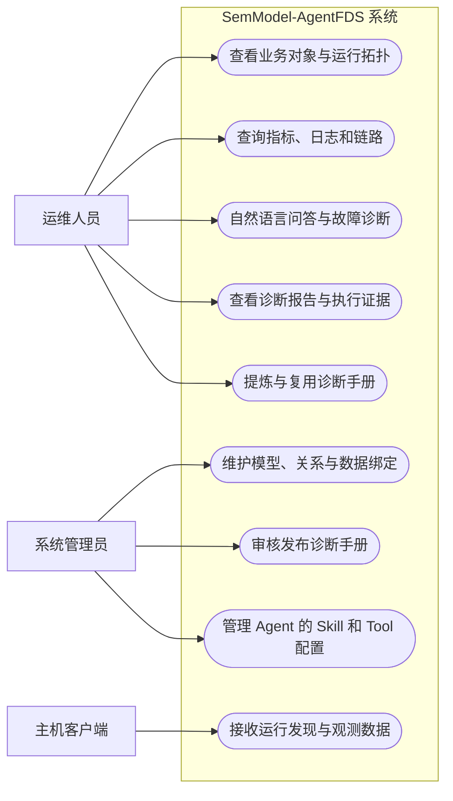
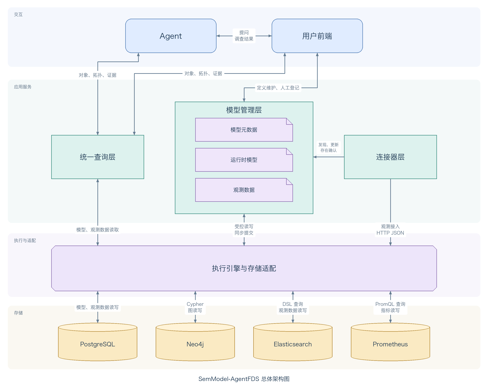
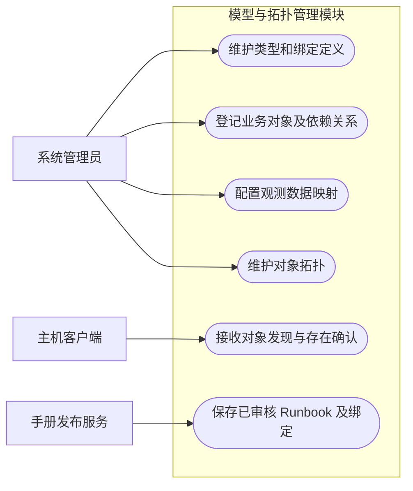
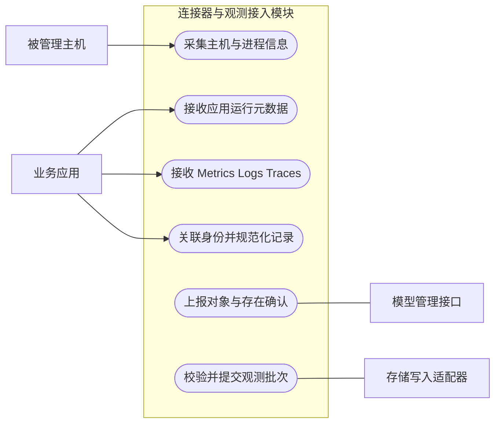
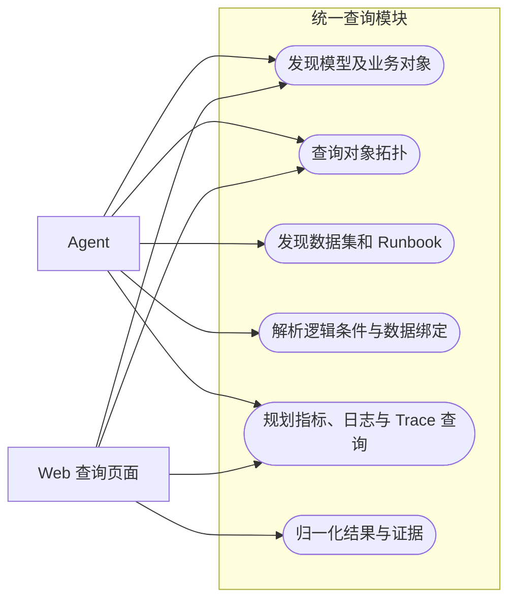
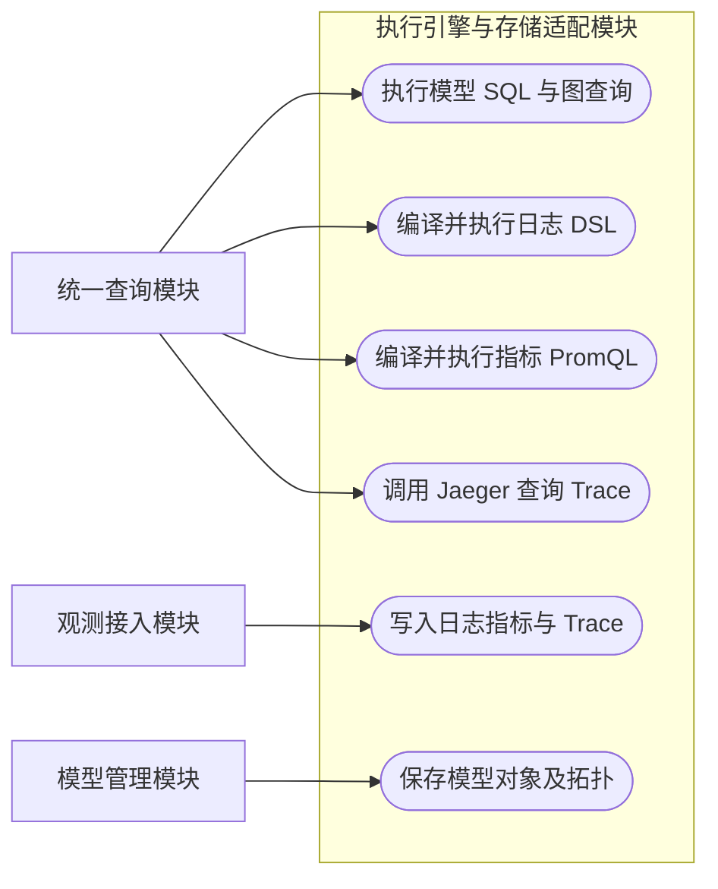
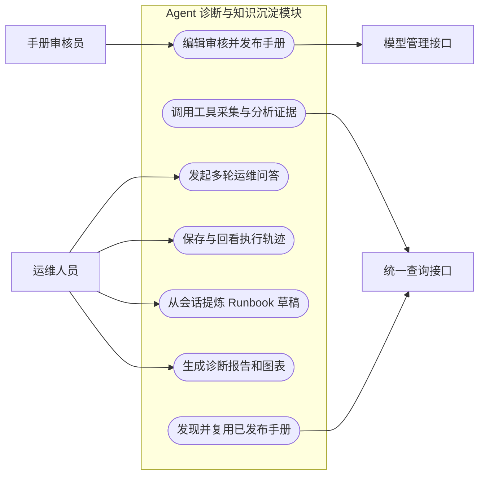
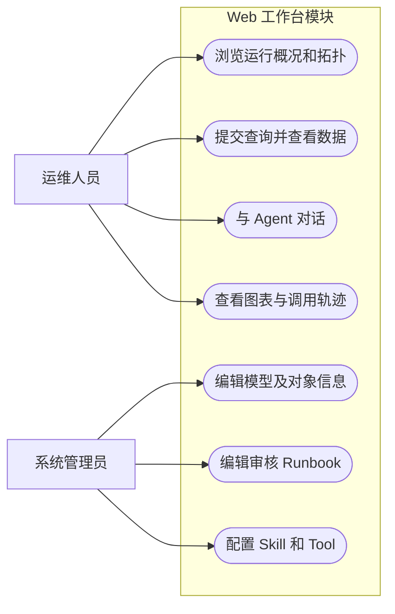

# 基于语义建模的 Agent 故障诊断系统架构设计（简略版本）

## 1. 系统总体功能

**现状问题：** 现阶段的运维数据分散在指标、日志和链路系统中，不同的系统同一个语义的字段命名可能完全不一样，并且在分布式微服务盛行的今天，系统之间的关系愈发复杂，即便经验丰富的程序员能理清复杂的关联，准确定位出系统的问题，也缺乏一种有效的方式将自身的排查方式以一种有效的手段告诉Agent，让Agent自己会排查。

**系统定位：** SemModel-AgentFDS 是面向中小型应用的**可观测数据查询与智能故障诊断系统**。系统通过统一语义模型关联业务对象、运行拓扑及 Metrics、Logs、Traces 三类观测数据，为运维开发人员提供**业务对象管理、自动采集、拓扑查看、统一查询、自然语言问答、故障辅助诊断、证据追溯和诊断手册复用**能力。

系统支持两类主要使用场景：一是查询“订单服务过去一小时的请求量、错误率和响应时间”等运行信息；二是调查“为什么最近一小时下单失败”，由 Agent 沿业务依赖与实例拓扑逐步查询证据，给出有依据的诊断结论和处理建议。完成调查后，可将有价值的排查方法提炼为 Runbook，经人工审核发布，供后续调查复用。

### 1.1 系统级视角

以下使用 Mermaid 流程图中的椭圆形节点表达 UML 用例；**边界是整个 SemModel-AgentFDS 系统**，图中展示的是外部角色可以使用的功能，而不是内部组件调用。

以下为架构设计图：

### 1.2 功能模块划分

| 模块 | 负责的核心工作 | 交付的主要结果 |
| --- | --- | --- |
| 模型管理 | 定义模型、对象、关系及观测数据映射，维护当前对象和拓扑 | 可查询的模型、对象、关系、数据绑定 |
| 连接器与观测数据采集 | 发现运行实例和主机，接收并上报指标、日志、链路 | 带对象身份和时间信息的运行数据 |
| 统一查询 | 按对象和逻辑字段组织查询，解析绑定并统一返回结果 | 面向前端和 Agent 的 `inspectOps` 查询接口 |
| 执行引擎与存储适配 | 将已绑定查询转为具体存储请求，执行读写 | PostgreSQL、Neo4j、ES、Prometheus、Jaeger 的受控访问 |
| Agent 诊断与知识沉淀 | 多轮调查、证据分析、报告生成、轨迹记录和手册提炼审核 | 可追溯诊断报告、查询图表、Runbook 草稿及发布流程 |
| Web 工作台 | 组织运维操作、管理页面和可视化交互 | 浏览器操作界面 |

六个模块按照**数据采集 → 模型与数据存储 → 统一查询 → Agent 调查 → 知识沉淀**协作。平台后端按模块组织在一个 FastAPI 应用中，采集客户端和数据存储独立部署。

## 2. 技术栈与用途

| 技术 | 所在部分 | 具体用途 |
| --- | --- | --- |
| **TypeScript + Vue 3** | Web 工作台 | 实现系统管理、业务拓扑展示、观测数据查询、AI 对话及审核交互 |
| **Python + FastAPI + Pydantic** | 服务端后端 | 提供语义建模、数据接入、统一查询、Agent 诊断及知识管理接口 |
| **Python + psutil** | 客户端 SDK | 采集主机与进程信息、接收应用观测数据，并统一上报至平台 |
| **OpenTelemetry** | 被观测应用 | 采集应用运行信息及日志、指标、Trace 等可观测数据 |
| **PostgreSQL** | 平台持久化 | 存储模型定义、对象与关系主记录、数据源配置、会话及审核记录 |
| **Neo4j** | 拓扑存储 | 存储业务实体及其关联关系，支持拓扑遍历与依赖分析 |
| **Elasticsearch** | 观测数据存储 | 存储和检索应用日志，并作为 Jaeger 的 Trace 存储后端 |
| **Prometheus** | 指标存储 | 存储主机、JVM、HTTP、线程池等时序指标，支持 PromQL 查询 |
| **Jaeger v2** | 链路追踪 | 接收、存储、查询和展示分布式 Trace |

## 3. 分模块功能设计

### 3.1 模型与拓扑管理模块

**职责：** 负责回答“系统中有哪些业务对象、它们如何关联、每类对象能查到什么数据，以及适用什么诊断手册”。这是整个系统的语义基础。

**具体功能与实现要点：**

1. **语义模型定义。** 管理四类节点定义：`EntityType`（实体类型）、`DatasetSpec`（观测数据集）、`DataSource`（数据源）和 `Runbook`（诊断手册）；管理四类绑定定义：`EntityBinding`（实体关系）、`DataBinding`（对象到观测数据）、`DataSourceBinding`（数据集到物理存储）和 `RunbookBinding`（实体类型到手册）。
2. **业务对象与关系管理。** 按类型维护业务系统、业务流程、应用、服务实例、主机、基础设施服务；配置、变更、业务活动和故障事件作为可登记的诊断上下文。维护包含、调用、拥有实例、运行于、依赖等实际关系，支持人工录入和客户端发现更新。
3. **拓扑维护。** 对象以稳定标识关联，PostgreSQL 保存当前模型记录，Neo4j 保存对应的图节点和边；提供指定对象的邻居与依赖关系查询。
4. **观测数据映射。** 将服务、实例、主机等对象关联到指标、日志和 Trace 数据集，再通过数据源绑定定位 Prometheus、Elasticsearch 或 Jaeger 中的实际数据。
5. **对象存在信息。** 根据客户端上报维护对象最后发现时间、当前存在状态和属性；管理动态发现对象的有效期。
6. **手册定义与绑定。** 保存已发布 Runbook 的结构化内容，以及它适用于哪些实体类型和对象范围；供统一查询模块发现。

**职责边界：** 本模块拥有**模型定义、对象、关系、绑定和已发布手册的保存规则**。客户端提供发现事实；统一查询模块使用模型解释读取意图；存储适配模块负责实际数据库访问；Agent 模块负责诊断和手册草稿审核工作流。

**模块级用例图**：

### 3.2 连接器与观测接入模块

**职责：** 将被观测业务系统的运行信息转换成平台可识别的对象发现事实和三类观测记录，建立可靠的数据上报通路。

**具体功能与实现要点：**

1. **主机运行发现。** 每台被观测主机运行一个 Python 客户端，周期读取主机基础信息、进程身份和主机资源指标，识别具体服务实例及所在主机。
2. **应用包接入。** 业务应用显式引入采集依赖包，生成运行实例标识并上报应用元数据；复用 OpenTelemetry 获取指标及应用日志、Trace。
3. **本地数据接收。** 客户端通过 HTTP JSON 接收运行元数据，通过 OTLP/HTTP 接收指标、日志和 Trace，统一关联环境、应用、实例及采集时间。
4. **分通路上报。** 对象与关系发现提交给模型管理接口；观测记录转换为统一 JSON 批次提交给平台观测接入接口。
5. **接入校验和写入分发。** 服务端完成身份、字段、批次及时间信息校验，把合法观测交由存储写入适配器写入 Prometheus、Elasticsearch 和 Jaeger。
6. **运行状态与重试。** 客户端记录各采集项最后成功时间、上报结果、队列长度和失败原因，对网络异常执行有限缓冲与重试。

**职责边界：** 本模块提供**采集、接收、身份关联和上报**能力；对象的正式创建与状态维护由模型模块完成；存储协议编码与数据库写入由执行适配模块完成；故障原因分析由 Agent 完成。

**模块级用例图**：

### 3.3 统一查询模块

**职责：** 为前端与 Agent 提供一致的语义查询入口，将“查询哪个对象、哪类观测、哪个时间段、执行什么操作”转换为确定的查询计划。

**具体功能与实现要点：**

1. **统一入口 `inspectOps`。** 以结构化 JSON 传入查询能力、对象引用、逻辑字段、过滤条件、时间范围和操作参数；前端人工查询与 Agent 工具调用复用同一契约。
2. **模型与对象发现。** 提供模型定义查询、对象检索、对象属性读取、依赖关系遍历以及受控图查询，使调用方从业务名称定位到具体对象。
3. **数据和手册发现。** 根据对象及绑定找到可读取的日志、指标、Trace 数据集、支持的查询操作和适用 Runbook。
4. **语义解析与计划生成。** 根据 `DataBinding` 和 `DataSourceBinding` 将逻辑对象身份、字段、单位及过滤条件绑定到具体数据源，形成结构化执行计划。
5. **查询操作。** 支持按时间段筛选日志、按指标窗口计算请求量和错误率、查看耗时趋势、按 traceId 查询链路和依赖路径。
6. **统一结果。** 对返回记录统一封装对象引用、字段、单位、时间范围、来源、数据质量与证据引用，供前端呈现及 Agent 分析。

**职责边界：** 本模块拥有**查询契约、对象解析、数据绑定、逻辑计划和结果语义**。查询的 SQL、Cypher、ES DSL、PromQL 或 Jaeger API 请求由执行模块生成；多轮调查步骤和诊断判断由 Agent 组织。

**模块级用例图**：

### 3.4 执行引擎与存储适配模块

**职责：** 接收上层已确定语义的读写请求，负责数据库方言、网络协议、连接管理与真实数据操作。

**具体功能与实现要点：**

1. **模型读取适配。** 通过 PostgreSQL 读取模型定义、对象及绑定，通过 Neo4j 执行参数化 Cypher 图遍历。
2. **观测查询编译。** 将已绑定的日志操作转换为 Elasticsearch Query DSL，将指标计算转换为 PromQL，将 Trace 查询转换为 Jaeger 查询 API 请求；PostgreSQL 结构化记录使用参数化 SQL。
3. **观测写入适配。** 接收观测模块提交的记录：日志通过 ES Bulk 写入；指标通过 Prometheus Remote Write 写入；Trace 通过 OTLP 写入 Jaeger。
4. **统一执行控制。** 集中处理存储连接、认证配置、超时、查询分页、错误码及后端响应解码，向统一查询模块返回结构化执行结果。
5. **存储配置。** 按模型的数据源及绑定信息确定索引、指标名称、访问地址与字段映射；存储协议细节集中在本模块实现。

**职责边界：** 本模块拥有**物理请求生成、数据库驱动、协议转换和实际读写**。数据代表哪个业务对象、如何解释指标及最终查询结果，由统一查询模块决定；对象和关系的业务变更规则由模型管理模块决定。

**模块级用例图**：

### 3.5 Agent 诊断与知识沉淀模块

**职责：** 以自然语言为调查入口，让大语言模型使用统一查询工具逐步收集、比对和解释运维证据，并将有效的排查经验整理为可审核、可复用的诊断手册。

**具体功能与实现要点：**

1. **会话与多轮上下文。** 创建和管理会话，保存用户问题、历史问答、当前调查对象及固定时间窗口；支持流式回复、中断与会话续接。
2. **单 Agent 调查流程。** 使用 LangChain 的单 Agent 工具调用模式，理解问题、定位对象、探索拓扑、查询指标/日志/Trace、提出并验证故障假设，组织最终诊断答复。
3. **Skill 与 Tool。** 内置运维查询和数据展示 Skill；Tool 负责实际调用 `inspectOps`、读取已保存证据及创建展示产物。Skill 说明调查方法和参数使用规范，Runbook 则提供具体故障场景的排查步骤。
4. **证据化结果输出。** 支持自然语言说明、数据表格、折线图、柱状图；诊断报告包含异常表现、影响对象、证据、候选原因、结论和处理建议。
5. **执行轨迹记录。** 以一次用户提问为单位，保存 Agent 运行状态、工具调用、查询参数、结果引用、耗时及错误，支持逐轮回看。
6. **Runbook 提炼与审核。** 从完整会话及执行证据提炼可复用的调查步骤，生成结构化手册草稿；管理员编辑、审核后调用模型管理接口发布 Runbook 与对象类型绑定。
7. **知识复用。** 新的诊断任务通过统一查询发现适用手册，Agent 根据手册步骤和当前实时观测继续调查，并在报告中引用实际证据。

**职责边界：** 本模块拥有**自然语言理解、调查编排、证据分析、报告、会话轨迹以及 Runbook 草稿与审核流程**。所有运维数据读取通过 `inspectOps` 完成；发布成功的手册定义由模型管理模块保存；图表前端渲染由 Web 模块完成。

**模块级用例图**：

### 3.6 Web 工作台模块

**职责：** 将各后端模块的功能组织成运维人员和管理员可使用的浏览器界面，提供清晰的业务入口、结果可视化和操作反馈。

**具体功能与实现要点：**

1. **概况首页。** 选择环境与业务系统，展示请求量、错误率、P95 延迟、对象数量、最近诊断和待审核手册。
2. **模型与拓扑页面。** 编辑模型定义及绑定，查看对象详情、存在状态、服务调用与实例部署关系，支持从拓扑节点进入查询或提问。
3. **数据查询页面。** 选择对象、时间和查询能力，编辑结构化请求，展示表格、指标曲线、日志列表和 Trace 链路结果。
4. **Agent 对话页面。** 提供多会话聊天、实时输出、停止本轮、查看证据和图表的交互。
5. **轨迹与手册页面。** 展示每轮工具调用与执行结果；提供手册目录、会话提炼入口、草稿编辑、审核及发布操作。
6. **能力配置页面。** 查看及配置已注册的 Skill、Tool 的启用状态、说明和运行参数。

**职责边界：** 本模块拥有**页面、表单、路由、交互状态及图表和拓扑渲染**。所有持久化操作与规则校验通过后端 API 执行；数据查询和诊断逻辑由对应服务模块承担。用户身份及角色权限由 FastAPI 公共认证组件校验，各业务接口执行相同的访问控制。

**模块级用例图**（以用户在界面上完成的交互为视角）：

## 4. 模块协作

| 业务步骤 | 责任模块 | 与其他模块的衔接 |
| --- | --- | --- |
| 定义应用、实例和依赖 | 模型与拓扑管理 | 将元数据保存到 PostgreSQL，并维护 Neo4j 图 |
| 发现实例、采集运行数据 | 连接器与观测接入 | 通过模型接口提交对象，通过写入适配器提交三类观测 |
| 查询某对象的日志和指标 | 统一查询 | 解析业务身份和字段映射，交给执行引擎访问具体存储 |
| 生成实际查询请求并取数 | 执行引擎与存储适配 | 返回原始执行结果，由统一查询归一化 |
| 解释异常并组织诊断结果 | Agent | 通过统一查询取证，保存对话轨迹 |
| 复用和沉淀排查知识 | Agent + 模型与拓扑管理 | Agent 生成与审核草稿，模型模块保存已发布手册和绑定 |
| 展示及操作 | Web 工作台 | 通过 HTTP JSON 和 SSE 调用各服务入口 |

## 5. 系统验收场景与实验设计

系统以模拟商城为统一实验对象，设置**故障定位与根因分析**、**运维知识沉淀与复用**两组验收场景。两组场景使用相同的业务调用关系和观测数据类型：场景一验证系统从对象发现、数据查询到故障定位的完整能力；场景二在此基础上验证从诊断会话形成 Runbook、人工审核发布、再次排障复用与知识更新。

### 5.1 共同实验环境

**业务服务与部署。** 商城由 4 个 Spring Boot 业务服务组成，初始部署 8 个服务实例，运行在 4 台应用主机上；另使用 1 台主机部署业务 MySQL，共 5 台主机。每台被管理主机运行主机客户端，业务应用通过本机采集包将运行元数据及观测数据交给客户端上报。

| 业务服务 | 实例数 | 主要职责 |
| --- | ---: | --- |
| `api-gateway` | 2 | 接收下单请求并转发 |
| `order-service` | 2 | 创建订单，协调库存与支付 |
| `inventory-service` | 2 | 库存查询、预留和扣减 |
| `payment-service` | 2 | 处理模拟支付 |
| **合计** | **8** | **4 个业务服务、5 台主机（含 MySQL 主机）** |

**模型与存储配置。** 模型管理模块登记 `Application`、`ServiceInstance`、`Host`、`InfrastructureService` 等对象，以及 `CALLS`、`HAS_INSTANCE`、`RUNS_ON`、`DEPENDS_ON` 等关系；通过 `DatasetSpec`、`DataBinding`、`DataSource`、`DataSourceBinding` 关联业务对象与观测数据。运行拓扑由模型管理模块维护，客户端负责发现和更新主机、运行实例及实际承载关系。

| 数据类别 | 技术组件 | 实验使用的数据 | 验证目的 |
| --- | --- | --- | --- |
| Metrics | Prometheus | 接口 QPS、错误率、P95/P99 延迟、HikariCP 活跃连接数、最大连接数、等待连接数 | 发现性能异常，验证连接池压力 |
| Logs | Elasticsearch | 订单调用失败日志、库存连接获取超时日志、`traceId`、实例标识 | 提供故障发生位置及错误内容 |
| Traces | Jaeger v2（ES 持久化） | 下单请求跨服务 Span、调用耗时、错误状态和实例标识 | 沿调用链定位高延迟环节 |

**故障机制与时间安排。** 促销期间提高并发下单请求，使 `inventory-service` 的 HikariCP 数据库连接池达到容量上限，出现连接等待和获取超时，并传导为订单接口超时。通过负载变化产生可观测的真实运行现象，故障真实标签仅用于实验评价；Agent 根据模型关系及查询获得的 Metrics、Logs、Traces 自主给出判断。

| 业务阶段 | 时间 | 流量与运行表现 |
| --- | --- | --- |
| 正常经营 | 19:50—20:00 | 建立接口延迟、错误率和数据库连接池占用基线 |
| 促销高峰 | 20:00—20:10 | 提升请求并发，出现连接池饱和、库存预留耗时升高及部分订单超时 |
| 流量恢复 | 20:10—20:20 | 降低请求压力，连接等待减少，订单接口逐步恢复 |

**具体操作**

两组场景会事先用脚本往测试环境机器导入模型、对象与关系拓扑，以及Logs、Metric、Trace数据进观测数据库，实现对上述场景的模拟。

### 5.2 场景一：促销期间下单超时故障定位与根因分析

**场景目标。** 验证系统能够根据自然语言问题自动定位故障服务、具体实例和瓶颈类型，使用跨源观测证据解释故障原因，并评估不同实例、主机规模下的查询及诊断表现。

**用户问题：** “今天晚上 20:00 左右，商城有用户反映下单失败或者超时，帮我排查一下原因，定位具体故障，并给出建议。”

#### 5.2.1 核心诊断流程

| 步骤 | 系统执行的功能 | 预期验收结果 |
| --- | --- | --- |
| 1. 模型建立与对象发现 | 管理员配置业务对象类型、关系及数据绑定；客户端发现运行实例、主机和承载关系，提交属性与观测数据 | 能查看商城应用、实例、主机、MySQL 资源及调用拓扑，并由对象定位三类数据集 |
| 2. 基线与故障数据采集 | 执行正常、高峰、恢复三阶段流量，接入 Metrics、Logs、Traces | 三类数据包含统一的时间范围、服务/实例身份和关联所需的 `traceId` |
| 3. 异常服务发现 | Agent 查询订单服务的接口错误率、请求量和延迟 | 发现促销期间 `/orders` 请求延迟和超时率明显升高 |
| 4. 调用链与依赖分析 | Agent 沿 `order-service` 的调用关系检索失败 Trace | 识别 `inventory-service`、`payment-service` 等下游依赖，发现库存预留环节耗时集中 |
| 5. 故障实例定位 | Agent 查询库存服务的实例列表和 HikariCP 指标 | 锁定受影响的库存实例，发现活跃连接接近上限、连接等待数升高 |
| 6. 日志交叉验证 | Agent 使用实例身份、时间窗口及 `traceId` 查询日志 | 找到 `Connection is not available, request timed out` 等连接获取超时证据，并与指标及 Trace 对齐 |
| 7. 诊断报告输出 | Agent 汇总拓扑、指标曲线、Trace、错误日志及关联过程 | 说明故障服务、实例、连接池饱和这一瓶颈及其对订单超时的影响，给出限流、连接占用排查与容量评估等建议 |

**验收判定：** Agent 正确定位 `inventory-service` 的故障实例，识别 **HikariCP 数据库连接池饱和与连接获取超时**，并在报告中引用相互印证的指标、日志和链路证据。系统保存本次诊断所用的查询结果、工具调用轨迹和最终报告，支持在 Web 工作台查看。

### 5.3 场景二：故障诊断后的 Runbook 知识沉淀与复用

**场景目标。** 复用场景一的商城故障，展示运维人员确认诊断后，系统从调查会话形成结构化运维手册，经审核发布，并指导 Agent 在第二次同类故障中进行新一轮证据验证和知识更新。

#### 5.3.1 第一次故障：从诊断结果生成手册

首次促销按 **19:50—20:20** 的三阶段流量完成故障诊断，Agent 依照场景一的流程取得订单错误率、异常调用链、库存实例连接池指标和超时日志，形成诊断报告。运维人员核对故障原因及处理建议后，执行知识沉淀流程。

| 步骤 | 系统执行的功能 | 预期验收结果 |
| --- | --- | --- |
| 1. 会话提炼 | 根据已结束的诊断会话和工具调用证据，提取故障症状、调查步骤、判断依据及处置建议 | 生成结构化 `RunbookDraft` 和可追溯的来源引用 |
| 2. 手册组织 | 将排查过程组织为适用范围、输入对象与时间窗、查询步骤、证据要求、判断分支、停止条件和输出要求 | 形成“下单超时与数据库连接池饱和排查”手册 `RB-001` |
| 3. 人工审核 | 运维人员检查手册内容、证据、适用对象及候选 `RunbookBinding`，确认发布内容 | 形成经过人工批准的手册定义及绑定 |
| 4. 手册发布 | 发布流程通过模型管理模块写入 `Runbook` 与 `RunbookBinding` | 发布 `RB-001 v1.0`，按应用和实例类型上下文检索到该手册 |

手册记录的是**通用排查方法**，例如“先检查订单接口异常，再沿调用关系定位耗时环节，最后通过连接池指标、日志和 Trace 验证瓶颈”；具体故障时间、实例及实际观测值作为本次诊断的来源证据保存。

#### 5.3.2 第二次故障：手册检索、证据验证与更新

第二天再次进行 **19:50—20:20** 的正常、高峰、恢复三阶段促销实验，复现同类连接池瓶颈。运维人员提交同类自然语言排障问题，Agent 在新一轮调查中复用已发布手册。

| 步骤 | 系统执行的功能 | 预期验收结果 |
| --- | --- | --- |
| 1. 手册发现 | Agent 根据已定位的 `Application` 或 `ServiceInstance` 对象上下文查找 `RunbookBinding`，读取匹配的 `RB-001` | 获取适用于当前对象和症状的排查步骤 |
| 2. 实时证据查询 | Agent 按手册指导重新查询当前时间段的订单指标、失败 Trace、库存连接池指标和关联日志 | 使用第二次促销产生的 Metrics、Logs、Traces 验证故障 |
| 3. 原因分析 | Agent 将新证据与手册判断条件对照，分析连接池饱和与数据库响应等候选因素 | 再次定位故障实例和连接获取超时环节，形成基于本次证据的结论 |
| 4. 诊断输出 | Agent 输出第二次故障报告、证据引用及处理建议 | 展示 Runbook 指导下的完整诊断过程 |
| 5. 知识更新 | 提炼第二次已结束会话，与当前手册比较；将新增的排查方法或适用条件交由人工审核并发布 | 有有效新增内容时将当前手册更新为 `RB-001 v1.1`；内容相同时保存本次复用记录 |

**验收判定：** 系统完成“首次诊断 → 会话提炼 → 人工审核 → Runbook 发布 → 再次故障检索 → 实时取证 → 诊断报告 → 知识更新”的闭环。两次诊断均保留独立证据与执行轨迹，能够比较 Agent 的诊断耗时、工具调用次数及模型上下文消耗，体现手册对调查过程的辅助作用。
